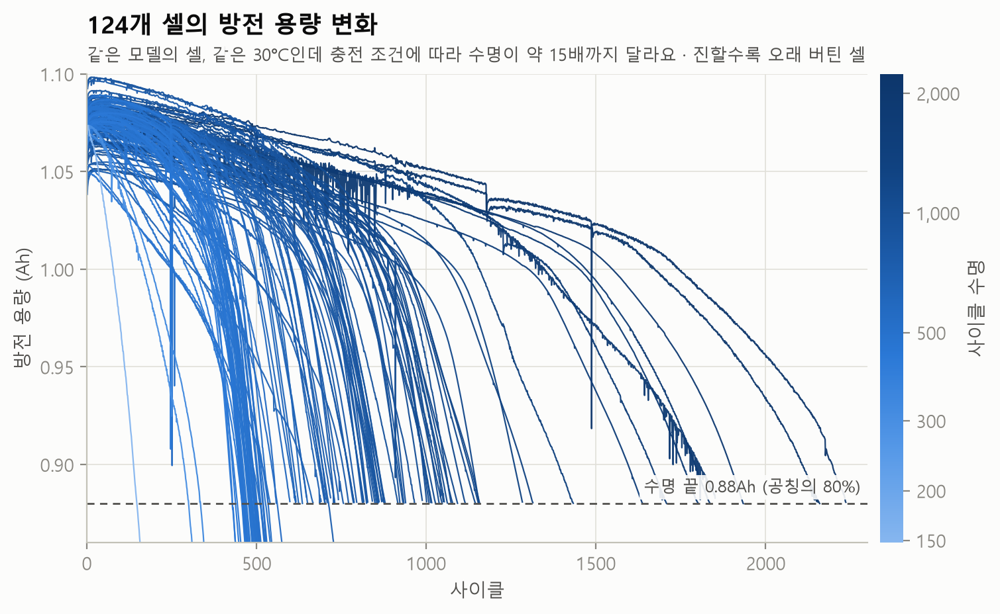
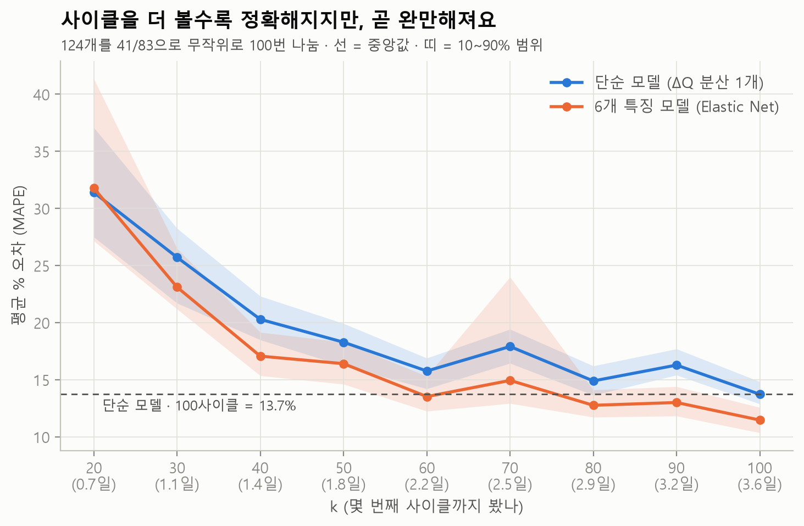

# Battery Life Lab

[](https://github.com/ChoJiwon00/battery-life-lab/actions/workflows/tests.yml)

**"충방전 초반 몇 번만 보고, 이 배터리가 몇 번까지 버틸지 알 수 있을까? 그리고 왜 늙는 걸까?"**

시판 LFP/흑연 셀 124개의 충방전 데이터로 **배터리 수명을 일찍 예측**하고 **열화의 단서**를 읽는 개인 프로젝트예요.
기준 논문(Severson 외, *Nature Energy* 2019)을 직접 구현해, 단순 모델(논문의 variance 모델) 결과(테스트 138 · 2차 테스트 196사이클)를 **사이클 단위까지 재현**했어요.
그 위에 "셀이 적었다면?", "며칠이면 되나?", "불량 셀을 일찍 골라낼 수 있나?" 같은 질문을 데이터로 실험했어요.



## LFP 소재 관점으로 보면

이 데이터의 셀은 모두 **LFP 양극**(A123 APR18650M1A, LFP/흑연)이에요. LFP를 소재 쪽에서 볼 때 이어지는 결과만 따로 모았어요.

| 질문 | 이 프로젝트에서 본 것 | 문서 |
|---|---|---|
| LFP 셀의 수명 신호는 어디서 오나? | 수명을 알려 주는 ΔQ 신호는 방전 봉우리(3.15 V) 아래 넓은 구간에 모여요. LFP 양극은 전압이 거의 평평해서, LFP/흑연 셀 곡선의 굴곡은 주로 흑연 음극 쪽에서 온다고 흔히 설명해요. 다만 4C 방전에서는 봉우리가 뭉개져서, 이 데이터만으로는 리튬 손실·활물질 손실·분극을 가를 수 없었고 **양극(LFP) 열화도 따로 떼어 보지 못했어요**. 가르려면 저율(천천히 충방전) 진단 곡선이나 전극별 물리 모델이 필요해요 | [특징 해석](docs/interpret.md) |
| 극판을 눌러 LFP 양극 밀도를 올리면? (시뮬레이션) | PyBaMM 하프셀 계산에서 공극률을 0.426에서 0.34까지 줄이면 0.1C 면적당 용량이 약 15% 늘고(1.82 → 2.09 mAh/cm²), 기준 전도도의 10C 유지율은 그대로(92.23%)였어요. 기준 전도도에서는 0.30부터 10C 방전 중 기공 속 전해질이 바닥나 10C 유지율이 떨어졌고(0.30에서 85.31%), 전자 전도도를 높여도 막지 못했어요. 이번에 바꾼 범위에서는 입자 반지름(50 → 200 nm)이 공극률보다 고율 성능을 훨씬 크게 바꿨어요(공극률 0.426의 10C 유지율 92.23 → 30.49%). 보정하지 않은 모델의 **경향**이에요 | [시뮬레이션 d](simulations/pybamm/README.md#d-고밀도-lfp-양극-극판을-눌러-밀도를-올리면-출력은) |
| 큰 입자는 왜 고율에서 불리한가? (시뮬레이션) | 같은 하프셀에서 공극률을 0.34로 둔 채 큰 입자(반지름 200 nm) 비율을 0%에서 100%로 늘리면 10C 유지율이 90.77%에서 31.62%로 줄었어요. 원인을 나눠 보니 이 모델에서는 거의 모두 입자 안 확산 거리 때문이었어요. 공극률 0.38·10C에서 200 nm 입자에 확산계수 ×16('도핑' 가정)을 주면 유지율이 30.49%에서 92.21%로 50 nm 수준까지 돌아왔고, 반응 속도 ×4('코팅' 가정)는 30.49% 그대로였어요. 섞으면 촘촘해지는 이득은 계산하지 않았고, 두 상 반응이 없는 단순 확산 모델로 방전만 계산한, 보정하지 않은 모델의 **경향**이에요 | [시뮬레이션 e](simulations/pybamm/README.md#e-큰-입자와-작은-입자를-섞으면-고율-성능은) · [시뮬레이션 f](simulations/pybamm/README.md#f-큰-입자의-손해는-반응-겉넓이-때문일까-확산-거리-때문일까) |
| 고밀도 LFP·표면 코팅 특허는 어디로 가나? | 주제에 맞는 한·미·중 특허 261건(본문 인용 86건, 중국 특허는 대부분 제목만 확인)을 정리해 보니, 밀도를 올리는 방법은 크기·모양·성질이 다른 입자나 원료를 섞는 특허가 가장 많았어요. 청구항·초록에 적힌 분말 압축 밀도는 2.45–2.76 g/cm³ 근처가 많았어요(보호 범위나 초록의 주장이지 제품 성능이 아니고, 재는 압력도 특허마다 달라요). 탄소 코팅은 양뿐 아니라 두께·고르기·흑연화도까지 숫자로 정하는 청구가 많았어요 | [특허 심층 리포트](https://github.com/ChoJiwon00/patent-radar/blob/main/reports/deep/high-density-lfp-2026-10.md) (Patent Radar) |
| 급속충전 조건과 LFP 셀 수명은 어떤 관계인가? | 셀 10개는 표기와 실제 전류가 달랐어요. 센 전류일수록 수명이 짧은 경향이고(관찰 데이터라 원인까지는 말할 수 없어요), "높은 SOC 전류가 더 해롭다"는 아직 확인하지 못했어요 | [충전 조건](docs/policies.md) |

## 한눈에 보는 결과

| 질문 | 답 (숫자는 각 문서에서 코드가 계산) | 문서 |
|---|---|---|
| 데이터를 논문과 똑같이 만들었나? | 셀 124개, 학습/테스트/2차 테스트 41/43/40 일치. 단순 모델의 오차(RMSE: 평균적으로 몇 사이클 틀렸나)가 **138 / 196사이클로 논문과 같음** | [품질 리포트](docs/data_quality.md) · [데이터 크기](docs/data_size.md) |
| 데이터에 문제는 없나? | 수명 라벨 124/124 일치, 곡선-요약표 정렬 1,289/1,289 일치. b2 이상값의 53%가 공식 노트의 컴퓨터 재시작 시점(250사이클 근처)에 몰림. b1도 여러 셀의 비슷한 사이클에 몰림(무리 4개에 84%, 재시작 시점인지는 미확인) | [품질 리포트](docs/data_quality.md) · [데이터 카드](docs/dataset_card.md) |
| 셀이 70·35·10개뿐이었다면? | 35개까지는 오차 중앙값이 거의 같아요(13.7→14.3%). 10개면 연구 10번 중 3번은 오차 25% 초과 | [데이터 크기 실험](docs/data_size.md) |
| 몇 사이클이면 충분할까? | 신호는 40사이클(약 1.4일)이면 상관 r < −0.8로 강해짐. 6개 특징 모델은 80사이클(약 2.9일)부터 단순 모델의 100사이클(약 3.6일) 성능을 계속 유지하지만, 같은 나누기끼리 비교하면 좋거나 같은 경우가 81%이고 논문 나누기 2차 테스트에서는 더 나빠서 **"줄일 가능성"까지만** 확인 | [사이클 수 실험](docs/cycles.md) |
| 5사이클로 불량 셀을 골라낼 수 있나? | 모델 정확도 85\~90%. 하지만 **배치만 보고 찍어도 96%** → 이 데이터의 "단수명 셀"은 거의 한 배치에 몰려 있어 셀 선별 능력을 증명하기 어려워요 | [불량 셀 선별](docs/screening.md) |
| 예측에 오차 범위를 붙일 수 있나? | 단순 모델 기준: 모델만 흔들면 90% 범위가 테스트 21% · 2차 테스트 40%만 맞음(과신). 셀 간 편차를 넣으면 논문 나누기에서 88\~93% 적중(섞어 나누기 100번에서는 중앙값 92\~93%, 가운데 80%가 81\~98%, 6\~8%는 80% 미만), 대신 폭이 약 ±25% | [오차 범위](docs/uncertainty.md) |
| 급속충전 조건과 수명은? | 셀 10개는 표기와 실제 전류가 달랐어요. 센 전류일수록 수명이 짧은 경향, "높은 SOC 전류가 더 해롭다"는 아직 확인 불가 | [충전 조건](docs/policies.md) |
| ΔQ 특징은 왜 통하나? | 신호는 2.87V 근처(봉우리 아래 넓은 구간)에 몰려 있고, 분산은 사실상 "ΔQ 골의 깊이"를 재요 (상관 r = 0.992) | [특징 해석](docs/interpret.md) |
| 시뮬레이션은 돌릴 수 있나? DFT는? | PyBaMM을 이 PC에서 실제로 돌림: 열화 4종 50사이클 약 20초, 고밀도 LFP 양극 하프셀 방전 95번 약 34초. 어려운 건 우리 셀의 파라미터. DFT는 소재 직무 영역 | [관련 연구·시뮬레이션](docs/related_work.md) · [실행 기록](simulations/pybamm/README.md) |



## 이 프로젝트에서 보여 주고 싶은 것

1. **재현부터 정확하게.** 논문의 숫자(테스트 138 · 2차 테스트 196사이클)를 기억이 아니라 인용 출처로 확인하고, 사이클 단위까지 맞췄어요.
2. **데이터를 의심하기.** 분석 전에 품질을 점검해서 공식 설명과 다른 점(이음매에서 용량 하락, 재시작 때 용량 튐 대신 기록 오류)과 숨은 흔적(8시간 휴지가 약 500분 충전 시간으로 기록됨)까지 찾아냈어요.
3. **좋아 보이는 숫자를 경계하기.** 불량 셀 선별의 높은 정확도가 사실 "배치"를 읽은 것일 수 있다는 점, 작은 연구의 성능 숫자가 부풀려질 수 있다는 점을 숫자로 보였어요.
4. **틀린 것을 기록하기.** 잘못 짐작하거나 잘못 본 것들을 [시행착오 기록](docs/troubleshooting.md)에 "어디서 알아챘나 → 원인 → 수정 → 재발 방지"로 남겼어요.
5. **여러 AI 에이전트로 일하고, 서로 검증하기.** 응용 실험 4개는 에이전트가 하나씩 구현하고 **다른 에이전트가 숫자를 다시 계산해 검증**했어요. 4개 모두 검증 단계에서 문제를 찾아 고쳤어요(재현성 버그, 과장된 해석, 너무 좁게 잡은 우연의 폭 등). 관련 자료 40개(논문·데이터셋·도구 문서)도 다른 에이전트가 서지 정보를 확인한 것만 실었어요. 끝으로 저장소 전체를 다섯 관점(숫자·정직성·코드·한국어·링크)으로 검토받아, 확인된 지적을 고쳤어요(미래 데이터 누설, 과장된 결론 등).

## 문서

| 문서 | 내용 |
|---|---|
| [📘 배경 지식](docs/background.md) | 배터리 기본, 열화 메커니즘, 논문 요약, 면접 문답 |
| [📊 데이터 품질 리포트](docs/data_quality.md) | 논문 비교, 점검 항목별 결과, 이상이 몰린 구간 ↔ 공식 노트 (자동 생성) |
| [📇 데이터 카드](docs/dataset_card.md) | 파일·열·단위, 셀 고르기 규칙, 알고 써야 할 점 |
| [🔬 데이터 크기 실험](docs/data_size.md) | 셀이 70·35·10개뿐이었다면? (자동 생성) |
| [⏱ 사이클 수 실험](docs/cycles.md) | 몇 사이클이면 충분할까? 셀 수 × 사이클 수 지도 (자동 생성) |
| [🧪 불량 셀 선별](docs/screening.md) | 5사이클로 수명이 짧을 셀 골라내기, 배치 교란 (자동 생성) |
| [📏 오차 범위](docs/uncertainty.md) | 부트스트랩·분할 conformal, 90% 범위가 정말 90% 맞나 (자동 생성) |
| [⚡ 충전 조건](docs/policies.md) | 급속충전 조건과 수명, 표기 vs 실제 전류 (자동 생성) |
| [🔍 특징 해석](docs/interpret.md) | 어느 전압이 수명을 알려 주나, dQ/dV와 가설 (자동 생성) |
| [📚 관련 연구·시뮬레이션](docs/related_work.md) | 확인된 자료 40개(논문·데이터셋·도구), PyBaMM 실행 결과, DFT는 우리 영역인가 |
| [💡 응용 아이디어](docs/ideas.md) | 다음에 해 볼 만한 응용과 진행 상황 |
| [🔧 시행착오 기록](docs/troubleshooting.md) | 잘못 본 것과 알아챈 방법·원인·수정·재발 방지 |
| [✍️ 내 작업](my_work/README.md) | **내가 직접** 판단·실행·작성한 작업 (AI는 질문 틀과 문장 다듬기만, 새 주장은 넣지 않음) |
| [📒 공부 노트](study/README.md) | 궁금했던 기술 질문을 AI와 이야기하며 특허·논문으로 확인한 기록 (질문·판단은 내 것, AI 설명은 따로 표시하고 AI가 출처와 대조) |

## 진행 상황

| 단계 | 내용 | 상태 |
|---|---|---|
| 0 | 배경 지식 정리 | ✅ |
| 1 | 데이터 받기·정리·품질 점검·논문 검증 | ✅ |
| 2 | 그래프로 살펴보기: 충전 조건별 수명, 무릎(knee), 내부저항·온도 변화 | 🔧 충전 조건 ✅ · 무릎 ⏳ |
| 3 | 열화 원인 분석: ΔQ(V), dQ/dV (저율 데이터 포함) | 🔧 4C 데이터로 특징 해석 ✅ · 저율 데이터 ⏳ |
| 4 | 수명 예측: 논문 재현 → 더 적은 사이클·새 특징으로 개선 | 🔧 재현(단순 모델) · 데이터 크기 · 오차 범위 · 불량 선별 ✅ · 사이클 수 줄이기는 가능성까지 · 새 특징 ⏳ |
| 5 | AI 자동화: 새 셀 데이터 → 분석·한국어 리포트 자동 생성 (Claude Code 스킬) | ⏳ |

## 데이터

Toyota Research Institute가 공개한 [Data-driven prediction of battery cycle life before capacity degradation](https://data.matr.io/1/projects/5c48dd2bc625d700019f3204)
데이터를 써요(**CC BY 4.0**). A123 APR18650M1A(LFP/흑연, 1.1Ah) 셀 124개를 30°C에서 69가지 급속충전 조건으로
수명 끝까지 시험한 기록이에요. 원본(7.70GB)은 저장소에 올리지 않고 아래 명령으로 직접 받아요.
자세한 내용은 [데이터 카드](docs/dataset_card.md)에 있어요.

## 실행 방법

Python 3.13 기준이에요.

```
python -m venv .venv
.venv\Scripts\python.exe -m pip install -r requirements.txt

.venv\Scripts\python.exe -m battery_lab info              # 데이터 상태 보기
.venv\Scripts\python.exe -m battery_lab download          # 받을 양 확인
.venv\Scripts\python.exe -m battery_lab download --yes    # 실제로 받기 (끊기면 다시 실행하면 이어받아요)
.venv\Scripts\python.exe -m battery_lab extract           # .mat에서 셀마다 값 추리기
.venv\Scripts\python.exe -m battery_lab assemble          # 124개 셀 데이터셋 만들기
.venv\Scripts\python.exe -m battery_lab report            # 품질 점검·논문 비교·그래프
.venv\Scripts\python.exe -m battery_lab sizes             # 데이터 크기 실험 (약 4분)
.venv\Scripts\python.exe -m battery_lab cycles            # 사이클 수 실험 (약 5분)
.venv\Scripts\python.exe -m battery_lab screening         # 불량 셀 선별 (약 3분)
.venv\Scripts\python.exe -m battery_lab uncertainty       # 오차 범위 (약 2분)
.venv\Scripts\python.exe -m battery_lab policies          # 충전 조건 (몇 초)
.venv\Scripts\python.exe -m battery_lab interpret         # 특징 해석 (몇 초)
.venv\Scripts\python.exe -m battery_lab judgment --miss-cost 10   # 판단 실험: 놓침 1개 = 버림 몇 개 손해? (약 35초)
.venv\Scripts\python.exe -m pytest -q                     # 테스트
```

문서의 숫자와 그래프는 Python 3.13.15와 [requirements-lock.txt](requirements-lock.txt)에 적힌 버전으로 만들었어요.
똑같은 숫자를 다시 내려면 `requirements.txt` 대신 이 파일로 설치하세요.

PyBaMM 시뮬레이션은 따로 만든 가상환경에서 돌려요. [simulations/pybamm/README.md](simulations/pybamm/README.md)를 보세요.

## 폴더 구조

```
battery-life-lab/
├─ battery_lab/
│  ├─ sources.py · download.py · extract.py · assemble.py   데이터 받기·정리 (논문 규칙으로 124개 셀)
│  ├─ quality.py · report.py · figures.py                   품질 점검·논문 검증·그래프
│  ├─ features.py · model.py                                수명 예측 특징(초반 k사이클의 ΔQ 통계)·모델 두 가지
│  ├─ sizes.py · size_report.py                             데이터 크기 실험
│  ├─ cycles.py · cycle_report.py · cycle_figures.py        사이클 수 실험
│  ├─ screening.py · screening_report.py                    불량 셀 선별
│  ├─ uncertainty.py · uncertainty_report.py                오차 범위
│  ├─ policies.py · policies_report.py                      충전 조건
│  ├─ interpret.py · interpret_report.py                    특징 해석
│  ├─ judgment.py                                           판단 실험 (놓침 손해 비율 바꿔 보기)
│  ├─ korean.py                                             숫자 뒤 조사 고르기 (이에요/예요 등)
│  └─ __main__.py                                           명령줄 진입점
├─ simulations/pybamm/  PyBaMM 시뮬레이션 스크립트·결과 (별도 가상환경)
├─ my_work/             내가 직접 판단·실행·작성한 작업
├─ study/               공부 노트 (내 질문과 생각 + 출처를 단 AI 설명)
├─ docs/                리포트·데이터 카드·시행착오 기록·관련 연구·그래프
├─ tests/               자동 테스트 (가짜 데이터로 확인)
└─ data/                내려받은 데이터 (GitHub에 올리지 않음)
```

## 참고

K. A. Severson, P. M. Attia et al., "Data-driven prediction of battery cycle life before capacity degradation",
*Nature Energy* 4, 383–391 (2019). https://www.nature.com/articles/s41560-019-0356-8
관련 연구 전체 목록은 [docs/related_work.md](docs/related_work.md)에 있어요.
