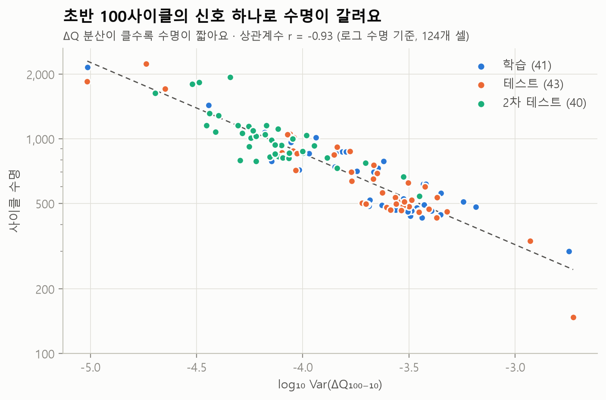

# Battery Life Lab

[](https://github.com/ChoJiwon00/battery-life-lab/actions/workflows/tests.yml)

**"충방전 초반 100번만 보고, 이 배터리가 몇 번까지 버틸지 알 수 있을까? 그리고 왜 늙는 걸까?"**

시판 LFP/흑연 셀 124개의 충방전 데이터로 **배터리 수명을 일찍 예측**하고, 방전 곡선과 dQ/dV로
**열화 원인(리튬 손실 vs 활물질 손실)** 을 분석하는 개인 프로젝트입니다.
기준 논문(Severson 외, *Nature Energy* 2019)의 결과를 직접 구현해 재현하고, 그 위에 한 걸음 더 나아가는 것이 목표예요.


## 지금까지의 결과 (1단계)

**데이터를 논문과 똑같이 재구성했고, 수명 예측의 핵심 신호를 확인했어요.**

| 검증 항목 | 논문 | 이 저장소 |
|---|---|---|
| 셀 수 · 학습/테스트/2차 테스트 | 124 · 41/43/40 | **124 · 41/43/40** |
| 사이클 수명 범위 | 150 ~ 2,300 | 148 ~ 2,237 |
| 초반 100사이클 용량 변화 (중앙값) | +0.2% | **+0.22%** |
| log Var(ΔQ₁₀₀₋₁₀)와 log 수명의 상관 | 강한 음의 상관 | **r = −0.927** |



용량은 100사이클 동안 거의 그대로인데, **100번째와 10번째 방전 곡선의 차이(ΔQ)** 가 셀마다 다르게 벌어지고,
그 분산 하나만으로 수명이 갈려요. 4단계 수명 예측 모델은 여기서 출발해요.

**분석 전에 데이터부터 의심했어요.** 자동 품질 점검으로 찾은 것:

- 수명 라벨 규칙이 배치마다 두 가지라는 것을 찾아 **124/124개 셀의 라벨을 실제 80% 도달 시점과 대조**
- 측정 기록과 공식 실험 노트를 맞춰 봄: b2 배치 이상의 **53%가 컴퓨터 재시작 시점(240~259사이클)에 몰림**. "8시간 휴지"가 약 500분짜리 충전 시간으로 남아 있었어요
- 공식 노트("재개하면 용량 상승")와 달리 이어 붙인 셀 3개는 **재개 직후 약 1.4% 하락 후 부분 회복**
- 수명 예측에 쓰는 10·100번째 사이클 곡선은 **124개 셀 모두 깨끗함**, 곡선-요약표 행 정렬 **1,289/1,289 일치**

| 문서 | 내용 |
|---|---|
| [📊 데이터 품질 리포트](docs/data_quality.md) | 논문 비교, 점검 항목별 결과, 이상이 몰린 구간 ↔ 공식 노트, 셀별 내용 (자동 생성) |
| [📇 데이터 카드](docs/dataset_card.md) | 파일·열·단위, 셀 고르기 규칙, 알고 써야 할 점 |
| [🔧 시행착오 기록](docs/troubleshooting.md) | **잘못 본 것 15가지**와 알아챈 방법·원인·수정·재발 방지 |
| [📘 배경 지식](docs/background.md) | 배터리 기본, 열화 메커니즘, 논문 요약, 면접 문답 |

## 진행 상황

| 단계 | 내용 | 상태 |
|---|---|---|
| 0 | 배경 지식 정리 | ✅ |
| 1 | 데이터 받기·정리·품질 점검·논문 검증 | ✅ |
| 2 | 그래프로 살펴보기: 충전 조건별 수명, 무릎(knee), 내부저항·온도 변화 | ⏳ |
| 3 | 열화 원인 분석: ΔQ(V), dQ/dV (저율 데이터 포함) | ⏳ |
| 4 | 수명 예측: 논문 재현 → 더 적은 사이클·새 특징으로 개선 | ⏳ |
| 5 | AI 자동화: 새 셀 데이터 → 분석·한국어 리포트 자동 생성 (Claude Code 스킬) | ⏳ |

## 데이터

Toyota Research Institute가 공개한 [Data-driven prediction of battery cycle life before capacity degradation](https://data.matr.io/1/projects/5c48dd2bc625d700019f3204)
데이터를 씁니다(**CC BY 4.0**). A123 APR18650M1A(LFP/흑연, 1.1Ah) 셀 124개를 30°C에서 69가지 급속충전 조건으로
수명 끝까지 시험한 기록이에요. 원본(7.70GB)은 저장소에 올리지 않고 아래 명령으로 직접 받아요.
자세한 내용은 [데이터 카드](docs/dataset_card.md)에 있어요.

## 실행 방법

Python 3.13 기준이에요.

```
python -m venv .venv
.venv\Scripts\python.exe -m pip install -r requirements.txt

.venv\Scripts\python.exe -m battery_lab info              # 데이터 상태 보기
.venv\Scripts\python.exe -m battery_lab download          # 받을 양 확인
.venv\Scripts\python.exe -m battery_lab download --yes    # 실제로 받기 (끊기면 다시 실행하면 이어받아요)
.venv\Scripts\python.exe -m battery_lab extract           # .mat에서 셀마다 값 추리기
.venv\Scripts\python.exe -m battery_lab assemble          # 124개 셀 데이터셋 만들기
.venv\Scripts\python.exe -m battery_lab report            # 품질 점검·논문 비교·그래프
.venv\Scripts\python.exe -m pytest -q                     # 테스트
```

## 폴더 구조

```
battery-life-lab/
├─ battery_lab/
│  ├─ sources.py      데이터 출처, 논문의 셀 고르기 규칙, 학습/테스트 나누기
│  ├─ download.py     내려받기 (이어받기, 크기 확인)
│  ├─ extract.py      .mat(HDF5)에서 셀마다 값 추리기
│  ├─ assemble.py     셀 이어 붙이기·빼기 → 데이터셋 파일
│  ├─ quality.py      품질 점검 (라벨 규칙, 회복 튐·순간 하락, 범위 밖 값, 곡선, 이음매, 행 정렬)
│  ├─ figures.py      그래프
│  ├─ report.py       품질 리포트 자동 생성
│  └─ __main__.py     명령줄 진입점
├─ docs/              리포트·데이터 카드·시행착오 기록·배경 지식·그래프
├─ tests/             자동 테스트 (진짜와 같은 구조의 작은 가짜 .mat으로 확인)
└─ data/              내려받은 데이터 (GitHub에 올리지 않음)
```

## 참고

K. A. Severson, P. M. Attia et al., "Data-driven prediction of battery cycle life before capacity degradation",
*Nature Energy* 4, 383–391 (2019). https://www.nature.com/articles/s41560-019-0356-8
