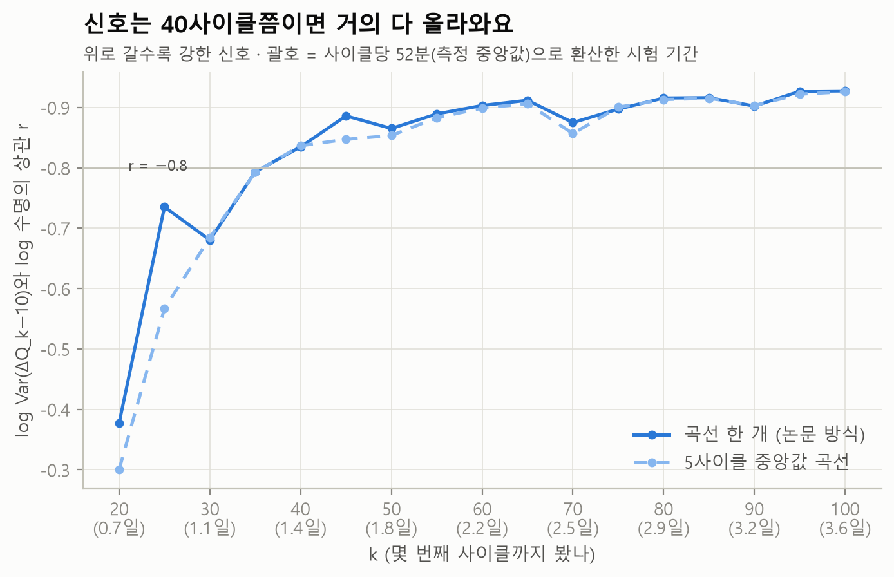
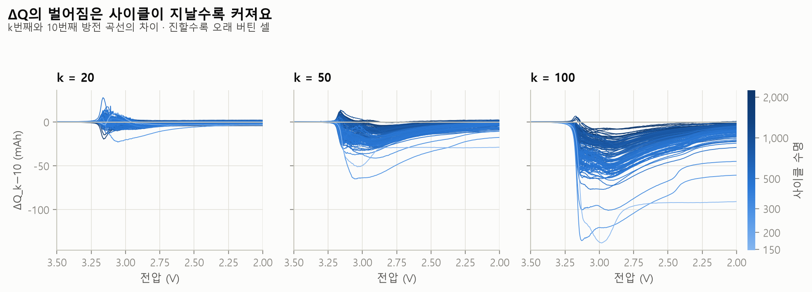
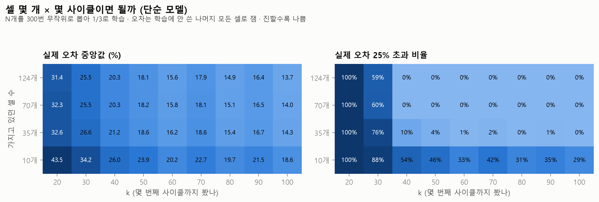

# 사이클 수 실험: 몇 사이클이면 충분할까?

`python -m battery_lab cycles`가 자동으로 만든 문서예요 (만든 날 2026-10-22).

## 질문

논문은 **100번째와 10번째 사이클**의 방전 곡선 차이(ΔQ₁₀₀₋₁₀)로 수명을 예측했어요.
20·30·…·90사이클만 보고도 예측할 수 있을까요? [데이터 크기 실험](data_size.md)이 "셀 몇 개"였다면 이번엔 "며칠"이에요.

## 왜 중요한가

- 이 데이터에서 사이클 하나는 중앙값 **52분**이에요(원시 데이터가 있는 100사이클 이내 사이클들로 측정). 100사이클이면 약 **3.6일**이 걸려요.
- **셀 개발:** 새 소재·설계를 평가할 때 며칠 만에 "오래 갈 셀인지" 감을 잡을 수 있으면 개발 속도가 빨라져요.
- **공정 개발:** 출하 전 검사·에이징을 얼마나 길게 해야 하는지 정하는 근거가 돼요.

## 방법

- ΔQ₁₀₀₋₁₀ 대신 **ΔQ_k−10**(k번째 − 10번째 사이클의 방전 곡선)으로 특징을 다시 만들어요. k = 20, 30, …, 100.
  용량 특징(2번째 사이클 용량, 초반 용량 증가분)도 2\~k사이클 안에서만 계산해요. **k번째 이후의 데이터는 쓰지 않아요.**
- 모델은 [데이터 크기 실험](data_size.md)과 같은 두 가지예요: 단순 모델 (ΔQ 분산 1개), 6개 특징 모델 (Elastic Net).
- 평가는 세 가지로 해요.
  1. 논문과 같은 나누기 (학습 41 · 테스트 43 · 2차 테스트 40)
  2. 124개를 41 / 83으로 무작위로 100번 나누기. 반복마다 **같은 나누기를 모든 k에 써서** 사이클 수 효과만 비교해요.
  3. 셀 수 N(124·70·35·10) × k 지도: N개를 300번 뽑아 1/3로 학습하고, 학습에 안 쓴 나머지 모든 셀로 오차를 재요. 단순 모델만 써요.
- 시험 기간은 사이클당 52분으로 환산했어요. 셀마다·충전 조건마다 실제 시간은 달라요.
- 곡선이 깨끗하지 않으면(품질 점검 기준) 가까운 깨끗한 곡선을 대신 썼어요. **k번째는 k−1, k−2처럼 앞쪽으로만** 찾고(k번째 이후 데이터를 쓰지 않도록), 10번째는 ±2사이클 안에서 찾아요:

| k | 셀 | 대신 쓴 사이클 |
|---|---|---|
| 30 | b1c45 | 29 |
| 70 | b2c40 | 69 |
| 70 | b2c41 | 69 |
| 80 | b2c40 | 79 |
| 90 | b1c27 | 89 |

## 결과 1 · 신호는 언제 올라오나

| k | 20 | 30 | 40 | 50 | 60 | 70 | 80 | 90 | 100 |
|---|---|---|---|---|---|---|---|---|---|
| 시험 기간 | 0.7일 | 1.1일 | 1.4일 | 1.8일 | 2.2일 | 2.5일 | 2.9일 | 3.2일 | 3.6일 |
| 상관 r (곡선 한 개) | -0.377 | -0.680 | -0.835 | -0.865 | -0.903 | -0.875 | -0.915 | -0.902 | -0.927 |
| 상관 r (5사이클 중앙값) | -0.300 | -0.684 | -0.836 | -0.853 | -0.899 | -0.857 | -0.913 | -0.903 | -0.926 |

*상관 r = 두 값이 함께 움직이는 정도(−1\~+1). −1에 가까울수록 "ΔQ 분산이 크면 수명이 짧다"는 관계가 뚜렷해요. 5사이클 중앙값 = k번째 곡선 하나 대신 k−4\~k번째 곡선 5개의 중앙값, 10번째 대신 8\~12번째 곡선 5개의 중앙값으로 ΔQ를 만든 것(k번째 이후 데이터는 쓰지 않아요).*

## 결과 2 · 예측 오차는 어떻게 줄어드나

무작위 나누기 100번의 평균 % 오차(MAPE):

| k | 시험 기간 | 단순 모델 (ΔQ 분산 1개) 중앙값 (10\~90%) | 6개 특징 모델 (Elastic Net) 중앙값 (10\~90%) |
|---|---|---|---|
| 20 | 0.7일 | 31.4% (27.5\~37.1) | 31.8% (27.2\~41.4) |
| 30 | 1.1일 | 25.7% (21.7\~28.3) | 23.1% (21.2\~26.5) |
| 40 | 1.4일 | 20.3% (18.5\~22.3) | 17.1% (15.4\~19.2) |
| 50 | 1.8일 | 18.3% (16.2\~19.9) | 16.4% (14.6\~18.3) |
| 60 | 2.2일 | 15.8% (14.2\~16.9) | 13.5% (12.2\~15.3) |
| 70 | 2.5일 | 17.9% (16.4\~19.4) | 14.9% (12.9\~24.0) |
| 80 | 2.9일 | 14.9% (13.6\~16.2) | 12.8% (11.7\~14.1) |
| 90 | 3.2일 | 16.3% (15.4\~17.7) | 13.0% (11.8\~14.4) |
| 100 | 3.6일 | 13.7% (12.9\~14.8) | 11.5% (10.4\~12.6) |

논문과 같은 나누기로 잰 값 (MAPE):

| k | 단순 · 테스트 | 단순 · 2차 테스트 | 6개 특징 · 테스트 | 6개 특징 · 2차 테스트 |
|---|---|---|---|---|
| 20 | 31.9% | 31.0% | 32.1% | 41.6% |
| 30 | 30.5% | 16.4% | 27.5% | 21.8% |
| 40 | 23.4% | 14.9% | 19.1% | 13.3% |
| 50 | 20.4% | 15.8% | 18.9% | 12.5% |
| 60 | 15.7% | 16.3% | 18.0% | 26.6% |
| 70 | 21.9% | 13.7% | 20.1% | 15.8% |
| 80 | 14.8% | 15.5% | 13.4% | 13.7% |
| 90 | 18.9% | 12.4% | 15.1% | 13.1% |
| 100 | 14.7% | 11.4% | 13.3% | 11.6% |

## 결과 3 · 셀 몇 개 × 몇 사이클이면 될까

실제 오차 중앙값 (단순 모델):

| 셀 수 | 20 | 30 | 40 | 50 | 60 | 70 | 80 | 90 | 100 |
|---|---|---|---|---|---|---|---|---|---|
| 124개 | 31.4% | 25.5% | 20.3% | 18.1% | 15.6% | 17.9% | 14.9% | 16.4% | 13.7% |
| 70개 | 32.3% | 25.5% | 20.3% | 18.2% | 15.8% | 18.1% | 15.1% | 16.5% | 14.0% |
| 35개 | 32.6% | 26.6% | 21.2% | 18.6% | 16.2% | 18.6% | 15.4% | 16.7% | 14.3% |
| 10개 | 43.5% | 34.2% | 26.0% | 23.9% | 20.2% | 22.7% | 19.7% | 21.5% | 18.6% |

실제 오차가 25%를 넘는 비율:

| 셀 수 | 20 | 30 | 40 | 50 | 60 | 70 | 80 | 90 | 100 |
|---|---|---|---|---|---|---|---|---|---|
| 124개 | 100% | 59% | 0% | 0% | 0% | 0% | 0% | 0% | 0% |
| 70개 | 100% | 60% | 0% | 0% | 0% | 0% | 0% | 0% | 0% |
| 35개 | 100% | 76% | 10% | 4% | 1% | 2% | 0% | 1% | 0% |
| 10개 | 100% | 88% | 54% | 46% | 33% | 42% | 31% | 35% | 29% |

## 읽는 법

1. **신호는 40사이클(약 1.4일)쯤이면 r이 −0.8보다 강해져요.** 20사이클에서는 r = -0.38로 약하고, 100사이클은 -0.927이에요.
2. **단순 모델은 100사이클보다 짧게 보면서 100사이클 성능의 2%p 안을 끝까지 유지하는 지점이 없어요.** 80사이클도 2%p 안(14.9%)이지만 90사이클에서 16.3%로 다시 벗어나요.
3. **6개 특징 모델은 80사이클(약 2.9일)부터 단순 모델의 100사이클 성능(13.7%) 이하를 계속 유지해요** (무작위 나누기 중앙값 12.8%). 60사이클도 중앙값은 13.5%이지만 70사이클에서 14.9%로 다시 나빠져서 기준으로 삼지 않았어요.
   - 하지만 **같은 나누기끼리 짝지어 보면** 80사이클 6개 특징 모델이 100사이클 단순 모델보다 좋거나 같은 경우는 81%예요. 논문 나누기에서는 테스트 13.4% · 2차 테스트 13.7%로, 100사이클 단순 모델(14.7% · 11.4%)보다 2차 테스트에서 나빠요.
   - 그래서 약 3.6일 → 2.9일로 시험 기간을 줄일 **가능성**은 보이지만, 확실하다고 말하기엔 일러요.
4. **셀 수 부족은 사이클로 메울 수 없어요.** 셀 10개면 100사이클까지 봐도 실제 오차가 25%를 넘는 비율이 29%예요. 반대로 셀이 35개 이상이면 50사이클부터 그 비율이 5% 아래로 내려가요.

### 오르락내리락하는 지점 (원인 미확인)

신호는 사이클이 늘수록 강해지지만 한 방향으로만 가지는 않아요. 5사이클 간격으로 보면 양옆보다 약해지는 지점이 **4곳** 있어요. 두 가지 가설을 데이터로 확인했어요.

| k | r | 양옆 r | 꺾인 정도 | 5사이클 중앙값 곡선의 r | 특징 벗어남 ↔ 온도 벗어남 상관 |
|---|---|---|---|---|---|
| 30 | -0.680 | -0.735 · -0.793 | 0.084 | -0.684 | -0.15 |
| 70 | -0.875 | -0.912 · -0.897 | 0.030 | -0.857 | -0.18 |
| 50 | -0.865 | -0.886 · -0.889 | 0.022 | -0.853 | -0.33 |
| 90 | -0.902 | -0.916 · -0.927 | 0.019 | -0.903 | -0.33 |

*꺾인 정도 = 이 k의 r − 양옆 r의 평균. r이 음수라서 이 값이 클수록 양옆보다 약해졌다는 뜻이에요. 특징 벗어남 ↔ 온도 벗어남 상관 = 셀마다 이 k의 특징이 ±10사이클 평균에서 벗어난 정도와, 같은 방식으로 잰 셀 겉면 온도가 벗어난 정도의 상관이에요.*

*깨끗한 곡선을 찾지 못한 셀이 있어서 셀 124개보다 적게 계산한 점: k=75(곡선 한 개, 123개), k=85(곡선 한 개, 123개), k=85(5사이클 중앙값, 123개).*

- **곡선 한 개의 잡음 때문인가? 일부만 맞아요.** 5사이클 중앙값 곡선으로 바꾸면 30, 50사이클의 꺾임은 사라지지만, 70, 90사이클은 그대로 남아요.
- **온도 때문인가? 이 데이터로는 가를 수 없어요.** 셀마다 잰 상관은 모두 절댓값 0.33 이하로 약하고, 3/4곳은 배치마다 상관의 방향(+/−)도 달라요. 하지만 셀 겉면 온도는 공식 설명상 참고용이라 잡음이 크고([데이터 카드](dataset_card.md)), 셀끼리 비교한 상관은 배치 전체가 함께 움직이는 변화를 잡지 못해요. 같은 방식으로 잰 배치별 온도 중앙값의 벗어남: 30사이클 b1 -0.02°C, b2 +0.06°C, b3 +0.07°C / 70사이클 b1 +0.31°C, b2 +0.37°C, b3 -0.17°C / 50사이클 b1 +0.02°C, b2 +0.09°C, b3 +0.11°C / 90사이클 b1 -0.02°C, b2 +0.22°C, b3 +0.11°C.
- 10사이클 간격의 오차 그래프(무작위 나누기 중앙값, 단순 모델)에서 바로 앞보다 오차가 커진 곳은 **70, 90사이클**이에요. 위 표의 꺾임 4곳 중 2곳(70, 90사이클)과 겹쳐요. 겹치는 곳은 모두 5사이클 중앙값 곡선으로도 남은 꺾임이에요. 30, 50사이클에서는 오차가 오히려 줄었어요 (31.4% → 25.7%, 20.3% → 18.3%). 겹친다는 것까지만 확인했고, 같은 원인인지는 몰라요.
- 그래서 "몇 사이클이면 되나"는 한 지점이 아니라 **전체 흐름과 반복 실험의 범위**로 판단했어요.

## 한계

- 10번째 사이클을 기준으로 고정했어요. 기준 사이클을 바꾸는 실험은 하지 않았어요.
- 시험 기간은 사이클당 52분(중앙값)으로 환산한 대략값이에요.
- 같은 124개 셀 안에서 나눈 실험이에요. 다른 셀·다른 조건에서도 같은 사이클 수가 충분하다는 보장은 없어요.
- 셀 수 × 사이클 수 지도는 단순 모델만 그렸어요(셀 10개면 6개 특징 모델을 만들 수 없어서).

## 시행착오

- **"70, 90사이클이 나쁘다"고 결론 낼 뻔했어요.** 논문 나누기 한 번만 보면 그 지점들의 오차가 바로 앞보다 커져서 그렇게 보였어요. 이웃 사이클을 촘촘히(5사이클 간격, 70사이클 주변은 1사이클 간격) 다시 재 보니 r이 사이클 하나 차이로도 오르내렸고, 곡선 잡음·온도 가설도 데이터로 확인했지만 둘 다 충분하지 않았어요. 원인은 모른다고 적었어요.
- **자동 분석이 "가장 크게 꺾인 한 곳"만 골랐더니 설명이 어긋났어요.** 70사이클을 보고 쓴 "오차 그래프도 그 지점에서 나빠진다"는 문장이, 코드가 고른 30사이클(신호가 빠르게 오르는 구간)에 그대로 붙었어요. 30사이클의 오차는 오히려 줄었어요. 그래서 꺾이는 지점을 모두 나열하고, 오차 그래프와의 대응도 계산으로 적도록 바꿨어요.
- **"6개 특징 모델은 60사이클(약 2.2일)로 100사이클 성능과 같아진다"고 썼었어요.** 조건을 *처음* 만족한 사이클 하나만 골랐는데, 바로 다음 70사이클에서 오차가 다시 커졌어요. 같은 나누기끼리 짝지어 보지도 않았어요. 다른 에이전트의 검토에서 지적받고, "그 사이클부터 100까지 계속 만족"하는 규칙으로 바꾸고 짝 비교와 논문 나누기 결과를 함께 적었어요.
- **깨진 k번째 곡선을 k+1, k+2번째 곡선으로 대신 쓸 수 있었어요.** "k사이클만 보고 예측"한다면서 미래 데이터를 쓴 셈이에요. 검토에서 지적받고 k번째는 앞쪽으로만 찾도록 고쳤고, 테스트로 막았어요.
- **중앙값 곡선이 더 나을 거라 짐작했는데 아니었어요.** 5사이클 중앙값 곡선은 전체적으로 비슷하거나 약간 약해서 채택하지 않았어요.
- **응용 아이디어 문서에 "사이클 하나가 약 1시간, 100사이클은 4일 넘게"라고 적었었어요.** 한 셀만 보고 쓴 숫자였어요. 측정해 보니 중앙값 52분, 100사이클은 약 3.6일이라 고쳤어요.
