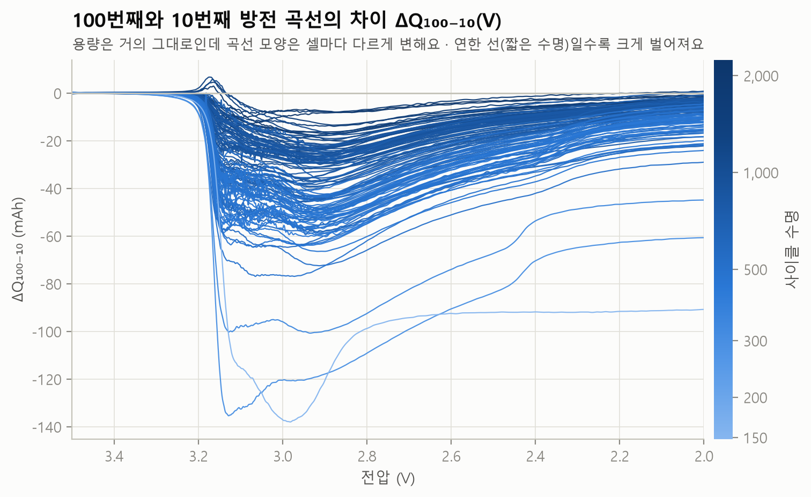

# 1단계 · 데이터 품질 점검과 논문 검증

`python -m battery_lab report`가 자동으로 만든 문서예요 (만든 날 2026-10-22).
분석하기 전에 정리한 데이터가 **논문과 같은지**, **어떤 문제가 어디에 섞여 있는지**부터 확인했어요.
점검 기준을 정하다 처음에 틀렸던 부분은 [시행착오 기록](troubleshooting.md)에 따로 적었어요.

## 논문 숫자와 비교

| 항목 | 논문 | 우리 데이터 |
|---|---|---|
| 셀 수 | 124 | 124 (배치별 41 · 43 · 40) |
| 학습 / 테스트 / 2차 테스트 | 41 / 43 / 40 | 41 / 43 / 40 |
| 사이클 수명 범위 | 150 \~ 2,300 | 148 \~ 2,237 (중앙값 736.5) |
| 사이클 2 → 100 용량 변화 (중앙값) | +0.2% | +0.22% |
| log Var(ΔQ₁₀₀₋₁₀)와 log 수명의 상관 | 강한 음의 상관 | r = -0.927 (124개 셀) |

*r = 상관계수(피어슨). 두 값이 한 직선을 따라 함께 움직이는 정도로, −1\~+1 사이예요. −1에 가까울수록 "ΔQ 분산이 클수록 수명이 짧다"는 관계가 뚜렷하고, 0이면 직선 관계가 없어요.*

**읽는 법.** 초반 100사이클 동안 용량은 거의 변하지 않아서, 용량만 보면 어느 셀이 일찍 죽을지 알 수 없어요.
하지만 100번째와 10번째 방전 곡선의 **차이(ΔQ)를** 보면 셀마다 벌어지는 정도가 달라요.

그 차이의 분산 하나만으로도 수명과 강하게 엮여 있어요. 4단계 수명 예측 모델의 출발점이에요.

## 데이터 정리 검증

| 검사 | 결과 |
|---|---|
| 곡선·원시 데이터의 j번째 사이클 = 요약표 j번째 사이클 | 원시 값이 있는 1,289개 사이클 중 **1,289개 일치** (최대 오차 0.005mAh, 빈 사이클 41개 제외) |
| 방전 곡선 전압 눈금(Vdlin) | 124/124개 셀이 같음 (3.5V → 2.0V, 1,000칸) |

## 품질 점검 결과

### 이상이 아니라 원래 그렇게 기록된 것

| 내용 | 해당 셀 수 |
|---|---|
| b1 배치의 1번째 사이클 빈 자리 (0으로 채운 줄) | 41 |
| 0.88Ah에 닿자 시험 종료 → 수명 = 마지막 기록 + 1 | 81 |
| 80%를 지나서도 더 시험 → 수명 = 처음 0.88Ah 미만 사이클 | 43 |

→ 두 경우를 나눠 보면 수명 라벨과 실제 80% 도달 사이클이 **124/124개 셀에서 정확히 같아요.**

### 실제로 섞여 있는 문제

| 점검 항목 | 해당 셀 수 |
|---|---|
| 수명 라벨과 실제 80% 도달이 다름 | 0 |
| 80% 도달을 확인할 수 없음 | 0 |
| 회복 튐 (쉬었다 재개한 뒤 용량이 0.5% 넘게 오름) | 1 |
| 순간 하락 (1% 넘게 꺼졌다가 돌아옴) | 19 |
| 범위 밖 용량 (0.1Ah 이하·1.2Ah 이상) | 4 |
| 방전 곡선에 말이 안 되는 값 (-0.01Ah 미만·1.3Ah 초과) | 33 |
| 충전 시간 60분 초과 (멈춘 동안의 시간까지 충전 시간에 기록됨) | 14 |
| 방전 곡선의 작은 되돌림 (1mAh 넘게, 측정 잡음 수준) | 53 |
| 빈 방전 곡선 | 0 |
| 범위 밖 온도 (20°C 미만·50°C 초과) | 0 |
| 내부저항 0 또는 중앙값의 3배 초과 | 15 |
| ⚠ 수명 예측에 쓰는 10·100번째 사이클 곡선 문제 | 0 |

### 이상이 몰린 곳 ↔ 공식 실험 노트

회복 튐·범위 밖 용량·깨진 곡선·긴 충전 시간이 일어난 사이클을 순서대로 놓고, 바로 앞 이상과 20사이클 안에 이어지면 한 무리로 묶었어요. 셀 5개 이상에서 일어난 무리만 적었어요 (한 셀에서만 되풀이된 이상은 그 셀만의 문제일 수 있어서요).

| 배치 | 이상이 몰린 사이클 | 이상 건수 | 겪은 셀 | 공식 실험 노트 |
|---|---|---|---|---|
| b1 | 12 \~ 13 | 9/32건 | 8/41개 | 컴퓨터가 두 번 자동 재시작돼 기록에 시간 공백이 있음. 1번째 사이클 기록 없음. |
| b1 | 141 \~ 166 | 8/32건 | 8/41개 | (위와 같음) |
| b1 | 655 \~ 684 | 5/32건 | 5/32개 | (위와 같음) |
| b1 | 879 \~ 909 | 5/32건 | 5/13개 | (위와 같음) |
| b2 | 245 \~ 258 | 28/53건 | 20/42개 | 컴퓨터 재시작으로 대부분의 셀이 250사이클 근처에서 약 8시간 쉼 → 용량 '튐'. |

*이상 건수 a/b = 이 무리의 이상 a건 / 그 배치의 이상 전체 b건. 겪은 셀 a/b = 이 무리에서 이상을 겪은 셀 a개 / 무리가 시작된 사이클까지 시험 중이던 셀 b개.*

- **b1에서는 이상이 여러 셀의 비슷한 사이클에 몰려 있어요.** 위 표의 무리 4개에 이상 32건 중 27건(84%)이 들어 있어요. 가장 큰 두 무리를 보면 사이클 12 \~ 13에 셀 8개에서 이상 9건, 사이클 141 \~ 166에 셀 8개에서 이상 8건이 있어요. 공식 노트에 적힌 '두 번 자동 재시작'과 같은 때인지는 시간 기록으로 확인하지 않았어요.
- **b2에서는 공식 노트의 재시작 시점(250사이클 근처)과 겹쳐요.** 이상 53건 중 28건(53%)이 사이클 245 \~ 258에 몰려 있어요.

### 이어 붙인 셀 5개의 이음매

1배치에서 멈췄다가 2배치에서 이어 시험한 셀이에요. 공식 노트는 "쉬었다 재개하면 용량이 오른다"고 했는데,
실제 기록은 아래와 같았어요 (기준: 이음매 직전 5사이클 중앙값).

| 셀 | 충전 조건 | 이음매 사이클 | 재개 첫 사이클 | 재개 뒤 10사이클 중앙값 |
|---|---|---|---|---|
| b1c0 | 3.6C(80%)-3.6C | 1,190 | -0.45% | -0.30% |
| b1c1 | 3.6C(80%)-3.6C | 1,179 | -1.36% | -0.89% |
| b1c2 | 3.6C(80%)-3.6C | 1,177 | -1.35% | -0.89% |
| b1c3 | 4C(80%)-4C | 1,226 | +0.07% | -0.17% |
| b1c4 | 4C(80%)-4C | 1,227 | -1.41% | -0.97% |

- 5개 중 3개는 재개 직후 오히려 0.5% 넘게 **떨어졌다가** 몇 사이클에 걸쳐 일부 회복했어요.
- 이어 붙이기 자체는 맞다고 판단했어요: 재개 뒤 10사이클 중앙값이 직전 값과 1.0% 안쪽으로 이어지고, 새 셀이라면 1.07Ah 근처에서 시작하기 때문이에요.
- 이음매는 모두 1,177사이클 이후라 수명 예측(첫 100사이클)에는 영향이 없어요. 2단계에서 용량 추세를 볼 때는 `cells.csv`의 `seam_cycle`로 표시해요.

**결론.** 수명 예측에 쓰는 10·100번째 사이클 곡선은 **124/124개 셀 모두 깨끗해요.**
용량 추세를 볼 때(2단계)는 순간 하락·범위 밖 값·이음매를 표시하거나 걸러서 봐요.

### 셀별 내용

| 셀 | 배치 | 충전 조건 | 내용 |
|---|---|---|---|
| b1c0 | b1 | 3.6C(80%)-3.6C | 순간 하락 45번 / 범위 밖 용량 (사이클 12) / 방전 곡선에 말이 안 되는 값 (사이클 12) / 내부저항 0 2개 · 중앙값 3배 초과 0개 |
| b1c1 | b1 | 3.6C(80%)-3.6C | 방전 곡선에 말이 안 되는 값 (사이클 655) / 내부저항 0 3개 · 중앙값 3배 초과 0개 |
| b1c2 | b1 | 3.6C(80%)-3.6C | 순간 하락 1번 / 충전 시간 60분 초과 (사이클 2176) / 방전 곡선에 말이 안 되는 값 (사이클 1487) / 내부저항 0 3개 · 중앙값 3배 초과 0개 |
| b1c3 | b1 | 4C(80%)-4C | 충전 시간 60분 초과 (사이클 879) / 방전 곡선에 말이 안 되는 값 (사이클 12, 156, 676) / 내부저항 0 1개 · 중앙값 3배 초과 0개 |
| b1c4 | b1 | 4C(80%)-4C | 순간 하락 1번 / 방전 곡선에 말이 안 되는 값 (사이클 12) / 내부저항 0 2개 · 중앙값 3배 초과 0개 |
| b1c5 | b1 | 4.4C(80%)-4.4C | 순간 하락 1번 / 충전 시간 60분 초과 (사이클 13) / 방전 곡선에 말이 안 되는 값 (사이클 909) / 내부저항 0 1개 · 중앙값 3배 초과 0개 |
| b1c6 | b1 | 4.8C(80%)-4.8C | 내부저항 0 1개 · 중앙값 3배 초과 0개 |
| b1c7 | b1 | 4.8C(80%)-4.8C | 내부저항 0 1개 · 중앙값 3배 초과 0개 |
| b1c9 | b1 | 5.4C(40%)-3.6C | 내부저항 0 1개 · 중앙값 3배 초과 0개 |
| b1c11 | b1 | 5.4C(50%)-3C | 내부저항 0 1개 · 중앙값 3배 초과 0개 |
| b1c14 | b1 | 5.4C(60%)-3C | 충전 시간 60분 초과 (사이클 13) |
| b1c15 | b1 | 5.4C(60%)-3C | 충전 시간 60분 초과 (사이클 13) |
| b1c16 | b1 | 5.4C(60%)-3.6C | 방전 곡선에 말이 안 되는 값 (사이클 163) / 내부저항 0 1개 · 중앙값 3배 초과 0개 |
| b1c18 | b1 | 5.4C(70%)-3C | 범위 밖 용량 (사이클 40) |
| b1c20 | b1 | 5.4C(80%)-5.4C | 방전 곡선에 말이 안 되는 값 (사이클 13) / 내부저항 0 1개 · 중앙값 3배 초과 0개 |
| b1c21 | b1 | 5.4C(80%)-5.4C | 방전 곡선에 말이 안 되는 값 (사이클 13, 166) / 내부저항 0 1개 · 중앙값 3배 초과 0개 |
| b1c23 | b1 | 6C(30%)-3.6C | 방전 곡선에 말이 안 되는 값 (사이클 894) / 내부저항 0 1개 · 중앙값 3배 초과 0개 |
| b1c24 | b1 | 6C(40%)-3C | 충전 시간 60분 초과 (사이클 902) / 방전 곡선에 말이 안 되는 값 (사이클 683) |
| b1c26 | b1 | 6C(40%)-3.6C | 방전 곡선에 말이 안 되는 값 (사이클 144) |
| b1c31 | b1 | 6C(50%)-3.6C | 방전 곡선에 말이 안 되는 값 (사이클 146) |
| b1c34 | b1 | 7C(30%)-3.6C | 방전 곡선에 말이 안 되는 값 (사이클 684) |
| b1c36 | b1 | 7C(40%)-3C | 방전 곡선에 말이 안 되는 값 (사이클 73, 454) |
| b1c37 | b1 | 7C(40%)-3C | 방전 곡선에 말이 안 되는 값 (사이클 143) |
| b1c40 | b1 | 8C(15%)-3.6C | 방전 곡선에 말이 안 되는 값 (사이클 141, 658) / 내부저항 0 1개 · 중앙값 3배 초과 0개 |
| b1c41 | b1 | 8C(15%)-3.6C | 충전 시간 60분 초과 (사이클 887) |
| b1c42 | b1 | 8C(25%)-3.6C | 방전 곡선에 말이 안 되는 값 (사이클 143) |
| b2c0 | b2 | 1C(4%)-6C | 순간 하락 1번 |
| b2c2 | b2 | 2C(2%)-5C | 충전 시간 60분 초과 (사이클 248) |
| b2c3 | b2 | 2C(7%)-5.5C | 순간 하락 1번 |
| b2c4 | b2 | 3.6C(22%)-5.5C | 순간 하락 1번 / 방전 곡선에 말이 안 되는 값 (사이클 247) |
| b2c5 | b2 | 3.6C(2%)-4.85C | 충전 시간 60분 초과 (사이클 249) |
| b2c6 | b2 | 3.6C(30%)-6C | 순간 하락 1번 / 방전 곡선에 말이 안 되는 값 (사이클 258) |
| b2c10 | b2 | 3.6C(9%)-5C | 순간 하락 1번 / 방전 곡선에 말이 안 되는 값 (사이클 251) |
| b2c11 | b2 | 4C(13%)-5C | 순간 하락 1번 / 방전 곡선에 말이 안 되는 값 (사이클 250) |
| b2c12 | b2 | 4C(31%)-5 | 범위 밖 용량 (사이클 253) / 충전 시간 60분 초과 (사이클 253) / 방전 곡선에 말이 안 되는 값 (사이클 253) |
| b2c13 | b2 | 4C(40%)-6C | 순간 하락 1번 / 방전 곡선에 말이 안 되는 값 (사이클 246) |
| b2c17 | b2 | 4.4C(24%)-5C | 순간 하락 2번 |
| b2c20 | b2 | 4.4C(8%)-4.85C | 순간 하락 1번 / 방전 곡선에 말이 안 되는 값 (사이클 249) |
| b2c22 | b2 | 4.65C(44%)-5C | 순간 하락 1번 / 방전 곡선에 말이 안 되는 값 (사이클 247) |
| b2c23 | b2 | 4.65C(69%)-6C | 충전 시간 60분 초과 (사이클 248) |
| b2c26 | b2 | 4.8C(80%)-4.8C | 방전 곡선에 말이 안 되는 값 (사이클 248) |
| b2c28 | b2 | 4.9C(61%)-4.5C | 순간 하락 1번 / 방전 곡선에 말이 안 되는 값 (사이클 250) |
| b2c29 | b2 | 4.9C(69%)-4.25C | 순간 하락 1번 |
| b2c37 | b2 | 5.6C(38%)-4.25C | 순간 하락 1번 / 방전 곡선에 말이 안 되는 값 (사이클 247) |
| b2c39 | b2 | 5.6C(58%)-3.5C | 충전 시간 60분 초과 (사이클 248) |
| b2c40 | b2 | 5.6C(5%)-4.75C | 순간 하락 2번 / 방전 곡선에 말이 안 되는 값 (사이클 74, 75, 84, 245 외 25곳) |
| b2c41 | b2 | 5.6C(65%)-3C | 충전 시간 60분 초과 (사이클 251) |
| b2c42 | b2 | 6C(20%)-4.5C | 순간 하락 1번 / 방전 곡선에 말이 안 되는 값 (사이클 247) |
| b2c44 | b2 | 6C(40%)-4C | 범위 밖 용량 (사이클 248) / 충전 시간 60분 초과 (사이클 248) / 방전 곡선에 말이 안 되는 값 (사이클 248) |
| b2c46 | b2 | 6C(52%)-3.5C | 방전 곡선에 말이 안 되는 값 (사이클 429) |
| b2c47 | b2 | 6C(60%)-3C | 회복 튐 1번 (사이클 258) |

전체 셀의 점검 값은 `data/processed/quality.csv`에 있어요.
