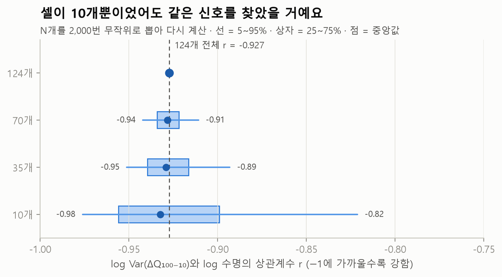
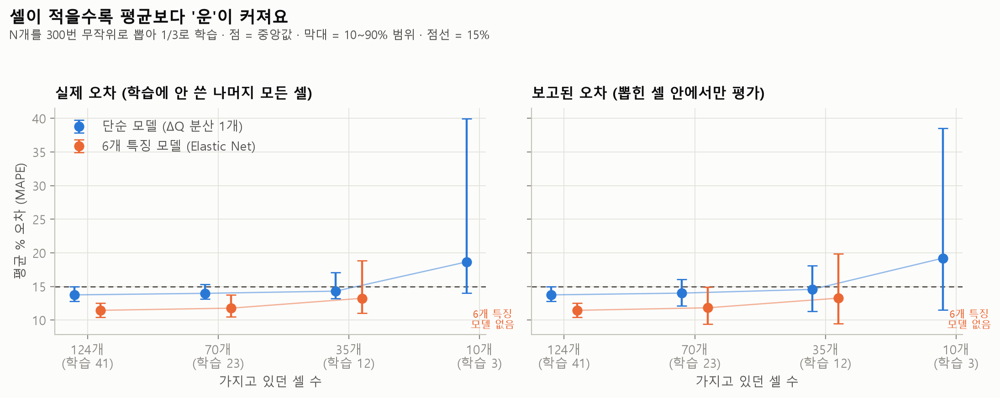
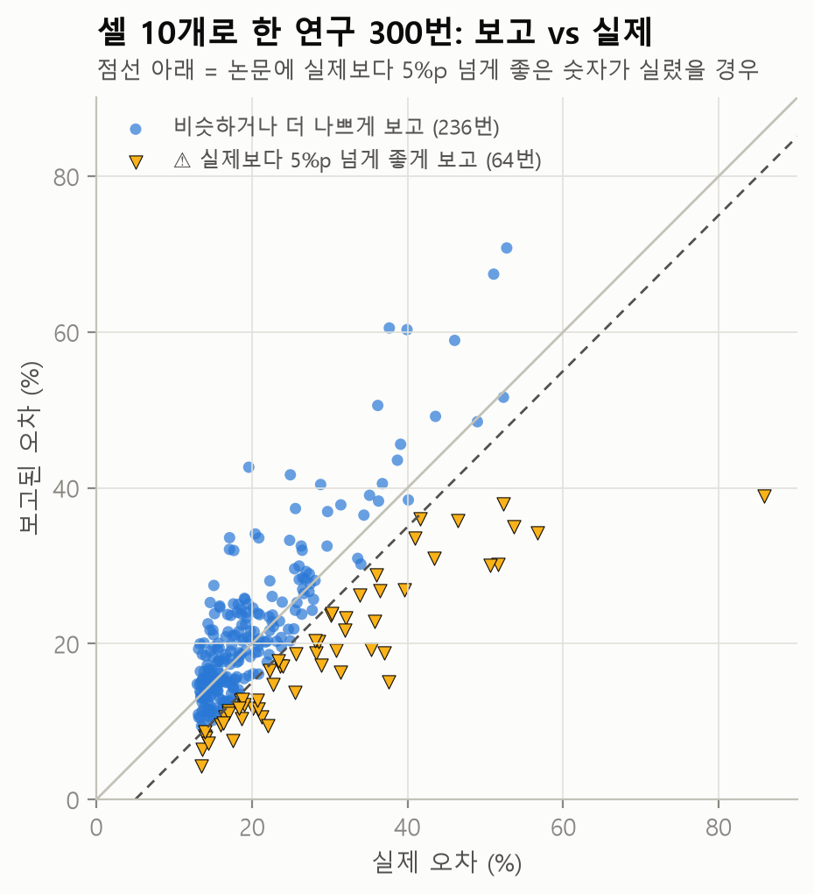

# 데이터 크기 실험: 셀이 70·35·10개뿐이었다면?

`python -m battery_lab sizes`가 자동으로 만든 문서예요 (만든 날 2026-10-22).

## 질문

원래 시험한 셀은 140개, 논문이 쓴 셀은 124개예요. 배터리 수명 시험은 셀 하나에 몇 달이 걸려서,
**"셀이 몇 개면 충분한가"는 곧 시간과 비용의 문제**예요. 그래서 이렇게 물었어요.

1. 셀이 적었어도 "초반 ΔQ 분산이 수명을 알려 준다"는 **발견**을 할 수 있었을까?
2. 셀이 적었다면 수명 예측 **모델은 얼마나 나빠졌고**, 그 연구가 **보고한 숫자는 믿을 만했을까?**

## 방법

- 124개 셀에서 N개(124·70·35·10)를 무작위로 뽑아 "그 N개만 있었던 연구"를 흉내 내요.
- **실험 1 (발견):** 뽑은 N개 안에서 상관 r을 다시 계산해요. N마다 2,000번.
- **실험 2 (예측):** 뽑은 N개를 논문처럼 1/3은 학습, 2/3는 평가에 써요. N마다 300번.
  - **보고된 오차:** 뽑힌 N개 안의 평가 셀로 잰 오차예요. 그 연구가 논문에 썼을 숫자예요.
  - **실제 오차:** 학습에 안 쓴 나머지 **모든** 셀로 잰 오차예요. 그 모델의 진짜 실력에 가까운 숫자예요.
- 모델 두 가지 ([model.py](../battery_lab/model.py), [features.py](../battery_lab/features.py))
  - **단순 모델 (ΔQ 분산 1개):** log10 Var(ΔQ₁₀₀₋₁₀) 하나로 log 수명에 직선을 맞춰요. 논문의 variance 모델과 같은 형태예요.
  - **6개 특징 모델 (Elastic Net):** ΔQ 곡선의 분산·최솟값·왜도·첨도, 2번째 사이클 용량, 초반 용량 증가분을 표준화해 Elastic Net으로 맞춰요. 논문의 discharge 모델을 참고했지만, 논문 코드가 공개돼 있지 않아 특징 정의가 같다고 보장하지는 못해요.
- 오차는 평균 % 오차(MAPE)로 비교해요. 실험 2는 1/3 학습이라 셀 10개면 학습 셀이 3개뿐이에요. 그래서 6개 특징 모델은 학습 셀이 6개 이상일 때만 만들어요.

## 기준점: 논문과 같은 나누기 (학습 41 · 테스트 43 · 2차 테스트 40)

| 모델 | 학습 | 테스트 | 2차 테스트 |
|---|---|---|---|
| 단순 모델 (ΔQ 분산 1개) | 104사이클 (14.1%) | 138사이클 (14.7%) | 196사이클 (11.4%) |
| 6개 특징 모델 (Elastic Net) | 65사이클 (9.0%) | 108사이클 (13.3%) | 173사이클 (11.6%) |

단순 모델의 테스트 / 2차 테스트 RMSE는 **138 / 196사이클**이에요. 논문의 variance 모델은 **138 / 196사이클**이고, 출처는 Attia 외(2021, arXiv:2101.01885)가 인용한 Severson 외(2019)의 variance 모델 결과예요. 논문 결과를 사이클 단위까지 재현했어요.

## 실험 1 · 셀이 적어도 같은 신호를 찾았을까?

| 셀 수 | 상관 r 중앙값 | 90% 범위 | r이 −0.8보다 약하게 나온 비율 |
|---|---|---|---|
| 124개 | -0.927 | (한 가지) | - |
| 70개 | -0.928 | -0.94 ~ -0.91 | 0% |
| 35개 | -0.929 | -0.95 ~ -0.89 | 0% |
| 10개 | -0.932 | -0.98 ~ -0.82 | 3% |

→ **신호가 아주 강해서, 셀 10개만 있었어도 97%의 경우 r이 −0.8보다 강하게 나와요.** "초반 ΔQ 분산이 수명과 엮여 있다"는 발견 자체는 작은 실험으로도 충분히 할 수 있었어요.

## 실험 2 · 셀이 적으면 예측은 얼마나 나빠질까?

| 셀 수 (학습) | 모델 | 실제 오차 중앙값 | 실제 오차 10~90% | 보고된 오차 10~90% | 실제 25% 초과 | 실제보다 5%p 넘게 좋게 보고 |
|---|---|---|---|---|---|---|
| 124개 (41) | 단순 모델 (ΔQ 분산 1개) | **13.7%** | 12.8 ~ 14.9% | 12.8 ~ 14.9% | 0% | 0% |
| 124개 (41) | 6개 특징 모델 (Elastic Net) | **11.4%** | 10.4 ~ 12.5% | 10.4 ~ 12.5% | 0% | 0% |
| 70개 (23) | 단순 모델 (ΔQ 분산 1개) | **14.0%** | 13.1 ~ 15.3% | 12.1 ~ 16.1% | 0% | 0% |
| 70개 (23) | 6개 특징 모델 (Elastic Net) | **11.8%** | 10.5 ~ 13.8% | 9.4 ~ 14.9% | 0% | 0% |
| 35개 (12) | 단순 모델 (ΔQ 분산 1개) | **14.3%** | 13.2 ~ 17.1% | 11.3 ~ 18.1% | 0% | 1% |
| 35개 (12) | 6개 특징 모델 (Elastic Net) | **13.2%** | 11.1 ~ 18.9% | 9.5 ~ 19.8% | 3% | 5% |
| 10개 (3) | 단순 모델 (ΔQ 분산 1개) | **18.6%** | 14.0 ~ 39.9% | 11.5 ~ 38.5% | 29% | 21% |
| 10개 (3) | 6개 특징 모델 (Elastic Net) | 만들 수 없음 (학습 셀 부족) | | | | |

*124개일 때는 평가 셀이 곧 '학습에 안 쓴 나머지 전체'라서 보고된 오차와 실제 오차가 같아요.*

### 읽는 법

1. **35개까지는 평균이 거의 안 나빠져요.** 단순 모델의 실제 오차 중앙값은 124개 13.7% → 35개 14.3%예요. 신호 하나에 직선 하나라 학습 셀 12개로도 거의 같은 직선이 나와요.
2. **대신 '운'의 폭이 커져요.** 10~90% 범위가 124개 12.8~14.9%에서 10개 14.0~39.9%로 넓어져요. 셀 10개(학습 3개)로 한 연구 중 **29%는 실제 오차가 25%를 넘는 모델**을 얻어요.
3. **작은 연구는 숫자가 실제보다 좋게 실릴 수 있어요.** 셀 10개 연구의 **21%** 는 보고된 오차가 실제보다 5%p 넘게 좋았어요. 평가 셀이 7개뿐이라 쉬운 셀이 몰리면 성능이 부풀려져요.
4. **복잡한 모델은 데이터가 많을 때만 확실히 이겨요.** 6개 특징 모델은 124개에서 11.4%로 단순 모델(13.7%)보다 좋지만, 35개에서는 중앙값 13.2% vs 14.3%로 차이가 줄고, 나쁜 쪽 끝(90%)은 18.9% vs 17.1%로 오히려 더 위험해요. 특징이 많을수록 적은 데이터에 휘둘리기 쉬워요.

## 이 결과가 말해 주는 것

- **발견은 작게, 검증은 크게.** 신호를 찾는 데는 적은 셀로도 충분했지만, "이 모델의 오차는 몇 %"라고 말하려면 평가 셀이 많아야 해요.
- **작은 실험의 성능 숫자는 범위로 말해야 해요.** 같은 방법이라도 어떤 셀을 뽑았느냐에 따라 보고 숫자가 크게 흔들려요.
- **현업으로 옮기면:** 새 소재·설계 평가에서 셀을 몇 개 만들지 정할 때, "원하는 오차 범위를 얻으려면 몇 개가 필요한가"를 이런 방식으로 미리 따져 볼 수 있어요.

## 한계

- 같은 124개 셀에서 다시 뽑는 실험이라, 정말로 다른 셀 N개로 새 실험을 한 것과 같지는 않아요.
  특히 셀 10개를 뽑을 때 같은 충전 조건의 셀이 학습과 평가에 나뉘어 들어갈 수 있어요.
- 학습 비율을 논문처럼 1/3로 고정했어요. 셀이 적을 때는 학습에 더 많이 쓰는 게 보통이라, 셀 10개 결과는 비관적인 쪽이에요.
- 6개 특징 모델은 논문의 discharge 모델을 참고해 직접 구현한 것이에요.

더 해 볼 만한 응용은 [응용 아이디어](ideas.md)에 정리해 두었어요.
