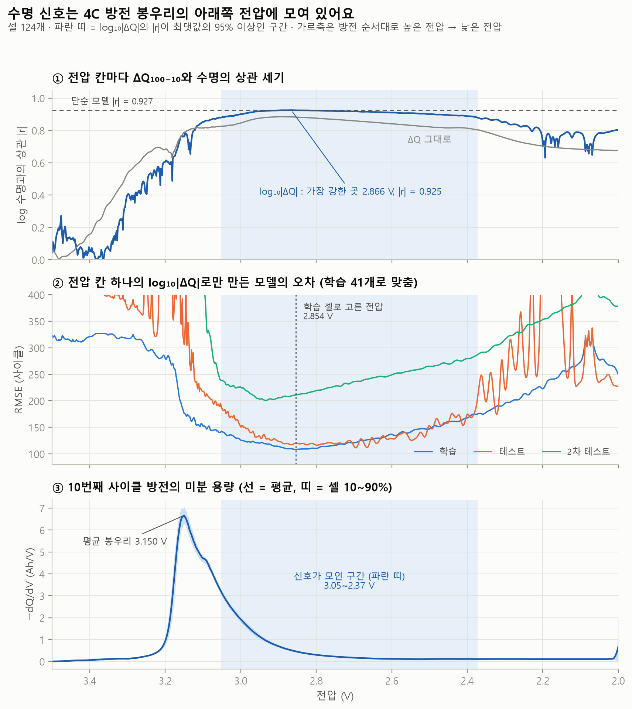
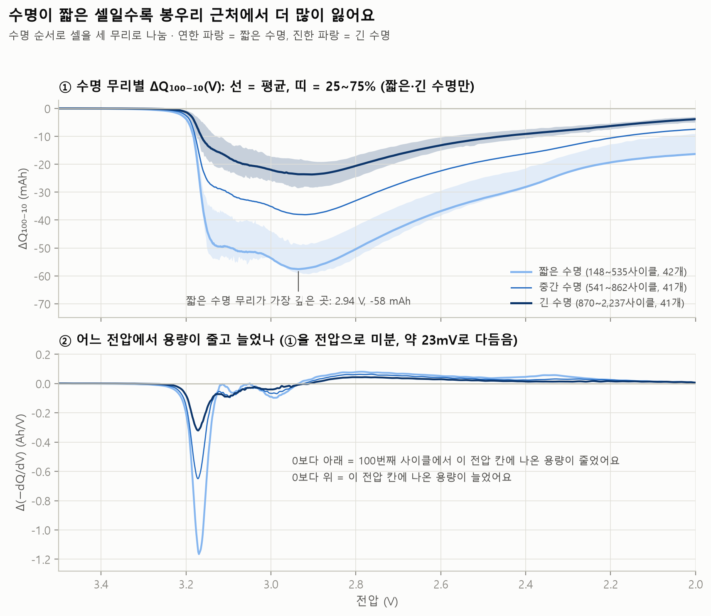

# ΔQ 특징이 왜 통하나: 어느 전압이 수명을 알려 줄까?

`python -m battery_lab.interpret_report`가 자동으로 만든 문서예요 (만든 날 2026-10-22).

## 질문

단순 모델 (ΔQ 분산 1개)은 ΔQ₁₀₀₋₁₀(V) 곡선(100번째와 10번째 방전 곡선의 차이, 전압 칸 1,000개)의 **분산 하나**로 수명을 맞혀요 (논문의 variance 모델과 같은 형태). 로그 수명과의 상관 r은 -0.927이에요. 상관 r은 두 값이 직선으로 함께 움직이는 정도로 −1\~+1 사이 값이고, −1에 가까울수록 '한쪽이 크면 다른 쪽은 작다'는 관계가 뚜렷해요. 그런데 분산은 1,000개 값을 한 숫자로 뭉치면서 '어느 전압에서' 달라졌는지는 버려요.

1. 1,000개 전압 칸 중 **어디에** 수명 신호가 모여 있을까?
2. 그 전압은 방전 곡선의 어디(평탄 구간·봉우리)이고, 전기화학적으로 **무엇을 뜻할 수 있을까?**
3. 수명이 짧은 셀과 긴 셀의 ΔQ 곡선은 **어떻게 다를까?**

## 왜 중요한가

- **셀 개발:** "모델이 맞혔다"에서 멈추면 다음 실험을 설계할 수 없어요. 신호가 어느 전압 구간에서 나오는지 알면, 그 구간을 저율(천천히 충방전) 진단으로 정밀하게 다시 재서 원인(리튬 손실인지 재료 손상인지)을 가르는 실험을 계획할 수 있어요.
- **공정 개발·품질:** 곡선 전체가 아니라 특정 전압 구간의 용량 변화만으로도 수명 신호가 잡힌다면, 초기 사이클 검사를 더 단순하게 만들 실마리가 돼요. (이 데이터는 공정 데이터가 아니라서 가능성만 말할 수 있어요.)
- **면접:** "ΔQ 분산이 왜 통하나요?"라는 질문에 "통계적으로 그렇다"가 아니라 "방전 곡선의 이 부분이 이렇게 바뀌기 때문"이라고 데이터로 답할 수 있어요.

## 방법

- **데이터:** 셀 124개. ΔQ₁₀₀₋₁₀(V) = 100번째 − 10번째 사이클의 방전 곡선 Q(V) ([interpret.py](../battery_lab/interpret.py)). 곡선은 행 번호가 아니라 사이클 번호로 찾고, 깨끗하지 않으면 100번째는 앞쪽(98\~100번째)에서만, 10번째는 ±2사이클 안에서 가까운 곡선을 써요 (이번엔 대신 쓴 셀 0개).
- **상관 스펙트럼:** 전압 칸마다 셀들의 ΔQ(V)와 log10(수명)의 상관 r을 구해요. ΔQ를 그대로 쓴 것과 log10|ΔQ|(절댓값의 로그)를 쓴 것 두 가지예요. 단순 모델도 로그를 쓰고, 수명과의 관계가 직선보다 곡선에 가까워서 로그를 함께 봐요.
- **흔들림 확인:** 셀 124개를 복원 추출(같은 셀이 여러 번 뽑힐 수 있게)로 1,000번 다시 뽑아, 상관이 가장 강한 전압이 얼마나 움직이는지 봐요 (난수 고정 seed 2026).
- **전압별 단일 특징 모델:** 전압 칸 하나의 값만으로 log10(수명)에 직선을 맞춰요. 논문과 같은 나누기(학습 41 · 테스트 43 · 2차 테스트 40)를 쓰고, **전압 고르기도 학습 셀로만** 해요. 평가 셀 오차를 보고 전압을 고르면 답을 보고 고르는 셈이에요.
- **dQ/dV(미분 용량):** 데이터에 들어 있는 10번째 사이클의 dQ/dV를 셀마다 모아 평균을 그려요 (봉우리 이동·높이 변화는 100번째와 비교). 방전에서는 dQ/dV가 음수라 −dQ/dV로 뒤집어 봉우리가 위로 오게 했어요. 봉우리는 3.0\~3.3 V 안에서 찾아요.
- **수명 무리:** 수명 순서로 셀을 세 무리(짧은·중간·긴 수명)로 나눠 ΔQ(V)의 평균과 25\~75% 범위를 비교해요.
- **ΔQ의 미분:** ΔQ(V)는 3.5V부터 그 전압까지 나온 용량 변화를 모두 더한 **누적 값**이에요. 어느 전압에서 변화가 생겼는지 보려고 ΔQ 곡선을 약 23mV 폭으로 다듬은 뒤 전압으로 미분했어요.
- **내부저항:** 요약표의 내부저항(IR)으로 10번째 → 100번째 사이클 변화를 계산해요 (각 사이클 ±2의 중앙값).
- 물리 시뮬레이션(전기화학 모델)은 돌리지 않았어요. 아래의 원인 해석은 모두 데이터와 함께 나타나는 것을 바탕으로 한 **가설**이에요.

## 결과

### 1. 신호는 봉우리 아래쪽 넓은 전압 구간에 모여 있어요

| 항목 | ΔQ 그대로 | log10\|ΔQ\| |
|---|---|---|
| 상관이 가장 강한 전압 | 2.893 V | 2.866 V |
| 그때의 상관 r | +0.885 | -0.925 |
| \|r\|이 최댓값의 95% 이상인 구간 | 3.01 \~ 2.60 V | 3.05 \~ 2.37 V |
| 셀 다시 뽑기 1,000번: 가장 강한 전압의 90% 범위 | | 2.93 \~ 2.80 V (중앙값 2.868 V) |
| 3.2 V보다 높은 전압에서 가장 강한 \|r\| | | 0.603 |

*비교: 단순 모델(log10 Var ΔQ)의 상관 r = -0.927. ΔQ가 음수(용량이 줄어듦)라서, ΔQ 그대로는 양의 상관 (덜 줄어든 셀일수록 오래 가는 경향), log10|ΔQ|는 음의 상관(많이 줄어든 셀일수록 일찍 끝나는 경향)이에요.*

### 2. 전압 칸 하나로 만든 모델 vs 단순 모델

| 모델 | 학습 | 테스트 | 2차 테스트 |
|---|---|---|---|
| 단순 모델 (ΔQ 분산 1개): log10 Var(ΔQ) (기준) | 104사이클 (14.1%) | 138사이클 (14.7%) | 196사이클 (11.4%) |
| 전압 하나: log10\|ΔQ(2.854 V)\| (학습 셀로 고름) | 108사이클 (14.4%) | 120사이클 (14.3%) | 211사이클 (11.5%) |
| 전압 하나: log10\|ΔQ(2.959 V)\| (Attia 외가 쓴 2.959 V) | 121사이클 (15.6%) | 131사이클 (15.6%) | 206사이클 (12.7%) |
| 전압 하나: ΔQ(2.908 V) 그대로 (학습 셀로 고름) | 194사이클 (18.2%) | 233사이클 (17.2%) | 275사이클 (13.9%) |

- 오차는 RMSE(평균 제곱근 오차. 예측이 평균적으로 몇 사이클 빗나갔는지)와 괄호 안 평균 % 오차(MAPE)예요. 단순 모델의 테스트 / 2차 테스트 RMSE 138 / 196사이클은 [데이터 크기 실험](data_size.md)의 기준점과 같은 값이에요.
- **비교 (원문 확인):** Attia 외(2021, [https://arxiv.org/abs/2101.01885](https://arxiv.org/abs/2101.01885))는 ΔQ₁₀₀₋₁₀를 2.959 V 한 점에서만 읽은 모델이 단순 모델과 비슷하다고 보고했어요 (단순 모델 대비 오차가 학습 +8.7%, 테스트 -13.8%, 2차 테스트 +7.1%). 이 전압은 예시 셀 하나의 Qn − Q2(2번째 사이클 기준 용량 차이)가 가장 깊은 전압이라 골랐다고 적혀 있어요. 우리 계산으로는 같은 전압에서 단순 모델 대비 +16.8%, -4.8%, +4.9%예요. 우리 124개 셀의 평균 ΔQ₁₀₀₋₁₀가 가장 깊은 전압은 2.934 V예요.
- 같은 논문에서 학습 오차로 고른 전압은 2.911 V였고 RMSE는 학습 108 · 테스트 118 · 2차 테스트 214사이클이에요. 우리는 2.854 V에서 108 · 120 · 211사이클이에요. 논문은 단일 특징에도 Elastic Net(제약을 건 선형 회귀)과 표준화를 썼고 우리는 보통 직선 맞추기라, 숫자가 똑같지는 않아요. (논문 요약 표에는 같은 모델이 2.913 V, 학습 109사이클로 적혀 있어 본문과 조금 달라요. 여기서는 본문 값을 썼어요.)
- *참고 (답을 보고 고른 값):* 테스트 셀 오차가 가장 작은 전압은 2.695 V (111사이클), 2차 테스트는 2.934 V (201사이클)예요. 평가 셀마다 '좋은 전압'이 달라서, 이런 숫자는 성능으로 쓰면 안 돼요.

### 3. 그 전압은 방전 곡선의 어디일까 (dQ/dV)

| 항목 | 값 |
|---|---|
| 10번째 사이클 평균 −dQ/dV의 봉우리 | 3.150 V, 6.67 Ah/V |
| 평균 곡선의 봉우리 개수 (2.5\~3.45 V, 주 봉우리의 5% 이상) | 1개 |
| 봉우리가 하나만 보이는 셀 | 107개 / 124개 |
| 신호가 가장 강한 전압(2.866 V)의 위치 | 봉우리보다 284 mV 아래, 높이는 봉우리의 8% |
| 봉우리 위치 이동 (10 → 100번째, 중앙값) | -1.5 mV (전압 칸 간격 1.5 mV) |
| 봉우리 높이 변화 (중앙값) | -4.1% |
| 수명과의 상관: 봉우리 이동 / 높이 변화 | r = +0.20 / +0.31 |

### 4. 짧은 수명 vs 긴 수명

| 무리 | 셀 | 수명 | ΔQ(2.866 V) 중앙값 | 평균 ΔQ가 가장 깊은 곳 | 2.0V 끝의 평균 ΔQ | 끝까지 되찾은 비율 | 봉우리 이동 중앙값 | 봉우리 높이 변화 중앙값 |
|---|---|---|---|---|---|---|---|---|
| 짧은 수명 | 42 | 148\~535 | -50.3 mAh | 2.94 V, -57.6 mAh | -16.3 mAh | 72% | -4.5 mV | -6.2% |
| 중간 수명 | 41 | 541\~862 | -35.1 mAh | 2.92 V, -38.1 mAh | -7.5 mAh | 80% | -1.5 mV | -4.1% |
| 긴 수명 | 41 | 870\~2,237 | -23.3 mAh | 2.91 V, -23.7 mAh | -3.8 mAh | 84% | +0.0 mV | -2.9% |

### 5. 내부저항으로 본 확인

- 10번째 → 100번째 사이클의 내부저항 변화는 중앙값 +0.056 mΩ(124개 셀)으로 아주 작아요. 10번째 사이클 내부저항(중앙값 16.6 mΩ)의 0.3%예요.
- 내부저항 변화와 log10|ΔQ(2.866 V)|의 상관(r = -0.13)과 로그 수명과의 상관(r = +0.14)은 둘 다 약해요.

## 읽는 법 (숫자는 코드가 계산)

1. **신호의 자리:** 상관은 2.866 V에서 가장 강하고(r = -0.925), 3.05\~2.37 V의 넓은 구간이 거의 같은 세기예요. 반대로 3.2 V보다 높은 전압에서는 가장 강한 곳도 |r| = 0.60 정도예요. 셀을 다시 뽑아도 가장 강한 전압은 90%가 2.93\~2.80 V 안에 있어요. 신호는 '한 점'이 아니라 **봉우리 아래쪽 구간 전체**에 퍼져 있어요.
2. **전압 하나로도 단순 모델과 비슷하게 맞혀요.** 학습 셀로 고른 2.854 V 한 점의 모델은 테스트 120사이클로 단순 모델(138)보다 낮고, 2차 테스트는 211사이클로 단순 모델(196)보다 높아요. 로그 없이 ΔQ 그대로 쓰면 테스트 233사이클로 크게 나빠져요. ΔQ와 로그 수명의 관계가 직선보다 곡선에 가깝기 때문으로 보여요 (가장 강한 |r|도 그대로 0.885, 로그 0.925).
3. **분산이 통하는 이유 (관찰):** 세 무리의 평균 ΔQ 곡선은 모양(봉우리에서 꺼지고, 그 아래에서 조금 회복)이 비슷하고 **골의 깊이가 달라요.** 그래서 분산은 사실상 '골이 얼마나 깊은가'를 재는 셈이에요. 실제로 셀마다 log 분산과 log10|ΔQ(2.866 V)|의 상관이 아주 높아요 (r = 0.992). 수명이 짧은 무리의 ΔQ(2.866 V) 중앙값은 긴 수명 무리의 약 2.2배예요. Attia 외(2021)도 IQR 같은 '퍼짐' 특징이 사실상 ΔQ의 3.2V 근처 '어깨'(급하게 꺼지는 부분)의 크기를 재는 셈이라고 해석했어요.
4. **ΔQ는 누적 값이에요.** 2.866 V의 ΔQ는 '그 전압에서 생긴 변화'가 아니라 3.5V부터 그 전압까지 생긴 변화의 합이에요. '수명 무리별 ΔQ' 그림의 ②를 보면 100번째 사이클은 **봉우리(3.15 V) 근처에서 나오던 용량이 줄고**(짧은 수명 무리에서 가장 크게 줄어든 곳 3.17 V), **약 2.93 V보다 낮은 전압에서는 조금 늘어요.** 전체 평균으로 가장 깊은 곳이 2.93 V, -39.9 mAh이고, 2.0V 끝에서는 -9.3 mAh라서 77%를 되찾아요. 상관이 가장 강한 전압(2.866 V)이 '줄어든 구간과 늘어난 구간의 경계'(2.93 V)에서 68 mV 거리로 가까운 것도 이와 관련 있어 보여요. 경계 근처의 ΔQ는 위쪽에서 잃은 양을 가장 많이 모아 담고 있으니까요 (가설).
5. **봉우리 꼭대기 한 점은 신호가 약해요.** 봉우리 위치 이동(r = +0.20)과 높이 변화(r = +0.31)는 ΔQ(|r| = 0.925)보다 수명과의 관계가 훨씬 약해요. 봉우리 이동은 중앙값 -1.5 mV로 전압 칸 간격(1.5 mV)과 비슷할 만큼 작아서 재기 어렵고, 넓은 구간의 용량을 더한 ΔQ가 이런 작은 변화를 더 안정적으로 잡는 것으로 보여요 (가설).

### 전기화학으로는 무엇을 뜻할 수 있을까 (가설)

- **이 셀의 방전 곡선:** LFP 양극은 전압이 거의 평평해서, LFP/흑연 셀 곡선의 굴곡은 주로 흑연 음극이 리튬을 단계적으로 내놓는 과정(staging)에서 온다고 흔히 설명해요. Attia 외(2021)도 ΔQ의 3.2V 근처 급한 '어깨'를 흑연의 가장 큰 평탄 구간 변화와 연결했어요. 우리 데이터의 4C 방전에서는 이 단계들이 하나의 봉우리(3.150 V)로 뭉쳐 보여요.
- **가설 A · 분극(전압 손실) 증가:** 같은 양의 리튬이 나오긴 하지만 곡선 전체가 아래로 밀려 **더 낮은 전압에서** 나온다면, 저항 증가·이온 이동이 느려지는 것(확산 한계)·전극 부위별 반응 차이(불균일)가 커졌을 수 있어요. '수명 무리별 ΔQ' 그림의 ②에서 봉우리 근처에서 줄어든 용량의 일부가 낮은 전압에서 다시 나오는 모양은 이 가설과 어긋나지 않아요.
- **가설 B · 진짜 용량 손실:** 2.0V까지 가도 되찾지 못한 부분은 사용할 수 있는 리튬이 줄었거나(리튬 손실, LLI) 리튬을 담는 재료가 줄어든(활물질 손실, LAM) 몫일 수 있어요. 다만 분극이 커져 2.0V에 더 일찍 닿아도 되찾지 못한 몫이 생기므로, 이 부분이 모두 진짜 손실이라고 할 수는 없어요. 저율 곡선이라면 흔히 리튬 손실은 두 전극이 맞물리는 위치가 어긋나 **곡선 한쪽 끝의 단계가 짧아지는** 모양으로, 활물질 손실은 그 전극이 맡은 **평탄 구간들이 함께 줄어드는** 모양으로 읽어요.
- **내부저항은 가설 A를 직접 뒷받침하지 않아요.** 측정된 내부저항 변화는 작고 ΔQ와의 상관도 약해요 (r = -0.13). 다만 이 저항은 80% SOC에서 짧은 펄스로 잰 값이라([배경 지식](background.md)), 방전 끝(낮은 SOC)의 분극과는 다를 수 있어서 가설 A를 지우지도 못해요.
- **왜 4C 데이터로는 가를 수 없나:** 빠른 방전에서는 저항·발열·전극 안의 불균일 때문에 봉우리가 뭉개지고 곡선 전체가 아래로 밀려요. Attia 외(2021)도 그림 1 설명에서 4C 응답이 불균일 때문에 매끈해져서 dQ/dV·dV/dQ 진단을 적용할 수 없다고 적었어요. 그래서 '용량이 줄어서 생긴 ΔQ'와 '전압이 밀려서 생긴 ΔQ'가 같은 모양으로 섞여요. 이 둘을 가르려면 같은 셀을 천천히(저율로) 잰 진단 곡선이나, 전극별 반응을 계산하는 물리 모델이 필요해요 ([배경 지식](background.md)의 dQ/dV 절, [응용 아이디어](ideas.md) 6번).

## 한계

- **관찰 데이터예요.** ΔQ와 수명이 '함께 나타난다'는 것까지만 말할 수 있어요. 충전 조건이 ΔQ와 수명 둘 다를 바꾸는 공통 원인일 수 있어요.
- **4C 방전 하나뿐이라 리튬 손실과 활물질 손실, 분극을 가르지 못해요.** 저율 진단 데이터나 물리 시뮬레이션은 쓰지 않았어요.
- **전압 1,000칸 중 하나를 고르는 건 여러 번 시도한 것과 같아요.** 학습 셀로 골랐지만, 학습 오차가 2.94\~2.72 V에서 최솟값의 10% 안으로 거의 평평해서 맞추는 방법이 조금만 달라도 고른 전압이 바뀌어요 (같은 학습 셀로 우리 보통 직선은 2.854 V, 논문 Elastic Net은 2.911 V). 셀 다시 뽑기에서도 가장 강한 전압이 움직여서, 1,000번 중 90%가 2.93\~2.80 V에 흩어져 있었어요. 그래서 '정확히 몇 V'보다 '봉우리 아래 구간'으로 읽어야 해요.
- **dQ/dV 배열은 데이터에 들어 있는 값을 그대로 썼어요.** 이 값을 전압으로 더해도 Qdlin의 용량 차이와 정확히 같지는 않아서 (데이터 쪽에서 매끄럽게 다듬은 것으로 보여요), 용량이 어디서 줄었는지는 Qdlin에서 직접 계산한 ΔQ를 미분해 봤어요.
- Qdlin은 방전의 정전류 구간만 담아요. 2.0V에 닿은 뒤의 용량은 ΔQ에 들어 있지 않아요.
- 셀 겉면 온도는 신뢰도가 낮아 쓰지 않았어요. 발열 차이가 곡선 모양에 주는 영향은 따로 떼어 보지 못했어요.
- 한 종류의 셀(LFP/흑연 18650), 한 온도(30°C)라서 다른 셀로 그대로 넓히기 어려워요.

## 시행착오

- **dQ/dV 봉우리를 2.0V 끝에서 찾음:** 처음엔 −dQ/dV가 가장 큰 곳을 전압 전체(3.5\~2.0V)에서 찾았는데, 셀마다 봉우리 위치 범위를 훑어보니 가장 낮은 값이 2.0V였어요. 그렇게 찾으면 봉우리가 3.0\~3.3 V 밖으로 나오는 셀: b3c6, b3c7, b3c19. 방전 끝(2.0V)에서 dQ/dV 값이 튀는 셀이 있어서예요. 그 상태로 계산한 봉우리 높이 변화와 수명의 상관(r = +0.01)은 '관계없음'처럼 보였는데, 봉우리는 3.0\~3.3 V 안에서만 찾도록 바꾸자 상관이 달라졌어요 (r = +0.31). → 봉우리·최댓값을 찾을 때는 먼저 셀 전체의 결과 범위를 확인해요.
- **dQ/dV 배열을 ΔQ의 미분과 같다고 짐작함:** 처음엔 '용량이 어느 전압에서 줄었나'를 데이터의 dQ/dV 배열 차이(100번째 − 10번째)로 그리려 했어요. 확인 삼아 그 차이의 셀 평균을 전압으로 더해 보니 -26.1 mAh로, Qdlin에서 바로 구한 2.0V의 평균 ΔQ(-9.3 mAh)와 맞지 않았어요. 그래서 '수명 무리별 ΔQ' 그림의 ②는 Qdlin의 ΔQ를 직접 미분해 만들고, dQ/dV 배열은 10번째 사이클의 봉우리 위치를 보는 데만 썼어요. → 미리 계산된 값은 다른 값과 서로 맞는지 더해 보고 써요.
- **근거가 되지 못하는 숫자를 이유로 댐 (검증 단계에서 고침):** 첫 원고는 '학습 셀 41개로 고른 전압은 흔들린다'의 예로 우리 2.854 V와 논문 2.911 V를 들었어요. 그런데 두 값은 같은 학습 셀에 다른 방법(보통 직선 vs Elastic Net)을 쓴 결과라, 셀 수 때문에 흔들린다는 근거가 못 돼요. 학습 오차가 2.94\~2.72 V에서 거의 평평하다는 계산과 셀 다시 뽑기 결과로 근거를 바꿨어요. 같은 검증에서 '직선이 아니라서예요'처럼 단정한 원인 문장도 '\~로 보여요'로 낮췄어요. → 숫자를 이유로 들 때는 그 숫자가 정말 그 이유를 보여 주는지 확인해요.

더 해 볼 만한 응용은 [응용 아이디어](ideas.md)에 정리해 두었어요.
