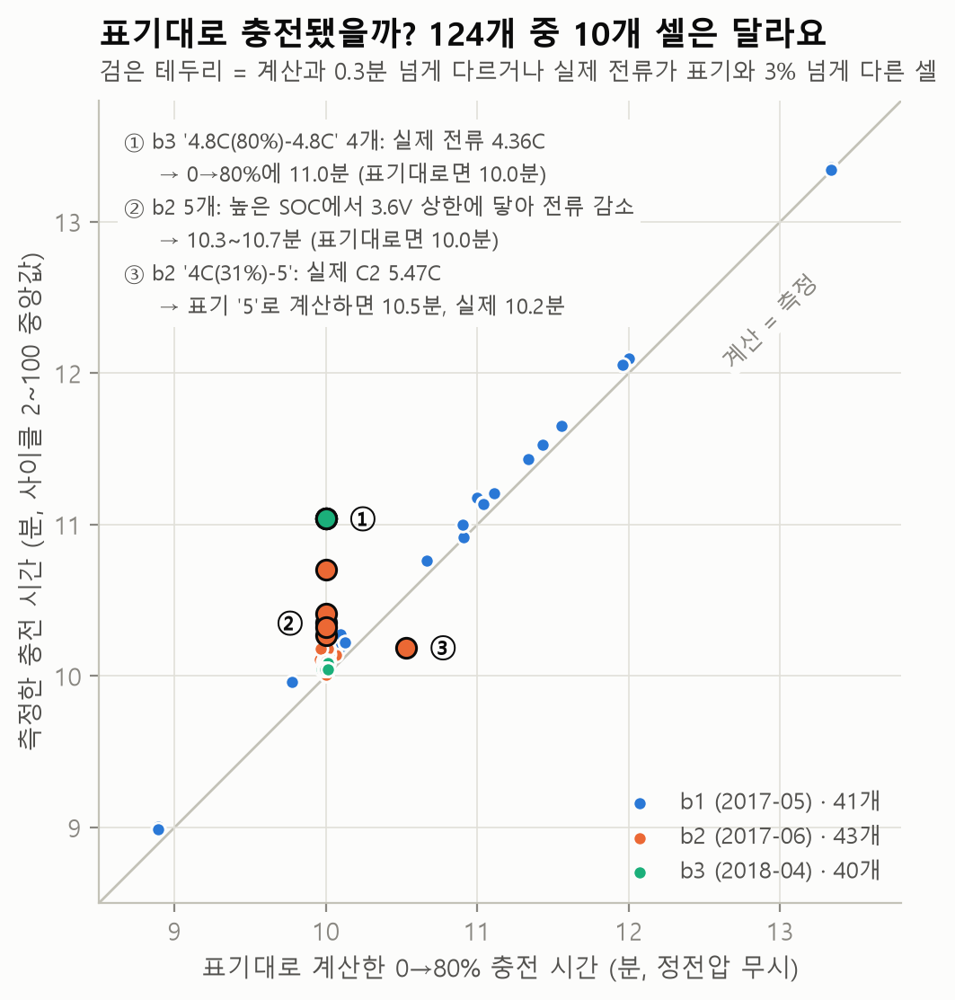
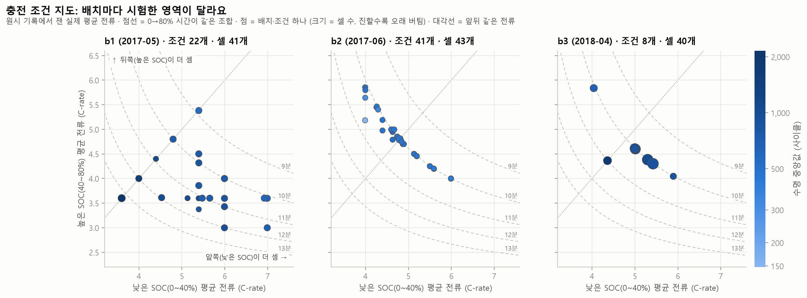
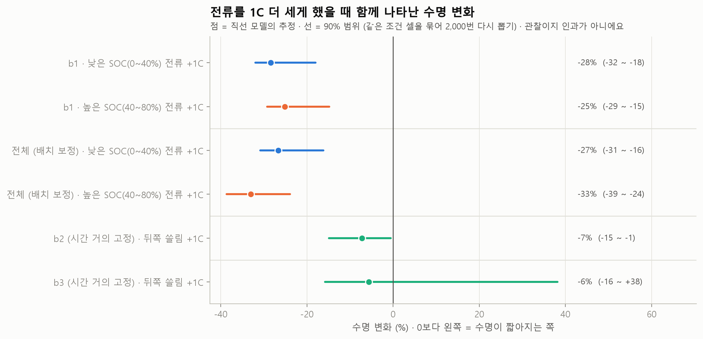
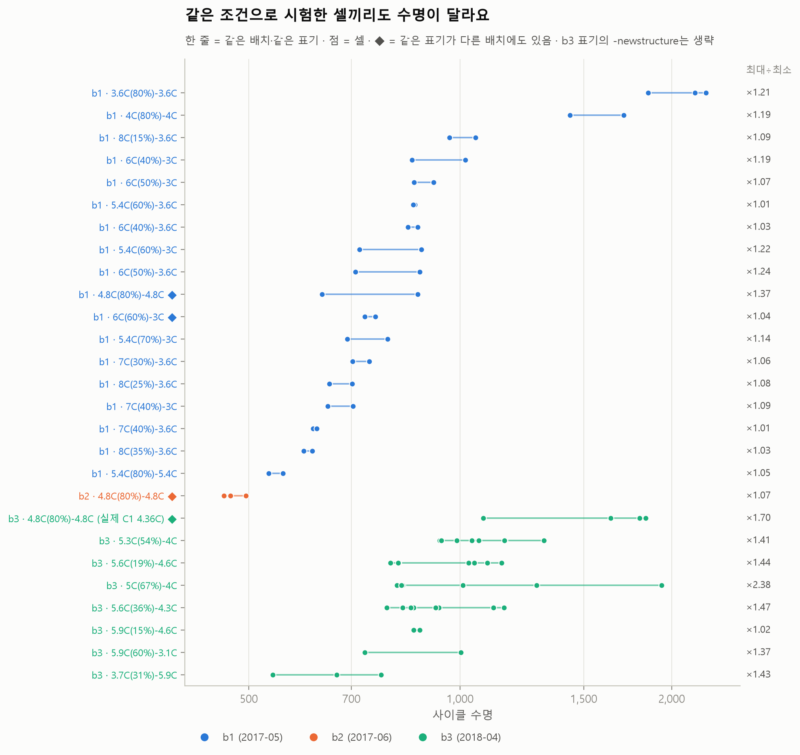
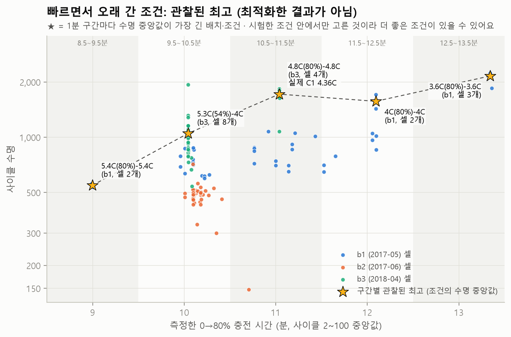

# 급속충전 조건과 수명: 빨리 충전하면 빨리 늙을까?

`python -m battery_lab.policies_report`가 자동으로 만든 문서예요 (만든 날 2026-10-22).
문서의 숫자는 모두 [policies.py](../battery_lab/policies.py)와 [policies_report.py](../battery_lab/policies_report.py)가 계산했어요.

## 질문

이 데이터의 124개 셀은 같은 모델의 셀을 같은 30°C 챔버에서, **급속충전 방식을 바꿔 가며** 시험했어요. 다만 배치(시험 시기)마다 시험한 조건 묶음과 시험 절차가 조금씩 달라요(결과 2). 충전 조건 표기는 69가지예요. 그래서 이렇게 물었어요. (SOC = 충전 상태. 0%는 빈 상태, 100%는 가득 찬 상태예요.)

1. 0→80% **충전 시간이 짧을수록 수명도 짧을까?**
2. 같은 시간이라도 **낮은 SOC(0\~40%)에서 세게** 넣는 것과 **높은 SOC(40\~80%)에서 세게** 넣는 것 중 어느 쪽이 짧은 수명과 더 함께 나타날까?
   (가설: 더 많이 찬 상태(높은 SOC)에서 센 전류를 넣으면 리튬이 흑연 안으로 다 못 들어가고 표면에 쌓이는 **리튬 석출**이 일어나기 쉽다고 알려져 있어요.)
3. **같은 조건으로 시험한 셀끼리는** 수명이 얼마나 비슷할까? 조건이 수명 차이를 얼마나 설명할까?
4. **빠르면서도 오래 간 조건**은 무엇이었을까? (시험한 조건 중 관찰된 최고)

## 왜 중요한가 (셀 개발·공정 개발 직무와 연결)

- **셀 개발:** "몇 분 만에 80%" 같은 급속충전 사양과 수명 보증은 서로 부딪쳐요. 같은 시간 안에서 **어느 SOC 구간의 전류를 줄여야 수명을 지키는지**가 충전 프로토콜(충전 순서·전류 설계)의 핵심이에요.
- **공정 개발:** 같은 조건으로 만든·시험한 셀끼리도 수명이 흔들려요(셀 간 편차. 만들 때의 산포가 원인 후보 중 하나예요). 조건 A가 B보다 낫다고 말하려면 **그 차이가 셀 간 편차보다 커야** 해요. 셀을 조건마다 몇 개씩 만들지(실험 계획, DOE)의 근거가 돼요.
- **데이터 다루기:** 시험 기록의 조건 표기가 실제와 다를 수 있어요. 이번에도 **원시 전류를 직접 재 보고서야** 표기와 다른 셀을 찾았어요.

## 방법

- **표기 읽기:** `C1(Q1%)-C2` = SOC 0→Q1%는 C1, Q1→80%는 C2로 충전, 80%부터는 모든 셀이 1C CC-CV(일정한 전류로 채우다가 3.6V에 닿으면 전압을 고정하고 마저 채움) (C-rate 1C = 1시간에 공칭 용량 1.1Ah를 채우는 전류).
  - 69가지 표기를 모두 읽었어요 (읽지 못한 표기 **0개**).
  - 3배치(b3) 40개 셀의 8가지 표기에는 끝에 `-newstructure`가 붙어 있어요. 따로 표시만 하고, 같은 표기 비교 때는 떼고 봐요. 이 표시는 b3 셀에만 있어서 **배치와 따로 떼어 볼 수 없어요.**
  - 끝의 C가 빠진 표기 1개(`4C(31%)-5`)는 숫자를 그대로 C-rate로 읽고 표시해 두었어요.
  - Q1이 80%인 6가지는 한 단계 충전(처음부터 80%까지 같은 전류)이에요.
- **계산한 시간:** (Q1 ÷ C1 + (80 − Q1) ÷ C2) ÷ 100 = 표기대로 0→80%에 걸리는 시간(h), ×60 하면 분. 예: `6C(40%)-3C`는 (40÷6 + 40÷3) ÷ 100 = 0.2시간 = 12분. 전압이 상한(3.6V)에 닿아 전류가 줄어드는 정전압 구간은 무시해요.
- **측정한 시간:** `summary.csv`의 충전 시간(chargetime)을 셀마다 사이클 2\~100에서 중앙값으로 냈어요. 시험이 멈췄던 사이클의 수백 분짜리 값에 흔들리지 않게 평균 대신 중앙값을 써요.
- **실제 전류:** 원시 기록(`raw/`)에서 사이클 2\~100 안의 사이클(셀 124개는 2개 사이클씩)을 골라, 충전 시작 뒤 넣은 용량 ÷ 1.1Ah로 SOC를 계산하고 SOC 40%·80%에 닿은 시각을 쟀어요. 80% 도달은 79.9%로 판정해요(시행착오 4). **낮은 SOC 평균 전류** = 0\~40% 폭 ÷ 걸린 시간, **높은 SOC 평균 전류** = 40\~80% 폭 ÷ 걸린 시간 (C-rate). **뒤쪽 쏠림** = 높은 SOC 평균 전류 − 낮은 SOC 평균 전류 (양수면 뒤쪽이 더 셈).
- **수명과 비교:** 수명은 log10으로 바꿔서 봐요 (수명이 148\~2,237사이클로 몇 배씩 퍼져 있어서 비율로 보는 게 자연스러워요).
  - 순위 상관(스피어만 ρ): 값 대신 순위로 계산해서 극단값 몇 개에 덜 흔들려요. −1\~+1.
  - 직선 모델: log10 수명 = a + b × 전류 (+ 여러 배치를 합칠 때는 **배치마다 다른 출발점**, 배치 보정). b를 "+1C마다 수명 몇 % 변화"로 바꿔 보여 줘요.
  - 90% 범위: 같은 조건(배치·표기)의 셀을 한 덩어리로 묶어 다시 뽑는 부트스트랩을 2,000번 (고정 시드 2026). 같은 조건 셀끼리는 닮아서, 셀을 하나하나 따로 뽑으면 범위가 실제보다 좁게 나와요.
- **반복 셀:** 같은 배치·같은 표기 셀이 2개 이상인 조건만 모아, 수명 차이 중 "어느 조건이냐"로 설명되는 몫(η², 에타 제곱)을 계산하고, 조건 이름을 무작위로 2,000번 섞었을 때의 값과 비교했어요 (섞어도 조건 수가 많으면 η²가 꽤 나와요).
- **관찰된 최고:** 측정한 충전 시간을 1분 구간(8.5\~13.5분)으로 나누고, 구간마다 **수명 중앙값이 가장 긴 배치·조건**을 골랐어요. 시험한 조건 중에서 고른 것이지 최적화한 결과가 아니에요.

## 결과

### 1. 표기대로 충전됐을까? (계산한 시간 vs 측정한 시간)

| 배치 | 셀 | 측정 − 계산 (중앙값) | 0.3분 넘게 다르거나 전류가 표기와 다른 셀 |
|---|---|---|---|
| b1 (2017-05) | 41 | +6초 | 0개 |
| b2 (2017-06) | 43 | +7초 | 6개 |
| b3 (2018-04) | 40 | +3초 | 4개 |

*점검: 원시 기록으로 잰 0→80% 시간과 summary의 충전 시간은 셀마다 최대 11초 차이 나고, 0.5분 넘게 다른 셀은 0개예요. 두 출처가 서로 맞아요.*

대부분은 계산과 측정이 수 초 안에서 맞아요. 다른 셀 **10개**는 원시 전류를 재 보니 이유가 3가지로 나뉘었어요.

| 이유 | 셀 | 표기 | 실제로 잰 전류 | 계산 → 측정 (분) | 실제 전류로 다시 계산 (분) |
|---|---|---|---|---|---|
| 3.6V 상한에 닿아 전류가 줄어듦 (정전압) | b2c0, b2c1, b2c13, b2c19, b2c23 | `1C(4%)-6C`, `2C(10%)-6C`, `4C(40%)-6C`, `4.4C(55%)-6C`, `4.65C(69%)-6C` | C2 5.26\~5.75C | 10.00 → 10.27\~10.70 | 10.17\~10.99 |
| 표기보다 센 전류 | b2c12 | `4C(31%)-5` | C2 5.47C | 10.53 → 10.19 | 10.02 |
| 표기보다 약한 전류 | b3c7, b3c10, b3c16, b3c45 | `4.8C(80%)-4.8C-newstructure` | C1 4.36C | 10.00 → 11.04 | 11.00 |

*3.6V 상한에 닿은 셀은 전압을 3.6V로 붙잡은 채 전류가 계속 줄어들어요(정전압). 그래서 '실제로 잰 전류'는 그 단계 가운데 구간의 중앙값일 뿐이고, 그 값으로 다시 계산한 시간도 대략적인 값이에요.*

→ **가장 중요한 발견:** b3의 `4.8C(80%)-4.8C-newstructure` 셀 4개는 실제로 **4.36C**로 충전됐어요. 표기 숫자(4.8)를 공칭 용량 숫자(1.1)로 나눈 값(4.36)과 같아서, 4.8C가 아니라 **4.8A로 설정된 것처럼 보여요** (추측이에요. 공식 설명에서 확인하지는 못했어요). 그래서 0→80%에 11.0분이 걸렸고, 이 셀들의 수명 중앙값은 1,720사이클이에요. 아래 분석에서는 표기 대신 **실제로 잰 전류**를 기본으로 써요.

### 2. 먼저 볼 함정: 배치마다 다른 실험이에요 (교란)

세 배치는 시험 시기가 다르고, **시험한 충전 조건의 종류도 달라요.** 그래서 배치 차이와 조건 차이가 섞여 있어요(교란, confounding).

| 배치 | 셀 | 표기 | 측정한 0→80% 시간 | 수명 중앙값 (범위) | 한 사이클 시간 (원시 기록 중앙값) |
|---|---|---|---|---|---|
| b1 (2017-05) | 41 | 22가지 | 9.0\~13.4분 | 842 (534\~2,237) | 52분 |
| b2 (2017-06) | 43 | 41가지 | 10.0\~10.7분 | 481 (148\~713) | 60분 |
| b3 (2018-04) | 40 | 8가지 | 10.0\~11.0분 | 964 (541\~1,935) | 46분 |

같은 표기가 여러 배치에 있는 경우만 따로 보면:

| 표기 (`-newstructure` 뗌) | 배치 | 셀 | 수명 중앙값 (범위) | 실제 C1 | 측정한 시간 |
|---|---|---|---|---|---|
| `4.8C(80%)-4.8C` | b1 | 2 | 753 (636\~870) | 4.80C | 10.01분 |
| `4.8C(80%)-4.8C` | b2 | 3 | 471 (461\~495) | 4.80C | 10.01분 |
| `4.8C(80%)-4.8C` | b3 | 4 | 1,720 (1,078\~1,836) | 4.36C | 11.04분 |
| `6C(60%)-3C` | b1 | 2 | 744 (731\~757) | 6.00C | 10.10분 |
| `6C(60%)-3C` | b2 | 1 | 713 (713\~713) | 6.00C | 10.10분 |

→ `4.8C(80%)-4.8C`: 실제 전류까지 같은 b1·b2끼리 b1 753 vs b2 471(×1.60); `6C(60%)-3C`: 실제 전류까지 같은 b1·b2끼리 b1 744 vs b2 713(×1.04). 같은 표기·같은 실제 전류인데도 배치에 따라 수명이 크게 다르기도, 거의 같기도 해요. **배치 차이가 일정하지 않아서 "배치 효과를 빼면 된다"고 단순하게 말할 수 없어요.** (다만 비교할 수 있는 표기가 2가지뿐이고 셀도 1\~4개씩이라 근거는 적어요.)

### 3. 충전 시간과 수명

| 범위 | 셀 | 측정한 시간 범위 | 시간과 log 수명의 순위 상관 ρ |
|---|---|---|---|
| 전체 | 124 | 9.0\~13.4분 | -0.02 |
| b1 (2017-05) | 41 | 9.0\~13.4분 | +0.63 |
| b2 (2017-06) | 43 | 10.0\~10.7분 | +0.03 |
| b3 (2018-04) | 40 | 10.0\~11.0분 | +0.11 |

→ 전체로 보면 ρ = -0.02로 **관계가 거의 안 보여요.** 그런데 충전 시간을 실제로 바꿔 가며 시험한 b1 안에서는 ρ = **+0.63**으로, 충전이 느린 조건일수록 수명이 긴 경향이 뚜렷해요. b2·b3는 셀 94%가 측정 시간 10.0\~10.4분 안에 몰려 있어 시간 차이가 작고, 대신 배치끼리 수명 수준이 달라서 합치면 경향이 묻혀요.

### 4. 낮은 SOC 전류 vs 높은 SOC 전류

b2·b3처럼 0→80% 시간이 거의 고정이면(셀 94%가 10.0\~10.4분) 한쪽을 세게 할수록 다른 쪽은 약해져요(지도의 점선 위를 움직임). 그래서 b2·b3는 **뒤쪽 쏠림** 하나로, 시간이 함께 바뀐 b1과 전체는 두 전류를 함께 넣은 모델로 봤어요.

| 모델 | 셀 (조건) | 항목 | +1C마다 수명 변화 | 90% 범위 | 판단 | 표기 전류로 다시 하면 | R² |
|---|---|---|---|---|---|---|---|
| b1 | 41 (22) | 낮은 SOC(0\~40%) 전류 +1C | **-28.4%** | -32 \~ -18% | 범위가 0을 포함하지 않음 | -28.3% (-32 \~ -18%) | 0.80 |
| b1 | 41 (22) | 높은 SOC(40\~80%) 전류 +1C | **-25.1%** | -29 \~ -15% | 범위가 0을 포함하지 않음 | -25.0% (-29 \~ -15%) | 0.80 |
| 전체 (배치 보정) | 124 (71) | 낮은 SOC(0\~40%) 전류 +1C | **-26.6%** | -31 \~ -16% | 범위가 0을 포함하지 않음 | -27.6% (-31 \~ -19%) | 0.78 |
| 전체 (배치 보정) | 124 (71) | 높은 SOC(40\~80%) 전류 +1C | **-33.0%** | -39 \~ -24% | 범위가 0을 포함하지 않음 | -33.2% (-40 \~ -24%) | 0.78 |
| b2 (시간 거의 고정) | 43 (41) | 뒤쪽 쏠림 +1C | **-7.2%** | -15 \~ -1% | 범위가 0을 포함하지 않음 | -8.5% (-17 \~ -1%) | 0.11 |
| b3 (시간 거의 고정) | 40 (8) | 뒤쪽 쏠림 +1C | **-5.7%** | -16 \~ +38% | 범위가 0을 포함 → 방향을 확신할 수 없음 | -5.7% (-15 \~ +38%) | 0.03 |

*R²: 수명(log) 차이 중 이 모델이 설명하는 몫 (0\~1). 전체 모델의 R²에는 배치마다 다른 출발점이 설명한 몫도 들어 있어요.*

두 전류를 함께 넣은 모델에서 "높은 SOC 전류의 기울기가 낮은 SOC 전류보다 더 나쁜(더 음수인)" 경우의 비율 (부트스트랩 다시 뽑기 중):

| 모델 | 높은 SOC 쪽이 더 나쁘게 나온 비율 | 높은 SOC +1C가 낮은 SOC +1C보다 수명을 더 바꾸는 정도 | 90% 범위 |
|---|---|---|---|
| b1 | 11% | +4.6% | -1.6 \~ +14.1% |
| 전체 (배치 보정) | 96% | -8.7% | -16.1 \~ -0.7% |

b2 안의 순위 상관은 뒤쪽 쏠림과 log 수명 사이 ρ = -0.08이에요. 직선 모델의 기울기(-7.2%)는 b2에서 수명이 가장 짧은 두 셀(`2C(10%)-6C` 148사이클, 뒤쪽 쏠림 +1.2C, `1C(4%)-6C` 300사이클, 뒤쪽 쏠림 +1.6C)에 크게 기대요. 이 두 셀만 빼고 다시 맞추면(민감도 점검) b2 기울기는 -1.9% (-6 \~ +2%), 전체(배치 보정) 모델의 '높은 SOC +1C가 낮은 SOC +1C보다 수명을 더 바꾸는 정도'는 -5.2% (-11.3 \~ +2.7%)이고, 둘 다 범위가 0을 포함해요.

### 5. 같은 조건 반복 셀: 조건 안 차이 vs 조건 사이 차이

| 범위 | 셀 (조건) | η² (조건으로 설명되는 몫) | 조건 이름을 섞었을 때 η² 평균 (섞은 결과의 95%가 이 값 이하) | 조건 안 흔들림 | 조건 평균끼리의 흔들림 |
|---|---|---|---|---|---|
| 전체 (배치·표기 조건) | 80 (27) | **0.84** | 0.33 (0.46) | ±18% | ±38% |
| b1 (2017-05) 안 | 37 (18) | **0.96** | 0.47 (0.68) | ±10% | ±39% |
| b3 (2018-04) 안 | 40 (8) | **0.55** | 0.18 (0.33) | ±22% | ±28% |

*흔들림 = log10 수명의 표준편차를 %로 바꾼 값. 같은 셀 수에서 배치만 알 때 η²는 0.19예요. b2는 반복 조건이 1개(셀 3개)뿐이라 배치 안 η²는 계산하지 않고 전체에만 넣었어요.*

→ 같은 조건 셀의 최대÷최소는 중앙값 ×1.14, 가장 큰 조건은 `b3 · 5C(67%)-4C-newstructure`(셀 6개, 813\~1,935사이클, ×2.38)예요.

### 6. 빠르면서 오래 간 조건 (관찰된 최고, 최적화한 결과가 아님)

| 측정한 충전 시간 | 조건 수 (셀) | 들어 있는 배치 | 수명 중앙값이 가장 긴 조건 | 그 조건의 수명 중앙값 (셀 수) | 구간 안 셀 하나의 최고 | 이 시간까지 본 최고 |
|---|---|---|---|---|---|---|
| 8.5\~9.5분 | 1 (2) | b1 | `b1 · 5.4C(80%)-5.4C` | 546 (2개) | 559 | 546 |
| 9.5\~10.5분 | 54 (92) | b1 b2 b3 | `b3 · 5.3C(54%)-4C-newstructure` | 1,051 (8개) | 1,935 | 1,051 |
| 10.5\~11.5분 | 10 (18) | b1 b2 b3 | `b3 · 4.8C(80%)-4.8C-newstructure` | 1,720 (4개) | 1,836 | 1,720 |
| 11.5\~12.5분 | 5 (9) | b1 | `b1 · 4C(80%)-4C` | 1,572 (2개) | 1,709 | 1,720 |
| 12.5\~13.5분 | 1 (3) | b1 | `b1 · 3.6C(80%)-3.6C` | 2,160 (3개) | 2,237 | 2,160 |

*이 시간까지 본 최고 = 이 구간과 더 빠른 구간들에서 본 '조건 수명 중앙값' 가운데 가장 긴 값이에요(셀 하나의 값이 아니에요).*

## 읽는 법 (숫자는 코드가 계산)

1. **표기를 믿기 전에 실제를 재요.** 124개 중 10개 셀은 표기와 실제 충전이 달랐어요. 특히 b3의 `4.8C(80%)-4.8C-newstructure` 셀은 표기보다 약한 전류로 충전됐는데, 표기만 보면 "이 전류로도 오래 간다"는 잘못된 결론을 낼 수 있었어요.
2. **충전이 느린 조건일수록 수명이 긴 경향은 충전 시간을 실제로 바꿔 시험한 b1 안에서 보여요** (ρ = +0.63). 전체로 합치면 ρ = -0.02로 사라져요. 배치를 섞어 보면 배치 안의 경향이 숨을 수 있어요.
3. **두 구간 모두 센 전류와 짧은 수명이 함께 나타나요.** 전체(배치 보정) 모델에서 +1C마다 낮은 SOC -27% (-31 \~ -16%), 높은 SOC -33% (-39 \~ -24%). b1만 보면 낮은 SOC -28% (-32 \~ -18%), 높은 SOC -25% (-29 \~ -15%)예요.
4. **"높은 SOC 전류가 더 해롭다"는 가설: 배치를 합친 모델에서는 보이지만, 배치 안에서는 일관되지 않아요.** 전체(배치 보정) 모델에서 높은 SOC 쪽이 더 나쁘게 나온 비율은 96%, 높은 SOC +1C가 낮은 SOC +1C보다 수명을 -8.7% 더 바꾸고 90% 범위는 -16.1 \~ -0.7%로 0을 포함하지 않아요. 그런데 b1만 보면 그 비율이 11%(차이 +4.6%, 범위 -1.6 \~ +14.1%)로 오히려 반대 방향이에요 (범위가 0을 포함해 확실하지는 않아요). 시간이 거의 고정된 b2에서는 직선 기울기가 뒤쪽 쏠림 +1C마다 -7.2%이지만 순위 상관은 ρ = -0.08로 거의 0이라, 수명이 아주 짧은 몇 개 셀이 만든 기울기로 보여요 (가장 짧은 2셀을 빼면 -1.9%). 합친 모델은 배치마다 다른 경향을 기울기 하나로 묶은 결과이고, b2의 2셀을 빼면 차이가 -5.2% (-11.3 \~ +2.7%)로 범위가 0을 포함해요. 그래서 가설 쪽으로 기우는 관찰은 있지만 확인됐다고 말하기는 일러요.
5. **조건이 수명 차이를 크게 설명하지만, 셀 간 편차도 작지 않아요.** 반복 셀에서 η² = 0.84 (이름을 섞으면 평균 0.33)예요. 조건 안 흔들림은 b1 ±10%, b3 ±22%라서, 셀 1개짜리 조건끼리 그 정도 차이는 우연일 수 있어요.
6. **관찰된 최고 중 일부 시간 구간은 b3 조건이 차지해요.** 9.5\~10.5분: b3 `5.3C(54%)-4C` 1,051 vs b1·b2 최고 `b1 · 5.4C(60%)-3.6C` 860 / 10.5\~11.5분: b3 `4.8C(80%)-4.8C` 1,720 vs b1·b2 최고 `b1 · 4.4C(80%)-4.4C` 1,074. 조건이 좋아서인지 b3에서 시험해서인지는 구분할 수 없어요. 새 충전 조건을 고른다면 이 목록은 "다시 시험해 볼 후보"이지 정답이 아니에요.

## 한계

- **관찰 데이터예요.** 충전 조건을 무작위로 셀에 배정한 실험이 아니라, 배치(시험 시기)마다 다른 조건 묶음을 시험했어요. 그래서 "이 조건 때문에 수명이 짧다"가 아니라 "이 조건과 짧은 수명이 함께 나타났다"까지만 말할 수 있어요.
- **`-newstructure`와 b3는 떼어 볼 수 없어요.** 이 표시가 붙은 셀은 모두 b3라서, 표시가 뜻하는 차이와 배치 차이를 구분할 수 없어요. 원시 기록에서 b3는 한 사이클 시간이 더 짧다는 것까지는 확인했지만, `newstructure`의 정확한 뜻은 확인하지 못했어요.
- **조건마다 셀이 적어요.** b2는 거의 조건마다 셀 1개라, 조건 안 흔들림보다 작은 차이는 우연과 구별할 수 없어요.
- **실제 전류는 원시 기록이 남은 일부 사이클(셀마다 2개)로만 쟀어요.** 셀이 늙으면서 3.6V 상한에 더 일찍 닿는 변화는 반영하지 않았어요.
- **직선 모델은 단순한 가정이에요.** "+1C마다 몇 %"는 시험한 전류 범위 안에서의 평균적인 기울기일 뿐이고, 그 밖으로 늘려 쓰면 안 돼요.
- **원인(리튬 석출 등)은 이 데이터로 직접 확인할 수 없어요.** 수명 숫자만 봤기 때문에, 석출 이야기는 가설로만 남겨요. 급속충전 때의 발열 차이도 교란일 수 있지만, 온도 센서(캔 표면 열전대)는 공식적으로 믿기 어려워서 쓰지 않았어요.
- b1에서 수명이 가장 긴 셀 5개(b1c0\~b1c4, `3.6C(80%)-3.6C`·`4C(80%)-4C` 셀 전부)는 1배치 기록이 끝날 때 아직 수명이 남아 있어서, 1,177\~1,227사이클부터 2배치 기간에 이어서 시험했어요. 그래서 결과 6의 11.5\~13.5분 "관찰된 최고"와 읽는 법 2의 b1 경향에 들어간 가장 긴 수명들은 중간에 쉬는 기간을 사이에 두고 이어 간 수명이에요 (이어 붙인 지점의 용량 변화 -1.4\~+0.1%, [데이터 품질](data_quality.md#이어-붙인-셀-5개의-이음매)).

## 시행착오

이번 작업에서 실제로 틀렸다가 고친 것들이에요. 형식: 상황 → 처음 생각 → 어떻게 알아챘나 → 원인 → 수정 → 재발 방지.

1. **조건 표기 = 실제 전류라고 짐작함**
   - 상황: 처음 계획은 표기(C1, C2)만으로 "낮은 SOC vs 높은 SOC 전류"를 비교하는 것이었어요.
   - 처음 생각: 표기대로 충전됐을 것이다.
   - 어떻게 알아챘나: 계산한 시간과 측정한 시간을 맞춰 보니 b3 `4.8C(80%)-4.8C-newstructure` 셀 4개만 약 1.0분 길었어요. 같은 표기의 b1·b2 셀은 차이가 없었어요.
   - 원인: 원시 전류를 재 보니 실제로는 4.36C였어요. 그 밖에도 높은 SOC에서 3.6V 상한에 닿아 전류가 줄어든 셀과, 표기 끝의 C가 빠진 셀에서 실제 전류가 표기와 달랐어요.
   - 수정: 원시 기록으로 실제 평균 전류를 재서 분석의 기본으로 쓰고, 표기 전류로 한 결과는 비교용으로 함께 실었어요.
   - 재발 방지: 조건 표기를 변수로 쓰기 전에, 표본 하나가 아니라 전체 셀의 원시 데이터로 확인해요.
2. **80% 뒤 쉬는 시간 재기가 거의 0분과 몇 분으로 갈림 (탐색 단계, 결과에는 안 씀)**
   - 상황: 배치끼리 시험 순서가 어떻게 다른지 보려고, SOC 80%에 닿은 뒤 다음 충전이 시작될 때까지 쉬는 시간을 재 봤어요.
   - 처음 생각: SOC가 80% 바로 아래 문턱(79.95%)을 넘은 첫 점 = 급속충전이 끝난 점.
   - 어떻게 알아챘나: 같은 셀의 사이클끼리 값이 거의 0분과 몇 분으로 갈렸어요.
   - 원인: 문턱을 넘은 첫 점이 아직 급속충전 중일 때가 있어서, 바로 다음 점(여전히 센 전류)을 "다시 충전 시작"으로 셌어요.
   - 수정: 이 측정은 버리고, 배치 비교에는 한 사이클 전체 시간만 썼어요.
   - 재발 방지: 문턱값으로 사건을 찾을 때는 문턱 바로 앞뒤 점의 전류를 같이 출력해 확인해요.
3. **부트스트랩 범위가 비어 나옴 (코드 버그)**
   - 상황: 전체(배치 보정) 모델의 90% 범위가 숫자 없이 비어 나왔어요.
   - 처음 생각: 배치별로 조건 덩어리를 나눠 다시 뽑으면 된다.
   - 어떻게 알아챘나: 다시 뽑기 2,000번 중 실제로 쓰인 것이 한 번도 없었어요. 배치 하나만 쓴 모델은 정상이었어요.
   - 원인: 배치별로 잘라 낸 작은 표에서 줄 번호를 가져와서, b2·b3 셀 자리에 b1 셀이 뽑혔어요. 그 결과 배치 표시 열이 모두 0이 돼 기울기를 계산할 수 없었어요.
   - 수정: 줄 번호를 전체 표 기준으로 가져오도록 고쳤고, 여러 배치를 섞어도 범위가 나오는지 확인하는 테스트를 넣었어요.
   - 재발 방지: 다시 뽑기 결과에 "실제로 쓰인 횟수"를 함께 남기고, 0이면 바로 의심해요.
4. **SOC 80% 도달을 '80.00% 이상'으로 잡음**
   - 상황: 원시 기록에서 SOC 40%·80%에 닿은 시각으로 구간 평균 전류를 계산했어요.
   - 처음 생각: 급속충전은 80%를 넘긴 순간 끝나니, 80.00% 이상인 첫 점을 찾으면 된다.
   - 어떻게 알아챘나: 충전 조건 지도에서 b2 점 하나(b2c5, `3.6C(2%)-4.85C`)가 같은 시간 곡선에서 혼자 멀리 떨어져 있었어요. 높은 SOC 평균 전류가 표기보다 한참 낮게 나왔는데, 그 셀의 summary 충전 시간은 정상이었어요.
   - 원인: 그 셀의 한 사이클은 급속충전이 80%를 아주 조금 넘긴 지점에서 끝났어요. 그런데 SOC를 '충전 첫 점 이후 넣은 용량'으로 계산하면서 첫 점에 이미 쌓여 있던 아주 작은 용량을 빼는 바람에 끝이 80%에 살짝 못 미쳤고, 80%에는 쉬는 시간이 지나 1C 충전이 시작돼서야 닿았어요. 쉬는 시간이 급속충전 시간에 들어간 거예요.
   - 수정: '닿음'의 기준을 79.9%로 바꾸고(나머지 0.1%p는 센 전류로 1초 안팎, 셀마다 0.6\~1.2초), 원시 기록으로 잰 시간과 summary 충전 시간이 0.5분 넘게 다른 셀을 세는 점검을 넣었어요 (고친 뒤 0개).
   - 재발 방지: 그래프에서 혼자 튀는 점은 데이터보다 계산 코드를 먼저 의심하고, 같은 값을 두 출처(원시 기록·summary)로 맞춰 봐요.
5. **근거 숫자 없이 쓴 주장 (검증 단계에서 발견)**
   - 상황: 구현을 마친 뒤 다른 에이전트가 문서의 숫자를 모듈 함수 없이 따로 짠 스크립트로 다시 계산하고, 문장과 숫자를 하나씩 대조했어요.
   - 처음 생각: b2의 직선 기울기(뒤쪽 쏠림 +1C마다 -7.2%)는 수명이 가장 짧은 셀 몇 개에 크게 기대고, 합친 모델의 신호도 몇 개 셀에 기댄다. (숫자 없이 문서에 이렇게 단정해 적었어요.)
   - 어떻게 알아챘나: 다시 계산한 숫자는 모두 문서와 맞았어요. 하지만 위 주장을 보여 주는 숫자가 문서 어디에도 없었어요. 또 읽는 법 4번은 그 원인을 '배치 사이 차이(교란)'라고 썼는데, 합친 모델에는 배치 보정(배치마다 다른 출발점)이 이미 들어 있었어요.
   - 원인: 주장을 확인하는 계산(그 셀들을 빼고 다시 맞추기)을 하지 않고 문장만 썼어요.
   - 수정: b2에서 수명이 가장 짧은 2셀(b2c1, b2c0)을 빼고 다시 맞추는 민감도 점검을 코드에 넣고 결과 4절에 실었어요. 빼면 b2 기울기는 -7.2% → -1.9% (-6 \~ +2%), 합친 모델의 '높은 SOC +1C가 낮은 SOC +1C보다 수명을 더 바꾸는 정도'는 -8.7% → -5.2% (-11.3 \~ +2.7%)로 둘 다 범위가 0을 포함해요. 주장 자체는 맞았지만 근거가 빠져 있었던 거예요. 읽는 법 4번의 원인은 '배치마다 다른 경향을 기울기 하나로 묶은 결과'로 고치고, 단정한 문장은 '\~로 보여요'로 낮췄어요. 같은 검증에서 계산식 문장의 단위 실수(÷100이 빠짐, 코드는 맞았음), 근거보다 센 표현(리튬 석출을 단정함 등), 설명이 빠진 표 칸과 각주도 함께 고쳤어요.
   - 재발 방지: "몇 개 셀에 기댄다" 같은 주장에는 그걸 보여 주는 숫자(빼고 다시 맞춘 결과 등)를 코드가 계산해 바로 옆에 붙여요. 문서를 만든 사람이 아닌 다른 눈으로 문장과 숫자를 다시 대조해요.

데이터 출처: https://data.matr.io/1/projects/5c48dd2bc625d700019f3204 (CC BY 4.0). 더 해 볼 만한 응용은 [응용 아이디어](ideas.md)에 있어요.
