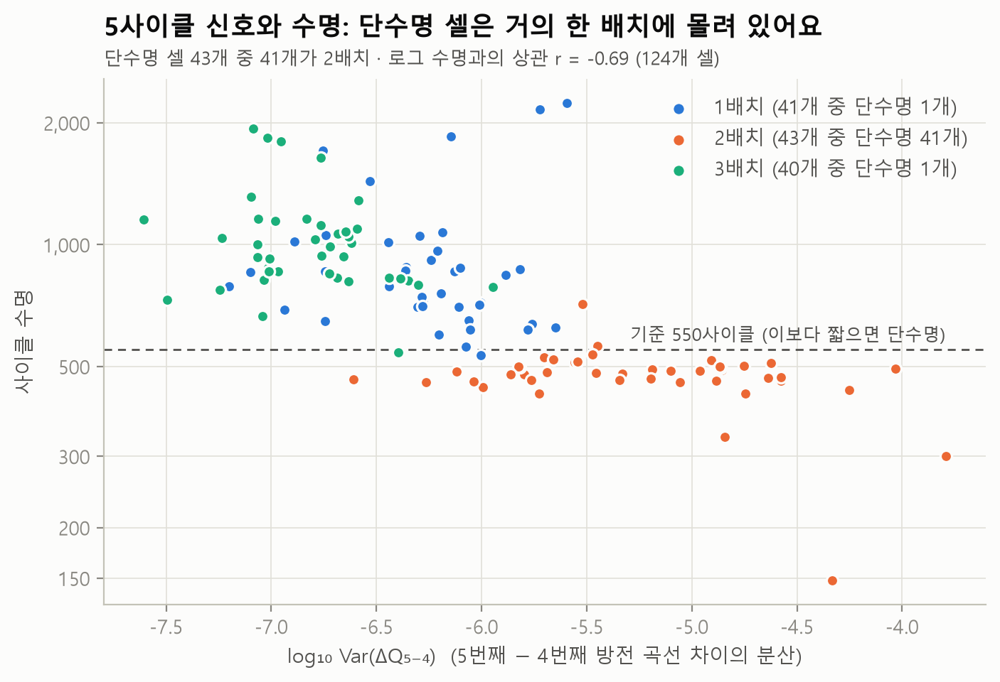
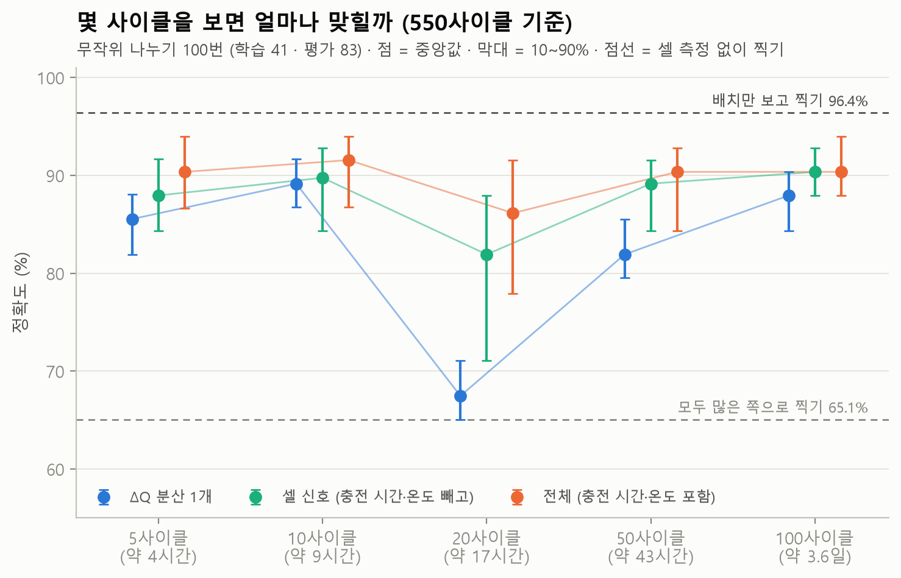
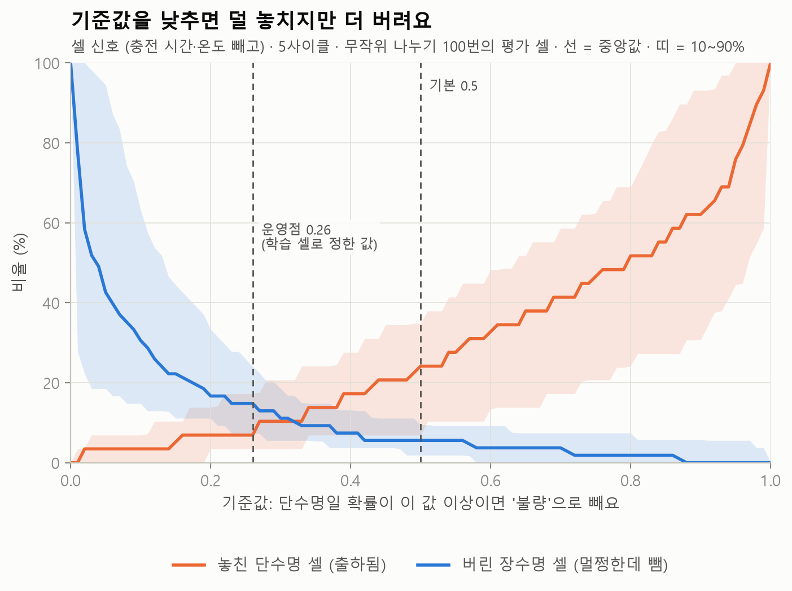
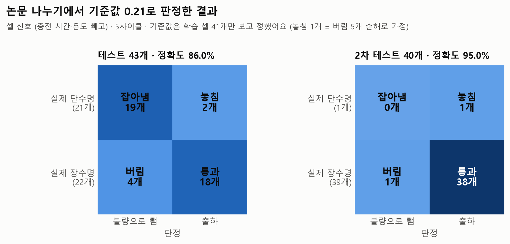

# 5사이클로 수명이 짧을 셀 골라내기 (분류)

`.venv\Scripts\python.exe -m battery_lab.screening_report`가 자동으로 만든 문서예요 (만든 날 2026-10-22).

## 질문

첫 **5사이클**만 보고 "수명이 550사이클도 안 될 셀"(단수명 셀)을 골라낼 수 있을까요?
그리고 10·20·50·100사이클까지 기다리면 얼마나 더 잘 맞힐까요?

논문(Severson 외, 2019)은 첫 5사이클로 셀을 두 그룹으로 나눠 테스트 오차를 **4.9%로** 보고했어요.
두 그룹을 가르는 기준 수명은 [저자가 올린 논문 PDF](https://web.mit.edu/braatzgroup/Severson_NatureEnergy_2019.pdf)의 Table 2와
[보충 자료](https://static-content.springer.com/esm/art%3A10.1038%2Fs41560-019-0356-8/MediaObjects/41560_2019_356_MOESM1_ESM.pdf)의 Supplementary Note 4에서 직접 확인했어요 → **550사이클**.

## 왜 중요한가 (셀 개발·공정 개발 직무와 연결)

- 이 데이터에서 사이클 하나는 중앙값 **52분**이에요(원시 기록이 있는 100사이클 이내 사이클로 측정). 5사이클은 약 4시간, 100사이클은 약 3.6일이에요. 수명이 긴 셀은 끝까지 시험하는 데 몇 달이 걸려요.
- **공정·품질:** 셀을 만든 뒤 화성(첫 충방전으로 전극 표면 막을 만드는 공정)·에이징(보관하며 안정시키는 공정) 직후의
  아주 짧은 데이터로 '오래 못 갈 셀'을 미리 빼면, 출하 뒤 불량과 긴 검사 시간을 줄일 수 있어요.
  이때 핵심은 정확도 하나가 아니라 **놓친 불량(출하된 단수명 셀)과 버린 정상 셀 사이의 균형**이에요.
- **셀 개발:** 새 소재·충전 조건을 평가할 때 몇 시간 만에 '가망 없는 후보'를 거를 수 있다면 시험 기간을 크게 줄일 수 있어요. 이 데이터에서 정말 그게 되는지가 이 문서의 질문이에요.
- **주의할 점:** 이 데이터는 공장 셀 선별 데이터가 아니라 **충전 조건을 일부러 바꿔 가며 시험한 연구 데이터**예요. 그래서 '셀 하나하나의 차이'를 읽은 것인지, '어느 시험 묶음·조건이었는지'를 읽은 것인지 따로 확인해야 해요(결과 1·6).

## 방법

- **나누는 기준:** 수명 < 550사이클이면 단수명, 아니면 장수명. 124개 중 단수명은 **43개**예요. 기준을 700사이클로 바꾼 결과도 함께 봤어요(논문 보충 자료도 700을 함께 봤어요).
- **특징 (n사이클까지의 데이터만, n보다 뒤는 절대 안 써요)** — [screening.py](../battery_lab/screening.py)

| 특징 | 뜻 |
|---|---|
| log 분산 ΔQ | log₁₀ Var(ΔQ(V)). ΔQ = n번째 − 기준 사이클의 방전 곡선(전압마다 방전 용량). 기준은 n ≤ 10이면 바로 앞 사이클(5사이클이면 ΔQ₅₋₄, 논문과 같음), n > 10이면 10번째 |
| log \|최솟값 ΔQ\| | ΔQ 곡선의 가장 낮은 값의 크기 (log) |
| 2번째 용량 · 용량 증가분 | 2번째 사이클 방전 용량, 2\~n사이클 최대 용량 − 2번째 용량 (1배치는 1번째 사이클 기록이 없어 모두 2번째부터) |
| 내부저항 3개 | 2번째 사이클 값, 2\~n 중 최솟값, n번째 − 2번째 |
| 충전 시간 | 2\~5사이클 평균. 이 데이터에서는 **충전 조건(실험 설정)을 거의 그대로 담아요** |
| 온도 3개 | 2\~n사이클 캔 표면 온도의 평균·최고·최저. 공식 설명상 **믿기 어려운 측정**(센서가 떨어진 셀이 있음)이에요 |

  두 곡선 중 하나라도 깨끗하지 않으면(품질 점검 기준) 두 곡선을 함께 1\~2사이클 **앞으로** 옮겨 써요. 이번 데이터에서는 그럴 일이 없었어요(옮긴 곳 0곳, 비어 있는 특징 0개).
- **모델 (로지스틱 회귀 = '단수명일 확률'을 내는 직선 모델, 특징은 표준화 = 평균 0·표준편차 1로 맞춤)**
  - **ΔQ 분산 1개:** 논문의 'variance classifier'와 같은 형태. 약한 L2 규제(계수가 너무 커지지 않게 누름).
  - **셀 신호 (충전 시간·온도 빼고):** ΔQ 2개 + 용량 2개 + 내부저항 3개. L1 규제(쓸모없는 특징의 계수를 0으로 만듦), 세기는 학습 셀 안 5겹 교차 검증으로 골라요.
  - **전체 (충전 시간·온도 포함):** 위 7개 + 충전 시간 + 온도 3개. 논문의 'full classifier'(L1 규제, 후보 18개 중 4개 선택)를 참고했지만 특징이 똑같지는 않아요. 특히 논문이 가장 크게 쓴 '온도 적분(시간에 대해 온도를 더한 값)'은 사이클별 시간 기록이 없어 평균 온도로 대신했어요.
- **비교 기준 (셀을 측정하지 않고 찍기)**
  - **모두 많은 쪽으로 찍기:** 학습 셀에서 더 많은 쪽으로 모두 판정
  - **배치만 보고 찍기:** 배치(1·2·3배치 = 시험 시기가 다른 세 묶음)마다 학습 셀에서 더 많은 쪽으로 판정. 셀은 전혀 보지 않아요.
- **평가**
  1. 논문 나누기: 학습 41 · 테스트 43 · 2차 테스트 40 (논문 보충 자료는 39 · 41 · 40개를 썼다고 적었어요. 4개 차이의 이유는 확인하지 못했어요. 보충 자료 Table 4·6의 칸을 직접 더하면 학습 셀이 38개로 나와서, 논문 안에서도 셀 수가 조금 어긋나요).
  2. 무작위 나누기: 124개를 학습 41 / 평가 83으로 100번 나눠요. 단수명 비율은 매번 같게 맞추고, **반복마다 같은 나누기를 모든 사이클 수·모델에 써서** 차이가 나누기 운이 아니라 사이클 수·모델 차이에서 오게 했어요 (고정 시드 2026).
- **운영점(실제로 쓸 기준값) 정하기:** 기본은 '단수명일 확률 ≥ 0.5면 뺀다'예요. 공정에서는 놓친 불량이 더 비싸서, **놓친 단수명 1개 = 버린 장수명 5개 손해**라고 가정했어요(우리가 정한 값). 학습 셀만으로(5겹 교차 검증 확률) 손해가 가장 작은 기준값을 고르고, 평가 셀에는 그 값을 그대로 써요.
  운영점 모델은 **셀 신호 (충전 시간·온도 빼고)** 모델로 정했어요. 공장에서는 모든 셀을 같은 조건으로 충전하니 '충전 조건 차이'를 담은 충전 시간 특징은 쓸 수 없고, 온도는 믿기 어려운 측정이라서예요.

## 결과

### 1. 먼저 볼 것: 단수명 셀 43개 중 41개가 2배치예요

| 배치 | 셀 | 단수명 셀 | 수명 최소 | 수명 중앙값 | 수명 최대 |
|---|---|---|---|---|---|
| b1 | 41 | **1** | 534 | 842 | 2,237 |
| b2 | 43 | **41** | 148 | 481 | 713 |
| b3 | 40 | **1** | 541 | 964 | 1,935 |

→ 550사이클 기준에서는 '단수명인가'가 거의 '2배치인가'와 같아요. 셀을 전혀 측정하지 않고 "2배치면 단수명"이라고만 해도 124개 중 **4개만 틀려요** (96.8%).
배치는 시험 시기뿐 아니라 시험한 충전 조건의 종류도 달라서, 이 차이가 셀 때문인지 시험 환경·조건 때문인지 이 데이터만으로는 가를 수 없어요 ([충전 조건 실험](policies.md)에서도 같은 함정을 다뤘어요).

충전 조건 이름이 똑같은데 배치만 다른 셀들:

| 충전 조건 | 배치 | 셀 | 수명 범위 |
|---|---|---|---|
| `4.8C(80%)-4.8C` | b1 | 2 | 636 \~ 870 |
| `4.8C(80%)-4.8C` | b2 | 3 | 461 \~ 495 |
| `6C(60%)-3C` | b1 | 2 | 731 \~ 757 |
| `6C(60%)-3C` | b2 | 1 | 713 |

→ 같은 조건 이름에서도 2배치 쪽 수명이 같거나 짧게 관찰돼요. 원인(시험 환경, 셀 생산 묶음 등)은 이 데이터로는 알 수 없는 가설이에요.

### 2. 논문 나누기 (5사이클, 기준값 0.5)

| 모델 | 학습 | 테스트 | 2차 테스트 | 테스트 합계 |
|---|---|---|---|---|
| ΔQ 분산 1개 | 85.4% | 79.1% | 97.5% | 88.0% |
| 셀 신호 (충전 시간·온도 빼고) | 100.0% | 86.0% | 95.0% | 90.4% |
| 전체 (충전 시간·온도 포함) | 100.0% | 88.4% | 95.0% | 91.6% |
| 참고: 모두 장수명이라고 찍기 | 48.8% | 51.2% | 97.5% | 73.5% |
| 논문 variance classifier (셀 39·41·40개) | 82.1% | 78.6% | 97.5% | 88.8% |
| 논문 full classifier | 97.4% | 92.7% | 97.5% | 95.1% |

*논문 숫자 출처: [논문 PDF](https://web.mit.edu/braatzgroup/Severson_NatureEnergy_2019.pdf) Table 2와 본문, 셀 수는 [보충 자료](https://static-content.springer.com/esm/art%3A10.1038%2Fs41560-019-0356-8/MediaObjects/41560_2019_356_MOESM1_ESM.pdf) Table 4·6. '테스트 합계' 칸의 88.8%·95.1%는 본문이 'test classification accuracy'라고만 쓴 값이에요. full classifier는 보충 자료 Table 6에서 테스트·2차 테스트를 합쳐 세면 81개 중 4개가 틀려 95.1%가 되므로, 논문의 테스트 오차 4.9%(= 100 − 95.1)는 두 테스트를 합친 값으로 보여요.*

→ 우리 'ΔQ 분산 1개'의 테스트 정확도는 79.1%(논문 78.6%)예요. '전체 (충전 시간·온도 포함)'의 테스트 합계 정확도는 91.6%로, 오차로는 8.4%예요. 셀 수(41·43·40 vs 39·41·40)와 특징(온도 적분 대신 평균 온도 등)이 달라서 **논문의 4.9%를 재현했다고 말하지 않아요.**
→ 2차 테스트(3배치)는 40개 중 1개만 단수명이라, **모두 장수명이라고 찍어도 97.5%예요.** 논문의 2차 테스트 정확도 97.5%도 이 값과 같고, 보충 자료 Table 4·6의 혼동 행렬을 보면 논문의 두 모델도 2차 테스트 40개를 모두 장수명으로 판정했어요.

운영점 모델이 학습 셀에서 고른 특징 (표준화한 계수, +면 단수명 쪽, 0이면 안 씀):

| 특징 | log 분산 ΔQ | ΔQ 최솟값 크기(log) | 2번째 용량 | 용량 증가분 | 2번째 내부저항 | 내부저항 최솟값 | 내부저항 변화 |
|---|---|---|---|---|---|---|---|
| 계수 | +5.14 | +0.69 | -0.68 | 0 | +4.37 | 0 | -4.66 |

*논문 full classifier가 고른 특징 4개: 온도 적분, 충전 시간, min ΔQ₅₋₄, var ΔQ₅₋₄ (보충 자료 Table 5).*

계수가 0이 아닌 특징의 배치별 중앙값 (5사이클):

| 배치 | log 분산 ΔQ | ΔQ 최솟값 크기(log) | 2번째 용량 | 2번째 내부저항 | 내부저항 변화 |
|---|---|---|---|---|---|
| b1 | -6.20 | -3.65 | 1.0784 | 16.74 | -0.08 |
| b2 | -5.33 | -2.26 | 1.0717 | 17.62 | -0.17 |
| b3 | -6.78 | -4.43 | 1.0653 | 15.52 | -0.07 |

*내부저항은 mΩ(밀리옴), 용량은 Ah. 특징마다 배치끼리 수준이 다르면, 모델이 셀이 아니라 배치 차이를 배웠을 수 있어요.*

### 3. 무작위 나누기: 몇 사이클이면 될까 (100번)

| 사이클 | 시험 기간 | ΔQ 분산 1개 | 셀 신호 (충전 시간·온도 빼고) | 전체 (충전 시간·온도 포함) | ΔQ 분산과 로그 수명의 상관 r |
|---|---|---|---|---|---|
| 5 | 약 4시간 | 85.5% (81.9\~88.1) | 88.0% (84.3\~91.7) | 90.4% (86.6\~94.0) | -0.69 |
| 10 | 약 9시간 | 89.2% (86.7\~91.7) | 89.8% (84.3\~92.8) | 91.6% (86.7\~94.0) | -0.63 |
| 20 | 약 17시간 | 67.5% (65.1\~71.1) | 81.9% (71.1\~88.0) | 86.1% (78.0\~91.6) | -0.38 |
| 50 | 약 43시간 | 81.9% (79.5\~85.5) | 89.2% (84.3\~91.6) | 90.4% (84.3\~92.8) | -0.87 |
| 100 | 약 3.6일 | 88.0% (84.3\~90.4) | 90.4% (88.0\~92.8) | 90.4% (88.0\~94.0) | -0.93 |
| 비교 | 셀 측정 없음 | 모두 많은 쪽으로 찍기 65.1% (65.1\~65.1) | 배치만 보고 찍기 96.4% (95.2\~98.8) | | |

*정확도 중앙값 (10\~90% 범위). 10\~90% 범위 = 무작위 나누기 100번의 결과를 작은 것부터 줄 세워 아래 10%와 위 10%를 뺀 가운데 80% 구간이에요. ΔQ의 기준: 5·10사이클은 바로 앞 사이클, 20·50·100사이클은 10번째 사이클.*

### 4. 놓친 불량 vs 버린 정상 셀

셀 신호 (충전 시간·온도 빼고), 5사이클, 무작위 나누기 100번의 평가 셀 83개:

| 기준값 | 놓친 단수명 셀 | 버린 장수명 셀 | 정확도 |
|---|---|---|---|
| 기본 0.5 | 24.1% (6.9\~34.8) | 5.6% (1.9\~9.4) | 88.0% (84.3\~91.7) |
| 운영점 (반복마다 학습 셀로 정함, 중앙값 0.26, 10\~90% 0.12\~0.45) | 6.9% (3.4\~24.1) | 13.9% (5.6\~26.1) | 86.7% (79.5\~90.5) |

논문 나누기에서는 학습 셀 41개로 정한 기준값이 **0.21**이었어요:

| 기준값 | 나누기 | 셀 | 잡은 단수명 | 놓친 단수명 | 버린 장수명 | 통과한 장수명 | 정확도 |
|---|---|---|---|---|---|---|---|
| 0.50 | 테스트 | 43 | 19 | 2 | 4 | 18 | 86.0% |
| 0.50 | 2차 테스트 | 40 | 0 | 1 | 1 | 38 | 95.0% |
| 0.50 | 테스트 합계 | 83 | 19 | 3 | 5 | 56 | 90.4% |
| 0.21 | 테스트 | 43 | 19 | 2 | 4 | 18 | 86.0% |
| 0.21 | 2차 테스트 | 40 | 0 | 1 | 1 | 38 | 95.0% |
| 0.21 | 테스트 합계 | 83 | 19 | 3 | 5 | 56 | 90.4% |

→ 기준값을 0.5에서 0.21로 바꾸니 테스트·2차 테스트 83개 중 **판정이 하나도 바뀌지 않았어요.** 이 나누기에서는 모델 확률이 0이나 1 가까이에 몰려 있어요(83개 중 78개가 0.1 미만이거나 0.9 이상). 확률이 이렇게 극단적이면 '확신'이 아니라 학습 셀이 너무 쉽게 갈렸다는 신호일 수 있어요.

기준값 0.21에서 틀린 셀 (테스트·2차 테스트):

| 셀 | 배치 | 충전 조건 | 수명 | 단수명일 확률 | 판정 |
|---|---|---|---|---|---|
| b2c14 | b2 | `4C(4%)-4.85C` | 485 | 0.05 | 놓침 (단수명인데 출하) |
| b1c20 | b1 | `5.4C(80%)-5.4C` | 534 | 0.00 | 놓침 (단수명인데 출하) |
| b3c28 | b3 | `3.7C(31%)-5.9C-newstructure` | 541 | 0.00 | 놓침 (단수명인데 출하) |
| b2c10 | b2 | `3.6C(9%)-5C` | 561 | 1.00 | 버림 (장수명인데 뺌) |
| b1c18 | b1 | `5.4C(70%)-3C` | 691 | 0.94 | 버림 (장수명인데 뺌) |
| b2c47 | b2 | `6C(60%)-3C` | 713 | 1.00 | 버림 (장수명인데 뺌) |
| b3c41 | b3 | `5.6C(36%)-4.3C-newstructure` | 786 | 1.00 | 버림 (장수명인데 뺌) |
| b1c2 | b1 | `3.6C(80%)-3.6C` | 2,237 | 0.53 | 버림 (장수명인데 뺌) |

→ 놓친 단수명 3개 중 2개는 수명이 기준의 95% 이상(534, 541사이클)으로 기준 바로 아래예요. 기준선 근처 셀은 가르기 어려울 수 있어요. 다만 이 2개의 단수명일 확률은 모두 0.1 미만(0.00, 0.00)이라, 모델이 기준선에서 망설였다기보다 배치마다 다른 특징 수준을 보고 b1·b3 셀을 장수명 쪽으로 판정했을 수 있어요(가설, 읽는 법 2).

### 5. 기준을 700사이클로 바꾸면 (5사이클, 무작위 나누기 100번)

700사이클 기준에서는 단수명이 54개이고 배치별로 b1 10/41 · b2 42/43 · b3 2/40개라, 배치만으로는 덜 갈려요.

| 모델 | 정확도 | 놓친 단수명 셀 | 버린 장수명 셀 |
|---|---|---|---|
| ΔQ 분산 1개 | 84.3% (81.9\~86.7) | 25.0% (13.9\~30.6) | 8.5% (4.3\~14.9) |
| 셀 신호 (충전 시간·온도 빼고) | 85.5% (81.9\~88.0) | 22.2% (13.9\~30.8) | 8.5% (4.0\~17.0) |
| 전체 (충전 시간·온도 포함) | 89.2% (84.3\~92.8) | 13.9% (8.3\~22.2) | 6.4% (2.1\~14.9) |
| 배치만 보고 찍기 | 89.2% (88.0\~91.6) | 22.2% (16.7\~25.0) | 2.1% (0.0\~2.1) |
| 모두 많은 쪽으로 찍기 | 56.6% (56.6\~56.6) | 100.0% (100.0\~100.0) | 0.0% (0.0\~0.0) |

### 6. 같은 충전 조건 안에서도 통할까 (공장 선별에 가장 가까운 질문)

같은 배치·같은 충전 조건 셀이 2개 이상인 27개 조건(80개 셀)에서 셀을 두 개씩 짝지어(126쌍) **ΔQ 분산이 큰 셀이 먼저 수명이 다했는지** 맞힌 비율이에요. 배치와 충전 조건이 같으니, 남은 차이는 셀 자체(제조 편차 등), 챔버 안 위치(온도 차이), 측정 잡음 같은 데서 올 수 있어요([보충 자료](https://static-content.springer.com/esm/art%3A10.1038%2Fs41560-019-0356-8/MediaObjects/41560_2019_356_MOESM1_ESM.pdf) Supplementary Fig. 3은 셀 평균 온도가 충전 조건·배치뿐 아니라 챔버 안 위치에 따라서도 달라진다고 적었어요). 50%면 동전 던지기예요.

| 사이클 | 맞힌 비율 | 수명을 조건 안에서 섞었을 때 (5\~95%) |
|---|---|---|
| 5 | **70.6%** | 39.7 \~ 60.3% |
| 10 | 58.7% | 40.5 \~ 59.5% |
| 20 | 42.1% | 40.5 \~ 60.3% |
| 50 | 56.3% | 39.7 \~ 60.3% |
| 100 | **63.5%** | 39.7 \~ 59.5% |

*'수명을 조건 안에서 섞었을 때' = 같은 배치·같은 충전 조건 안에서 셀의 수명만 무작위로 섞고 맞힌 비율을 다시 세는 일을 2,000번 해서, 그 값들의 가운데 90%(5\~95%)를 적은 거예요. ΔQ가 수명과 상관없을 때 우연히 나오는 범위예요. 굵은 글씨 = 섞었을 때의 95% 지점보다 높음. 짝들은 셀을 공유해서 서로 독립이 아니에요.*

## 읽는 법 (숫자는 코드가 계산)

1. **5사이클 데이터만으로도 '모두 많은 쪽으로 찍기'보다 훨씬 잘 맞혀요.** 무작위 나누기 정확도 중앙값이 ΔQ 분산 1개 85.5%, 셀 신호 (충전 시간·온도 빼고) 88.0%, 전체 (충전 시간·온도 포함) 90.4%로, 모두 많은 쪽으로 찍기(65.1%)보다 높아요. 다만 이 정확도가 무엇을 읽은 결과인지는 2번을 함께 봐야 해요.
2. **하지만 '배치만 보고 찍기'(96.4%)를 넘지 못해요.** 550사이클 기준의 단수명 셀은 거의 다 2배치라서, 높은 정확도가 '셀 하나하나를 읽었다'는 증거가 되지 못해요. 위 배치별 중앙값처럼 5사이클 특징도 배치마다 수준이 달라서, 모델이 2배치를 알아보는 데 썼을 수 있어요(가설).
3. **사이클을 더 본다고 꼭 나아지지 않아요.** ΔQ 분산 1개는 20사이클에서 가장 나빴어요(67.5%, 상관 r = -0.38). [논문 보충 자료](https://static-content.springer.com/esm/art%3A10.1038%2Fs41560-019-0356-8/MediaObjects/41560_2019_356_MOESM1_ESM.pdf)는 초반에는 '바로 이웃한 사이클끼리' 비교해야 잘 맞는다고 보고하며, 챔버 온도가 몇 사이클에 걸쳐 오르내리기 때문이라는 가설을 냈어요. 우리는 5·10사이클은 이웃 사이클끼리, 20사이클부터는 10번째 사이클과 비교했어요. 그래서 20사이클의 하락은 '사이클 수'보다 '어느 사이클과 비교했나'의 영향일 수 있어요(가설). [사이클 수 실험](cycles.md)도 함께 보세요.
4. **기준값은 공정의 선택이에요.** 기준값을 0.5에서 운영점(중앙값 0.26)으로 낮추면 놓친 단수명 셀은 중앙값 24.1% → 6.9%로 17.2%p 줄고, 버린 장수명 셀은 5.6% → 13.9%로 8.3%p 늘어요. 하지만 학습 셀 41개로 정한 기준값은 나누기마다 0.12\~0.45로 흔들리고, 평가 셀에서 놓친 비율의 90% 끝은 24.1%예요. 실제 라인이라면 더 많은 셀로 기준값을 다시 확인해야 해요.
5. **기준을 700사이클로 바꾸면** 배치만 보고 찍기가 89.2%로 떨어지고, 전체 (충전 시간·온도 포함)는 89.2%로 정확도가 같아요. 대신 실수의 종류가 달라요: 놓친 단수명 셀은 배치만 보고 찍기 22.2% vs 전체 모델 13.9%, 버린 장수명 셀은 2.1% vs 6.4%예요. 셀 신호 (충전 시간·온도 빼고) 모델의 놓친 단수명 셀은 22.2%로 배치만 보고 찍기(22.2%)와 비슷해요. 놓침이 가장 적은 전체 모델은 충전 시간(= 충전 조건)과 온도를 함께 쓰므로, 이 차이도 '셀 하나하나를 읽은 덕분'이라기보다 '충전 조건을 안 덕분'일 수 있어요(가설).
6. **같은 조건 안에서도 신호가 관찰돼요:** 5사이클 70.6%, 100사이클 63.5%가 '수명을 섞었을 때'의 95%보다 높아요. 나머지 사이클 수는 운으로도 나올 수 있는 범위예요. 짝이 서로 독립이 아니고 조건마다 셀이 2\~8개뿐이라, 이 결과는 '가능성이 보인다' 정도로만 읽어야 해요.

## 한계

- **배치와 단수명이 거의 겹쳐요.** 550사이클 기준에서는 모델이 셀을 읽었는지 배치를 읽었는지 가를 수 없어요. 공장 셀 선별(같은 조건, 같은 시험 환경)에 바로 옮길 수 있는 결과가 아니에요.
- **관찰 데이터예요.** 특징과 수명이 함께 나타난다는 것이지, 특징이 수명을 정한다는 뜻이 아니에요.
- **ΔQ₅₋₄는 아주 작은 차이예요.** LFP는 전압이 평평한 구간이 길어서, 전압이 조금만 흔들려도 같은 전압에서의 용량 차이(ΔQ)가 크게 바뀌어요. 온도·측정 잡음에 민감할 수 있어요(가설).
- **특징이 논문과 같지 않아요.** 논문의 'full classifier' 후보 18개를 다 만들지 않았고, 온도 적분은 평균 온도로 대신했어요. 셀 수도 달라요.
- **운영점의 비용 비율(놓침 1 = 버림 5)은 우리가 정한 가정이에요.** 실제 비용(리콜·보증 비용 vs 셀 원가)에 따라 달라져요.
- **평가 셀이 적어요.** 논문 나누기의 2차 테스트에는 단수명 셀이 1개뿐이라, 그 나누기의 놓침 비율은 거의 의미가 없어요. 그래서 무작위 나누기를 함께 봤어요.
- 같은 124개 셀을 다시 나누는 것이라, 정말로 새 셀로 확인한 것과 같지는 않아요.

## 시행착오

1. **이 과제를 '셀 품질 선별'로만 생각했어요.** 데이터를 처음 훑으며 배치별로 단수명 셀을 세어 보니 43개 중 41개가 2배치였어요. 이대로면 정확도가 높아도 셀을 읽었다는 근거가 안 돼요. → 수정: 모델을 만들기 전에 '배치만 보고 찍기' 비교 기준, 700사이클 기준, 같은 조건 안 짝 비교를 계획에 넣었어요. → 재발 방지: 라벨(정답)을 만들면 먼저 배치·조건별로 세어 본다.
2. **운영점을 '학습 셀에서 놓침 10% 이하인 가장 높은 기준값'으로 정했다가 실패했어요.** 논문 나누기의 학습 셀은 b1 20개 중 단수명 0개 · b2 21개 중 단수명 21개라서 학습 셀 안에서는 거의 완벽하게 갈렸고, 조건을 겨우 만족하는 끝값 0.89가 골라졌어요. 이 값을 테스트에 쓰니 놓친 단수명이 21개 중 6개(0.5일 때는 2개)로 오히려 늘었어요. → 수정: '놓침 1개 = 버림 5개' 손해가 가장 작은 기준값들의 **가운데 값**을 고르도록 바꿨어요. → 재발 방지: 학습 셀에서 정한 기준값은 끝값이 아니라 여유 있는 값을 쓰고, 무작위 나누기로 흔들림을 함께 본다.
3. **셀별 확률 표에서 '배치 이름' 열이 덮어써졌어요.** 비교 기준 이름(`batch`)을 확률 열 이름으로 그대로 써서, 틀린 셀 목록을 뽑을 때 배치 칸에 0·1이 찍혔어요. → 수정: 확률 열 이름 앞에 `p_`를 붙였어요.
4. **논문 나누기에서 비교 기준의 2차 테스트 성적이 엉뚱하게 나왔어요.** 3배치는 학습에 한 개도 없어서 '배치만 보고 찍기'는 학습 셀 전체의 다수(단수명 21 vs 장수명 20)로 판정했고, 2차 테스트 정확도가 2.5%로 찍혔어요. 규칙이 할 수 없는 일을 숫자로 만든 것이라, 논문 나누기 표에서는 비교 기준을 빼고 '모두 장수명이라고 찍기'의 비율을 참고로 넣었어요. → 재발 방지: 비교 기준도 '이 나누기에서 쓸 수 있는가'를 먼저 확인한다.
5. **시험 실행 결과가 엉뚱한 폴더에 저장됐어요.** 반복 횟수를 줄여 build()를 먼저 돌려 보면서, 출력 폴더를 Git Bash 형식 경로(`/c/Users/...`)로 넘겼어요. 그런데 만든 문서가 예상한 폴더에 없었어요. Windows용 Python은 이 경로를 `C:\c\Users\...`로 읽어서 `C:\c` 아래에 새 폴더를 만들었어요. → 수정: 그 폴더에서 결과물을 찾아 검토하고, 안에 든 시험 출력 파일은 확인한 뒤 지웠어요(C 드라이브 바로 아래라 빈 폴더 삭제는 안전 검사가 막았어요). 나중에 다른 검증 에이전트가 같은 실수를 한 번 더 했어요([시행착오 기록](troubleshooting.md) 37번). → 재발 방지: Windows용 Python에 넘기는 경로는 `C:\...` 형식으로 쓰고, 실행 뒤 결과 파일이 예상한 곳에 생겼는지 먼저 확인한다.
6. **같은 코드를 두 번 돌렸더니 표의 숫자가 달라졌어요** (검증 단계에서 발견). 20사이클 '전체' 모델의 정확도 중앙값이 두 실행에서 0.6%p 달랐어요. L1 규제 로지스틱 회귀에 쓴 saga 풀이법은 학습 중에 데이터 순서를 무작위로 섞는데, 시드(random_state, 무작위의 출발점)를 넘기지 않아서 실행마다 섞는 순서가 달랐어요. → 수정: 모든 L1 모델에 시드를 넘기고, 같은 입력이면 같은 숫자가 나오는지 테스트로 확인해요. → 재발 방지: 무작위가 들어가는 곳에는 모두 시드를 넘기고, 문서를 만든 뒤 한 번 더 돌려 같은지 비교한다.
7. **해석 문장이 숫자보다 앞서 나갔어요** (검증 단계에서 발견). 처음 문서의 읽는 법 5번은 "배치 안에도 단수명 셀이 섞이면 셀을 측정하는 쪽이 놓침을 줄여요"라고 썼어요. 문장과 숫자를 하나씩 대조해 보니 700사이클 기준에서 셀 신호 (충전 시간·온도 빼고) 모델의 놓친 단수명 셀은 22.2%로 배치만 보고 찍기(22.2%)와 비슷해요. 놓침이 적었던 건 충전 시간(= 충전 조건)과 온도도 쓰는 전체 모델(13.9%)이었어요. 같은 검증에서 '5사이클 신호는 분명히 있어요'(읽는 법 1번), '조건이 같으니 차이는 셀 자체(제조 편차 등)나 측정 잡음에서 와요'(6절)처럼 근거보다 센 표현도 나왔어요. → 수정: 읽는 법 5번은 숫자에 따라 문장이 바뀌게 하고, 단정한 곳은 '(가설)'·'\~올 수 있어요'로 낮추고 근거(보충 자료 등)를 붙였어요. → 재발 방지: '셀을 읽었다'는 해석은 비교 기준(배치만 보고 찍기)과 숫자로 견준 뒤에만 쓰고, 그 숫자를 코드가 계산해 문장 옆에 붙인다.
