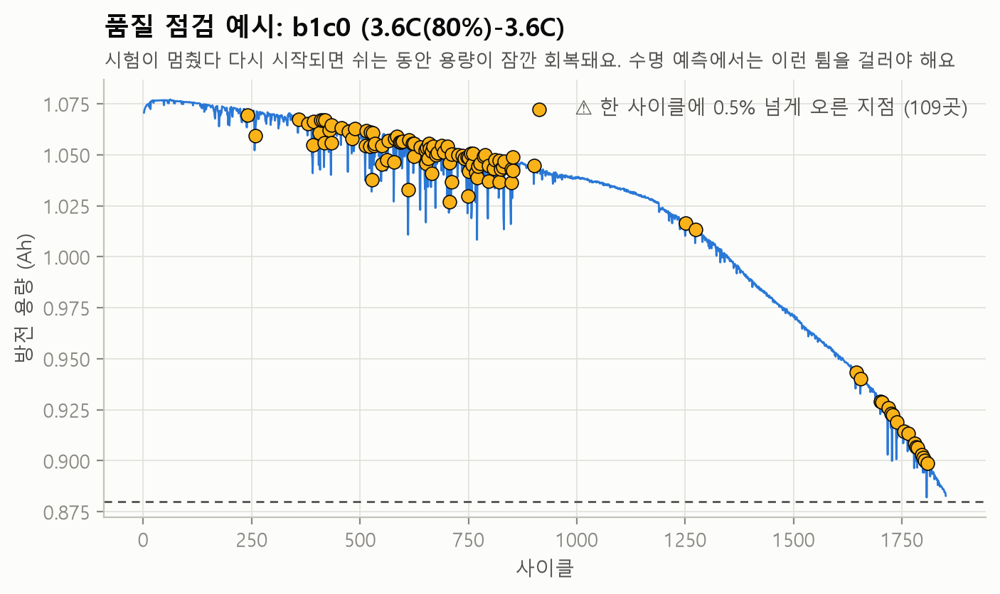
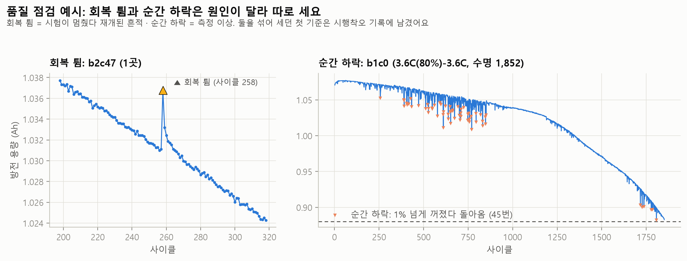

# 시행착오 기록

작업하면서 **잘못 짐작했거나 잘못 본 것**을 모두 적어 둔 기록이에요. 결과만 보면 깔끔해 보이지만,
실제로는 여러 번 틀렸고 그때마다 데이터를 다시 보며 고쳤어요. 항목마다 이렇게 정리했어요.

> **상황** → **처음 생각** → **어떻게 알아챘나** → **원인** → **수정** → **재발 방지**

---

## 한눈에 보기

| # | 단계 | 잘못 본 것 | 알아챈 방법 | 결과 |
|---|---|---|---|---|
| 1 | 품질 점검 | 41개 셀에 용량·온도·저항이 모두 이상하다 | 이상 셀 수가 b1 배치 크기(41)와 정확히 같음 | 1번째 사이클 빈 자리로 따로 집계 |
| 2 | 품질 점검 | 81개 셀이 수명 끝(80%)에 도달하지 않았다 | 그래프에선 모든 셀이 0.88Ah 아래로 내려감 | 라벨 규칙 두 가지를 찾아 **124/124 일치** |
| 3 | 품질 점검 | '회복 튐'이 135건(15개 셀) | 그래프에 표시해 보니 대부분 순간 하락의 복귀 | 기준을 4번 고쳐 **1건(1개 셀)**, 공식 노트의 b2 재시작 시점(250사이클 근처)과 일치 |
| 4 | 품질 점검 | b2 재시작 때의 튐을 기준이 놓쳤다? | 공식 노트 "대부분의 셀이 튐"과 결과가 다름 | 놓친 게 아님: 튐은 0.04%로 작고, 기록 오류로 나타남 |
| 5 | 데이터 검증 | 공식 노트대로 "재개 뒤 용량이 오른다" | 이어 붙인 셀 5개의 이음매를 직접 계산 | 3개는 오히려 1.4% 하락 후 부분 회복 |
| 6 | 데이터 정리 | 곡선의 100번째 행 = 100번째 사이클 (한 셀만 보고 확인) | 124개 셀로 넓히니 7개가 애매 | 약한 간접 증거 대신 원시 값으로 **1,289/1,289 일치** 확인 |
| 7 | 데이터 정리 | 전압 눈금은 3.5→2.0V 등간격일 것 | .mat 안에서 `Vdlin` 항목 발견 | 짐작 대신 데이터 값 저장 (124개 셀 모두 같음 확인) |
| 8 | 데이터 정리 | barcode·channel은 글자로 읽힌다 | 저장된 값이 빈 문자열·깨진 글자 | MATLAB string 객체라 저장에서 제외 |
| 9 | 데이터 받기 | 배치 파일도 저율 데이터와 같은 주소에 있다 | 크기 확인 요청이 404 | 배치 페이지에서 실제 주소 확인 |
| 10 | 데이터 받기 | 다운로드 두 개가 멈췄다 (0MB) | 다른 방법으로 크기를 재니 1.9GB | 쓰는 중인 파일의 크기 표시가 늦은 것 |
| 11 | 문서 | 배경 문서에 "급속충전 조건 72가지 내외" | 출처를 다시 찾다 확인 불가 | 삭제 후 데이터에서 센 값(69가지)으로 교체 |
| 12 | 문서 | 리포트 결론 "이상은 대부분 재개 시점에 몰림" | 배치별로 계산하니 b2만 해당(b1은 당시 21%로 흩어짐) | 결론 문장을 계산 결과로 만들도록 변경 (b1 "흩어짐"은 41번에서 다시 고침) |
| 13 | 테스트 | 테스트 기대값 −1.4% | 테스트 실패 → 손으로 다시 계산 | 코드가 맞았고 기대값을 어림한 게 틀림 |
| 14 | 데이터 카드 | 전류 `I`는 암페어(A) | 단위를 적으려고 값 범위를 보니 방전 −4, 충전 6.04 | C-rate 단위였음 (1C = 1.1A). 카드에 명시 |
| 15 | 품질 점검 | (검사 항목 누락) 충전 시간은 안 봄 | 데이터 카드용 값 범위에서 최대 1,290분 발견 | 60분 초과 검사 추가 → b2의 **8시간 휴지가 약 500분 충전 시간으로** 남아 있었음 |
| 16 | 데이터 크기 실험 | 논문 수치를 기억으로 쓸 뻔함 ("variance 모델 138/196사이클") | 숫자가 눈에 익었지만 출처가 없었음 | 인용 논문에서 **138/196 확인**, 확인 못 한 학습 오차는 쓰지 않음 |
| 17 | 테스트 | 특징 계산 테스트가 −∞ = −∞로 통과 | 테스트는 통과했는데 경고가 남음 | 가짜 ΔQ를 진짜처럼 음수로, 무한대 특징은 비워 두고 오류로 알림 |

---

## 1. "41개 셀이 이상하다" → 1번째 사이클 빈 자리

- **상황:** 첫 품질 점검에서 범위 밖 용량·온도, 내부저항 0, 빈 방전 곡선이 **똑같이 41개 셀**에서 나왔어요.
- **처음 생각:** 측정 장비 문제로 여러 셀이 오염됐다.
- **어떻게 알아챘나:** 41은 b1 배치에서 논문이 쓴 셀 수와 정확히 같아요. 우연이라기엔 너무 딱 맞아서 배치별로 다시 셌더니 **전부 b1**이었어요.
- **원인:** 공식 설명에 "b1은 1번째 사이클 데이터가 없다"고 적혀 있어요. 그 자리가 **모든 값이 0인 줄**로 채워져 있었어요.
  ```
  cell_id  cycle   QD      QC      IR      Tavg
  b1c5     1       0.000   0.000   0.000   0.00   ← 빈 자리
  b1c5     2       1.076   1.076   0.016   31.00
  ```
- **수정:** 용량·충전량·저항·온도가 모두 0인 줄은 '빈 자리'로 따로 세고, 이상값 검사에서 뺐어요.
- **재발 방지:** 이상값 개수가 배치 크기와 같으면, 먼저 **데이터가 원래 그렇게 기록된 것은 아닌지** 의심해요.

## 2. "81개 셀이 80%에 도달하지 않았다" → 수명 라벨 규칙 두 가지

- **상황:** "용량이 처음 0.88Ah(공칭의 80%) 미만이 된 사이클"을 찾았더니 81개 셀에서 그런 사이클이 없었어요.
- **처음 생각:** 시험이 수명 끝 전에 중단된 셀이 많다.
- **어떻게 알아챘나:** 124개 셀의 용량 그래프에서는 **모든 셀이 0.88Ah 선까지** 내려가 있었어요. 숫자와 그래프가 서로 달랐어요.
- **원인:** 마지막 기록을 직접 열어 보니 0.8800\~0.8834Ah로, 0.88 **미만**이 아니었어요. 셀마다 비교했더니 규칙이 정확히 두 가지였어요.

  | 배치 | 셀 수 | 시험 방식 | 수명 라벨 |
  |---|---|---|---|
  | b1 · b3 | 81 | 0.88Ah에 닿자 시험 종료 (그 사이클은 기록에 없음) | 마지막 기록 사이클 **+ 1** |
  | b2 | 43 | 80%를 지나 20\~37사이클 더 시험 | 처음 0.88Ah 미만이 된 사이클 |

- **수정:** 두 규칙을 모두 코드에 넣었더니 수명 라벨과 실제 80% 도달 사이클이 **124/124개 셀에서 정확히 같아졌어요.**
  처음에 쓰던 '5사이클 이동 중앙값' 판정도 끝부분에서 값이 모자라 늦게 판정하는 문제가 있어,
  '현재 값과 앞으로 5사이클 중앙값이 모두 0.88 미만'으로 바꿨어요. 순간 하락에도 속지 않아요.
- **재발 방지:** 숫자 결과가 그래프와 다르면 그래프를 믿고 **숫자를 만든 기준**을 의심해요.

## 3. "회복 튐 135건" → 기준을 네 번 고쳐 1건

가장 오래 걸린 문제예요. '회복 튐'은 시험이 멈췄다 재개되면 쉬는 동안 용량이 잠깐 회복되는 현상이에요.
수명 추세를 볼 때 걸러야 해서 정확히 찾아야 했어요.

| 버전 | 기준 | 결과 | 무엇이 틀렸나 · 어떻게 알았나 |
|---|---|---|---|
| 1 | 한 사이클 만에 0.5% 넘게 오르면 튐 | **135건 / 15개 셀** (b1c0 혼자 107건) | 그래프에 표시해 보니 대부분 **순간 하락이 원래대로 돌아오는 순간**이었어요 |
| 2 | 순간 하락(주변보다 1% 넘게 꺼짐)을 먼저 빼고, 직전 10사이클 **중앙값**보다 0.5% 높으면 튐 | 4개 셀 (b1c0 12건) | 하락이 잦은 구간에선 중앙값 자체가 같이 끌려 내려가, 정상값이 튐처럼 보였어요 |
| 2→3 사이 | 직전 10사이클 **최댓값**으로 바꾸려다 | (적용 전 검산) | 빨리 늙는 셀은 10사이클 사이에 이미 0.7% 줄어서, 1%짜리 진짜 튐도 0.3%로 보여 **놓쳐요** |
| 3 | 직전 **5**사이클 최댓값 | 2개 셀 (b1c0 4건: 409·435·514·853) | 409 앞뒤를 열어 보니 **8사이클 동안 처졌다가 원래 수준으로 돌아온 것**이었어요. 기준 5사이클이 모두 처진 구간 안이었어요 |
| 4 (최종) | 직전 **20**사이클을 **최근 감소 속도만큼 보정**한 '처지기 전 수준'보다 0.5% 높고 유지되면 튐 | **1건 / 1개 셀** (b2c47, 258사이클) | 공식 노트의 b2 재시작 시점(250사이클 근처)과 맞아요 |



*고치기 전 그래프. 주황 점 대부분이 실제로는 순간 하락 뒤 원래 값으로 돌아온 지점이에요.
(이 그래프는 순간 하락을 빼지 않고 단순 계산해서 109곳으로 표시됐어요.)*



- **수정:** 버전마다 '틀렸던 경우'를 테스트로 남겼어요. 잦은 하락, 1%보다 얕은 하락이 연달아 나오는 경우,
  8사이클 처졌다 돌아오는 경우에는 튐이 없어야 하고, 빨리 늙는 셀의 1% 튐은 잡아야 해요.
- **재발 방지:** 기준을 숫자로만 확인하지 않고 **그래프에 표시해서 눈으로 확인**해요. 기준을 바꿀 때마다 직전 버전이 틀렸던 사례를 테스트로 추가해요.

## 4. "b2 재시작의 튐을 놓쳤다?" → 놓친 게 아니었음

- **상황:** 공식 노트에는 "b2는 컴퓨터 재시작으로 대부분의 셀이 250사이클 근처에서 8시간 쉬었고 용량이 튄다"고 적혀 있어요. 그런데 최종 기준으로 잡힌 튐은 1개 셀뿐이었어요.
- **처음 생각:** 0.5% 기준이 너무 높아서 놓쳤다.
- **확인:** 250사이클 넘게 시험한 b2 셀 42개의 230\~275사이클 구간을 직접 봤어요. 0.5% 넘게 오른 셀은 **0개**였고, 상승폭 중앙값은 **0.04%였어요**.
- **결론:** 기준이 놓친 게 아니에요. 이 데이터에서 재시작은 용량 튐보다 **기록 오류**로 드러났어요.
  - 1.49Ah(253사이클)·1.54Ah(248사이클) 같은 범위 밖 용량
  - 말이 안 되는 방전 곡선
  
  - 약 500분짜리 충전 시간 (15번에서 발견)

  실제로 b2의 이상 53%가 240\~259사이클에 몰려 있어요. 기준을 낮추면 측정 잡음까지 튐으로 잡히니 기준은 그대로 뒀어요.
- **재발 방지:** "놓쳤다"고 판단하기 전에, 놓쳤다는 구간의 실제 값부터 확인해요.

## 5. 공식 노트 "재개하면 용량이 오른다" → 이 데이터에선 하락 후 부분 회복

- **상황:** b1에서 멈췄다가 b2에서 이어 시험한 셀 5개는 한 셀로 이어 붙여요(논문 저자 코드와 같은 규칙). 공식 노트는 "쉬었다 재개하면 용량이 오른다"고 해요.
- **확인:** 이음매 직전 5사이클 중앙값과 비교했어요.

  | 셀 | 재개 첫 사이클 | 재개 뒤 10사이클 중앙값 |
  |---|---|---|
  | b1c0 | −0.45% | −0.30% |
  | b1c1 | −1.36% | −0.89% |
  | b1c2 | −1.35% | −0.89% |
  | b1c3 | +0.07% | −0.17% |
  | b1c4 | −1.41% | −0.97% |

- **판단:** 3개는 오히려 **떨어졌다가** 몇 사이클에 걸쳐 일부 회복했어요. 그래도 이어 붙이기 자체는 맞다고 봤어요.
  재개 뒤 값이 직전 값과 1% 안쪽으로 이어지고, 새 셀이었다면 1.07Ah 근처에서 시작했을 거예요.
  원인은 데이터만으로는 단정할 수 없어서 관찰한 사실만 적었어요. b1c1은 재개 뒤 평균 온도가 약 0.5°C 높았어요.
- **수정:** 이어 붙인 지점을 `cells.csv`의 `seam_cycle`로 남겨, 용량 추세를 볼 때 표시하거나 거를 수 있게 했어요.
  이음매는 모두 1,177사이클 이후라 첫 100사이클로 하는 수명 예측에는 영향이 없어요.
- **재발 방지:** 공식 설명도 **데이터로 한 번 확인**해요.

## 6. "100번째 행 = 100번째 사이클" → 사이클 번호로 찾기

- **상황:** 논문의 핵심 특징 ΔQ₁₀₀₋₁₀은 100번째와 10번째 사이클의 방전 곡선을 빼서 만들어요.
- **처음 생각:** 곡선 배열의 99번째 행(0부터 셈)이 100번째 사이클이다.
- **어떻게 알아챘나:** 공식 설명에 "b1은 1번째 사이클 데이터가 없다"는 문장이 있어, 행과 사이클이 어긋날 수 있었어요.
- **1차 확인 (부족했음):** 요약표 용량의 사이클 간 변화와, 곡선 최댓값의 변화가 어느 위치에서 가장 잘 맞는지 비교했어요.
  b2c0 **한 셀**에서 위치 0(그대로)이 0.345로 가장 높아(다른 위치 −0.24\~−0.03) "맞다"고 결론 내렸어요.
- **다시 의심한 계기:** 문서를 쓰며 검산하다가, 한 셀만 보고 124개 셀 전체에 대해 단정했다는 걸 알아챘어요.
  같은 방법을 124개 셀로 넓히자 **117개는 위치 0, 7개는 다른 위치**가 나왔어요. 추세를 빼고 다시 해도 4개 셀이 애매했어요.
- **원인:** 비교 방법이 약했어요. 곡선(Qdlin)은 **정전류 구간의 용량**만 담는데 요약표 용량은 마지막 정전압 구간까지 포함해요.
  그래서 하락이 정전압 구간에서 생긴 셀(예: b1c0)은 곡선에 안 보여 상관이 0 근처였어요. "정렬이 틀렸다"는 증거가 아니라 "이 방법으로는 모른다"는 뜻이었어요.
- **2차 확인 (직접 증거):** 일부 사이클은 원시 측정값을 저장해 뒀어요. 원시 방전 용량의 최댓값은 요약표 용량과 같은 출처라,
  같은 행이면 거의 정확히 같아야 해요. 결과는 **1,289/1,289개 사이클 일치, 오차 0.005mAh 이하**였어요.
  나머지 41개는 b1의 빈 1번째 사이클이에요. 행 정렬은 124개 셀 모두 맞아요.
- **수정:** 그래도 행 번호를 짐작하지 않게, 곡선 파일에 행마다 사이클 번호를 같이 저장하고 **사이클 번호로 행을 찾도록** 했어요.
  1번째 사이클이 없는 경우를 테스트로 넣었어요.
- **재발 방지:** 한 셀(표본 하나)로 전체를 단정하지 않아요. 간접 증거가 애매하면 **같은 출처의 직접 증거**를 찾아요.

## 7·8. 데이터 구조를 짐작했다가 고친 것

- **전압 눈금 (7):** 처음엔 3.5V→2.0V를 1,000칸으로 고르게 나눴을 거라 짐작했어요. 그런데 .mat을 열어 항목을 출력해 보니 `Vdlin`이 따로 있었어요.
  값은 짐작과 같았지만(3.5→2.0V, 1,000칸, 124개 셀 모두 같음을 확인) 이제 **데이터에 적힌 값**을 써요.
  처음엔 b2의 두 셀만 비교하고 "모든 셀이 같다"고 썼다가, 6번 일을 겪고 124개 셀 전체로 다시 확인했어요.
- **barcode·channel (8):** MATLAB 글자 배열(2바이트 문자)로 가정하고 읽었더니 빈 문자열·깨진 글자가 저장됐어요.
  원본을 열어 보니 MATLAB의 string 객체(uint32 배열)라 이 방식으로는 읽을 수 없었어요.
  **잘못된 값을 남기는 것보다 안 남기는 게 낫다**고 보고 저장에서 뺐어요. 분석에는 쓰지 않는 값이에요.

## 9·10. 데이터 받기

- **주소 (9):** 데이터 페이지에서 저율 데이터 파일이 `s3.amazonaws.com/.../final_data/` 아래 있어서, 배치 파일도 같은 곳에 있을 거라 짐작했어요.
  크기 확인 요청이 404였어요. 페이지는 JavaScript로 그려져서 일반 웹 읽기로는 내용이 안 보였어요.
  그래서 브라우저로 배치 페이지를 열어 실제 주소(`data.matr.io/1/api/v1/file/<id>/download`)를 찾았어요.
  크기는 내려받지 않고 헤더만 요청해 확인한 뒤(합계 8,269,341,808바이트) `sources.py`에 적어 뒀어요. 다 받으면 이 크기와 같은지 검사해요.
- **멈춘 줄 안 다운로드 (10):** 세 배치를 동시에 받는데, PowerShell로 재니 두 개가 0MB로 보여 멈춘 줄 알았어요.
  다른 방법(Git Bash의 `ls`)으로 재니 1.9GB·1.2GB로 잘 받고 있었어요.
  Windows가 **쓰는 중인 파일의 크기를 목록에 늦게 반영**하는 것으로 보여요. 진행 상황은 한 가지 방법만 믿지 않고 교차 확인해요.

## 11·12. 문서에 확인 안 된 내용을 쓴 것

- **(11)** 배경 문서 초안에 기준 논문의 충전 조건이 "72가지 내외"라고 썼어요. 출처를 다시 찾았는데 확인할 수 없었어요(다른 논문 숫자와 헷갈린 것으로 보여요). 바로 지웠고, 데이터를 받은 뒤 직접 세어 **69가지**(3배치의 `newstructure` 표기 포함)로 채웠어요.
- **(12)** 품질 리포트 결론에 "이상은 대부분 시험이 멈췄다 재개된 시점에 몰려 있다"고 고정 문장으로 썼어요. 배치별로 계산해 보니 b2(당시 46%)에만 맞고 b1은 가장 많은 구간도 당시 21%라 "흩어져 있다"고 적었어요. 그런데 이 "흩어짐"도 틀린 결론이었어요 — b1의 이상도 여러 셀의 비슷한 사이클에 몰려 있었어요([41번](#41-b1의-이상은-흩어져-있다--고친-결론도-틀렸음)). 지금 [품질 리포트](data_quality.md) 기준은 b2 53%(245\~258사이클), b1은 무리 4개에 84%예요. 그래프 부제목에도 특정 셀의 숫자(107번)를 그대로 써 둔 곳이 있었어요.
- **수정:** 리포트의 결론·숫자는 **코드가 계산한 값으로만** 만들도록 바꿨어요.
- **재발 방지:** 문서에 쓰는 숫자는 출처 링크가 있거나 코드가 계산한 것만 써요.

## 13. 테스트가 틀린 경우

이음매 계산 테스트에서 기대값을 −1.4%로 적었는데 코드 결과는 −1.62%였어요. 손으로 다시 계산해 보니 기준값을 1.0Ah 근처로 어림하고 그 사이 자연 감소분을 빼먹은 **테스트의 기대값이 틀렸어요**. 기대값을 계산식으로 적도록 고쳤어요.

## 14. 전류 단위를 암페어로 짐작

- **상황:** 테스트용 가짜 데이터를 만들 때 4C 방전 전류를 −4.4A(4 × 1.1Ah)로 넣었어요.
- **어떻게 알아챘나:** 데이터 카드에 열마다 단위를 적으려고 실제 값 범위를 확인했어요. `1C(4%)-6C` 조건 셀의 10번째 사이클에서 방전은 정확히 −4, 충전 최댓값은 6.04였어요. 암페어라면 −4.4와 6.6이어야 해요.
- **원인:** 원본의 전류는 **C-rate 단위**(1C = 1.1A)로 저장돼 있어요.
- **수정:** 가짜 데이터를 −4.0으로 고치고, 데이터 카드에 "암페어가 아니에요"라고 적었어요. 아직 분석에 전류를 쓰지 않아 결과에는 영향이 없었어요.
- **재발 방지:** 단위는 이름으로 짐작하지 않고 **알려진 조건(4C 방전)과 값을 맞춰 보고** 정해요.

## 15. 충전 시간 검사를 빠뜨림 → 8시간 휴지의 흔적을 찾음

- **상황:** 품질 점검에 용량·온도·내부저항·곡선은 넣었는데 충전 시간은 넣지 않았어요.
- **어떻게 알아챘나:** 데이터 카드용으로 열마다 값 범위를 보다가 충전 시간 최댓값이 **1,290분**인 것을 봤어요. 보통은 9\~20분이에요.
- **확인:** 60분이 넘는 기록은 14개 셀에 14줄이었어요. 그중 b2의 7개는 **248\~253사이클에 약 490\~510분**이었어요.
  약 8.3시간으로, 공식 노트의 "250사이클 근처에서 컴퓨터 재시작으로 약 8시간 쉼"과 맞아요. 시험이 충전 단계에서 멈춰서 **쉰 시간까지 충전 시간으로 기록**된 거예요.
  20분대 값은 셀이 늙으면서 정전압 충전이 길어지는 자연스러운 현상이라(상위 1%가 20분) 기준은 60분으로 잡았어요.
- **수정:** "충전 시간 60분 초과" 검사를 추가하고, 이상이 몰린 구간 분석에도 넣었어요. b2 이상 중 240\~259사이클에 몰린 비율이 46% → **53%로** 올라 재시작 시점이 더 뚜렷해졌어요.
- **재발 방지:** 모든 열의 값 범위를 한 번씩 훑어보는 단계를 점검 맨 앞에 둬요.

## 16. 논문 수치를 기억으로 쓸 뻔함

- **상황:** 데이터 크기 실험의 기준점으로 단순 모델을 논문과 같은 나누기로 돌렸더니 테스트 / 2차 테스트 RMSE가 137.9 / 195.9사이클이 나왔어요.
  숫자가 눈에 익어서 "논문 표와 똑같다"고 쓰고 싶었어요.
- **문제:** 그 '눈에 익음'은 기억일 뿐 출처가 없었어요. 논문 본문은 유료라 바로 볼 수 없었어요.
- **확인:** 검색으로 바로 나오지 않아 논문을 인용한 다른 논문들을 직접 열었어요.
  - 첫 번째 논문: 결과가 그래프 선으로만 나와 숫자를 확인할 수 없었어요.
  - 두 번째 논문(Attia 외, 2021, arXiv:2101.01885): 본문에 "variance 모델의 1차/2차 테스트 오차 138/196사이클"이라는 문장이 있었어요.
- **수정:** 확인된 138/196만 문서에 쓰고 출처를 같이 적었어요. 기억에 있던 학습 오차는 확인하지 못해서 쓰지 않았어요.
  같은 논문에 인용된 'full' 모델 값(100/214)은 우리 6개 특징 모델과 특징 구성이 달라 비교에 쓰지 않았어요.
- **재발 방지:** 논문 수치는 **확인한 출처가 있는 것만** 써요. 출처를 코드(`size_report.py`)에 같이 적어 둬요.

## 17. 통과했지만 의미 없던 테스트

- **상황:** 특징 계산 테스트가 통과했는데 "log10에 0이 들어갔다"는 경고가 남았어요.
- **원인:** 가짜 ΔQ 곡선을 0 이상으로만 만들어서 최솟값이 0이었고, log(0) = −∞를 코드와 테스트가 똑같이 계산해 **−∞ = −∞로 통과**했어요. 진짜 ΔQ는 음수예요.
- **수정:** 가짜 ΔQ를 진짜처럼 음수로 바꾸고 "특징이 모두 유한한 값인지"를 검사에 넣었어요.
  코드도 무한대 특징을 조용히 쓰지 않고 비워 두게 해서, 실험을 돌리면 어느 셀이 문제인지 오류로 알려 줘요.
- **재발 방지:** 테스트가 통과해도 **경고는 무시하지 않아요.** 가짜 데이터는 진짜 데이터의 부호·범위를 따라 만들어요.

## 작은 것들

| 상황 | 원인 | 수정 |
|---|---|---|
| 그래프 만들 때 "글꼴을 찾을 수 없음" 경고가 쏟아짐 | 설치 안 된 한글 글꼴까지 후보로 넣음 | 설치된 한글 글꼴 하나만 고름 |
| 그 뒤 "아래첨자(₁₀₀) 글자 없음" 경고 | 한글 글꼴엔 아래첨자가 없는데 대신 그려 줄 글꼴을 뺐음 | 한글 글꼴 + matplotlib 기본 글꼴 순서로 지정 |
| 테스트용 가짜 데이터에서 상관계수가 계산 안 됨 | 가짜 셀들이 모두 똑같이 늙도록 만들어짐 | 수명이 짧을수록 빨리 늙게 바꾸고 "상관 < −0.9"를 검사 |
| 원시 데이터 저장 코드에서 위치 정보를 필드마다 덮어씀 | 열 길이가 다르면 어긋날 수 있었음 (코드 검토 중 발견) | 사이클마다 길이를 맞추고 위치 정보는 한 번만 계산 |
| Git Bash 창에서 한글 출력이 깨짐 | Python 출력 인코딩이 cp949 | `PYTHONIOENCODING=utf-8`로 실행 |
| GitHub 자동 테스트 결과를 기다리는 스크립트가 끝까지 결과를 못 찾음 | 커밋 번호를 짧게(7자리) 넣었는데 조회에는 전체 번호가 필요 | 최근 실행 목록에서 찾음 (두 커밋 모두 통과 확인) |
| 외부 PDF를 격리 모드(`-I`)로 읽다가 한글·기호 출력에서 멈춤 | 격리 모드는 출력 인코딩 설정(환경 변수)까지 무시 | 스크립트 안에서 출력 인코딩을 직접 지정 |
| 4분짜리 실험 결과가 화면에 안 나옴 | 실행 시간 측정 명령이 출력을 삼킴 | 결과를 파일로 저장해 두고 파일에서 다시 읽음 |
| 데이터 크기 그래프에서 "15%"·"r = −0.927" 글자가 다른 요소와 겹침 | 글자 위치를 축 바깥쪽에 고정 | 위치를 옮기고 부제목에 설명 |

---

## 여기서 배운 원칙

1. **이상값 개수가 배치 크기와 같으면 기록 방식부터 의심한다.** (1번)
2. **숫자와 그래프가 다르면 숫자를 만든 기준을 의심한다.** (2·3번)
3. **기준을 바꿀 때마다 직전 버전이 틀린 사례를 테스트로 남긴다.** (3번)
4. **"놓쳤다"고 판단하기 전에 그 구간의 실제 값을 본다.** (4번)
5. **공식 설명도 데이터로 확인한다.** (5번)
6. **짐작한 구조는 검증하거나, 데이터에 적힌 값으로 바꾼다. 검증은 표본 하나가 아니라 전체로, 간접 증거보다 직접 증거로.** (6·7·8번)
7. **문서의 숫자는 출처가 있거나 코드가 계산한 것만 쓴다.** (11·12번)
8. **단위는 알려진 조건과 값을 맞춰 정하고, 모든 열의 값 범위를 먼저 훑는다.** (14·15번)
9. **논문 수치는 확인한 출처가 있는 것만 쓴다. 기억은 출처가 아니다.** (16번)
10. **테스트가 통과해도 경고는 무시하지 않는다.** (17번)
11. **자동 분석이 고른 지점에, 다른 지점을 보고 쓴 설명을 미리 붙여 두지 않는다.** (18번)
12. **이름표(문자열)로 결과를 찾을 때는 대소문자·형식을 가정하지 않는다.** (19번)
13. **좋아 보이는 성능은 "아무것도 읽지 않는 기준"(예: 배치만 보고 찍기)과 먼저 비교한다.** (응용 실험 · 불량 셀 선별)
14. **만든 사람이 아닌 다른 눈으로 다시 계산해 본다.** 응용 실험 4개는 모두 검증 단계에서 고칠 것이 나왔다. (응용 실험 · 24·27·28·31번과 아래 '에이전트가 찾은 실수' 표)
15. **"처음 만족한 지점" 하나로 결론 내지 않는다.** 그 뒤로도 계속 만족하는지, 같은 조건끼리 짝지어도 그런지, 다른 나누기에서도 그런지 본다. (34번)
16. **"k까지만 본다"는 실험은 빈자리를 메우는 값까지 k 이전 것인지 확인한다.** (33번)
17. **요약은 짧은 만큼 과장되기 쉽다.** README 같은 요약의 숫자마다 어느 배치·모델·나누기의 값인지 본문과 다시 대조한다. (39번)
18. **재발 방지는 적어 두는 데서 끝내지 않고, 다음 작업자(에이전트)가 읽는 지시에 넣는다.** (37번)
19. **고친 결론도 다시 의심한다.** "30% 미만이면 흩어짐"처럼 경계값으로 만든 문장은 그 경계와 구간 나누기에 근거가 있는지 본다. (41번)
20. **마크다운은 실제로 보이는 모습으로 확인한다.** 물결표, 굵은 글씨 뒤 조사처럼 원문에서는 멀쩡해 보여도 화면에서 깨지는 것이 있다. (40번)

---

# 응용 실험 단계 (사이클 수 실험 · 응용 4가지 · 관련 연구)

이 단계에서는 사이클 수 실험을 직접 하고, 응용 4가지(불량 셀 선별 · 오차 범위 · 충전 조건 · 특징 해석)는
**AI 에이전트가 하나씩 구현한 뒤 다른 에이전트가 숫자를 다시 계산해 검증**했어요. 관련 연구 조사도 에이전트가 하고,
인용은 다른 에이전트가 링크를 열어 하나씩 확인했어요. 각 실험 문서 끝의 "시행착오" 절에 자세한 내용이 있고, 여기에는 요약을 모았어요.

## 한눈에 보기

| # | 어디서 | 잘못 본 것 | 알아챈 방법 | 결과 |
|---|---|---|---|---|
| 18 | 사이클 수 실험 | "70사이클이 나쁘다", 그리고 자동 분석이 고른 30사이클에 70사이클용 설명이 붙음 | 촘촘히 다시 재고, 생성된 문장을 숫자와 대조 | 꺾이는 지점 4곳을 모두 나열, 오차 그래프와의 대응은 계산으로 |
| 19 | 관련 연구 작업 흐름 | 시뮬레이션 결과가 "없다" | 에이전트 작업 일지를 직접 열어 봄 | 작업 흐름 코드(AI 에이전트가 씀)가 `'simulation'`만 찾고 `'SIMULATION'`을 놓침 → 고쳐서 문서 작성만 다시 |
| 20 | 응용 아이디어 문서 | "사이클 하나 ≈ 1시간, 100사이클은 4일 넘게" | 시험 기간을 계산하려고 248개 사이클을 실제로 잼 | 중앙값 52분, 100사이클 약 3.6일로 고침 (또 한 셀만 본 숫자) |
| 21 | 명령어 | `--help`가 오류 | 합친 뒤 명령어를 직접 실행 | 도움말의 `%`를 argparse(명령어 옵션을 읽는 파이썬 도구)가 서식 기호로 읽음 → `%%`로 바꾸고 회귀 테스트(고친 버그가 다시 생기지 않는지 보는 테스트) 추가 |
| 22 | 사이클 수 테스트 | 가짜 오차표(20·40·60·80·100사이클 = 30·20·15.5·14.2·14.0%)에서 "100사이클 오차 + 1.0%p 안에 처음 드는 사이클 수"를 60으로 기대 | 테스트 실패 → 손으로 다시 계산 | 60사이클은 15.5% > 15.0%라 기준 밖이고, 처음 드는 건 80. 코드가 맞았고 테스트 기대값을 고침 |
| 23 | 불량 셀 선별 | 높은 정확도 = 셀을 잘 읽었다 | 라벨을 배치별로 세어 봄 | 단수명 43개 중 41개가 b2 → "배치만 보고 찍기" 기준(96%)을 넣고 결론을 바꿈 |
| 24 | 불량 셀 선별 (검증에서) | 같은 코드를 두 번 돌렸는데 숫자가 다름 | 검증 에이전트가 다시 돌려 비교 | 로지스틱 회귀 풀이법에 시드가 빠짐 → 넣고, 두 번 돌려 바이트 단위로 같은지 확인 |
| 25 | 충전 조건 | 충전 조건 표기 = 실제 전류 | 표기로 계산한 충전 시간과 측정 시간을 비교 | 10개 셀이 달랐음(예: b3 `4.8C` 표기 셀은 실제 4.36C) → 원시 기록으로 실제 전류를 잼 |
| 26 | 충전 조건 | 부트스트랩 범위가 비어 있음(NaN, '숫자 아님' 표시) | 결과 표에서 반복 횟수 0을 발견 | 잘라 낸 표 기준 줄 번호를 써서 배치가 섞임 → 전체 표 기준으로 고치고 회귀 테스트 |
| 27 | 오차 범위 (검증에서) | "우연의 폭"을 이항분포로 계산 | 검증 에이전트가 이론(Angelopoulos·Bates)과 대조 | 평가 셀이 같은 범위를 함께 써서 실제 흔들림이 더 큼 → 베타-이항분포로 다시 셈 |
| 28 | 오차 범위 (검증에서) | "±25%로 같으니 b3가 더 나쁘게 맞은 게 아니다" | 계산 방식을 따져 봄 | 분할 conformal은 log에서 모든 셀에 같은 폭이라 ±25%는 항상 같음 → 근거를 MAPE로 바꿈 |
| 29 | 특징 해석 | dQ/dV 봉우리 찾기 | 셀마다 찾은 봉우리 전압이 2.0V인 셀이 있음 | 방전 끝(2.0V)에 튀는 값이 있음 → 3.0\~3.3V 안에서만 찾음 |
| 30 | 특징 해석 | 데이터의 dQdV = Qdlin의 미분 | 적분해 보니 −26.1 vs −9.3mAh로 안 맞음 | dQdV는 따로 계산된 값 → 해석용 미분은 Qdlin에서 직접 계산 |
| 31 | 응용 4가지 (검증에서) | 해석 문장의 단정 ("분명히", "\~때문이에요") | 검증 에이전트가 문장과 숫자를 하나씩 대조 | 근거가 약한 곳은 "(가설)"·"\~로 보여요"로 바꾸고 근거 숫자를 코드가 계산해 붙임 |
| 32 | 불량 셀 선별 | 시험 실행 출력 폴더를 Git Bash 경로(`/c/Users/...`)로 넘김 | 출력이 예상한 곳에 없음 | Windows Python이 `C:\c\...`로 해석해 새 폴더를 만듦 → 내용(시험 출력 5개)을 확인하고 정리 |

## 18. "70사이클이 나쁘다" → 꺾이는 지점은 네 곳, 원인은 일부만 설명됨

- **상황:** 사이클 수(k)를 20\~100으로 바꿔 가며 수명 예측을 해 보니, 논문 나누기 한 번에서 70·90사이클의 오차가 바로 앞보다 커졌어요.
- **처음 생각 ①:** "70사이클이 나쁘다." → 이웃 사이클을 촘촘히 다시 재 보니 r이 사이클 하나 차이로도 오르내렸어요(68: −0.881, 71: −0.914).
- **처음 생각 ②:** "곡선 한 개의 잡음 때문이다." → 5사이클 중앙값 곡선으로 바꿔 봤더니 30·50사이클의 꺾임은 사라졌지만 70·90사이클은 남았어요. **일부만 맞았어요.**
- **처음 생각 ③:** "b1 챔버 온도가 들쭉날쭉해서다." → 셀마다 특징이 벗어난 정도와 온도가 벗어난 정도의 상관이 모두 약했어요(절댓값 0.33 이하). 원인은 모른다고 적었어요.
- **또 하나의 실수:** 리포트를 자동으로 만들게 하면서 "가장 크게 꺾인 한 곳"만 고르게 했어요. 그런데 코드는 30사이클을 골랐고, 70사이클을 보고 쓴 "오차 그래프도 그 지점에서 나빠진다"는 문장이 그대로 붙었어요. 30사이클의 오차는 오히려 줄었어요.
- **수정:** 꺾이는 지점을 **모두** 나열하고 지점마다 두 가설을 검사하게 했어요. 오차 그래프와의 대응도 계산으로 적어요. 자세한 내용은 [사이클 수 실험](cycles.md)에 있어요.
- **재발 방지:** 자동으로 고른 대상에 미리 써 둔 설명을 붙이지 않아요. 설명 문장도 그 대상의 숫자에서 만들어요.

## 19. "시뮬레이션 결과가 없다" → 작업 흐름 코드가 이름표를 못 찾음

- **상황:** 관련 연구 작업 흐름이 끝났는데, 문서 작성 에이전트가 "넘겨받은 시뮬레이션 실행 기록이 비어 있다"며 그 칸을 "기록 없음"으로 두었어요.
  숫자를 지어내지 않은 건 잘한 일이었어요.
- **어떻게 알아챘나:** 에이전트별 작업 일지(journal)를 직접 열어 보니 시뮬레이션 에이전트는 PyBaMM을 세 번 실행한 기록을 잘 돌려줬어요.
- **원인:** 에이전트는 트랙 이름을 `'SIMULATION'`으로 돌려줬는데, 에이전트들을 이어 주는 작업 흐름 코드(AI 에이전트가 쓴 코드)는 `t.track === 'simulation'`으로 정확히 같은 글자만 찾았어요.
- **수정:** 대소문자와 상관없이 찾도록 고치고, 앞단계(조사·인용 확인)는 저장된 결과를 재사용한 채 문서 작성만 다시 돌렸어요.
- **재발 방지:** 다른 에이전트가 만든 이름표는 형식을 가정하지 않고 찾아요. "없다"는 결과가 나오면 원본 기록부터 열어 봐요.

## 에이전트가 찾은 실수 (각 문서의 시행착오 절)

| 실험 | 자세한 내용 | 대표 사례 |
|---|---|---|
| 불량 셀 선별 | [screening.md](screening.md#시행착오) | 배치 교란(23), 시드 누락(24), 운영 기준값이 학습 셀의 끝값으로 골라짐, 열 이름이 겹쳐 배치 이름이 덮어써짐, 잘못된 경로(32) |
| 오차 범위 | [uncertainty.md](uncertainty.md#시행착오) | 이항분포 우연의 폭(27), ±25% 근거 오류(28), 논문 나누기 한 번을 일반화함, 테스트 기대값의 잡음 크기 짐작 |
| 충전 조건 | [policies.md](policies.md#시행착오) | 표기 vs 실제 전류(25), 부트스트랩 줄 번호(26), 80% 도달 판정이 79.9999%에서 빗나감, 근거 숫자 없이 쓴 주장(검증 단계·31번, 고친 결과는 [4절](policies.md#4-낮은-soc-전류-vs-높은-soc-전류)의 민감도 점검) |
| 특징 해석 | [interpret.md](interpret.md#시행착오) | 2.0V 끝의 튀는 값(29), dQdV ≠ Qdlin의 미분(30), 같은 학습 셀에서 나온 두 값을 "흔들림"의 근거로 씀 |

---

# 전체 검토 단계 (다섯 관점 검토)

모든 실험을 마친 뒤, 저장소 전체를 **다섯 관점(숫자 · 정직성 · 코드 · 한국어 · 링크)의 검토 에이전트**에게 맡겼어요.
지적마다 다른 에이전트가 반박을 시도해서, 살아남은 지적(확인됨 또는 일부 맞음)만 고쳤어요. 반박된 지적은 고치지 않았어요.
고칠 때도 생성기 묶음마다 "고치는 에이전트 → 다시 확인하는 에이전트" 순서로 했어요.

## 한눈에 보기

| # | 어디서 | 잘못 본 것 | 알아챈 방법 | 결과 |
|---|---|---|---|---|
| 33 | 사이클 수 실험 | 깨진 k번째 곡선을 가장 가까운 깨끗한 곡선으로 대신함 (k+1·k+2번째 포함) | 코드 검토: 찾는 순서가 0, −1, +1, −2, +2 | "k사이클만 본다"면서 미래 곡선을 쓸 수 있었음 → k번째는 앞쪽으로만 찾고 테스트로 막음 |
| 34 | 사이클 수 실험 · README | "6개 특징 모델은 60사이클(약 2.2일)로 100사이클 성능" | 정직성 검토: 바로 다음 70사이클에서 다시 나빠짐 | "그 뒤로 계속 만족" 규칙으로 바꾸니 80사이클, 짝 비교로는 81%만 좋거나 같음 → "가능성"으로 낮춤 |
| 35 | 데이터 크기 실험 | "원래 시험한 셀은 140개" | 숫자 검토: 140은 기록 수 | 5개는 b1 셀을 b2에서 이어 시험한 같은 셀 → 셀 135개 · 기록 140개 · 사용 124개를 코드가 셈 |
| 36 | 판단 실험 테스트 | "손해 비율마다 같은 나누기를 쓴다" 테스트 | 검토 에이전트가 일부러 틀린 코드로 돌려도 통과함 | 정확도가 비었는지만 봐서 항상 통과 → 나누기 횟수를 세는 테스트로 바꿈 (17번과 같은 종류) |
| 37 | 검토 반영 작업 | 32번 경로 실수가 다시 일어남 | `C:\c` 폴더가 다시 생김 | 재발 방지를 기록만 하고 에이전트 지시에 넣지 않았음 → 시험 출력은 지우고 프로젝트 규칙(CLAUDE.md)에 넣음 |
| 38 | 자동 생성 문서 | 숫자 뒤 조사 ("-0.927예요", "+0.63로", "0.21 였어요") | 한국어 검토 | 숫자가 바뀌면 조사도 바뀌어야 함 → 숫자 끝소리로 조사를 고르는 `korean.py`를 만들어 씀 |
| 39 | README 요약 표 | "이상값은 재시작 시점에 몰림", "관련 논문 40개", "90% 범위가 21%만 맞음" | 숫자·정직성 검토 | 12번에서 고친 일반화를 요약에서 되풀이함 → 배치·자료 종류(논문·데이터셋·도구)·모델과 나누기를 밝힘 |
| 40 | 자동 생성 문서 전체 | "10\~90% 범위가 12.8\~14.9%"처럼 쓴 범위 | 최종 검증 에이전트가 GitHub 마크다운 규칙과 대조 | 물결표 하나도 취소선 기호라, 한 문단에 \~가 두 개면 그 사이에 줄이 그어지고 \~가 사라짐 → 생성 문서는 모두 `mdtext.write_doc`으로 써서 \~를 글자로 바꾸고, 손으로 쓴 문서도 같은 함수로 정리 |
| 41 | 품질 리포트 | "b1의 이상은 흩어져 있다" (12번에서 고친 결론) | 최종 검증: 바로 위 표에 "사이클 0\~19에 9건"이 있는데 문장은 "흩어짐" | 20사이클 고정 구간의 몫(28%)이 30% 미만이면 "흩어짐"으로 쓰게 했었음. 실제로는 9건이 모두 12\~13사이클, 141\~166의 8건은 고정 구간 둘로 쪼개져 있었음 → 실제 사이클로 무리를 묶으니 무리 4개에 84% |
| 42 | 문서 전반 (최종 검증) | 검토를 반영하고 다시 만든 뒤에도 남은 오류 45건 | 다시 만든 문서를 네 묶음으로 나눠 찾고, 다른 에이전트가 하나씩 반박 | 예: README "논문을 사이클 단위까지 재현"(실제는 단순 모델만), 진행 표 "✅"(사이클 수는 가능성까지), 데이터 카드 "짝수 번째"(0부터 센 짝수) → 모두 고침 |

## 33. "k사이클만 본다" → 빈자리를 미래 곡선으로 메울 수 있었음

- **상황:** 사이클 수 실험은 k번째와 10번째 방전 곡선의 차이로 수명을 예측해요. k번째 곡선이 깨져 있으면(품질 점검 기준) 가까운 깨끗한 곡선을 대신 썼어요.
- **처음 생각:** "가장 가까운 곡선을 쓰면 된다." 찾는 순서는 k, k−1, k+1, k−2, k+2였어요.
- **어떻게 알아챘나:** 코드 관점 검토 에이전트가 이 순서를 보고 "k+1, k+2는 k사이클 시점에는 아직 없는 데이터"라고 지적했어요.
- **원인:** 품질 점검용으로 만든 "가까운 곡선 찾기"를 예측 실험에 그대로 썼어요. 품질 점검에서는 앞뒤 어느 쪽이든 상관없지만, 예측에서는 미래 데이터가 섞이면 안 돼요.
- **수정:** 찾기 함수에 "앞쪽으로만" 옵션을 넣고, k번째 곡선과 사이클 수 그림·특징 해석에서 쓰도록 했어요. 10번째 곡선은 k보다 한참 앞이라 ±2사이클 그대로예요.
  "101번째 이후 곡선만 바꿔도 특징이 같아야 한다"는 테스트를 넣었어요. 다시 계산하니 k=75·85는 앞쪽에 깨끗한 곡선이 없는 셀이 하나 있어 124개가 아니라 123개로 계산됐어요(문서에 표시).
- **재발 방지:** "k까지만 본다"는 실험은 빈자리를 메우는 값까지 k 이전 것인지 확인해요. 다른 목적으로 만든 함수를 가져다 쓸 때는 그 함수의 가정을 다시 읽어요.

## 34. "60사이클이면 100사이클 성능" → 처음 만족한 한 지점으로 결론

- **상황:** README의 대표 결과로 "6개 특징 모델은 60사이클(약 2.2일)로 단순 모델의 100사이클(약 3.6일) 성능"이라고 굵게 썼어요.
- **처음 생각:** 무작위 나누기 100번의 오차 중앙값이 단순 모델 100사이클 값(13.7%) 이하가 되는 **첫** 사이클이 60이었어요.
- **어떻게 알아챘나:** 정직성 검토 에이전트가 같은 문서의 표를 근거로 반박했어요. 70사이클에서는 다시 14.9%로 나빠지고, 같은 나누기끼리 짝지으면 좋거나 같은 경우가 55%뿐이고, 논문 나누기에서는 60사이클이 훨씬 나빴어요(2차 테스트 26.6% vs 11.4%).
  같은 문서에 "한 지점이 아니라 전체 흐름으로 판단했다"고 써 놓고 정작 결론은 한 지점으로 냈어요. 같은 방식으로 만든 "단순 모델은 80사이클에서 2%p 안"도 90사이클에서 깨졌어요.
- **원인:** 결론 문장을 만드는 코드가 "조건을 처음 만족한 k"를 골랐어요. 오차가 오르내리는 곡선에서는 우연히 한 번 들어온 지점이 골라져요.
- **수정:** "그 k부터 100까지 **계속** 만족하는 가장 짧은 k"로 바꾸고, 짝 비교 결과와 논문 나누기 결과를 함께 적게 했어요.
  결과는 80사이클(약 2.9일), 짝 비교로 좋거나 같은 경우 81%, 논문 나누기 2차 테스트에서는 더 나쁨이에요. 그래서 "줄일 수 있다"가 아니라 "줄일 가능성이 보인다"로 낮췄어요. README·응용 아이디어 문서도 같이 고쳤어요.
- **재발 방지:** "처음 만족한 지점" 하나로 결론 내지 않아요. 그 뒤로도 계속 만족하는지, 짝지어도 그런지, 다른 나누기에서도 그런지 봐요.

## 35\~39. 그 밖의 검토 지적

- **35 · 140개 vs 135개:** 원본 기록은 140개지만 그중 5개는 b1 셀을 b2에서 이어 시험한 같은 셀이라, 실제로 시험한 셀은 135개예요. 문서에 140을 직접 적어 두었고, AI도 대화에서 "140개를 시험했다"고 잘못 말했어요. 이제 코드가 세어 적어요.
- **36 · 항상 통과하는 테스트:** "손해 비율마다 같은 나누기를 쓴다"를 확인한다던 테스트가 정확도 칸이 비었는지만 봤어요. 검토 에이전트가 일부러 비율마다 새로 나누는 코드를 만들어 돌려도 통과했어요. 나누기 함수를 몇 번 불렀는지 세는 테스트로 바꿨어요.
- **37 · 같은 경로 실수의 재발:** 검토를 반영하는 동안 다른 검증 에이전트가 Git Bash 경로를 Windows Python에 넘겨 `C:\c`가 다시 생겼어요. 32번의 재발 방지가 문서에만 있고 에이전트가 읽는 지시에는 없었어요. 시험 출력을 확인하고 지운 뒤(빈 폴더 삭제는 안전 검사가 막음), 프로젝트 규칙 파일(CLAUDE.md)에 경로 규칙을 넣었어요.
- **38 · 숫자 뒤 조사:** 생성 문장에 "{숫자}예요"처럼 조사를 고정해 두니 숫자가 바뀌면 틀렸어요("-0.927예요"). 숫자 끝자리를 한국어로 읽은 소리(칠 → 받침 있음)로 조사를 고르는 작은 도우미를 만들었어요.
- **39 · 요약의 과장:** README 요약 표가 본문보다 강하게 말했어요. "이상값은 재시작 시점에 몰림"(본문: 재시작 시점과 겹치는 건 b2만 — 12번에서 이미 고친 일반화), "관련 논문 40개"(실제: 논문 35 · 데이터셋 2 · 도구 문서 3), "90% 범위가 21%만 맞음"(단순 모델·테스트 기준, 2차 테스트는 40%). 요약 숫자마다 본문과 대조해 고쳤어요.

## 41. b1의 이상은 흩어져 있다? → 고친 결론도 틀렸음

- **상황:** 12번에서 "이상은 대부분 재개 시점에 몰린다"는 고정 문장을 배치별 계산으로 바꾸면서, 가장 많은 20사이클 구간의 몫이 30% 미만이면 "흩어져 있다"고 쓰게 했어요. b1은 28%라 "흩어짐"이 나왔어요.
- **어떻게 알아챘나:** 최종 검증 에이전트가 같은 리포트의 표를 근거로 반박했어요. 표에는 "b1 · 사이클 0\~19 · 이상 9건 · 셀 8개"가 있는데, 바로 아래 문장은 "흩어져 있다"였어요. 수명이 2,000사이클을 넘는 배치에서 20사이클 구간 하나에 28%가 몰렸다면 흩어진 게 아니에요.
- **원인:** 구간을 0\~19, 20\~39…처럼 고정해서 나눴어요. 그래서 실제로는 사이클 12\~13 두 사이클에 9건이 다 들어 있다는 것도, 141\~166의 8건이 140\~159와 160\~179 두 구간으로 쪼개진 것도 보이지 않았어요. "30%"라는 경계에도 근거가 없었어요.
- **수정:** 이상이 난 사이클을 순서대로 놓고, 바로 앞 이상과 20사이클 안이면 한 무리로 묶어요. 셀 5개 이상에서 일어난 무리만 적어요. 그러니 b1 이상 32건 중 27건(84%)이 무리 4개(12\~13, 141\~166, 655\~684, 879\~909사이클)에 들어 있었어요. 공식 노트의 "두 번 자동 재시작"과 같은 때인지는 시간 기록으로 확인하지 않아서, 그렇게 연결 짓지 않았어요. README도 같이 고쳤어요.
- **재발 방지:** 고친 결론도 다시 의심해요. 경계값으로 만든 문장은 그 경계와 구간 나누기에 근거가 있는지 봐요.

## 40·42. 최종 검증에서 찾은 그 밖의 것

- **40 · 물결표 취소선:** GitHub 마크다운은 물결표 하나(\~)로 감싼 글자도 취소선으로 그려요. 그래서 "10\~90% 범위가 12.8\~14.9%"처럼 한 문단에 범위가 두 개 있으면 그 사이 글자에 줄이 그어지고 \~는 사라졌어요. 원문 파일에서는 멀쩡해 보여서 아무도 몰랐어요. 생성 문서는 모두 `battery_lab/mdtext.py`의 `write_doc`으로 써서 \~를 글자 그대로 보이게(`\~`) 바꾸고, 손으로 쓴 문서도 같은 함수로 한 번 정리했어요. 테스트도 넣었어요.
- **42 · 다시 만든 뒤에도 남은 오류:** 검토를 반영하고 문서를 다시 만든 뒤, 네 묶음으로 나눠 다시 찾고 다른 에이전트가 하나씩 반박하게 했어요. 살아남은 지적이 45건이었어요. 대부분 작았지만(굵은 글씨 뒤 띄어 쓴 조사, 반올림한 중앙값 736 vs 736.5), 몇 개는 주장의 크기 문제였어요. README의 "논문을 사이클 단위까지 재현"은 실제로는 단순 모델만이었고, 진행 표의 "✅"는 사이클 수 줄이기가 "가능성까지"인데 완료로 표시돼 있었어요. 데이터 카드의 "짝수 번째 셀 → 테스트"는 0부터 센 짝수라 보통 읽는 뜻과 반대였어요. 모두 고쳤어요.

---

# 고밀도 LFP 시뮬레이션 단계 (2026-10-23)

PyBaMM으로 "극판을 눌러 LFP 양극 밀도를 올리면 출력은?"을 계산했어요([시뮬레이션 d](../simulations/pybamm/README.md#d-고밀도-lfp-양극-극판을-눌러-밀도를-올리면-출력은)).
에이전트가 만들고, 다른 에이전트가 따로 다시 계산해 검증하고, 또 다른 에이전트가 문서를 점검했어요.
이어서 2026-10-24에는 큰 입자와 작은 입자를 섞는 입도 배합을 계산했어요([시뮬레이션 e](../simulations/pybamm/README.md#e-큰-입자와-작은-입자를-섞으면-고율-성능은), 45–50번).
이때도 만든 에이전트와 다른 에이전트가 따로 짠 코드로 다시 계산해 검증하고, 또 다른 에이전트가 문서를 점검했어요.

| # | 어디서 | 잘못 본 것 | 알아챈 방법 | 결과 |
|---|---|---|---|---|
| 43 | 입자 크기 곁가지 실험 | 입자 안을 20칸으로만 나눠 계산 | 검증 에이전트가 칸 수를 바꿔 다시 풀어 봄 | 200 nm 입자의 10C 유지율이 약 1%p 높게 나왔음(31.47 → 30.49%) → 입자 반지름 50 nm마다 20칸으로 늘리고, 격자 점검을 전해질이 바닥나는 설계까지 8개로 넓힘(최대 차이 0.16%) |
| 44 | 시뮬레이션 문서 | "공극률 0.30·0.26에서 전도도가 낮으면 집전체 바로 앞 얇은 층만 못 쓴다" | 문서 점검 에이전트가 설계마다 리튬이 찬 정도를 다시 계산 | 0.30·×0.1 설계는 가장 덜 찬 곳이 분리막 쪽이라 설명이 맞지 않았음 → 0.26에만 쓰고, 근거 숫자를 위치를 보여 주는 값으로 바꿈 |
| 45 | 입도 배합 격자 점검 | 10C 유지율이 가장 낮은 설계(공극률 0.26·큰 입자 100%)를 빼고 4개 설계만 점검 | 검증 에이전트가 그 설계를 따로 다시 풀어 봄 | 입자 안 칸 2배의 최대 차이가 0.158%에서 0.186%로 바뀌었음(결론은 그대로) → 그 설계를 넣어 5개로 늘림. 43번의 재발 방지를 지키지 못한 경우 |
| 46 | 입도 배합 결과 JSON | 요약표의 `surface_area_fraction_large`(큰 입자 봉우리의 겉넓이 몫)에 반지름 100 nm보다 큰 입자 전체의 몫을 담음 | 검증 에이전트가 봉우리마다 겉넓이를 따로 계산 | 큰 입자 20%에서 5.96%로 적혔지만 큰 봉우리 몫은 5.89% → 봉우리 몫을 계산하는 함수를 더하고, 100 nm 기준 값은 `surface_area_fraction_above_100nm`으로 따로 남김 |
| 47 | 입도 배합 그림 | 점이 겹치지 않게 공극률마다 가로 위치를 ±1.8%p 안에서 비켜 그리고 알리지 않음 | 검증 에이전트가 그림의 점을 JSON 값과 하나씩 대조 | 그림 안 문구와 JSON 그림 설명에 비켜 그렸다고 적음 |
| 48 | 입도 배합과 d 비교 설명 | 큰 입자 100% 배합이 d의 200 nm보다 1C·2C에서는 낮고 5C·10C에서는 높은 까닭을 설명하지 않음 | 검증 에이전트가 반지름이 다른 한 가지 크기 셀 여러 개를 따로 풀어 부피 비율로 평균해 봄 | 반지름에 따라 용량이 줄어드는 모양 때문임을 확인(느린 방전에서는 큰 꼬리 입자의 손해가, 빠른 방전에서는 작은 쪽 입자의 이득이 더 큼) → JSON 설명에 더함 |
| 49 | 만든 에이전트의 작업 보고 | 결과 파일과 다른 숫자: "계산 175번 중 99번 기본"(본 방전은 130번이고, 175번에는 0.1C 반복 계산과 점검이 섞임), 큰 입자 20%의 겉넓이 몫 5.96%(46번), 격자 최대 차이 0.158%(45번) | 검증 에이전트가 보고 문장을 결과 파일과 대조 | 결과 파일이 아니라 보고 문장만 틀렸음 → 문서의 숫자는 마지막 결과 파일에서 다시 뽑아 씀 |
| 50 | 입도 배합 문서 | 결과 파일에 없는 숫자를 씀(5C 유지율이 20%p마다 줄어드는 폭의 최댓값을 반올림한 값끼리 빼서 구함, 따로 다시 계산한 설계 수). 계산기를 바꿔 다시 푼 점검 3번 중 기본 계산기가 풀지 못한 1번을 빼고 2번만 적음. "섞어서 더 촘촘해지는 이득", "입도 배합을 쓰는 가장 큰 이유"처럼 PyBaMM이 보여 주지 못하는 효과를 사실처럼 쓰고, 큰 입자의 손해를 겉넓이 하나로 설명함 | 문서 점검 에이전트가 문장마다 결과 파일과 대조 | 같은 공극률의 큰 입자 0%와의 차이처럼 결과 파일에 있는 값으로 바꾸고, 풀지 못한 점검도 적음. 패킹은 "특허가 노리는 것"과 "가정"으로만 쓰고, 큰 입자는 겉넓이와 퍼지는 거리가 함께 바뀌어 이 계산에서 나눠 보지 않았다고 적음 |

- **재발 방지:** 계산 칸(격자) 점검은 쉬운 설계가 아니라 결과가 가장 급하게 바뀌는 설계(전해질이 바닥나는 설계, 큰 입자)에서 해요. 한 설계에서 본 모습을 비슷한 설계 전체의 설명으로 넓히지 않고, 설명 문장은 그 설계의 숫자에서 만들어요(원칙 11과 같은 종류).
- **재발 방지(45–50번):** 격자 점검 설계는 결과표에서 가장 극단인 값(가장 낮은 유지율)을 낸 설계부터 넣어요. 결과 파일의 이름표(필드 이름)는 담긴 값을 따로 계산해 맞는지 봐요.
  그림에서 점을 옮기는 것처럼 값을 그대로 그리지 않은 부분은 그림 안에 적어요. 보고와 문서의 숫자는 기억이나 중간 출력이 아니라 마지막 결과 파일에서 다시 뽑아요.
  모델이 계산하지 않은 효과(패킹)는 "노리는 것"이나 "가정"으로만 쓰고, 점검은 실패한 것까지 적어요.

---

# 환경 (2026-10-26)

| # | 어디서 | 잘못 본 것 | 알아챈 방법 | 결과 |
|---|---|---|---|---|
| 51 | 집 PC의 테스트 | 어제까지 돌던 테스트라 코드 문제일 거라고 생각할 뻔함 | 오류 문구가 "애플리케이션 제어 정책에서 이 파일을 차단했습니다" | Windows 스마트 앱 컨트롤이 서명 없는 h5py 3.16.0 파일을 막음. 임시 환경에서 3.15.1·3.14.0·3.13.0·3.12.1은 모두 정상, 3.16.0은 새로 깔아도 막힘 → 잠금 파일을 3.15.1로 고정. 테스트 129개 통과, 실제 .mat 파일 읽기 확인 |

- **재발 방지:** 어제까지 되던 것이 오늘 import 단계에서 안 되면, 코드보다 먼저 보안 기능의 차단 문구인지 봐요. 보안 설정은 끄지 않고, 막히지 않는 버전으로 고정해요(PyBaMM의 casadi 3.7.2와 같은 방법). GitHub CI(리눅스)는 이 차단과 상관없어요.

---

# 공부 노트 (2026-10-31)

| # | 어디서 | 잘못 본 것 | 알아챈 방법 | 결과 |
|---|---|---|---|---|
| 52 | 공부 노트 01 초안 | 대화를 해요체로 정리하면서 AI가 던진 반문과 그 틀(예: "구조는 결정 구조일까, 알갱이일까?", 탄소원을 넣는 단계)을 '내 생각' 칸에 그대로 녹였고, "\~것 같아" 같은 단서를 단정으로 바꿈. AI 설명(밀도가 오르면 좋아지는 건 부피당 에너지)도 '내가 잘못 생각했던 것'에 1인칭으로 씀 | 검토 에이전트가 '내 생각' 칸을 원래 말(반말 원문)과 한 줄씩 대조 | 원래 말만 남기고, 답하기 전에 받은 AI 반문을 괄호나 →로 앞에 적음. AI가 낸 질문은 '궁금했던 것'에서도 따로 표시 |
| 53 | 공부 노트 01의 삼성SDI 실시예 표 | 표를 실시예 번호 순서로 옮겨, 섞은 비율이 오락가락하는데도 밀도와 팽창률이 한 방향으로 줄어드는 것처럼 보이게 함. 같은 표의 비교예 3(작은 2차 입자로 섞은 것)도 빠뜨림 | 검토 에이전트가 행마다 섞은 비율을 특허 원문과 대조 | 2차 입자 비율 순서로 다시 놓으니, 섞은 것끼리는 2차 입자가 많을수록 더 부풀어 특허의 '구멍이 팽창을 받아 준다'는 설명과 방향이 반대였음 → 그대로 적고, 값이 하나씩뿐이라 경향은 단정하지 않음. 비교예 3도 더함 |

- **재발 방지:** 사람의 글을 다듬을 때는 원래 말을 따로 보관해 대조하고, AI가 먼저 꺼낸 질문·틀·사실은 그 사람 칸에 넣지 않거나 출처를 앞에 적어요. 표를 옮길 때는 비교하려는 변수(여기서는 섞은 비율) 순서로 놓고, 원문 표의 행을 빼면 뺐다고 적어요.

---

# 시뮬레이션 f (2026-10-31)

PyBaMM으로 "큰 입자의 고율 손해는 반응 겉넓이 때문일까, 확산 거리 때문일까?"를 계산했어요([시뮬레이션 f](../simulations/pybamm/README.md#f-큰-입자의-손해는-반응-겉넓이-때문일까-확산-거리-때문일까)).
에이전트가 만들고, 다른 에이전트가 따로 다시 계산해 검증했어요. 54번은 계산 환경에서, 55–59번은 검증에서, 60–61번은 README 문장 점검에서 찾은 것이에요. 55–61번은 모두 결론을 바꾸지 않았어요.
55·56·58·59번은 스크립트를 고쳐 다시 돌렸고, 용량·유지율·되찾은 몫은 다시 돌리기 전과 똑같았어요.

| # | 어디서 | 잘못 본 것 | 알아챈 방법 | 결과 |
|---|---|---|---|---|
| 54 | PyBaMM 가상환경 | 임시 폴더(작업용 스크래치패드)에 만들어 둔 PyBaMM 가상환경을 계속 쓸 수 있다고 생각함 | 처음에는 `failed to locate pyvenv.cfg` 오류가 났고, 그다음에는 `pybamm`·`casadi`가 빈 이름공간 패키지로 들어옴(폴더만 있고 파일이 없으면 파이썬이 오류 없이 빈 패키지로 읽어요) | 폴더만 남고 패키지 파일과 `pyvenv.cfg`가 거의 다 사라져 있었음 → README 실행 명령이 이미 가리키던 `C:\p`에 다시 만듦(pybamm 26.8.0.0, casadi 3.7.2. casadi는 스마트 앱 컨트롤 때문에 3.7.2 고정) |
| 55 | f 스크립트의 원인 값 | 반쯤 방전했을 때 과전압을 '용량의 절반' 지점이 아니라 그 바로 다음 출력 시점 값으로 읽음 | 검증 에이전트가 같은 함수 안의 중간 전압은 보간해서 읽는데 과전압은 시간 칸 하나를 고르는 것을 보고, 보간한 값과 비교 | 공극률 0.38·10C에서 200 nm 48.69 대 48.03 mV, k×4 14.13 대 14.01 mV, 50 nm 13.45 대 13.36 mV, 공극률 0.30·200 nm 56.45 대 56.08 mV(최대 0.66 mV 차이). 처음 README 초안은 정수(약 49·14·13 mV)로 얼버무렸는데, 200 nm는 보간하면 48.03이라 정수도 맞지 않았음 → 스크립트가 과전압도 방전 용량으로 보간해 읽게 고쳐 다시 돌림. 반응 과전압은 최대 1.10 mV 바뀌었고(대부분 작아짐, 가장 크게 바뀐 것은 섞은 전극의 큰 입자), 다시 읽은 값은 검증 에이전트가 따로 보간한 값과 같음(48.03·14.01·13.36·56.08 mV). README 표 2는 소수 한 자리로 적음 |
| 56 | 손잡이 배수 확인(`parameter_scaling_proof`) | "확산계수도 PyBaMM 처리 경로로 계산해 배수와 맞았다" | 검증 에이전트가 코드를 읽어 보니, 상수인 확산계수는 처리 경로를 거치지 않고 저장된 숫자를 다시 읽고 있었음. 상수에도 처리 경로가 동작하는 것을 직접 확인(D×16에서 9.44e-17 m²/s) | 배수가 실제로 모델에 들어간 것은 용량 변화와 검증 에이전트의 따로 계산으로 확인됨 → 상수도 처리 경로로 계산하게 고쳐 다시 돌림. 108개 항목이 모두 배수와 맞았고(D×16에서 16.0), 결과 JSON의 설명 문장(`rule_ko`)도 고침 |
| 57 | 만든 에이전트의 작업 보고 | 격자 점검의 최대 차이를 "200 nm·k×4의 −0.16%"로 적음 | 검증 에이전트가 격자 점검 표 전체와 대조 | 가장 큰 것은 200 nm 기준 설계(모든 방향 2배)의 −0.160%, k×4는 −0.159% → README에 "200 nm 기준과 k×4가 모두 약 −0.16%"로 적음(49번과 같은 종류) |
| 58 | 결과 JSON 결론(`conclusion_ko`)·작업 보고 | 반응 속도 상수를 올려도 소용없는 까닭을 "반응 과전압(수십 mV)이 하한 2.0 V까지의 여유(전압 창 폭 1.6 V)에 비해 작아서"에 기대어 설명 | 검증 에이전트가 방전이 끝나는 방식을 따로 확인 | 이 LFP 전압 곡선은 리튬이 가득 찬 쪽 끝(x=1)에서도 2.487 V라서, 2.0 V까지 남은 약 0.5 V는 겉면이 가득 차면서 생김. 겉면이 거의 가득 차면 전압이 급히 떨어지고 교환 전류 밀도도 0으로 가서 과전압이 급히 커짐. k×4는 끝나는 겉면 채움 정도를 0.9997에서 0.9998로만 바꿈 → README와 결과 JSON 결론을, 겉면이 가득 차서 끝나고 반응을 빠르게 해도 끝나는 겉면 채움 정도가 거의 안 바뀐다는 뜻으로 고침. 요약 문장(`findings_ko`)에서도 전압 창 폭을 빼고 k×4의 끝 채움 정도를 넣음 |
| 59 | 결과 변수로 읽은 확산계수 | "결과 변수를 꺼낼 때 아주 작은 값이 0으로 읽힌다" | 검증 에이전트가 두 계산기(IDAKLU, CasadiSolver)로 같은 결과 변수를 다시 읽어 봄 | 기준값 5.9e-18은 0, D×16(9.44e-17)은 1.1102e-16(= 2⁻⁵³)으로 읽혀서, 작은 값이 0이 되는 게 아니라 약 1.1e-16 m²/s 단위로 끊겨 읽히는 것이었음(두 계산기에서 같음). 모델 안 값은 정상(처리 경로로 9.44e-17) → README와 결과 JSON 설명(`in_model_note_ko`)을 '약 1.1e-16 단위의 계단으로만 읽힌다'로 고치고, 결과 변수는 확인에 쓰지 않음 |
| 60 | README f절 초안의 '왜 이 질문인가요?' | 공부 노트 01에 "코팅·도핑을 하면 이 비교가 달라질까"라는 질문이 있다고 적음 | 문서 점검 에이전트가 공부 노트 01 원문과 대조 | 노트 4절에는 "전하 전달보다 입자 안 이동에 시간이 걸릴 것 같다"는 짐작만 있고, 코팅 같은 처리를 한 채로 다시 비교하자는 질문은 그다음 대화에서 나왔음 → 링크를 4절에 걸고 두 출처를 나눠 적음(52번과 같은 종류) |
| 61 | README f절 초안의 문장 | 계산하지 않은 것을 계산한 것처럼 쓴 문장: "200 nm 입자 안쪽은 아직 비어 있다"(입자 중심 농도는 꺼내지 않았고 평균만 있음), "셀의 급속 충전은 흑연 쪽 리튬 석출로 막히는 경우가 많아 양극 결론이 충전 속도를 정하지 않는다"(출처 없는 일반화), "확산계수는 올린 만큼 효과"(×2 → 30%, ×4 → 64%, ×16 → 100%라 비례가 아님) | 문서 점검 에이전트가 문장마다 결과 JSON과 대조 | 평균값(0.3055)으로만 말하고, 한계는 "방전만 계산했고 충전은 계산하지 않았다"로 바꾸고, "많이 올릴수록 더 많이 되찾는다"로 고침. 같은 점검에서 표 3 머리말이 마지막 칸(되찾은 몫)과 맞지 않는 것도 고침 |

- **재발 방지(54번):** 오래 쓰는 도구용 가상환경(PyBaMM 등)은 임시 폴더(`AppData\Local\Temp`, 스크래치패드)가 아니라 `C:\p`처럼 고정된 폴더에 만들어요.
  README의 실행 명령이 가리키는 가상환경과 실제로 쓰는 가상환경이 같은지 확인해요. `import`가 오류 없이 되는데 속이 비어 있으면 설치가 깨진 거라, 버전(`pybamm.__version__`)을 찍어 확인해요.
- **재발 방지(55–59번):** 같은 '절반 지점'의 값은 모두 같은 방식(보간)으로 읽고, 읽는 방식이 허락하는 만큼만 자릿수를 적어요.
  "○○로도 확인했다"는 문장은 그 확인이 정말 다른 경로를 거쳤는지 코드에서 봐요. 최댓값은 표 전체에서 다시 골라요.
  원인 설명은 그 설계의 숫자(여기서는 방전이 끝날 때 겉면 채움 정도)로 써요. 결과 변수가 이상하게 0이면 '작아서'라고 짐작하지 말고, 배수를 준 값도 읽어 어떤 모양으로 틀리는지 봐요.
  검증에서 찾은 코드 문제는 문서에 "아직 그대로"라고 적어 두기보다 고쳐서 다시 돌리고, 바뀐 숫자와 안 바뀐 숫자를 비교해 적어요.
- **재발 방지(60–61번):** 사람의 생각을 옮길 때는 그 문서의 해당 절을 열어 대조하고, 링크도 그 절에 걸어요.
  결과 파일에 없는 값(여기서는 입자 중심 농도)이나 출처 없는 일반론으로 결론이나 한계를 쓰지 않아요.
