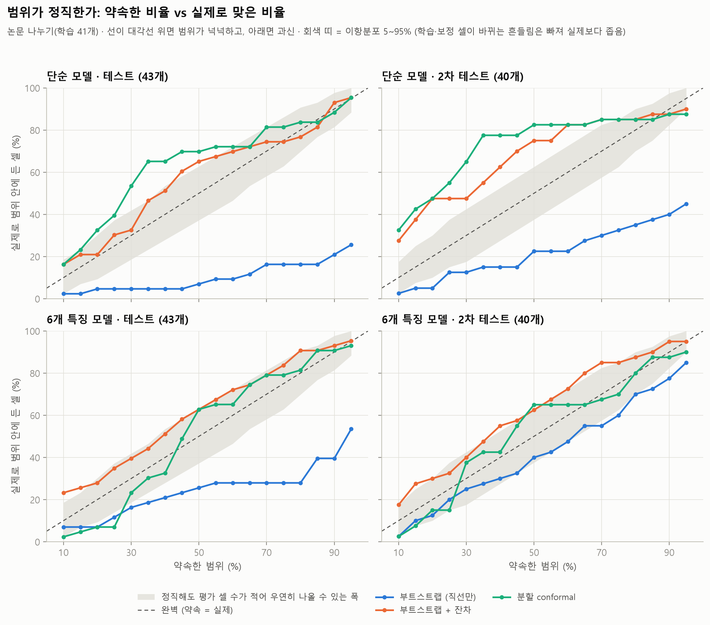
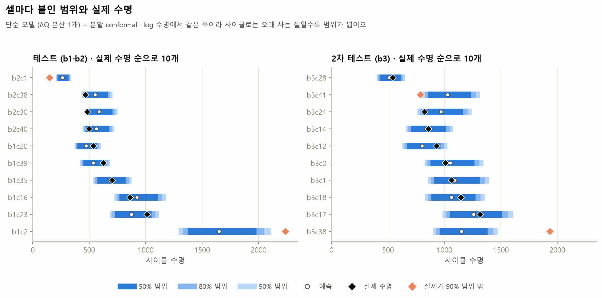
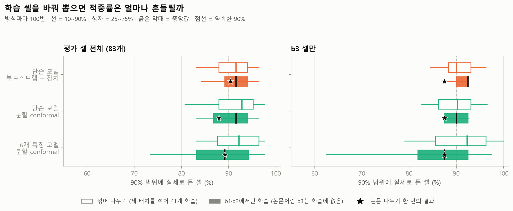

# 예측에 오차 범위 붙이기 (불확실성)

`python -m battery_lab.uncertainty_report`가 자동으로 만든 문서예요 (만든 날 2026-10-22, 계산 3.2분).

## 질문

수명 예측 모델은 "이 셀은 587사이클"처럼 숫자 하나를 내놓아요. 하지만 실무에서 정말 필요한 건
**"90% 확률로 459\~750사이클"** 같은 범위예요 (이 문서의 예시 셀 b2c30에서 실제로 계산한 결과). 그래서 이렇게 물었어요.

1. 초반 100사이클로 한 수명 예측에 **범위**를 붙일 수 있을까?
2. "90% 범위"(실제 수명이 그 안에 들어올 확률이 90%라고 내놓은 범위)라고 했으면 **정말로 셀의 90% 안팎이 그 안에 들어올까?** (범위가 정직한가 = 보정, calibration)
3. 다른 시기에 시험한 3배치(b3, 2차 테스트)에서도 그럴까?

## 왜 중요한가

- **셀 개발:** 새 소재·설계 후보를 100사이클 데이터로 비교할 때, 두 후보의 예측 차이가 범위보다 작으면 "아직 구분할 수 없음"이에요. 범위가 있어야 시험을 더 돌릴지, 지금 고를지 근거를 갖고 정할 수 있어요.
- **공정 개발·품질:** 보증 수명을 정할 때 중요한 건 예측값이 아니라 **범위의 아래 끝**이에요. 그래서 실제 수명이 범위보다 **짧게** 빗나간 비율(위험한 쪽)을 따로 셌어요.
- **정직하지 않은 범위는 숫자 하나보다 위험해요.** "90%"라고 믿고 결정했는데 실제로는 절반도 안 맞는 범위라면 과신이에요. 그래서 범위를 만드는 것보다 **범위가 약속을 지키는지 확인하는 것**에 더 힘을 썼어요.

## 방법

- **예측 모델:** [데이터 크기 실험](data_size.md)과 같은 두 모델이에요. 둘 다 log10(수명)을 예측해요 ([model.py](../battery_lab/model.py)).
  - **단순 모델 (ΔQ 분산 1개):** 논문의 variance 모델과 같은 형태
  - **6개 특징 모델 (Elastic Net):** 논문의 discharge 모델을 참고해 직접 구현
- **범위를 만드는 방법 세 가지** ([uncertainty.py](../battery_lab/uncertainty.py))
  - **부트스트랩 (직선만):** 학습 셀 41개를 중복을 허용해 다시 뽑아(부트스트랩, bootstrap) 모델을 여러 번 만들고(단순 1,000번 · 6개 특징 200번), 예측값이 흔들리는 폭을 범위로 써요. **모델(직선)이 얼마나 불확실한지**만 담아요.
  - **부트스트랩 + 잔차:** 위의 예측값마다, 그 모델이 학습에 쓰지 않은 셀(OOB, out-of-bag)에서 낸 오차를 더해요. **특징이 같아도 셀마다 수명이 다른 '셀 사이 편차'까지** 담아요.
  - **분할 conformal:** 학습 셀을 무작위로 나눠 21개로 모델을 만들고, 나머지 20개 (보정 셀)의 오차 크기 순위로 폭을 정해요. 오차가 어떤 모양이든 **평균적으로** 약속한 비율을 지키도록 설계된 방법이에요 (분포 가정이 없음, distribution-free). 단, 새 셀이 보정 셀과 같은 주머니에서 나왔다고 볼 수 있어야 해요 (교환 가능성, exchangeability). 입문 자료: [Angelopoulos · Bates, "A Gentle Introduction to Conformal Prediction and Distribution-Free Uncertainty Quantification" (arXiv:2107.07511)](https://arxiv.org/abs/2107.07511).
  - 세 방법 모두 log10 수명에서 범위를 만들고 사이클로 바꿔요. 그래서 사이클로는 위쪽이 아래쪽보다 조금 길어요.
- **정직함 확인:** 학습 41개로 범위를 만들고, 테스트 43개(b1, b2)와 2차 테스트 40개(b3)에서 셌어요.
  - **적중률(coverage):** 실제 수명이 범위 안에 든 셀의 비율. 90% 범위라면 90% 근처여야 정직해요.
  - **범위 폭:** 범위의 위 끝 − 아래 끝(사이클). 적중률이 같다면 좁을수록 쓸모 있어요.
  - **보정 그래프:** 10%부터 95%까지 범위를 바꿔 가며 약속한 비율과 실제 비율을 비교해요.
- **우연의 폭:** 셀이 40개 남짓이면 정직한 범위라도 적중률이 우연히 흔들려요. 진짜 적중 확률이 약속과 같을 때 셀 n개에서 나올 수 있는 적중률의 5\~95% 범위를 이항분포(동전 던지기 계산)로 구해 같이 적었어요. 단, 이 폭은 평가 셀이 서로 따로 맞고 틀린다고(독립) 보고 계산해서 **실제 흔들림보다 좁아요.** 실제로는 모든 평가 셀이 같은 학습·보정 셀로 만든 범위를 함께 쓰기 때문이에요. 분할 conformal은 그 흔들림까지 넣은 폭을 이론(베타-이항분포)으로 계산할 수 있어서 '읽는 법'에 같이 적었어요 (위 입문 자료의 3.2절·부록 C).
- **나누기를 바꿔 보기:** 학습 41개를 무작위로 다시 뽑는 실험을 두 방식으로 100번씩 했어요 (부트스트랩 방법은 나누기마다 모델을 300개씩 만들어요). 평가는 학습에 안 쓴 나머지 83개 셀 전체예요.
  - **섞어 나누기 (세 배치를 섞어 41개 학습)**
  - **b1·b2에서만 학습 (논문처럼 b3는 학습에 없음)**
  - 6개 특징 모델의 부트스트랩은 모델을 60,000번 다시 맞춰야 해서 이 실험에서는 뺐어요 (분할 conformal만).
- 무작위 뽑기는 모두 고정한 시드(seed 2026)로 해서, 다시 돌려도 같은 숫자가 나와요.

## 결과

### 1. 논문 나누기: 학습 41개 → 테스트 43개 · 2차 테스트 40개

칸 = **실제로 범위 안에 든 셀 비율** · 범위의 평균 폭(사이클)

**테스트 43개 (b1, b2)**

| 모델 | 방법 | 50% 범위 | 80% 범위 | 90% 범위 |
|---|---|---|---|---|
| 단순 모델 | 부트스트랩 (직선만) | 7% · 34 | 16% · 64 | **21% · 84** |
| 단순 모델 | 부트스트랩 + 잔차 | 65% · 220 | 77% · 304 | **93% · 354** |
| 단순 모델 | 분할 conformal | 70% · 259 | 84% · 306 | **88% · 348** |
| 6개 특징 모델 | 부트스트랩 (직선만) | 26% · 65 | 28% · 124 | **40% · 157** |
| 6개 특징 모델 | 부트스트랩 + 잔차 | 63% · 163 | 91% · 290 | **93% · 376** |
| 6개 특징 모델 | 분할 conformal | 63% · 162 | 81% · 266 | **91% · 395** |

*정직한 범위라도 셀 43개면 적중률이 우연히 50% 범위 37\~63%, 80% 범위 70\~91%, 90% 범위 81\~98% 사이로 나올 수 있어요 (이항분포 5\~95%).*

**2차 테스트 40개 (b3)**

| 모델 | 방법 | 50% 범위 | 80% 범위 | 90% 범위 |
|---|---|---|---|---|
| 단순 모델 | 부트스트랩 (직선만) | 22% · 52 | 35% · 100 | **40% · 134** |
| 단순 모델 | 부트스트랩 + 잔차 | 75% · 306 | 85% · 436 | **88% · 499** |
| 단순 모델 | 분할 conformal | 82% · 365 | 85% · 432 | **88% · 490** |
| 6개 특징 모델 | 부트스트랩 (직선만) | 40% · 131 | 70% · 252 | **78% · 313** |
| 6개 특징 모델 | 부트스트랩 + 잔차 | 62% · 236 | 88% · 423 | **95% · 542** |
| 6개 특징 모델 | 분할 conformal | 65% · 205 | 80% · 337 | **88% · 500** |

*정직한 범위라도 셀 40개면 적중률이 우연히 50% 범위 38\~62%, 80% 범위 70\~90%, 90% 범위 82\~98% 사이로 나올 수 있어요 (이항분포 5\~95%).*

### 2. 예시: 셀마다 붙인 범위

테스트 셀 b2c30(5.2C(10%)-4.75C)의 경우, 단순 모델 + 분할 conformal의 답은
"**예측 587사이클, 90% 확률로 459\~750사이클**"이고 실제 수명은 **481사이클**이에요 (범위 안).

*그래프의 셀은 결과를 보고 고르지 않고, 나누기마다 실제 수명 순으로 고르게 10개씩 뽑았어요. 이 중 90% 범위 밖은 테스트 2개, 2차 테스트 2개예요.*

### 3. 학습 셀을 바꿔 뽑으면 적중률은 얼마나 흔들릴까

90% 범위의 적중률 · 방식마다 100번 · 칸 = 중앙값 (10\~90% 범위) · '80% 미만' 칸은 100번 중 비율, '논문 나누기' 칸은 한 번의 값

*10\~90% 범위 = 100번의 적중률을 작은 것부터 줄 세워 아래 10%와 위 10%를 뺀 가운데 80% 구간이에요.*

| 모델 | 방법 | 섞어 나누기: 평가 셀 전체 | 섞어 나누기: 적중률 80% 미만이었던 나누기 비율 | 섞어 나누기: b3 셀만 | b1·b2에서만 학습: b3 셀만 | 논문 나누기: b3 (한 번) |
|---|---|---|---|---|---|---|
| 단순 모델 | 부트스트랩 (직선만) | 28% (20%\~34%) | 100% | 34% (22%\~44%) | 39% (30%\~43%) | 40% |
| 단순 모델 | 부트스트랩 + 잔차 | 92% (83%\~96%) | 6% | 90% (85%\~96%) | 92% (88%\~92%) | 88% |
| 단순 모델 | 분할 conformal | 93% (81%\~98%) | 8% | 90% (83%\~97%) | 90% (88%\~93%) | 88% |
| 6개 특징 모델 | 분할 conformal | 92% (83%\~98%) | 8% | 92% (79%\~100%) | 88% (62%\~98%) | 88% |

*섞어 나누기에서는 평가 셀 83개 중 b3가 보통 27개쯤 들어가요. b1·b2에서만 학습하면 b3 40개가 모두 평가에 들어가요.*

### 4. 2차 테스트(b3)는 학습 셀과 무엇이 다를까

**수명과 예측 오차** (학습 셀 전체로 만든 모델 기준)

| 나누기 | 셀 | 배치 | 수명 중앙값 (10\~90%) | 단순 모델 치우침 | 단순 모델 log 오차 흩어짐 | 단순 모델 보통 셀의 log 오차 | 6개 특징 모델 치우침 | 6개 특징 모델 log 오차 흩어짐 |
|---|---|---|---|---|---|---|---|---|
| 학습 (모델이 본 셀) | 41 | b1, b2 | 527 (459\~966) | 0.0% | 0.070 | 0.067 | 0.0% | 0.047 |
| 테스트 | 43 | b1, b2 | 561 (459\~1,044) | -3.3% | 0.075 | 0.054 | -5.7% | 0.079 |
| 2차 테스트 | 40 | b3 | 964 (785\~1,347) | +2.0% | 0.069 | 0.046 | -3.0% | 0.058 |

*치우침 = 실제 수명이 예측보다 평균 몇 % 긴가(+) 짧은가(−) (log 오차 평균을 %로 바꾼 값). 흩어짐 = log10 오차의 표준편차. 보통 셀의 log 오차 = |log10 오차|의 중앙값. 학습 셀은 모델이 직접 보고 맞춘 셀이라 오차가 작게 나오는 쪽이에요.*

**특징 분포** (학습 셀 41개 기준)

| 특징 | 테스트: 중앙값 차이 | 2차 테스트: 중앙값 차이 | 2차 테스트 중 학습 셀 범위 밖 |
|---|---|---|---|
| ΔQ 분산 | -0.08 | **-1.42** | 0% |
| ΔQ 최솟값 | -0.05 | **-1.42** | 0% |
| ΔQ 왜도 | -0.04 | **+0.56** | 0% |
| ΔQ 첨도 | +0.02 | **-0.99** | 8% |
| 2번째 사이클 용량 | +0.03 | **-1.11** | 5% |
| 초반 용량 증가분 | +0.28 | **-0.85** | 8% |

*중앙값 차이 = (그 나누기의 중앙값 − 학습 셀 중앙값) ÷ 학습 셀 표준편차. ±1이면 학습 셀이 흩어진 폭만큼 옮겨 간 것이에요. 범위 밖 = 학습 셀의 최솟값\~최댓값 밖인 셀 비율. ΔQ 특징 네 개는 모델에 넣는 그대로 log10 값이에요 ([features.py](../battery_lab/features.py)).*

b3의 충전 조건 8가지는 이름 끝의 `-newstructure`를 떼고 비교해도 b1·b2와 겹치는 것이 1가지예요.

## 읽는 법 (숫자는 코드가 계산)

1. **모델만 흔들면 범위가 너무 좁아요.** 부트스트랩 (직선만)의 90% 범위는 평균 폭이 84사이클(테스트)로 좁지만, 실제로 맞은 셀은 테스트 21%, 2차 테스트 40%뿐이에요. 학습 셀 41개로 맞춘 직선 자체는 꽤 안정적이지만, **같은 특징값을 가진 셀끼리도 수명이 다르기 때문**이에요. "직선이 얼마나 확실한가"와 "셀 하나의 수명이 얼마나 확실한가"는 다른 질문이에요.
2. **셀 사이 편차를 넣으면 약속에 가까워져요.** 단순 모델의 90% 범위는 부트스트랩 + 잔차가 테스트 93% · 2차 테스트 88%, 분할 conformal이 88% · 88%를 맞혔어요. 두 방법 × 두 모델 × 두 나누기 8경우 중 **8경우가 우연의 폭 안**이에요. 대신 폭은 넓어요: 단순 모델 + 분할 conformal의 90% 범위는 예측값의 약 ±25%(테스트 평균 폭 348사이클)예요.
3. **좁은 범위(50%)는 오히려 넉넉했어요.** 50% 범위의 적중률이 8경우 중 5경우에서 이항분포 우연의 폭보다 높았어요(보정 그래프에서 선이 대각선 위). 다만 이항분포 폭은 실제보다 좁아요. 분할 conformal만 이론 폭(베타-이항분포: 테스트 30\~74%, 2차 테스트 30\~75%)으로 다시 보면 4경우 중 1경우만 그 폭 위예요. 섞어 나누기 100번에서는 단순 모델 50% 범위의 적중률 중앙값이 부트스트랩 + 잔차 49%, 분할 conformal 54%예요. 그래서 논문 나누기에서 50%가 넉넉했던 것은 **이 나누기만의 우연**일 가능성이 있어요(가설). 단순 모델의 보통 셀 |log 오차|: 학습 셀 0.067 · 테스트 0.054 · 2차 테스트 0.046. 넉넉했던 5경우 중 단순 모델 4경우는 모델이 직접 본 학습 셀의 보통 오차가 그 평가 셀보다 오히려 더 커서, 학습 셀로 정한 50% 폭이 평가 셀에는 넉넉했던 것으로 보여요. 나머지 6개 특징 모델 1경우는 학습 셀의 보통 오차가 그 평가 셀보다 뚜렷이(10% 넘게) 크지 않아서 이 설명이 맞지 않아요 (6개 특징 모델 + 분할 conformal · 2차 테스트: 학습 셀 0.036 vs 2차 테스트 0.036).
4. **6개 특징 모델의 범위는 좁은 범위(50%)에서 더 많이 좁아져요.** 분할 conformal의 평균 폭을 비교했어요. 논문 나누기 테스트에서는 50% 범위 6개 특징 162 vs 단순 259사이클, 90% 범위 395 vs 348사이클이었어요. 섞어 나누기 100번의 중앙값은 50% 범위 154 vs 218사이클, 90% 범위 407 vs 443사이클이고, 6개 특징 모델이 더 좁았던 나누기는 50% 범위 83%, 90% 범위 62%예요. 그래서 논문 나누기에서 90% 범위가 오히려 넓었던 것은 이 나누기 한 번의 결과로 보이고, 넓은 범위로 갈수록 이득이 줄어드는 것은 공통이에요. 대부분의 셀은 더 잘 맞히지만 크게 빗나가는 몇 개는 비슷하게 빗나가서, 넓은 범위의 폭은 그 몇 개가 정하는 것으로 보여요(가설).
5. **분할 conformal은 '평균적으로' 정직하지만 한 번 한 번은 흔들려요.** 섞어 나누기 100번에서 단순 모델의 90% 범위 적중률은 중앙값 93%이지만 10\~90%가 81%\~98%였어요. 8%의 경우 80%도 안 됐어요. 보정 셀이 20개뿐이라 90% 범위의 폭이 사실상 **보정 셀 20개 중 2번째로 큰 오차** 하나로 정해지기 때문이에요. 이론(베타-이항분포)으로 계산해도 보정 셀 20개 · 평가 셀 83개면 적중률의 10\~90%가 81\~98%로, 실제로 본 흔들림과 비슷해요. 평가 셀만의 우연(이항분포)이었다면 86\~94%였을 폭이에요. 부트스트랩 + 잔차는 같은 조건에서 83%\~96%(6%가 80% 미만)였어요. 학습 셀을 반으로 나누지 않고 모두 쓰기 때문으로 보여요(가설).
6. **2차 테스트(b3)는 '다른 묶음'이지만, log 기준 범위는 대체로 지켜졌어요 (관찰).**
   - 다른 점: b3 셀은 수명 중앙값이 964사이클로 테스트(561)의 1.7배예요. 특징 6개 중 3개(ΔQ 분산, ΔQ 최솟값, 2번째 사이클 용량)의 중앙값이 학습 셀에서 표준편차 1배 넘게 떨어져 있어요. 테스트 셀은 모든 특징이 학습 셀과 거의 같은 자리예요. 충전 조건은 b1·b2와 겹치는 것이 8가지 중 1가지이고, 시험 시작일은 b2보다 약 9개월 뒤예요([sources.py](../battery_lab/sources.py)).
   - 비슷한 점: 단순 모델이 쓰는 특징 하나(ΔQ 분산)는 b3 셀의 100%가 학습 셀 범위 안에 있어요 (학습 셀이 본 범위 안에서 옮겨 간 것). 단순 모델의 log 오차 흩어짐도 0.069로 테스트(0.075)와 비슷해요. 90% 범위의 적중률은 두 방법 × 두 모델 4경우 중 4경우가 우연의 폭 안이었어요.
   - 무작위 나누기에서 b3 셀만 본 적중률은 단순 모델 + 분할 conformal이 b3가 학습에 일부 있을 때 90%, 전혀 없을 때 90%로 차이가 작아요. 6개 특징 모델은 중앙값 92% → 88%, 나쁜 쪽 끝(10%)은 79% → 62%예요. **6개 특징 모델은 b3 셀 일부가 학습 셀 범위 밖에 있는 특징(ΔQ 첨도, 2번째 사이클 용량, 초반 용량 증가분)까지 쓰기 때문에 새 묶음에서 더 흔들리는 것**일 수 있어요(가설. 모델 두 개만 비교했어요).
   - **가설:** 2차 테스트의 RMSE(평균 제곱근 오차. 예측이 대략 몇 사이클 빗나갔나)가 테스트보다 큰 것(단순 모델 196 vs 138사이클, [데이터 크기 실험](data_size.md))은 b3 셀이 더 나쁘게 맞아서라기보다, **수명이 길어서 같은 % 오차가 더 많은 사이클이 되기 때문**일 수 있어요. 평균 % 오차(MAPE)는 2차 테스트 11.4% · 테스트 14.7%로 오히려 작고, log 오차 흩어짐도 0.069 vs 0.075예요. (분할 conformal의 범위는 log에서 모든 셀에 같은 폭이라, 예측값 대비 ±25%로 두 나누기가 같은 것은 계산 방식 때문이에요. 이 가설의 근거가 아니에요.) 셀 40개로는 이 가설을 확정할 수 없고, 새 묶음이 학습 셀과 같은 주머니에서 나왔다는 보장도 없어요.
7. **위험한 쪽 빗나감:** 실제 수명이 90% 범위보다 **짧았던** 테스트 셀은 네 경우 중 가장 많을 때 9%(셀 43개 중 4개, 단순 모델 + 분할 conformal)였어요 (범위가 위아래로 고르게 빗나간다면 약 5%, 셀 43개 중 약 2개). 보증 수명을 범위의 아래 끝으로 잡는다면, 이 비율이 "보증보다 일찍 죽는 셀"의 대략적인 비율이에요.

## 이 결과가 말해 주는 것

- **범위를 붙일 때는 '모델의 불확실성'과 '셀 사이 편차'를 모두 넣어야 해요.** 모델만 흔드는 범위는 보기엔 깔끔하지만 과신이에요.
- **범위는 만들었으면 반드시 확인해요.** "90%"라는 이름표가 아니라, 학습에 안 쓴 셀에서 실제로 몇 %가 들어오는지가 범위의 실력이에요.
- **현업으로 옮기면:** 새 셀의 수명을 "예측 587사이클" 대신 "90% 범위 아래 끝 459사이클"처럼 보고하고, 새 묶음(새 소재·새 공정 조건)이 학습 셀과 다를수록 그 범위를 덜 믿어야 해요.

## 한계

- **셀이 적어요.** 테스트 43개 · 2차 테스트 40개라서 정직한 90% 범위도 적중률이 81\~98%·82\~98% 사이에서 우연히 흔들려요(이항분포). 같은 보정 셀을 함께 쓰는 흔들림까지 넣으면(분할 conformal, 베타-이항분포) 77\~100%·75\~100%로 더 넓어요. 몇 %p 차이로 방법의 우열을 가릴 수 없어요.
- **보장은 '평균적으로'예요.** 분할 conformal의 약속은 새 셀이 보정 셀과 같은 주머니에서 나왔다는 가정(교환 가능성) 아래에서, 여러 번 했을 때의 평균이에요. 셀 하나하나나 b3 같은 새 묶음에 대한 보장이 아니에요.
- **폭이 모든 셀에 같아요(log 기준).** 분할 conformal은 어떤 셀이 더 불확실한지 구분하지 않아요. 특징이 극단적인 셀이라고 범위를 더 넓히지 않아요.
- **부트스트랩 표본에는 같은 셀이 여러 번 들어가요.** 그래서 6개 특징 모델 안의 교차 검증(규제 세기 고르기)이 조금 낙관적일 수 있어요.
- **6개 특징 모델의 부트스트랩은 무작위 나누기 실험에서 뺐어요** (계산 시간). 그 모델의 흔들림은 분할 conformal로만 봤어요.
- **관찰 데이터예요.** b3가 왜 다르게(또는 비슷하게) 보이는지는 가설이고, 충전 조건·시험 시기·셀 묶음 중 무엇 때문인지 가릴 수 없어요.
- 분위수 회귀(quantile regression), 베이지안 회귀 같은 다른 방법은 시도하지 않았어요.

## 시행착오

| 상황 | 처음 생각 | 어떻게 알아챘나 | 원인 → 수정 |
|---|---|---|---|
| 2차 테스트(b3)의 범위 | b3는 시기·충전 조건이 달라 어느 모델이든 범위가 덜 맞을 것(과신)이라고 짐작 | 계산해 보니 논문 나누기에서는 네 경우 모두 우연의 폭 안. 무작위 나누기에서는 6개 특징 모델만 나쁜 쪽 끝이 낮아짐 | 짐작을 결론으로 쓰지 않고, 'b3를 학습에서 뺀 무작위 나누기'를 따로 돌려 숫자로 비교. 다른 점(수명·특징)과 비슷한 점(log 오차 크기)을 나눠 적고 '가설'로 표시 |
| 문서 초안의 숫자 | 문서를 만드는 코드 안에 예시 숫자(셀 수, 보정 셀 수, 배치 사이 간격 등)를 손으로 적음 | 문서 규칙(숫자는 코드가 계산)과 맞춰 보다 발견. 배치 사이 간격은 날짜로 계산하니 어림한 값과 달랐음 | 모두 데이터·설정에서 계산하도록 바꿈 (예: 시험 시작일 간격 약 9개월, 보정 셀 20개 중 2번째로 큰 오차) |
| 가짜 데이터 테스트 | 평가 셀만 많으면 정직한 범위의 적중률이 약속에 가깝게 나올 것 | 테스트가 실패(90% 범위인데 더 적게 맞음) → 학습 셀의 오차 크기를 직접 찍어 봄 | 학습 셀이 적으면 학습 셀에 실제로 붙은 잡음이 우연히 작게 나와 범위도 좁아짐. 코드가 아니라 테스트의 짐작이 틀림 → 학습 셀도 크게 잡음 |
| 요약표 열 이름 | 중앙값 열을 `median`으로 이름 붙임 | 문서를 만들다 오류 | pandas 표의 한 줄에서 `r.median`이 값이 아니라 함수로 읽힘 → 열 이름을 `mid`로 바꿈 |
| 그래프 범례 | 범례를 그래프 안 빈 곳에 둠 | 그림을 직접 열어 보니 선·점과 겹침 | 범례를 그래프 아래로 옮김 |
| 2차 테스트 가설의 근거 (검증 단계) | 분할 conformal 90% 범위의 예측값 대비 비율이 두 나누기 모두 ±25%로 같으니, b3도 % 오차가 비슷하다는 근거라고 씀 | 별도 검증에서 conformal 폭 계산식을 다시 보다 발견 | log에서 폭이 모든 셀에 같아 이 비율은 계산상 항상 같음(근거가 될 수 없음) → 근거를 MAPE와 log 오차 흩어짐으로 바꿈 |
| 우연의 폭 (검증 단계) | 이항분포 5\~95%면 '우연'을 충분히 담는다고 봄 | 무작위 나누기에서 본 흔들림(81\~98%)이 이항분포(86\~94%)보다 넓은 것을 보고 입문 자료를 다시 확인 | 모든 평가 셀이 같은 보정 셀을 쓰면 적중률은 베타-이항분포를 따름 → 분할 conformal의 이론 폭을 함께 적고, 50% 범위가 '넉넉했다'는 경우를 다시 셈 |
| 6개 특징 모델의 90% 폭 (검증 단계) | 논문 나누기 한 번에서 90% 폭이 더 넓은 것을 '좁은 범위에서만 이득'이라고 일반화 | 무작위 나누기 결과와 맞춰 보니 90% 범위도 62%의 나누기에서 6개 특징 모델이 더 좁음 | 나누기 한 번으로 일반화함 → 무작위 나누기의 중앙값과 짝 비교 비율을 같이 적음 |

더 해 볼 만한 응용은 [응용 아이디어](ideas.md)에 정리해 두었어요.
