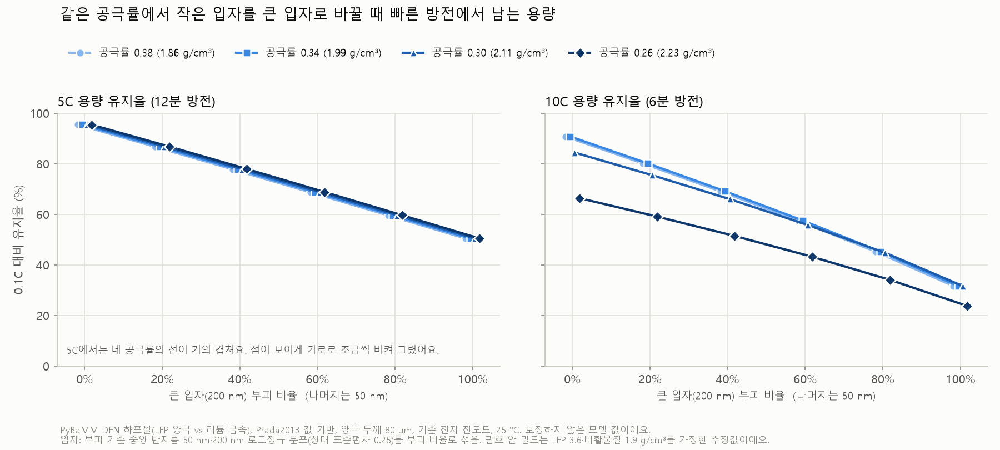
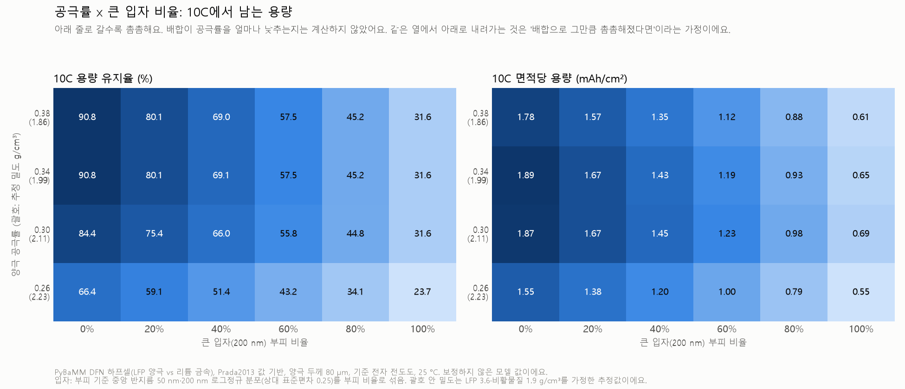
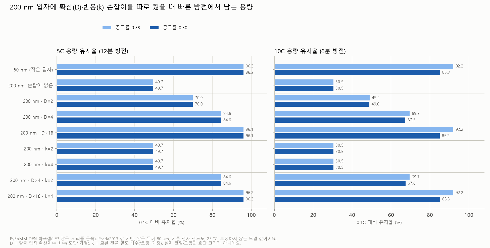
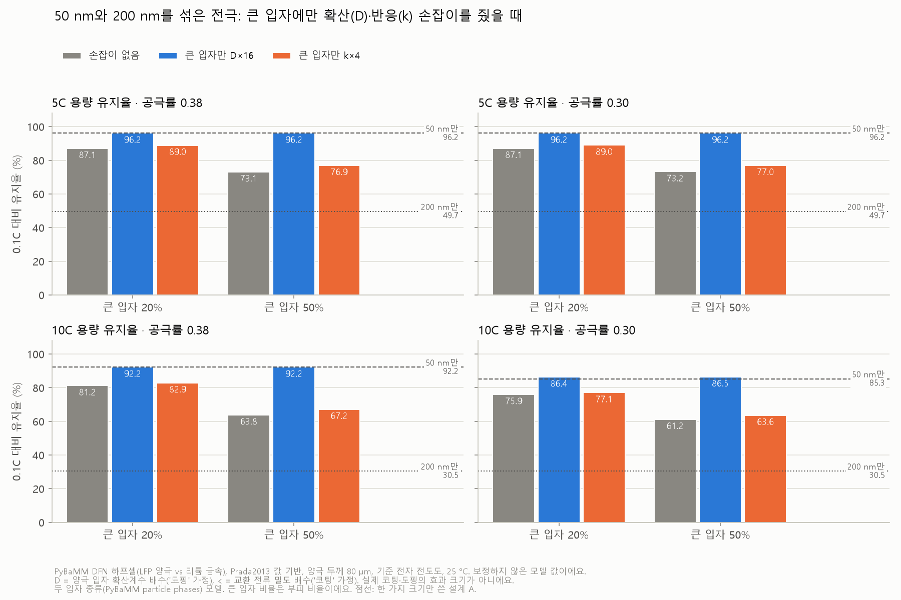

# PyBaMM 시뮬레이션 맛보기

"배터리 시뮬레이션을 우리 PC에서 돌릴 수 있을까?"를 직접 확인한 기록이에요.
[PyBaMM](https://pybamm.org/)은 무료 오픈소스 파이썬 배터리 시뮬레이터예요. 셀 안의 리튬 이동을 물리 방정식으로 계산해요.
자세한 해석과 관련 연구는 [관련 연구 · 시뮬레이션](../../docs/related_work.md)에 있어요.

> 이 폴더의 스크립트와 결과는 조사 에이전트가 만들고 실행했고, 결과 숫자는 결과 파일을 다시 열어 대조했어요.

## 결론부터

- **돌리는 건 쉬웠어요.** 일반 데스크톱(AMD Ryzen 5 5600XT 6코어, RAM 32GB, Windows 11)에서 방전 한 번에 0.06\~0.21초,
  열화 4종을 모두 켠 50사이클이 약 20초였어요.
- **어려운 건 "우리 셀에 맞는 숫자(파라미터)"를 구하는 일이에요.** PyBaMM에 들어 있는 LFP 파라미터 세트는 다른 셀(정격 2.3Ah)이고,
  열화(SEI) 파라미터가 없어요. 다른 셀의 값을 빌려 넣으면 Severson 셀처럼 늙지 않아요 (아래 c).
- **LFP 양극을 눌러 밀도를 올리면, 10C에서는 어느 지점부터 손해가 커졌어요 (아래 d).** 면적당 용량은 늘고 5C까지는 손해가 거의 없었지만,
  기준 전도도에서는 공극률 0.30부터 10C 유지율이 꺾였고, 전자 전도도를 높여도 막지 못했어요. 보정하지 않은 모델의 경향이에요.
- **큰 입자와 작은 입자를 섞으면(입도 배합), 같은 공극률에서는 큰 입자가 많을수록 고율 성능이 크게 줄었어요 (아래 e).** 공극률 0.34에서 큰 입자(반지름 200 nm) 비율을 0%에서 100%로 늘리면
  10C 유지율이 90.77%에서 31.62%로 줄었어요. 섞으면 더 촘촘해진다는 이득(패킹)은 PyBaMM이 계산하지 않아 가정으로만 따져 봤고,
  그 가정으로도 계산한 공극률(0.26까지) 안에서는 10C 면적당 용량이 작은 입자만 쓴 공극률 0.38 설계보다 많아지지 않았어요. 보정하지 않은 모델의 경향이에요.
- **큰 입자가 고율에서 손해를 보는 까닭을 나눠 보니, 이 모델에서는 거의 모두 입자 안 확산 거리 때문이었어요 (아래 f).** 공극률 0.38의 10C에서 200 nm 입자에
  확산계수 ×16(가정한 '도핑')을 주면 유지율이 30.49%에서 92.21%로 50 nm(92.23%)만큼 돌아왔고, 반응 속도 상수 ×4(가정한 '코팅')는 30.49% 그대로였어요.
  손잡이는 실제 코팅·도핑이 아니라 원인을 가르려고 한 값만 바꾼 가정이에요. LFP의 두 상 반응이 없는 단순 확산 모델로 하프셀 방전만 계산한, 보정하지 않은 모델의 경향이에요.

## 실행한 것

| 스크립트 | 무엇을 | 걸린 시간 | 결과 |
|---|---|---|---|
| [a_lfp_discharge.py](a_lfp_discharge.py) | LFP/흑연 셀(Prada2013, 2.3Ah)을 0.5C·1C·2C로 방전, 모델 3가지(SPM·SPMe·DFN) 비교 | 9번 계산 합계 약 3.7초 (한 번 0.06\~0.21초) | 방전 용량 0.5C 2.119Ah(92%) · 1C 1.939Ah(84%) · 2C 1.599Ah(70%). 세 모델 차이 0.001Ah 이하 |
| [b_degradation.py](b_degradation.py) | NMC811/흑연+SiOx 셀(OKane2022, LG M50 5Ah) + DFN에 SEI 성장·리튬 석출·입자 균열·활물질 손실을 모두 켜고, 충전 속도 0.5C·1C·2C로 50사이클 | 18.6 · 19.6 · 21.1초 | 아래 표 |
| [c_lfp_sei_demo.py](c_lfp_sei_demo.py) | LFP 셀(Prada2013)에 다른 셀(OKane2022)의 SEI 값 78개를 빌려 넣고, Severson과 비슷한 4C 충방전 100사이클 | 2.9초 | 100사이클 동안 용량이 거의 줄지 않음(최고 1.1772 → 1.1766Ah), 리튬 손실 0.033% |
| [d_lfp_density_rate.py](d_lfp_density_rate.py) | LFP 양극 하프셀(Prada2013 양극 + 리튬 금속, DFN)에서 공극률 5단계 × 전자 전도도 3단계 = 15개 설계를 0.1C\~10C로 방전. 곁가지로 입자 반지름 50·100·200 nm | 95번 계산, 전체 33.9초 (한 번 약 0.2\~0.8초) | 공극률 0.426 → 0.26에서 0.1C 면적당 용량 1.82 → 2.34 mAh/cm². 10C 유지율(기준 전도도)은 0.34까지 92.23%, 0.26에서 67.23% (아래 d) |
| [e_lfp_size_mix.py](e_lfp_size_mix.py) | d와 같은 LFP 하프셀에 입자 크기 분포(중앙 반지름 50 nm·200 nm 두 봉우리)를 넣고, 큰 입자 부피 비율 6단계 × 공극률 4단계 = 24개 설계를 0.1C–10C로 방전. 점검용 좁은 분포 2개 | 본 방전 130번(한 번 1.9–214.2초). 결과에 쓰인 계산 시간 합 5363.4초(점검 포함, 실패한 시도 제외) | 공극률 0.34에서 큰 입자 0% → 100%로 10C 유지율 90.77 → 31.62%, 5C 유지율 95.45 → 50.41%. 0.1C 면적당 용량은 2.09 → 2.06 mAh/cm² (아래 e) |
| [f_lfp_ct_vs_mass.py](f_lfp_ct_vs_mass.py) | d와 같은 LFP 하프셀에서 200 nm 입자에 확산계수 배수(×2·×4·×16)와 반응 속도 상수 배수(×2·×4)를 따로·함께 주고 50 nm와 비교(공극률 0.38·0.30, 18개 설계). 50 nm·200 nm를 섞은 전극(큰 입자 20·50%)에서 큰 입자에만 주기(12개 설계). 점검용 8개 | 방전 190번(한 번 약 0.3–1.2초), 6개 동시 실행으로 점검까지 전체 188.9초 | 공극률 0.38의 10C 유지율: 50 nm 92.23%, 200 nm 30.49% → 확산계수 ×16 92.21%, 반응 속도 상수 ×4 30.49% (아래 f) |

### b) 충전 속도별 50사이클 열화 (OKane2022)

| 충전 속도 | 1C 방전 용량 (1 → 50사이클) | 리튬 재고 손실 (LLI) | 음극 활물질 손실 | 양극 활물질 손실 | 리튬 석출로 잃은 용량 |
|---|---|---|---|---|---|
| 0.5C | 4.9357 → 4.9062Ah (−0.60%) | 0.59% | 0.075% | 0.021% | 0.0216Ah |
| 1C | 4.9357 → 4.9038Ah (−0.65%) | 0.62% | 0.075% | 0.035% | 0.0259Ah |
| 2C | 4.9357 → 4.8912Ah (−0.90%) | 0.76% | 0.076% | 0.054% | 0.0364Ah |

→ **충전이 빠를수록 리튬 석출이 늘고 용량이 더 빨리 줄어드는 경향**이 물리 모델에서도 나와요.
[배경 지식](../../docs/background.md)의 "급속충전이 수명을 줄이는 이유"와 같은 방향이에요.
다만 50사이클이라 감소량은 1% 미만이고, 우리 데이터(LFP, 4C 방전)의 셀과는 다른 셀이에요.

### d) 고밀도 LFP 양극: 극판을 눌러 밀도를 올리면 출력은?

**왜 이 질문인가요?**

고밀도 LFP는 같은 부피에 활물질(리튬을 실제로 담는 LFP 가루)을 더 많이 담는 거예요.
극판을 세게 눌러 가루 사이 빈틈(공극)을 줄이면 같은 두께에 더 많이 들어가요.
그런데 이 빈틈에는 전해질이 차 있고, 리튬 이온은 이 길로 움직여요. 그래서 빈틈이 줄면 빠른 방전(고율)에서 손해를 볼 수 있어요.
한편 LFP는 전자가 잘 흐르지 않는 물질이라, 탄소 코팅과 도전재로 전자 길을 만들어 줘요.
이 계산은 **"빈틈을 줄이면 고율에서 얼마나 손해를 보고, 전자 전도도(탄소 코팅·도전재의 몫)가 그 손해를 얼마나 바꾸나?"를** 살펴봐요.

**어떻게 돌렸나요?**

- **모델:** PyBaMM의 DFN 모델이에요. 전극 두께 방향과 입자 안을 함께 계산하고, 위 a에서 비교한 SPM·SPMe·DFN 중 가장 자세한 모델이에요.
- **셀 구성:** 하프셀(LFP 양극 대 리튬 금속)이에요. 양극 재료를 코인셀로 시험하는 것과 같은 구성이에요.
  25 °C로 온도를 고정하고, 만충(전류를 흘리지 않을 때 양극 전압이 3.6 V가 되는 상태)에서 시작해 일정한 전류로 2.0 V까지 방전해요.
- **값:** Prada2013(A123 LFP/흑연 26650 셀)의 양극·전해질·분리막 값을 기본으로 써요.
  하프셀의 리튬 금속 쪽에 필요한 값 **4개만** 다른 세트(Xu2019)에서 빌렸어요.
  Prada2013에 없어서 새로 넣은 값 2개, 흑연 값을 리튬 금속 값으로 바꾼 값 2개예요. 빌린 이름은 결과 JSON에 모두 적었어요.
- **바꾼 것:**
  - 양극 공극률(빈틈 비율) 5단계: 0.426(Prada2013 기준) · 0.38 · 0.34 · 0.30 · 0.26
  - 양극 전자 전도도 3단계: 기준값 0.338 S/m의 ×0.1 · ×1 · ×10. 탄소 코팅·도전재가 만드는 전자 길이 나쁘거나 좋은 경우를 흉내 낸 값이에요.
  - 15개 설계 × 방전 속도 5가지(0.1C·1C·2C·5C·10C) = 75번 계산했어요. 곁가지로 입자 반지름도 바꿔 봤어요(아래 표).
- **고정한 것:** 양극 두께 80 µm, 입자 반지름 50 nm, 분리막 25 µm예요.
  빈틈이 줄어든 만큼 고체가 늘고, 활물질과 비활물질(바인더+탄소)의 비율은 기준 설계와 같게 둬요.
  활물질 부피 비율 = 0.374 × (1 − 공극률) ÷ (1 − 0.426)이에요.
- **이온 길과 전자 길:** PyBaMM은 브루그만 식으로 길이 좁아지는 정도를 계산해요.
  이온 길은 공극률^1.5, 전자 길은 (1 − 공극률)^1.5에 비례해요. 그래서 누를수록 이온 길은 좁아지고 전자 길은 조금 넓어져요.
- **1C와 유지율:** 1C는 설계마다 **자기 0.1C 방전 용량**으로 정해요(1C 전류 = 0.1C 용량 ÷ 1시간).
  그래서 용량이 큰 설계에는 같은 "10C"라도 더 큰 전류가 흘러요.
  **용량 유지율 = xC 방전 용량 ÷ 0.1C 방전 용량 × 100**이에요.
  에너지 유지율은 같은 계산을 에너지(전압 × 용량)로 한 거라, 전압이 떨어진 손해까지 보여 줘요.
- **계산 점검:** 95번 계산(본 실험 75번 + 곁가지 20번)이 모두 하한 전압에 닿아 정상으로 끝났고, 실패는 0번이에요. 전체 33.9초 걸렸어요.
  계산 칸(격자)을 모든 방향으로 2배로 늘려 8개 설계의 10C 방전을 다시 풀었더니, 용량 차이가 최대 0.158%였어요.

**결과 표** (입자 반지름 50 nm. 칸 안의 세 숫자는 전자 전도도 ×0.1 / ×1(기준) / ×10 순서예요.)

| 양극 공극률 | 전극 밀도 g/cm³ **추정(가정: LFP 3.6, 비활물질 1.9 g/cm³)** | 0.1C 면적당 용량 (mAh/cm²) | 5C 용량 유지율 (%) | 10C 용량 유지율 (%) | 10C 에너지 유지율 (%) |
|---|---|---|---|---|---|
| 0.426 (기준) | 1.73 | 1.82 | 95.63 / 96.16 / 96.16 | 91.52 / 92.23 / 92.24 | 77.41 / 88.22 / 88.92 |
| 0.38 | 1.86 | 1.96 | 96.14 / 96.15 / 96.16 | 91.59 / 92.23 / 92.23 | 77.67 / 87.87 / 88.44 |
| 0.34 | 1.99 | 2.09 | 96.14 / 96.15 / 96.16 | 91.64 / 92.23 / 92.17 | 77.81 / 87.38 / 87.42 |
| 0.30 | 2.11 | 2.21 | 96.14 / 96.15 / 96.15 | 91.72 / 85.31 / 78.20 | 77.80 / 80.04 / 73.90 |
| 0.26 | 2.23 | 2.34 | 96.14 / 96.15 / 96.15 | 80.29 / 67.23 / 62.10 | 66.39 / 62.69 / 58.52 |

- 0.1C 면적당 용량은 전도도와 거의 상관없이 같아서 한 칸으로 적었어요. 전극 면적 1 cm²(집전체 한 면)당 값이에요.
- 0.1C에서는 15개 설계 모두 이론 용량의 99.91%를 써요.
  1C·2C 유지율은 15개 설계 모두 99.29%·98.51%로 같아서 표에서 뺐어요.


그림 1. 공극률에 따른 5C·10C 용량 유지율과 10C 에너지 유지율이에요. 선 색은 전자 전도도예요.


그림 2. 가로축은 0.1C 면적당 용량(오른쪽일수록 많이 담음), 세로축은 10C 용량 유지율이에요.

**읽는 법**

- **누른 만큼 더 담겨요.** 공극률을 0.426에서 0.26으로 낮추면 0.1C 면적당 용량이 1.82에서 2.34 mAh/cm²로 늘어요.
  늘어난 활물질 양에 그대로 비례해서 늘어요.
- **5C까지는 손해가 거의 없고, 10C에서는 촘촘한 쪽에서 꺾여요.** 5C 용량 유지율은 15개 설계 모두 95.63\~96.16%예요.
  기준 전도도의 10C 유지율은 0.34까지 92.23%로 그대로였다가 0.30에서 85.31%, 0.26에서 67.23%로 떨어져요.
  이 두 설계는 10C 방전 중 양극 빈틈 속 전해질 농도가 0까지 내려가요(처음 1200 mol/m³). 이온 길이 좁아져 안쪽에 리튬 이온이 모자라는 거예요.
  전도도 ×0.1에서는 0.30까지 91.72%로 버티다가 0.26에서 80.29%로 꺾여요.
  0.34와 0.30 사이 공극률은 계산하지 않아서, 정확히 어디서 꺾이기 시작하는지는 몰라요.
- **빈틈이 넉넉할 때, 전도도가 낮은 손해는 용량보다 전압에 먼저 나타나요.** 공극률 0.426에서 전도도를 ×0.1로 낮추면
  10C 용량 유지율은 92.23 → 91.52%로 조금만 줄어요. 하지만 10C 평균 전압이 3.2201 → 2.8451 V로 떨어져 에너지 유지율은 88.22 → 77.41%로 줄어요.
  하한을 2.5 V로 잡으면 10C 용량 유지율도 91.49 → 85.74%로 차이가 커져요.
- **촘촘할 때는 전도도를 높여도 10C 손해를 막지 못해요.** 공극률 0.30·0.26에서는 오히려 전도도가 낮을수록 10C 용량 유지율이 높아요
  (0.30에서 91.72 / 85.31 / 78.20%, 0.26에서 80.29 / 67.23 / 62.10%).
  공극률 0.26으로 보면 이렇게 설명돼요. 전도도가 낮으면 반응이 집전체 쪽에서 먼저 일어나 그쪽 전해질이 일찍 바닥나고, 그 뒤로는 집전체 바로 앞 얇은 층만 못 써요.
  전도도가 높으면 반응이 분리막 쪽에서 시작해 안쪽으로 나아가다 전해질이 바닥나서, 집전체 쪽의 더 두꺼운 층을 못 써요.
  방전이 끝났을 때 집전체 쪽 끝 입자의 리튬 채움 정도(0\~1)는 0.1669 / 0.3607 / 0.1423으로 셋 다 낮지만,
  양극 전체 평균은 0.8034 / 0.6738 / 0.6229라서 전도도가 높을수록 못 쓴 부분이 더 커요.
  0.30의 ×0.1 설계는 끝 모습이 달라요. 집전체 쪽 끝 입자도 0.9566까지 찼고, 가장 덜 찬 곳(0.8022)은 분리막 가까이에 있어요.
  또 에너지 유지율로 보면 0.30에서는 기준 전도도가 가장 높아요(77.80 / 80.04 / 73.90%). 전도도가 낮으면 평균 전압이 낮기 때문이에요.
  그래도 0.30·0.26에서 전도도를 높여 10C 용량 유지율이 나아진 경우는 없었어요. 이 모델에서 촘촘한 전극의 10C 한계는 전자 길보다 **이온 길(빈틈)이** 정해요.

**곁가지: 입자 크기** (기준 전도도)

| 양극 공극률 | 입자 반지름 | 0.1C 면적당 용량 (mAh/cm²) | 5C 용량 유지율 (%) | 10C 용량 유지율 (%) |
|---|---|---|---|---|
| 0.426 | 50 nm (기준) | 1.82 | 96.16 | 92.23 |
| 0.426 | 100 nm | 1.81 | 84.62 | 69.72 |
| 0.426 | 200 nm | 1.79 | 49.67 | 30.49 |
| 0.30 | 50 nm (기준) | 2.21 | 96.15 | 85.31 |
| 0.30 | 100 nm | 2.21 | 84.62 | 67.62 |
| 0.30 | 200 nm | 2.19 | 49.67 | 30.48 |

이번에 바꾼 범위에서는 입자 반지름이 공극률보다 고율 성능을 훨씬 크게 바꿔요.
입자 안 계산 칸은 반지름에 맞춰 늘렸어요(50 nm 20칸, 100 nm 40칸, 200 nm 80칸).
다만 이 숫자는 아래 한계의 "단순 확산" 가정에 특히 크게 기대요.

**한계**

- **특정 분말의 값이 아니에요.** Prada2013은 A123 26650 셀(LFP/흑연)의 값 묶음이에요. 어느 회사의 특정 LFP 분말을 잰 값이 아니에요.
- **절대 숫자는 예측이 아니에요.** 이 계산은 입자 안 리튬 이동을 단순 확산으로 계산하고,
  LFP 특유의 두 상 반응(FePO₄와 LiFePO₄가 경계를 이루며 바뀌는 반응)은 다루지 않아요. 실측에 맞추는 보정도 하지 않았어요.
  그래서 표의 숫자를 실제 코인셀·제품 성능으로 읽으면 안 되고, **설계끼리 비교한 경향**(어느 쪽이 나은지, 촘촘해지면 꺾이는지)을 보는 용도예요.
  꺾이는 공극률 숫자(0.30)도 아래 가정들(브루그만 지수, 분리막·전해질 값)에 따라 달라질 수 있어요.
- **전도도는 탄소 코팅의 대체값이에요.** 양극 전체의 전자 전도도 한 숫자로 탄소 코팅·도전재 효과를 뭉뚱그렸어요.
  코팅 두께나 고르기 같은 코팅 자체를 계산한 게 아니에요. 또 전도도를 바꿀 때 비활물질 부피는 그대로 둬요(실제로는 탄소를 늘리면 활물질 자리가 줄어요).
- **입자 크기 분포와 쌓이는 방식이 없어요.** 모든 입자를 같은 크기의 공 하나로 계산하고,
  큰 입자와 작은 입자가 섞여 빈틈을 채우는 방식(패킹)은 모델에 없어요.
  공극률은 숫자로만 바꿨고, 길이 구불구불한 정도(브루그만 지수 1.5)도 모든 공극률에 똑같이 썼어요.
  (입자 크기 분포는 아래 e에서 넣어 봤어요. 쌓이는 방식은 e에도 없어요.)
- **전극 밀도는 추정값이에요.** LFP 3.6, 비활물질 1.9 g/cm³를 가정해 계산했고, 모델 계산에는 쓰지 않았어요.
  Prada2013은 비활물질 비율(고체의 약 35 부피%)이 상용 전극보다 훨씬 커서, 같은 공극률이라도 상용 전극보다 밀도가 낮게 나와요.
  상용 전극의 밀도 숫자와 바로 비교하면 안 돼요.
- **분리막·전해질은 Prada2013 값이에요.** 분리막이 25 µm라서, 유리섬유 분리막을 쓰는 코인셀보다 이온 길이 짧아요.

**실행 방법** (저장소 루트에서)

```
C:\p\Scripts\python.exe simulations\pybamm\d_lfp_density_rate.py
.venv\Scripts\python.exe simulations\pybamm\d_lfp_density_rate.py --plot-only
```

첫 줄은 계산과 그림을 함께 만들어요. PyBaMM 가상환경에 matplotlib(그림 그리는 도구)이 없으면 그림 단계만 건너뛰어요.
그때 둘째 줄로 프로젝트 `.venv`에서 그림만 다시 그려요.
결과는 [results/d_density_rate.json](results/d_density_rate.json)(모든 설정과 숫자),
[results/d_density_rate.csv](results/d_density_rate.csv)(계산 한 번당 한 줄, 95줄)와 그림 2장이에요.

### e) 큰 입자와 작은 입자를 섞으면 고율 성능은?

**왜 이 질문인가요?**

[고밀도 LFP 특허 심층 리포트](https://github.com/ChoJiwon00/patent-radar/blob/main/reports/deep/high-density-lfp-2026-10.md)를 보면,
밀도를 올리는 특허에서 가장 흔한 방법이 **크고 작은 입자 섞기(입도 배합)**였어요.
큰 입자가 뼈대를 만들고 작은 입자가 그 사이 빈틈을 채워서, 같은 힘으로 눌러도 더 촘촘하게(공극률이 낮게) 쌓이게 하려는 거예요.
그런데 위 d에서는 입자 반지름(50 nm → 200 nm)이 공극률보다 고율 성능을 훨씬 크게 바꿨어요. 그러면 큰 입자를 섞는 만큼 빠른 방전에서 손해를 보지 않을까요?
이 계산은 두 가지를 나눠서 봐요.

1. 같은 공극률에서 작은 입자 일부를 큰 입자로 바꾸면, 고율에서 얼마나 잃나요?
2. 섞은 덕분에 공극률을 더 낮출 수 있다고 **가정**하면, 고율에서 남는 용량은 어떻게 되나요?

**어떻게 돌렸나요?**

- **셀과 조건은 d와 같아요.** DFN 모델, LFP 양극 대 리튬 금속 하프셀, Prada2013 값(리튬 금속 쪽 값 4개만 Xu2019에서 빌림), 25 °C,
  만충(3.6 V)에서 2.0 V까지 일정 전류 방전, 양극 두께 80 µm, 기준 전자 전도도 0.338 S/m예요.
  1C와 용량 유지율을 정하는 방법도 d와 같아요. 설계마다 자기 0.1C 방전 용량으로 1C를 정하고, 유지율 = xC 용량 ÷ 0.1C 용량 × 100이에요.
- **입자 크기 분포:** d는 모든 입자를 한 가지 크기로 계산했어요. e에서는 PyBaMM의 입자 크기 분포 기능(`"particle size": "distribution"`)을 써서,
  전극의 한 위치에 여러 크기의 입자가 함께 있게 했어요. 크기마다 같은 전해질 속에서 따로 반응하고, 입자 안에서 따로 리튬이 퍼져요.
  - 봉우리 두 개: 작은 입자(부피 기준 중앙 반지름 50 nm)와 큰 입자(200 nm)예요. d에서 비교한 50 nm·200 nm와 같은 크기예요.
  - 실제 분말처럼 봉우리마다 크기가 조금씩 퍼져 있게 했어요(로그정규 분포, 상대 표준편차 0.25). 분포는 23.89–418.63 nm 바깥을 잘랐어요.
- **"큰 입자 비율"은 부피(=무게) 비율이에요.** 같은 LFP라 밀도가 같아서 부피 비율이 곧 무게 비율이에요.
  큰 입자 20%는 "리튬을 담는 LFP 가루의 20%가 큰 입자"라는 뜻이에요.
- **부피 기준과 면적 기준:** 크기 분포는 두 가지로 셀 수 있어요. 부피 기준은 "LFP 양의 몇 %가 이 크기인가", 면적 기준은 "반응이 일어나는 겉넓이의 몇 %가 이 크기인가"예요.
  같은 부피를 큰 공으로 채우면 겉넓이가 줄어요(반지름이 4배면 겉넓이는 4분의 1).
  그래서 큰 입자 20%(부피)는 겉넓이로는 5.89%밖에 되지 않아요(아래 표 1).
  PyBaMM은 면적 기준 분포를 입력으로 받아요. 그래서 부피 기준 분포를 반지름으로 나눠 면적 기준으로 바꿔 넣었어요.
  PyBaMM이 안에서 거꾸로 계산한 부피 분포를 두 봉우리로 나눠 보니, 넣은 비율(0·20·40·60·80·100%)과 같았어요.
- **바꾼 것:** 큰 입자 비율 6단계(0·20·40·60·80·100%) × 양극 공극률 4단계(0.38·0.34·0.30·0.26) = 24개 설계를 방전 속도 5가지(0.1C·1C·2C·5C·10C)로 방전했어요.
  같은 공극률이면 배합 비율과 상관없이 활물질 양(이론 용량)이 같아요. 활물질 부피 비율 식은 d와 같아요.
- **공극률은 입력값이에요.** PyBaMM은 입자가 쌓이는 모양(패킹)을 계산하지 않아요. 그래서 "어느 배합이 어느 공극률을 만드나"는 이 계산에 없고,
  공극률은 배합과 따로 바꿨어요(아래 한계).
- **계산 칸:** 입자 안은 80칸이에요. d에서 정한 규칙(반지름 50 nm마다 20칸)을 큰 봉우리 200 nm에 맞췄어요.
  입자 크기는 30칸(로그 간격)으로 나눴고, 두께 방향은 d와 같아요.
- **계산 점검:**
  - 본 방전 130번(배합 설계 24개와 아래 좁은 분포 점검 2개, 각각 5가지 속도)이 모두 하한 전압에 닿아 정상으로 끝났고, 실패는 0번이에요.
    99번은 기본 계산기로, 31번은 허용 오차를 바꾼 대안 계산기로 풀렸어요.
    같은 10C 방전을 다른 계산기로 다시 풀어 본 점검 3번 중 2번은 용량 차이가 0.002% 이하였고,
    대안 계산기로 풀린 설계를 기본 계산기로 다시 풀어 보려던 1번은 기본 계산기가 풀지 못했어요.
  - 가장 힘든 설계 5개의 10C 방전을 계산 칸을 늘려 다시 풀었어요. 용량 차이는 입자 안 칸 2배에서 최대 0.186%(공극률 0.26·큰 입자 100%),
    크기 칸 2배에서 최대 0.006%, 두께 방향 칸을 늘렸을 때 최대 0.07%였어요.
    두께 방향을 40칸으로 늘린 점검 10번 중 5번은 전해질이 바닥나는 설계에서 계산기 세 가지 모두 풀지 못해서, 양극 쪽만 30칸으로 늘린 점검을 더했어요(5개 설계 모두 풀림).
  - 봉우리 폭을 아주 좁게(상대 표준편차 0.02) 해서 공극률 0.30에서 다시 풀면 d의 50 nm·200 nm 결과와 유지율이 0.01%p 안으로 같았어요. 분포 기능을 제대로 쓰고 있는지 본 점검이에요.
  - 만든 에이전트와 다른 에이전트가 이 스크립트를 쓰지 않고 따로 짠 코드로 일부 설계를 다시 계산해 결과 파일과 대조했어요.

**결과 표 1. 배합 비율만으로 거의 정해지는 값** (1C·2C·5C 유지율은 공극률 4단계에서 거의 같아서 범위로 적었어요)

| 큰 입자 부피 비율 | 큰 입자 봉우리의 겉넓이 몫 | 겉넓이로 가중한 평균 반지름 R32 (nm) | 1C 용량 유지율 (%) | 2C 용량 유지율 (%) | 5C 용량 유지율 (%) |
|---|---|---|---|---|---|
| 0% | 0.00% | 48.58 | 99.20 | 98.29 | 95.41–95.45 |
| 20% | 5.89% | 57.15 | 96.37–96.38 | 92.95–93.00 | 86.68–86.77 |
| 40% | 14.31% | 69.38 | 93.82 | 87.88–87.94 | 77.74–77.89 |
| 60% | 27.32% | 88.28 | 91.51–91.52 | 83.24–83.27 | 68.68–68.80 |
| 80% | 50.06% | 121.32 | 89.37 | 79.02–79.03 | 59.57–59.62 |
| 100% | 100.00% | 193.89 | 87.27–87.28 | 75.06–75.08 | 50.40–50.41 |

- PyBaMM은 전극의 반응 겉넓이를 3 × 활물질 부피 비율 ÷ R32로 계산해요. 그래서 R32가 커질수록 반응할 겉넓이가 줄어요.

**결과 표 2. 10C 용량 유지율 (%)** (가로는 큰 입자 부피 비율, 세로는 양극 공극률이에요. 괄호는 d와 같은 가정으로 추정한 전극 밀도 g/cm³예요.)

| 양극 공극률 (추정 밀도) | 0% | 20% | 40% | 60% | 80% | 100% |
|---|---|---|---|---|---|---|
| 0.38 (1.86) | 90.78 | 80.11 | 69.05 | 57.48 | 45.19 | 31.62 |
| 0.34 (1.99) | 90.77 | 80.12 | 69.07 | 57.50 | 45.20 | 31.62 |
| 0.30 (2.11) | 84.39 | 75.43 | 65.97 | 55.78 | 44.75 | 31.61 |
| 0.26 (2.23) | 66.38 | 59.09 | 51.42 | 43.18 | 34.07 | 23.72 |

**결과 표 3. 면적당 용량 (mAh/cm²)** (큰 입자 비율 칸 안의 두 숫자는 5C / 10C예요. 전극 면적 1 cm²당 값이에요.)

| 양극 공극률 | 0.1C (큰 입자 0% → 100%) | 0% | 20% | 40% | 60% | 80% | 100% |
|---|---|---|---|---|---|---|---|
| 0.38 | 1.96 → 1.94 | 1.87 / 1.78 | 1.70 / 1.57 | 1.52 / 1.35 | 1.34 / 1.12 | 1.16 / 0.88 | 0.98 / 0.61 |
| 0.34 | 2.09 → 2.06 | 1.99 / 1.89 | 1.80 / 1.67 | 1.61 / 1.43 | 1.42 / 1.19 | 1.23 / 0.93 | 1.04 / 0.65 |
| 0.30 | 2.21 → 2.18 | 2.11 / 1.87 | 1.91 / 1.67 | 1.71 / 1.45 | 1.51 / 1.23 | 1.31 / 0.98 | 1.10 / 0.69 |
| 0.26 | 2.34 → 2.31 | 2.23 / 1.55 | 2.03 / 1.38 | 1.81 / 1.20 | 1.60 / 1.00 | 1.38 / 0.79 | 1.16 / 0.55 |



그림 3. 큰 입자 부피 비율(가로)에 따른 5C·10C 용량 유지율이에요. 선은 공극률이에요.
점이 겹치지 않게 공극률마다 가로 위치를 조금씩(±1.8%p 안) 비켜 그렸어요.



그림 4. 왼쪽은 10C 용량 유지율, 오른쪽은 10C 면적당 용량이에요. 아래 줄로 갈수록 촘촘해요.
같은 열에서 아래로 내려가는 것은 "배합으로 그만큼 촘촘해졌다면"이라는 가정이에요.

**읽는 법**

- **같은 공극률에서는 큰 입자가 늘수록 고율 성능이 거의 같은 걸음으로 줄어요.** 5C 용량 유지율은 큰 입자 0%에서 95.41–95.45%, 100%에서 50.40–50.41%예요.
  같은 공극률의 큰 입자 0%보다 큰 입자 20%에서 8.64–8.77%p, 60%에서 26.61–26.77%p, 100%에서 45.00–45.05%p 낮아서, 20%p마다 거의 같은 폭으로 줄어요. 10C에서는 공극률 0.38·0.34의 90.78·90.77%가 31.62%까지 줄어요.
  1C에서도 99.20%에서 87.27–87.28%로 줄어요.
- **큰 입자는 담는 리튬 양에 비해 반응할 겉넓이가 작고, 리튬이 안쪽까지 퍼져 들어가야 하는 거리도 길어요.** 큰 입자 20%(부피)의 겉넓이 몫은 5.89%이고, 80%여도 50.06%예요(표 1).
  공극률 0.38·큰 입자 20%에서 10C 방전이 끝났을 때 리튬 채움 정도(0에서 1, 1이 가득. 봉우리마다 평균한 값)는 작은 봉우리 입자가 0.9031, 큰 봉우리 입자가 0.3849였어요.
  이 모델에서는 큰 입자 안쪽까지 리튬이 들어가기 전에 전압이 하한에 닿는 거예요. 겉넓이와 퍼지는 거리 가운데 어느 쪽이 더 크게 작용하는지는 이 계산에서 나눠 보지 않았어요.
- **느리게 방전하면 차이가 작아요.** 0.1C에서는 큰 입자 0%가 이론 용량의 99.9%, 100%가 98.6%를 써요.
  공극률 0.38의 0.1C 면적당 용량으로는 1.96084에서 1.93525 mAh/cm²로 조금만 줄어요.
- **유지율로 보면 공극률은 5C까지는 거의 상관없고, 10C에서는 0.30 이하부터 손해가 겹쳐요.** 표 1의 1C·2C·5C 유지율은 공극률 4단계에서 거의 같아요.
  10C에서 큰 입자 0%는 공극률 0.34에서 90.77%, 0.30에서 84.39%, 0.26에서 66.38%로 d처럼 꺾여요.
  이 설계들은 10C 방전 중 양극 빈틈 속 전해질 농도가 0까지 내려가요(0보다 아주 조금 작게 나온 값은 계산 오차라 0으로 읽어요).
  큰 입자가 많을수록 0.30에서 꺾이는 폭이 작아서, 큰 입자 100%는 0.38·0.34·0.30에서 31.62 / 31.62 / 31.61%로 거의 같아요.
  이 설계는 0.30에서도 전해질 최솟값이 41.4 mol/m³로 바닥나지 않았고, 공극률 0.34에서는 큰 입자가 많을수록 전해질 최솟값이 높았어요(0%에서 205.0, 100%에서 345.4 mol/m³).
  큰 입자 쪽 한계로 방전이 먼저 끝나 전해질이 덜 쓰인 것으로 보이지만, 따로 확인하지는 않았어요.
  0.26에서는 모든 배합이 떨어져요(큰 입자 100%도 23.72%).
- **"섞어서 더 촘촘해진다면"(가정)으로 표 3을 읽어 보면:** 예를 들어 작은 입자만으로는 공극률 0.38까지, 큰 입자 20%를 섞으면 0.30까지 누를 수 있다고 가정해 봐요.
  그러면 0.1C 면적당 용량은 1.96에서 2.21 mAh/cm², 5C 면적당 용량은 1.87에서 1.91로 늘지만, 10C 면적당 용량은 1.78에서 1.67로 줄어요.
  이 표 안에서 10C 면적당 용량이 작은 입자만 쓴 공극률 0.38 설계(1.78)보다 많은 배합 설계는 없었어요(큰 입자를 섞은 설계는 많아야 1.67).
  5C에서는 큰 입자 20%로 0.30·0.26까지 내려간다면 더 많았지만(1.91·2.03), 큰 입자 40% 이상은 0.26까지 내려가도 더 적었어요(40%에서 1.81).
  그러니 이 모델에서 배합으로 가정한 만큼 촘촘해진다면, 면적당 용량은 0.1C에서는 늘고, 5C에서는 큰 입자 20%로 0.30 이하까지 내려갈 때만 늘고,
  10C에서는 계산한 공극률(0.26까지) 안에서 늘지 않았어요.
  다만 실제로 배합이 공극률을 얼마나 낮추는지는 이 계산이 답하지 못해요. 위 숫자는 모두 그 가정 위에서만 읽어요.
- **d와 맞춰 보기:** 큰 입자 0% 배합은 d의 50 nm 한 가지 크기보다 10C 유지율이 0.85–1.46%p 낮아요.
  큰 입자 100% 배합은 d의 200 nm(공극률 0.30)보다 1C·2C에서 1.43·1.28%p 낮고, 5C·10C에서 0.74·1.13%p 높아요.
  봉우리 폭을 아주 좁게 하면 d와 0.01%p 안으로 같아지니, 이 차이는 크기가 퍼져 있는 데서 와요.
  방향이 바뀌는 이유는 용량이 반지름에 따라 줄어드는 모양 때문이에요. 느린 방전에서는 200 nm보다 큰 꼬리 입자가 잃는 용량이 작은 쪽 입자가 더 내는 용량보다 크고,
  빠른 방전에서는 큰 입자가 이미 거의 쓰이지 않아서 작은 쪽 입자가 더 내는 용량이 더 커요.

**한계**

- **패킹(빈틈 채우기)을 계산하지 않아요.** 특허들이 입도 배합으로 노리는 것은 작은 입자가 큰 입자 사이를 채워
  같은 힘으로 눌러도 더 촘촘해지는(공극률이 낮아지는, 즉 패킹 밀도가 높아지는) 거예요.
  PyBaMM은 입자가 쌓이는 모양을 계산하지 않아서, 배합으로 실제로 얼마나 촘촘해지는지는 계산에 들어 있지 않아요.
  공극률은 입력값으로 따로 바꿨고, 표 2·3과 그림 4를 같은 열에서 아래로 읽는 것은 "배합으로 그만큼 촘촘해졌다면"이라는 **가정**이에요.
  어느 배합이 어느 공극률을 만드는지는 실험이나 패킹 계산으로 따로 정해야 해요.
  이온 길이 구불구불한 정도(브루그만 지수 1.5)도 모든 배합에 같게 썼어요. 실제로는 배합에 따라 기공 모양도 달라질 수 있어요.
- **특정 분말의 값이 아니에요.** Prada2013은 A123 26650 셀(LFP/흑연)의 값 묶음이에요. 어느 회사의 특정 LFP 분말을 잰 값이 아니에요.
  또 큰 입자와 작은 입자에 같은 확산계수·반응 속도 상수를 썼어요. 실제로는 탄소 코팅·결함이 달라 값이 다를 수 있어요.
- **LFP의 두 상 반응은 다루지 않아요.** 입자 안 리튬 이동을 단순 확산으로 계산해요.
  FePO₄와 LiFePO₄가 경계를 이루며 바뀌는 LFP 특유의 반응은 모델에 없어요. 큰 입자의 손해는 이 가정에 특히 크게 기대요(d와 같음).
- **경향만 봐요.** 실측에 맞추는 보정을 하지 않았어요. 표의 숫자를 실제 코인셀·제품 성능으로 읽으면 안 되고,
  **배합끼리 비교한 방향**(큰 입자가 많을수록 고율에서 어떻게 바뀌나)을 보는 용도예요.
- **입자 크기 눈금이 특허와 달라요.** 특허 리포트의 입자 크기는 대부분 µm 단위이고, 작은 1차 입자가 뭉친 2차 입자의 크기인 경우도 있어요.
  이 계산의 반지름은 리튬이 고체 속을 퍼져 지나가야 하는 거리이고, d와 비교하려고 d의 50 nm·200 nm를 그대로 썼어요. 특허의 µm 배합을 그대로 옮긴 계산이 아니에요.
- **고르게 섞여 있다고 가정해요.** 두께 방향 어느 위치에서나 큰 입자와 작은 입자가 같은 비율로 섞여 있어요(층이 갈라지는 분리는 없음).
- **전극 밀도는 d와 같은 추정값이에요.** LFP 3.6, 비활물질 1.9 g/cm³를 가정했고, 모델 계산에는 쓰지 않았어요.

**실행 방법** (저장소 루트에서)

```
C:\p\Scripts\python.exe simulations\pybamm\e_lfp_size_mix.py --workers 5
.venv\Scripts\python.exe simulations\pybamm\e_lfp_size_mix.py --plot-only
```

첫 줄은 계산과 그림을 함께 만들어요. d처럼 PyBaMM 가상환경에 matplotlib이 없으면 그림 단계만 건너뛰고, 둘째 줄로 프로젝트 `.venv`에서 그림만 다시 그려요.
d 스크립트의 상수·식과 d 결과 파일을 함께 읽어서, 같은 폴더에 d가 있어야 해요.
설계마다 따로 프로세스를 돌려서 `--workers`로 동시에 돌릴 개수를 정해요(기본 4).
본 방전 한 번이 길게는 214.2초 걸렸고, 계산 한 번이 600초 안에 끝나지 않으면 멈추고 다음 계산기로 넘어가요.
`--cache 폴더`를 붙이면 끝난 설계를 그 폴더에 남겨서, 중간에 멈춰도 다시 실행하면 이어서 돌아요.
캐시 파일 이름에 코드 버전이 들어 있지 않아서, 스크립트를 고친 뒤에는 캐시 폴더를 비우고 돌려요.
결과는 [results/e_size_mix.json](results/e_size_mix.json)(모든 설정과 숫자, 점검 기록),
[results/e_size_mix.csv](results/e_size_mix.csv)(계산 한 번당 한 줄, 130줄)와 그림 2장이에요.

### f) 큰 입자의 손해는 반응 겉넓이 때문일까, 확산 거리 때문일까?

**왜 이 질문인가요?**

위 e에서는 큰 입자(반지름 200 nm)가 많을수록 고율 성능이 크게 줄었어요. 그런데 e에서는 그 까닭을 나눠 보지 않았어요.
PyBaMM에서 입자를 크게 하면 두 가지가 한꺼번에 바뀌어서, 어느 쪽 때문인지 따로 봐야 해요.

1. **반응할 겉넓이가 줄어요 (전하 이동).** 리튬 이온은 입자 겉면에서 전자를 받으며 입자 안으로 들어가요. 이 겉면 반응을 전하 이동이라고 해요.
   같은 양의 LFP를 큰 공으로 채우면 겉넓이가 줄어요(반지름 4배 → 전극 부피당 겉넓이 4분의 1). 같은 전류를 더 좁은 면으로 받아야 해서, 반응을 밀어붙이는 데 전압(과전압)이 더 들어요.
2. **입자 안에서 퍼지는 거리가 길어져요 (물질 이동).** 겉면으로 들어온 리튬은 입자 안쪽으로 퍼져 들어가야 해요. 이걸 고체 확산, 물질 이동이라고 해요.
   퍼지는 데 걸리는 시간은 대략 반지름² ÷ 확산계수(R²/D)에 비례해서, 반지름이 4배면 16배 길어져요.

[공부 노트 01](../../study/01-bimodal-packing.md#4-lfp의-큰-입자는-2차-입자다-대부분은)의 4절에서, 큰 입자는 전하 전달(charge transfer)보다 입자 안 이동(mass transfer)에 시간이 더 걸릴 것 같다는 짐작이 나왔어요.
그다음 대화에서 코팅 같은 처리를 한 채로 한 번 더 비교해 봐야 하지 않느냐는 질문이 나왔어요.
이 계산은 200 nm 입자에서 둘 중 하나만 50 nm 수준으로 되돌려 보고, **10C 손해가 어느 쪽에서 오는지** 나눠 봐요.

**어떻게 돌렸나요?**

- **셀과 조건은 d와 같아요.** DFN 모델, LFP 양극 대 리튬 금속 하프셀, Prada2013 값(리튬 금속 쪽 값 4개만 Xu2019에서 빌림), 25 °C,
  만충(3.6 V)에서 2.0 V까지 일정 전류 방전, 양극 두께 80 µm, 기준 전자 전도도 0.338 S/m예요.
  설계마다 자기 0.1C 방전 용량으로 1C를 정하고, 유지율 = xC 용량 ÷ 0.1C 용량 × 100이에요.
  입자 안 계산 칸도 d의 규칙(반지름 50 nm마다 20칸)을 따라 50 nm는 20칸, 200 nm는 80칸이에요.
- **손잡이 두 개 (둘 다 가정한 대체값이에요):**
  - **반응 속도 상수 ×k:** 양극 교환 전류 밀도(겉면 반응이 얼마나 쉽게 일어나는지 나타내는 값)에 k를 곱했어요. **"코팅이 겉면 반응을 쉽게 만든다면"**을 흉내 낸 거예요.
  - **확산계수 ×D:** 양극 입자 확산계수(리튬이 고체 속을 얼마나 잘 다니는지, 기준 5.9×10⁻¹⁸ m²/s)에 D를 곱했어요. **"도핑이 리튬을 잘 다니게 만든다면"**을 흉내 낸 거예요.
  - 실제 코팅·도핑이 이 값을 이만큼 바꾼다는 뜻이 아니에요. 한 값만 바꿔 원인을 가르는 계산 실험이에요(아래 한계).
- **왜 ×4와 ×16인가요?** 반지름이 50 nm에서 200 nm로 4배가 되면,
  - 전극 부피당 반응 겉넓이가 4분의 1이 돼요. 그래서 **k×4**면 전극 부피당 반응 능력(겉넓이 × 교환 전류 밀도)이 50 nm와 같아져요.
  - 퍼지는 시간 눈금 R²/D가 16배(4²)가 돼요. 50 nm는 423.73초, 200 nm는 6779.66초예요(10C 방전은 360초, 5C는 720초). 그래서 **D×16**이면 50 nm와 같아져요.
  - 둘 다 주면(D×16·k×4) 식으로는 50 nm와 같은 문제가 돼요. 중간 단계로 D×2·D×4·k×2와 D×4·k×2도 돌렸어요.
- **두 가지 설계:**
  - **설계 A (한 가지 크기):** 공극률 0.38·0.30 각각에서 50 nm 기준 1개와 200 nm 8가지(손잡이 없음, D×2·D×4·D×16, k×2·k×4, D×16·k×4, D×4·k×2) = 18개 설계예요.
    0.38은 10C에서도 양극 빈틈의 전해질이 바닥나지 않는 쪽, 0.30은 d의 입자 크기 곁가지와 견주는 쪽이에요.
  - **설계 B (섞은 전극):** PyBaMM의 두 입자 종류 기능(`"particle phases": ("1", "2")`)으로 50 nm와 200 nm를 섞고(큰 입자 부피 20%·50%), 큰 입자에만 D×16 또는 k×4를 줬어요.
    두 공극률 × 두 비율 × 3가지(손잡이 없음·D×16·k×4) = 12개 설계예요. e의 로그정규 분포와 달리 크기가 딱 두 가지예요.
  - 모두 0.1C·1C·2C·5C·10C로 방전했어요.
- **되찾은 몫:** (손잡이를 준 200 nm 유지율 − 손잡이 없는 200 nm 유지율) ÷ (50 nm 유지율 − 손잡이 없는 200 nm 유지율) × 100이에요.
  100%면 50 nm만큼 되찾은 것, 0%면 하나도 못 되찾은 거예요. 설계 B는 분모를 (50 nm만 쓴 전극 − 손잡이 없는 섞은 전극)으로 계산해요.
  같은 공극률·같은 방전 속도끼리, 반올림하지 않은 유지율로 계산했어요.
- **계산 점검:**
  - 설계 38개(점검용 8개 포함) × 방전 속도 5가지 = 190번이 모두 하한 전압에 닿아 정상으로 끝났고, 실패는 0번이에요.
    188번은 기본 계산기로, 2번(둘 다 0.1C)은 허용 오차를 좁힌 계산기로 풀렸어요.
  - **손잡이가 정말 들어갔나:** 방전을 시작할 때 모델 안의 교환 전류 밀도가 손잡이 없는 200 nm의 k배(2배·4배)로 나왔어요.
    확산계수와 교환 전류 밀도 모두, 바꿔 넣은 값을 시험 점에서 직접 계산하고 PyBaMM이 모델에 값을 넣는 경로(`process_symbol`)로도 계산해 배수와 맞는지 봤어요(108개 모두 맞음). D 배수에 따라 용량도 바뀌었어요.
    PyBaMM 결과 변수로 꺼낸 확산계수는 약 1.1×10⁻¹⁶ m²/s 단위의 계단으로만 읽혀서(기준값 5.9×10⁻¹⁸은 0, D×16 값은 약 1.1×10⁻¹⁶으로 나옴) 확인에 쓰지 않았어요([시행착오 기록](../../docs/troubleshooting.md#시뮬레이션-f-2026-10-31) 59번).
  - **d와 맞춰 보기:** 50 nm·200 nm 기준 설계(공극률 0.30의 두 개와 0.38의 50 nm)는 0.1C 면적당 용량·유지율이 d 결과와 똑같았어요(용량 차이 0.0%, 유지율 차이 0.00%p).
  - **D×16·k×4 = 50 nm인가:** 식으로는 같아야 해요. 유지율 차이는 최대 0.0148%p(공극률 0.38)·0.0123%p(0.30)였고, 입자 안 칸 수를 서로 맞추면 0.0%p였어요. 남은 차이는 계산 칸 때문이에요.
  - **계산 칸(격자):** 두 공극률에서 설계 A의 200 nm 기준, D×16, k×4, D×16·k×4와 설계 B(큰 입자 50%)의 손잡이 없음, D×16, k×4를 10C로 칸 수를 늘려(입자 안만 2배, 모든 방향 2배) 다시 풀었어요(28번, 모두 풀림).
    10C 용량 차이는 설계 A의 200 nm 기준과 k×4가 모두 약 −0.16%였고(입자 안 칸만 늘려도 같아서, 입자 안 칸 때문), D×16이 든 설계는 0.022% 이하였어요. 설계 B는 최대 0.096%였어요.
  - **설계 B가 제대로 섞였나:** 두 종류를 모두 같은 크기로 두면 설계 A와 같아야 해요. 모두 200 nm로 두면 두 공극률 모두, 모두 50 nm로 두면 공극률 0.38에서 0.1C 용량과 유지율이 같았어요.
    모두 50 nm인 공극률 0.30·10C(전해질이 바닥나는 조건)만 10C 용량이 0.4273% 낮았는데, 양극 두께 방향 칸을 40·80칸으로 늘리니 차이가 0.114%·0.033%로 줄었어요.
    그래서 설계 B의 공극률 0.30·10C 숫자는 대략값으로 읽어요. 두 종류 모델은 시작 전압도 최대 0.4 mV 높게 나왔고, 원인은 찾지 못했어요.
  - **e와 견주기:** 공극률 0.38·큰 입자 20%의 10C 유지율은 설계 B가 81.19%, e(크기가 퍼진 분포)가 80.11%예요. 분포 모양이 달라 같지 않아도 되는 값이에요.
  - 만든 에이전트와 다른 에이전트가 일부를 따로 다시 계산해 결과 파일과 대조했어요.

**결과 표 1. 설계 A (한 가지 크기): 용량 유지율과 되찾은 몫** (칸 안의 두 숫자는 공극률 0.38 / 0.30이에요. 1C·2C 유지율은 두 공극률에서 같아서 한 번만 적었어요.)

| 설계 | 1C 유지율 (%) | 2C 유지율 (%) | 5C 유지율 (%) | 10C 유지율 (%) | 10C 되찾은 몫 (%) | 10C 에너지 유지율 (%) |
|---|---|---|---|---|---|---|
| 50 nm (기준) | 99.29 | 98.51 | 96.15 / 96.15 | 92.23 / 85.31 | 100 / 100 (정의) | 87.87 / 80.04 |
| 200 nm, 손잡이 없음 | 88.70 | 76.35 | 49.67 / 49.67 | 30.49 / 30.48 | 0 / 0 (정의) | 28.55 / 28.12 |
| 200 nm · D×2 | 94.35 | 88.07 | 70.01 / 70.01 | 49.17 / 49.03 | 30.25 / 33.83 | 46.08 / 45.13 |
| 200 nm · D×4 | 97.17 | 94.03 | 84.62 / 84.62 | 69.70 / 67.53 | 63.50 / 67.57 | 65.44 / 62.30 |
| 200 nm · D×16 | 99.29 | 98.50 | 96.14 / 96.14 | 92.21 / 85.16 | 99.97 / 99.72 | 86.81 / 78.87 |
| 200 nm · k×2 | 88.70 | 76.35 | 49.67 / 49.67 | 30.49 / 30.49 | 0.00 / 0.01 | 28.76 / 28.35 |
| 200 nm · k×4 | 88.70 | 76.35 | 49.68 / 49.67 | 30.49 / 30.49 | 0.00 / 0.01 | 28.90 / 28.51 |
| 200 nm · D×4·k×2 | 97.17 | 94.03 | 84.62 / 84.62 | 69.70 / 67.61 | 63.50 / 67.71 | 65.91 / 62.87 |
| 200 nm · D×16·k×4 | 99.29 | 98.50 | 96.15 / 96.15 | 92.22 / 85.30 | 99.98 / 99.98 | 87.86 / 80.02 |

**결과 표 2. 설계 A의 10C 방전에서 입자 속 모습** (칸 안의 두 숫자는 공극률 0.38 / 0.30이에요. 채움 정도는 0에서 1, 1이 가득이에요.)

| 설계 | 방전 끝 입자 평균 채움 정도 | 방전 끝 겉면 채움 정도 | 반쯤 방전했을 때 반응 과전압 (mV) |
|---|---|---|---|
| 50 nm (기준) | 0.9220 / 0.8533 | 0.9997 / 0.9310 | 13.4 / 15.7 |
| 200 nm, 손잡이 없음 | 0.3055 / 0.3055 | 0.9997 / 0.9996 | 48.0 / 56.1 |
| 200 nm · D×16 | 0.9218 / 0.8517 | 0.9997 / 0.9296 | 45.9 / 52.5 |
| 200 nm · k×4 | 0.3056 / 0.3055 | 0.9998 / 0.9997 | 14.0 / 16.9 |
| 200 nm · D×16·k×4 | 0.9219 / 0.8531 | 0.9997 / 0.9310 | 13.4 / 15.7 |

- 입자 평균 채움 정도는 입자 안과 양극 두께 방향을 모두 평균한 값이고, 겉면 채움 정도와 반응 과전압은 두께 방향으로 평균한 값이에요.
- '반쯤 방전했을 때'는 그 설계가 10C에서 낸 용량의 절반 지점이에요. 설계마다 용량이 달라서, 200 nm와 50 nm는 서로 다른 깊이에서 비교한 값이에요.
  계산 출력 시점 사이는 방전 용량으로 보간해서 읽었어요(처음에는 다음 출력 시점 값을 읽었다가 고쳤어요, [시행착오 기록](../../docs/troubleshooting.md#시뮬레이션-f-2026-10-31) 55번).

**결과 표 3. 설계 B (섞은 전극): 큰 입자에만 손잡이를 줬을 때** (마지막 칸을 뺀 칸 안의 두 숫자는 5C / 10C 용량 유지율(%)이에요. 마지막 칸은 10C 되찾은 몫 D×16 / k×4예요.)

| 공극률 · 큰 입자 비율 | 손잡이 없음 | 큰 입자만 D×16 | 큰 입자만 k×4 | 50 nm만 쓴 전극 | 10C 되찾은 몫 (%) D×16 / k×4 |
|---|---|---|---|---|---|
| 0.38 · 20% | 87.07 / 81.19 | 96.15 / 92.22 | 88.96 / 82.90 | 96.15 / 92.23 | 99.92 / 15.44 |
| 0.38 · 50% | 73.12 / 63.80 | 96.15 / 92.22 | 76.94 / 67.17 | 96.15 / 92.23 | 99.95 / 11.87 |
| 0.30 · 20% | 87.14 / 75.93 | 96.15 / 86.36 | 88.99 / 77.07 | 96.15 / 85.31 | 111.17 / 12.18 |
| 0.30 · 50% | 73.22 / 61.19 | 96.15 / 86.46 | 77.00 / 63.63 | 96.15 / 85.31 | 104.79 / 10.10 |



그림 5. 설계 A에서 손잡이별 5C·10C 용량 유지율이에요. 막대 색은 공극률이에요.


그림 6. 50 nm와 200 nm의 유지율 차이 가운데 손잡이가 되찾은 몫이에요. 가로축은 방전 속도, 점선 100%는 50 nm만큼 되찾은 거예요.
값이 거의 같은 손잡이끼리는 선이 겹쳐요.



그림 7. 설계 B에서 큰 입자에만 손잡이를 줬을 때 5C·10C 용량 유지율이에요. 점선은 설계 A의 50 nm만 쓴 전극과 200 nm만 쓴 전극이에요.

**읽는 법**

- **이 모델에서 큰 입자의 손해는 거의 모두 입자 안 확산 거리(물질 이동) 때문이에요.** 공극률 0.38의 10C에서 50 nm는 92.23%, 200 nm는 30.49%예요.
  확산계수만 ×16 하면 92.21%로 차이의 99.97%를 되찾고, 반응 속도 상수만 ×4 하면 30.49% 그대로예요(되찾은 몫 0.00%).
  공극률 0.30의 10C에서도 D×16이 99.72%, k×4가 0.01%를 되찾았어요. 1C·2C·5C에서도 D×16은 99.97–99.98%, k×4는 0.00–0.01%예요.
  둘을 함께 줬을 때(D×16·k×4)의 몫도 D×16만 줬을 때와 거의 같아요. 함께 준 몫에서 따로 준 몫의 합을 뺀 값(두 효과가 얽힌 정도)이 모든 속도에서 0.25%p 이하였어요.
- **확산계수는 많이 올릴수록 더 많이 되찾아요.** 공극률 0.38의 10C에서 D×2는 차이의 30.25%, D×4는 63.50%를 되찾았어요.
  D×2·D×4는 느린 방전일수록 더 많이 되찾아요(D×4가 1C에서 79.98%, 10C에서 63.50%).
- **왜 반응을 빠르게 해도 소용없나요?** 방전은 큰 입자 겉면이 리튬으로 가득 차서 전압이 급히 떨어질 때 끝나요.
  이때 200 nm 입자는 겉면만 가득 차고 입자 평균은 0.3055에 머물러, 안쪽은 아직 많이 비어 있어요(공극률 0.38·10C 방전 끝 겉면 채움 정도 0.9997).
  200 nm는 10C 방전이 109.77초 만에 끝났어요(50 nm는 332.04초).
  반응을 4배 빠르게 해도 끝나는 겉면 채움 정도는 0.9997에서 0.9998로만 바뀌어서, 남는 용량이 그대로예요.
  겉면이 늦게 차려면 들어온 리튬이 안쪽으로 빨리 퍼져야 하고, 그건 확산계수가 정해요. D×16에서는 방전 끝 입자 평균이 0.9218로 50 nm(0.9220)와 거의 같아요.
- **반응 속도는 용량이 아니라 전압(에너지)에 조금 나타나요.** 반쯤 방전했을 때 반응 과전압은 200 nm가 48.0 mV, k×4가 14.0 mV, 50 nm가 13.4 mV예요(공극률 0.38).
  k×4로 겉넓이 손해만큼 반응을 쉽게 하면 과전압은 50 nm 수준으로 내려가요. 하지만 용량은 그대로이고, 10C 에너지 유지율만 조금 올라요(200 nm 28.55% → k×4 28.90%).
  확산을 되돌린 D×16의 10C 에너지 유지율은 86.81%이고, 여기에 k×4까지 주면 87.86%로 50 nm(87.87%)와 같아져요.
  d에서 "전도도가 낮은 손해는 용량보다 전압에 먼저 나타난다"고 본 것과 비슷한 모습이에요.
- **섞은 전극에서도 큰 입자의 확산이 열쇠였어요 (설계 B).** 공극률 0.38에서 큰 입자에만 D×16을 주면 큰 입자 20%·50% 모두 10C 유지율이 92.22%로, 50 nm만 쓴 전극(92.23%)과 거의 같아져요.
  큰 입자에만 k×4를 주면 10C에서 10.10–15.44%, 1C·2C·5C에서 11.02–24.11%를 되찾았어요. 한 가지 크기(설계 A)에서 k×4가 0.01% 이하였던 것과 달라요.
  공극률 0.38·큰 입자 20%에서 큰 입자의 10C 방전 끝 평균 채움 정도가 0.3789에서 0.4849로 올라서, 반응이 쉬워진 큰 입자가 전류를 더 많이 나눠 받은 것으로 보여요. 따로 확인하지는 않았어요.
- **공극률 0.30의 설계 B에서는 D×16의 몫이 100%를 넘었어요.** 큰 입자에만 D×16을 준 섞은 전극의 10C 유지율(86.36·86.46%)이 50 nm만 쓴 전극(85.31%)보다 조금 높았어요.
  이 조건은 전해질이 바닥나는 조건이라 계산 칸에 민감해요. 양극 두께 방향을 80칸으로 늘려도 86.55·86.52% 대 85.32%로 높았지만, 까닭은 이 계산에서 확인하지 않았어요.
- **d·e와 이어 보기:** d에서 촘촘한 전극의 10C 한계는 이온 길(빈틈 속 전해질)이 정했어요. f에서 큰 입자의 10C 한계는 입자 안 확산이 정했어요.
  e에서 나눠 보지 않았던 "겉넓이와 퍼지는 거리 가운데 어느 쪽인가"는, 이 모델 안에서는 퍼지는 거리였어요.
  이 모델에서 큰 입자의 손해를 되돌린 손잡이는 확산계수뿐이었고, 반응 속도 상수는 한 가지 크기에서는 거의 효과가 없었어요.
  전자 전도도는 f에서 바꾸지 않았어요(d에서 50 nm 입자로만 바꿔 봄).

**한계**

- **LFP의 두 상 반응을 다루지 않아요.** 입자 안 리튬 이동을 확산계수 하나로 정해지는 단순 확산으로 계산해요.
  실제 LFP는 FePO₄와 LiFePO₄가 경계를 이루며 바뀌는 반응이라, 입자 안 이동이 이 모델처럼 R²/D 하나로 정해지지 않을 수 있어요.
  "확산 거리가 원인"이라는 결론은 이 단순 확산 가정 안에서만 읽어요.
- **특정 분말의 값이 아니에요.** Prada2013은 A123 26650 셀(LFP/흑연)의 값 묶음이에요. 어느 회사의 특정 LFP 분말을 잰 값이 아니에요.
  기준 확산계수(5.9×10⁻¹⁸ m²/s)나 교환 전류 밀도 함수(Kashkooli2017)가 다른 값이면 두 원인의 몫도 달라질 수 있어요. 겉면 막 저항은 모델에 없어요.
- **손잡이는 실제 코팅·도핑이 아니에요.** k와 D는 원인을 가르려고 한 값만 바꾼 가정이에요. 실제 공정이 이 배수를 낼 수 있다는 뜻이 아니에요.
  실제 탄소 코팅이 주로 바꾸는 것은 전자 전도도예요. 전자 전도도는 d에서 따로 바꿔 봤어요(×0.1·×1·×10).
  실제 코팅은 겉면 막 저항도 바꾸고, 도핑은 용량·전압도 바꿀 수 있어요. 이 계산에는 그런 효과가 없어요.
- **하프셀 방전만 계산했어요.** LFP 양극을 리튬 금속과 짝지어 방전(양극에 리튬이 들어가는 쪽)만 풀었고, 충전(리튬이 빠져나가는 쪽)은 계산하지 않았어요.
  실제 셀(LFP/흑연)의 급속 충전에서는 흑연 음극에 리튬이 석출되는 문제도 있어요([배경 지식](../../docs/background.md)의 리튬 석출). 그래서 이 결론을 셀의 충전 속도로 넓혀 읽지 않아요.
- **경향만 봐요.** 실측에 맞추는 보정을 하지 않았어요. 표의 숫자를 실제 코인셀·제품 성능으로 읽으면 안 되고,
  **손잡이끼리 비교한 방향**(어느 쪽을 되돌리면 손해가 사라지나)을 보는 용도예요.
- **입자 크기 눈금은 d·e와 같아요.** 반지름 50·200 nm는 리튬이 고체 속을 지나가야 하는 거리예요. 특허의 µm 단위 2차 입자 크기를 그대로 옮긴 계산이 아니에요.
- **고르게 섞여 있다고 가정해요 (설계 B).** 두께 방향 어느 위치에서나 큰 입자와 작은 입자가 같은 비율로 섞여 있어요(층이 갈라지는 분리는 없음, e와 같음).

**실행 방법** (저장소 루트에서)

```
C:\p\Scripts\python.exe simulations\pybamm\f_lfp_ct_vs_mass.py --workers 6
.venv\Scripts\python.exe simulations\pybamm\f_lfp_ct_vs_mass.py --plot-only
```

첫 줄은 계산과 그림을 함께 만들어요. d처럼 PyBaMM 가상환경에 matplotlib이 없으면 그림 단계만 건너뛰고, 둘째 줄로 프로젝트 `.venv`에서 그림만 다시 그려요.
d 스크립트의 상수·식과 d 결과 파일을 함께 읽어서, 같은 폴더에 d가 있어야 해요. e 결과 파일은 있으면 견주기에 써요.
설계마다 따로 프로세스를 돌려서 `--workers`로 동시에 돌릴 개수를 정해요(기본 4).
이 결과는 6개를 동시에 돌렸고, 본 방전 46.2초, 점검까지 전체 188.9초 걸렸어요(방전 한 번 약 0.3–1.2초).
결과는 [results/f_ct_vs_mass.json](results/f_ct_vs_mass.json)(모든 설정과 숫자, 점검 기록),
[results/f_ct_vs_mass.csv](results/f_ct_vs_mass.csv)(방전 한 번당 한 줄, 190줄)와 그림 3장이에요.

## 설치 방법 (Windows에서 만난 함정 두 가지)

프로젝트의 `.venv`와 **따로** 가상환경을 만들어요. PyBaMM은 무겁고, 아래처럼 버전을 고정해야 해서 섞지 않는 게 좋아요.

```
python -m venv C:\p
C:\p\Scripts\python.exe -m pip install pybamm "casadi==3.7.2"
```

1. **경로 길이 제한:** 가상환경 경로가 길면 설치 중 `[WinError 206] 파일 이름이나 확장명이 너무 깁니다`가 나요.
   casadi 안에 아주 긴 경로의 파일이 있어서예요. 짧은 경로(예: `C:\p`)에 만들면 해결돼요.
2. **스마트 앱 컨트롤 차단:** 최신 casadi 3.8.1의 서명 없는 파일을 Windows가 막아 `import pybamm`이 실패했어요.
   보안 설정은 끄지 않고, 차단되지 않는 **casadi 3.7.2로 고정**해 해결했어요. 그러면 pip가 맞는 PyBaMM(26.8.0.0)을 골라요.

가상환경은 임시 폴더(예: `AppData\Local\Temp` 아래)에 만들지 않아요. 임시 폴더에 있던 PyBaMM 가상환경의 파일이 거의 다 사라진 적이 있어요([시행착오 기록](../../docs/troubleshooting.md#시뮬레이션-f-2026-10-31) 54번).

PyBaMM은 사용 통계 전송 기능이 있어서, 스크립트 맨 위에서 `PYBAMM_DISABLE_TELEMETRY=true`로 꺼 두었어요.

## 실행

```
C:\p\Scripts\python.exe simulations\pybamm\a_lfp_discharge.py
C:\p\Scripts\python.exe simulations\pybamm\b_degradation.py 2 50 okane_charge2C_50cyc
C:\p\Scripts\python.exe simulations\pybamm\c_lfp_sei_demo.py 4 100
C:\p\Scripts\python.exe simulations\pybamm\d_lfp_density_rate.py
C:\p\Scripts\python.exe simulations\pybamm\e_lfp_size_mix.py --workers 5
C:\p\Scripts\python.exe simulations\pybamm\f_lfp_ct_vs_mass.py --workers 6
```

결과 JSON·CSV는 스크립트와 같은 폴더에 저장돼요. 이 저장소에 함께 올린 결과는 [results/](results/)에 있어요.

## 주의

- 이 계산들은 **우리 데이터의 셀(A123 LFP 1.1Ah)에 맞춘 것이 아니에요.** 숫자를 실제 셀 수명과 비교하면 안 돼요.
- 다음 단계는 "돌리기"가 아니라 **파라미터 맞추기**예요(예: 측정한 방전 곡선에 모델을 맞추는 도구 PyBOP).
  관련 내용은 [관련 연구 문서](../../docs/related_work.md)에 정리했어요.
