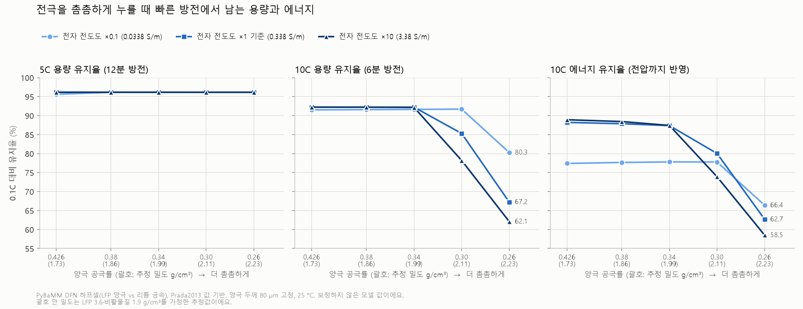
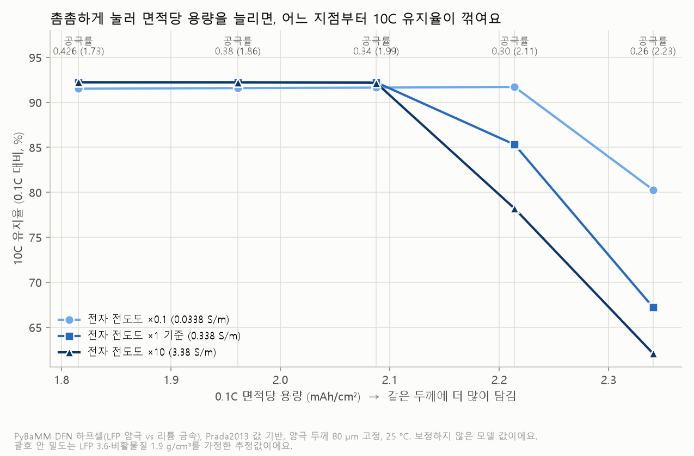

# PyBaMM 시뮬레이션 맛보기

"배터리 시뮬레이션을 우리 PC에서 돌릴 수 있을까?"를 직접 확인한 기록이에요.
[PyBaMM](https://pybamm.org/)은 무료 오픈소스 파이썬 배터리 시뮬레이터예요. 셀 안의 리튬 이동을 물리 방정식으로 계산해요.
자세한 해석과 관련 연구는 [관련 연구 · 시뮬레이션](../../docs/related_work.md)에 있어요.

> 이 폴더의 스크립트와 결과는 조사 에이전트가 만들고 실행했고, 결과 숫자는 결과 파일을 다시 열어 대조했어요.

## 결론부터

- **돌리는 건 쉬웠어요.** 일반 데스크톱(AMD Ryzen 5 5600XT 6코어, RAM 32GB, Windows 11)에서 방전 한 번에 0.06\~0.21초,
  열화 4종을 모두 켠 50사이클이 약 20초였어요.
- **어려운 건 "우리 셀에 맞는 숫자(파라미터)"를 구하는 일이에요.** PyBaMM에 들어 있는 LFP 파라미터 세트는 다른 셀(정격 2.3Ah)이고,
  열화(SEI) 파라미터가 없어요. 다른 셀의 값을 빌려 넣으면 Severson 셀처럼 늙지 않아요 (아래 c).
- **LFP 양극을 눌러 밀도를 올리면, 10C에서는 어느 지점부터 손해가 커졌어요 (아래 d).** 면적당 용량은 늘고 5C까지는 손해가 거의 없었지만,
  기준 전도도에서는 공극률 0.30부터 10C 유지율이 꺾였고, 전자 전도도를 높여도 막지 못했어요. 보정하지 않은 모델의 경향이에요.

## 실행한 것

| 스크립트 | 무엇을 | 걸린 시간 | 결과 |
|---|---|---|---|
| [a_lfp_discharge.py](a_lfp_discharge.py) | LFP/흑연 셀(Prada2013, 2.3Ah)을 0.5C·1C·2C로 방전, 모델 3가지(SPM·SPMe·DFN) 비교 | 9번 계산 합계 약 3.7초 (한 번 0.06\~0.21초) | 방전 용량 0.5C 2.119Ah(92%) · 1C 1.939Ah(84%) · 2C 1.599Ah(70%). 세 모델 차이 0.001Ah 이하 |
| [b_degradation.py](b_degradation.py) | NMC811/흑연+SiOx 셀(OKane2022, LG M50 5Ah) + DFN에 SEI 성장·리튬 석출·입자 균열·활물질 손실을 모두 켜고, 충전 속도 0.5C·1C·2C로 50사이클 | 18.6 · 19.6 · 21.1초 | 아래 표 |
| [c_lfp_sei_demo.py](c_lfp_sei_demo.py) | LFP 셀(Prada2013)에 다른 셀(OKane2022)의 SEI 값 78개를 빌려 넣고, Severson과 비슷한 4C 충방전 100사이클 | 2.9초 | 100사이클 동안 용량이 거의 줄지 않음(최고 1.1772 → 1.1766Ah), 리튬 손실 0.033% |
| [d_lfp_density_rate.py](d_lfp_density_rate.py) | LFP 양극 하프셀(Prada2013 양극 + 리튬 금속, DFN)에서 공극률 5단계 × 전자 전도도 3단계 = 15개 설계를 0.1C\~10C로 방전. 곁가지로 입자 반지름 50·100·200 nm | 95번 계산, 전체 33.9초 (한 번 약 0.2\~0.8초) | 공극률 0.426 → 0.26에서 0.1C 면적당 용량 1.82 → 2.34 mAh/cm². 10C 유지율(기준 전도도)은 0.34까지 92.23%, 0.26에서 67.23% (아래 d) |

### b) 충전 속도별 50사이클 열화 (OKane2022)

| 충전 속도 | 1C 방전 용량 (1 → 50사이클) | 리튬 재고 손실 (LLI) | 음극 활물질 손실 | 양극 활물질 손실 | 리튬 석출로 잃은 용량 |
|---|---|---|---|---|---|
| 0.5C | 4.9357 → 4.9062Ah (−0.60%) | 0.59% | 0.075% | 0.021% | 0.0216Ah |
| 1C | 4.9357 → 4.9038Ah (−0.65%) | 0.62% | 0.075% | 0.035% | 0.0259Ah |
| 2C | 4.9357 → 4.8912Ah (−0.90%) | 0.76% | 0.076% | 0.054% | 0.0364Ah |

→ **충전이 빠를수록 리튬 석출이 늘고 용량이 더 빨리 줄어드는 경향**이 물리 모델에서도 나와요.
[배경 지식](../../docs/background.md)의 "급속충전이 수명을 줄이는 이유"와 같은 방향이에요.
다만 50사이클이라 감소량은 1% 미만이고, 우리 데이터(LFP, 4C 방전)의 셀과는 다른 셀이에요.

### d) 고밀도 LFP 양극: 극판을 눌러 밀도를 올리면 출력은?

**왜 이 질문인가요?**

고밀도 LFP는 같은 부피에 활물질(리튬을 실제로 담는 LFP 가루)을 더 많이 담는 거예요.
극판을 세게 눌러 가루 사이 빈틈(공극)을 줄이면 같은 두께에 더 많이 들어가요.
그런데 이 빈틈에는 전해질이 차 있고, 리튬 이온은 이 길로 움직여요. 그래서 빈틈이 줄면 빠른 방전(고율)에서 손해를 볼 수 있어요.
한편 LFP는 전자가 잘 흐르지 않는 물질이라, 탄소 코팅과 도전재로 전자 길을 만들어 줘요.
이 계산은 **"빈틈을 줄이면 고율에서 얼마나 손해를 보고, 전자 전도도(탄소 코팅·도전재의 몫)가 그 손해를 얼마나 바꾸나?"를** 살펴봐요.

**어떻게 돌렸나요?**

- **모델:** PyBaMM의 DFN 모델이에요. 전극 두께 방향과 입자 안을 함께 계산하고, 위 a에서 비교한 SPM·SPMe·DFN 중 가장 자세한 모델이에요.
- **셀 구성:** 하프셀(LFP 양극 대 리튬 금속)이에요. 양극 재료를 코인셀로 시험하는 것과 같은 구성이에요.
  25 °C로 온도를 고정하고, 만충(전류를 흘리지 않을 때 양극 전압이 3.6 V가 되는 상태)에서 시작해 일정한 전류로 2.0 V까지 방전해요.
- **값:** Prada2013(A123 LFP/흑연 26650 셀)의 양극·전해질·분리막 값을 기본으로 써요.
  하프셀의 리튬 금속 쪽에 필요한 값 **4개만** 다른 세트(Xu2019)에서 빌렸어요.
  Prada2013에 없어서 새로 넣은 값 2개, 흑연 값을 리튬 금속 값으로 바꾼 값 2개예요. 빌린 이름은 결과 JSON에 모두 적었어요.
- **바꾼 것:**
  - 양극 공극률(빈틈 비율) 5단계: 0.426(Prada2013 기준) · 0.38 · 0.34 · 0.30 · 0.26
  - 양극 전자 전도도 3단계: 기준값 0.338 S/m의 ×0.1 · ×1 · ×10. 탄소 코팅·도전재가 만드는 전자 길이 나쁘거나 좋은 경우를 흉내 낸 값이에요.
  - 15개 설계 × 방전 속도 5가지(0.1C·1C·2C·5C·10C) = 75번 계산했어요. 곁가지로 입자 반지름도 바꿔 봤어요(아래 표).
- **고정한 것:** 양극 두께 80 µm, 입자 반지름 50 nm, 분리막 25 µm예요.
  빈틈이 줄어든 만큼 고체가 늘고, 활물질과 비활물질(바인더+탄소)의 비율은 기준 설계와 같게 둬요.
  활물질 부피 비율 = 0.374 × (1 − 공극률) ÷ (1 − 0.426)이에요.
- **이온 길과 전자 길:** PyBaMM은 브루그만 식으로 길이 좁아지는 정도를 계산해요.
  이온 길은 공극률^1.5, 전자 길은 (1 − 공극률)^1.5에 비례해요. 그래서 누를수록 이온 길은 좁아지고 전자 길은 조금 넓어져요.
- **1C와 유지율:** 1C는 설계마다 **자기 0.1C 방전 용량**으로 정해요(1C 전류 = 0.1C 용량 ÷ 1시간).
  그래서 용량이 큰 설계에는 같은 "10C"라도 더 큰 전류가 흘러요.
  **용량 유지율 = xC 방전 용량 ÷ 0.1C 방전 용량 × 100**이에요.
  에너지 유지율은 같은 계산을 에너지(전압 × 용량)로 한 거라, 전압이 떨어진 손해까지 보여 줘요.
- **계산 점검:** 95번 계산(본 실험 75번 + 곁가지 20번)이 모두 하한 전압에 닿아 정상으로 끝났고, 실패는 0번이에요. 전체 33.9초 걸렸어요.
  계산 칸(격자)을 모든 방향으로 2배로 늘려 8개 설계의 10C 방전을 다시 풀었더니, 용량 차이가 최대 0.158%였어요.

**결과 표** (입자 반지름 50 nm. 칸 안의 세 숫자는 전자 전도도 ×0.1 / ×1(기준) / ×10 순서예요.)

| 양극 공극률 | 전극 밀도 g/cm³ **추정(가정: LFP 3.6, 비활물질 1.9 g/cm³)** | 0.1C 면적당 용량 (mAh/cm²) | 5C 용량 유지율 (%) | 10C 용량 유지율 (%) | 10C 에너지 유지율 (%) |
|---|---|---|---|---|---|
| 0.426 (기준) | 1.73 | 1.82 | 95.63 / 96.16 / 96.16 | 91.52 / 92.23 / 92.24 | 77.41 / 88.22 / 88.92 |
| 0.38 | 1.86 | 1.96 | 96.14 / 96.15 / 96.16 | 91.59 / 92.23 / 92.23 | 77.67 / 87.87 / 88.44 |
| 0.34 | 1.99 | 2.09 | 96.14 / 96.15 / 96.16 | 91.64 / 92.23 / 92.17 | 77.81 / 87.38 / 87.42 |
| 0.30 | 2.11 | 2.21 | 96.14 / 96.15 / 96.15 | 91.72 / 85.31 / 78.20 | 77.80 / 80.04 / 73.90 |
| 0.26 | 2.23 | 2.34 | 96.14 / 96.15 / 96.15 | 80.29 / 67.23 / 62.10 | 66.39 / 62.69 / 58.52 |

- 0.1C 면적당 용량은 전도도와 거의 상관없이 같아서 한 칸으로 적었어요. 전극 면적 1 cm²(집전체 한 면)당 값이에요.
- 0.1C에서는 15개 설계 모두 이론 용량의 99.91%를 써요.
  1C·2C 유지율은 15개 설계 모두 99.29%·98.51%로 같아서 표에서 뺐어요.



그림 1. 공극률에 따른 5C·10C 용량 유지율과 10C 에너지 유지율이에요. 선 색은 전자 전도도예요.



그림 2. 가로축은 0.1C 면적당 용량(오른쪽일수록 많이 담음), 세로축은 10C 용량 유지율이에요.

**읽는 법**

- **누른 만큼 더 담겨요.** 공극률을 0.426에서 0.26으로 낮추면 0.1C 면적당 용량이 1.82에서 2.34 mAh/cm²로 늘어요.
  늘어난 활물질 양에 그대로 비례해서 늘어요.
- **5C까지는 손해가 거의 없고, 10C에서는 촘촘한 쪽에서 꺾여요.** 5C 용량 유지율은 15개 설계 모두 95.63\~96.16%예요.
  기준 전도도의 10C 유지율은 0.34까지 92.23%로 그대로였다가 0.30에서 85.31%, 0.26에서 67.23%로 떨어져요.
  이 두 설계는 10C 방전 중 양극 빈틈 속 전해질 농도가 0까지 내려가요(처음 1200 mol/m³). 이온 길이 좁아져 안쪽에 리튬 이온이 모자라는 거예요.
  전도도 ×0.1에서는 0.30까지 91.72%로 버티다가 0.26에서 80.29%로 꺾여요.
  0.34와 0.30 사이 공극률은 계산하지 않아서, 정확히 어디서 꺾이기 시작하는지는 몰라요.
- **빈틈이 넉넉할 때, 전도도가 낮은 손해는 용량보다 전압에 먼저 나타나요.** 공극률 0.426에서 전도도를 ×0.1로 낮추면
  10C 용량 유지율은 92.23 → 91.52%로 조금만 줄어요. 하지만 10C 평균 전압이 3.2201 → 2.8451 V로 떨어져 에너지 유지율은 88.22 → 77.41%로 줄어요.
  하한을 2.5 V로 잡으면 10C 용량 유지율도 91.49 → 85.74%로 차이가 커져요.
- **촘촘할 때는 전도도를 높여도 10C 손해를 막지 못해요.** 공극률 0.30·0.26에서는 오히려 전도도가 낮을수록 10C 용량 유지율이 높아요
  (0.30에서 91.72 / 85.31 / 78.20%, 0.26에서 80.29 / 67.23 / 62.10%).
  공극률 0.26으로 보면 이렇게 설명돼요. 전도도가 낮으면 반응이 집전체 쪽에서 먼저 일어나 그쪽 전해질이 일찍 바닥나고, 그 뒤로는 집전체 바로 앞 얇은 층만 못 써요.
  전도도가 높으면 반응이 분리막 쪽에서 시작해 안쪽으로 나아가다 전해질이 바닥나서, 집전체 쪽의 더 두꺼운 층을 못 써요.
  방전이 끝났을 때 집전체 쪽 끝 입자의 리튬 채움 정도(0\~1)는 0.1669 / 0.3607 / 0.1423으로 셋 다 낮지만,
  양극 전체 평균은 0.8034 / 0.6738 / 0.6229라서 전도도가 높을수록 못 쓴 부분이 더 커요.
  0.30의 ×0.1 설계는 끝 모습이 달라요. 집전체 쪽 끝 입자도 0.9566까지 찼고, 가장 덜 찬 곳(0.8022)은 분리막 가까이에 있어요.
  또 에너지 유지율로 보면 0.30에서는 기준 전도도가 가장 높아요(77.80 / 80.04 / 73.90%). 전도도가 낮으면 평균 전압이 낮기 때문이에요.
  그래도 0.30·0.26에서 전도도를 높여 10C 용량 유지율이 나아진 경우는 없었어요. 이 모델에서 촘촘한 전극의 10C 한계는 전자 길보다 **이온 길(빈틈)이** 정해요.

**곁가지: 입자 크기** (기준 전도도)

| 양극 공극률 | 입자 반지름 | 0.1C 면적당 용량 (mAh/cm²) | 5C 용량 유지율 (%) | 10C 용량 유지율 (%) |
|---|---|---|---|---|
| 0.426 | 50 nm (기준) | 1.82 | 96.16 | 92.23 |
| 0.426 | 100 nm | 1.81 | 84.62 | 69.72 |
| 0.426 | 200 nm | 1.79 | 49.67 | 30.49 |
| 0.30 | 50 nm (기준) | 2.21 | 96.15 | 85.31 |
| 0.30 | 100 nm | 2.21 | 84.62 | 67.62 |
| 0.30 | 200 nm | 2.19 | 49.67 | 30.48 |

이번에 바꾼 범위에서는 입자 반지름이 공극률보다 고율 성능을 훨씬 크게 바꿔요.
입자 안 계산 칸은 반지름에 맞춰 늘렸어요(50 nm 20칸, 100 nm 40칸, 200 nm 80칸).
다만 이 숫자는 아래 한계의 "단순 확산" 가정에 특히 크게 기대요.

**한계**

- **특정 분말의 값이 아니에요.** Prada2013은 A123 26650 셀(LFP/흑연)의 값 묶음이에요. 어느 회사의 특정 LFP 분말을 잰 값이 아니에요.
- **절대 숫자는 예측이 아니에요.** 이 계산은 입자 안 리튬 이동을 단순 확산으로 계산하고,
  LFP 특유의 두 상 반응(FePO₄와 LiFePO₄가 경계를 이루며 바뀌는 반응)은 다루지 않아요. 실측에 맞추는 보정도 하지 않았어요.
  그래서 표의 숫자를 실제 코인셀·제품 성능으로 읽으면 안 되고, **설계끼리 비교한 경향**(어느 쪽이 나은지, 촘촘해지면 꺾이는지)을 보는 용도예요.
  꺾이는 공극률 숫자(0.30)도 아래 가정들(브루그만 지수, 분리막·전해질 값)에 따라 달라질 수 있어요.
- **전도도는 탄소 코팅의 대체값이에요.** 양극 전체의 전자 전도도 한 숫자로 탄소 코팅·도전재 효과를 뭉뚱그렸어요.
  코팅 두께나 고르기 같은 코팅 자체를 계산한 게 아니에요. 또 전도도를 바꿀 때 비활물질 부피는 그대로 둬요(실제로는 탄소를 늘리면 활물질 자리가 줄어요).
- **입자 크기 분포와 쌓이는 방식이 없어요.** 모든 입자를 같은 크기의 공 하나로 계산하고,
  큰 입자와 작은 입자가 섞여 빈틈을 채우는 방식(패킹)은 모델에 없어요.
  공극률은 숫자로만 바꿨고, 길이 구불구불한 정도(브루그만 지수 1.5)도 모든 공극률에 똑같이 썼어요.
- **전극 밀도는 추정값이에요.** LFP 3.6, 비활물질 1.9 g/cm³를 가정해 계산했고, 모델 계산에는 쓰지 않았어요.
  Prada2013은 비활물질 비율(고체의 약 35 부피%)이 상용 전극보다 훨씬 커서, 같은 공극률이라도 상용 전극보다 밀도가 낮게 나와요.
  상용 전극의 밀도 숫자와 바로 비교하면 안 돼요.
- **분리막·전해질은 Prada2013 값이에요.** 분리막이 25 µm라서, 유리섬유 분리막을 쓰는 코인셀보다 이온 길이 짧아요.

**실행 방법** (저장소 루트에서)

```
C:\p\Scripts\python.exe simulations\pybamm\d_lfp_density_rate.py
.venv\Scripts\python.exe simulations\pybamm\d_lfp_density_rate.py --plot-only
```

첫 줄은 계산과 그림을 함께 만들어요. PyBaMM 가상환경에 matplotlib(그림 그리는 도구)이 없으면 그림 단계만 건너뛰어요.
그때 둘째 줄로 프로젝트 `.venv`에서 그림만 다시 그려요.
결과는 [results/d_density_rate.json](results/d_density_rate.json)(모든 설정과 숫자),
[results/d_density_rate.csv](results/d_density_rate.csv)(계산 한 번당 한 줄, 95줄)와 그림 2장이에요.

## 설치 방법 (Windows에서 만난 함정 두 가지)

프로젝트의 `.venv`와 **따로** 가상환경을 만들어요. PyBaMM은 무겁고, 아래처럼 버전을 고정해야 해서 섞지 않는 게 좋아요.

```
python -m venv C:\p
C:\p\Scripts\python.exe -m pip install pybamm "casadi==3.7.2"
```

1. **경로 길이 제한:** 가상환경 경로가 길면 설치 중 `[WinError 206] 파일 이름이나 확장명이 너무 깁니다`가 나요.
   casadi 안에 아주 긴 경로의 파일이 있어서예요. 짧은 경로(예: `C:\p`)에 만들면 해결돼요.
2. **스마트 앱 컨트롤 차단:** 최신 casadi 3.8.1의 서명 없는 파일을 Windows가 막아 `import pybamm`이 실패했어요.
   보안 설정은 끄지 않고, 차단되지 않는 **casadi 3.7.2로 고정**해 해결했어요. 그러면 pip가 맞는 PyBaMM(26.8.0.0)을 골라요.

PyBaMM은 사용 통계 전송 기능이 있어서, 스크립트 맨 위에서 `PYBAMM_DISABLE_TELEMETRY=true`로 꺼 두었어요.

## 실행

```
C:\p\Scripts\python.exe simulations\pybamm\a_lfp_discharge.py
C:\p\Scripts\python.exe simulations\pybamm\b_degradation.py 2 50 okane_charge2C_50cyc
C:\p\Scripts\python.exe simulations\pybamm\c_lfp_sei_demo.py 4 100
C:\p\Scripts\python.exe simulations\pybamm\d_lfp_density_rate.py
```

결과 JSON·CSV는 스크립트와 같은 폴더에 저장돼요. 이 저장소에 함께 올린 결과는 [results/](results/)에 있어요.

## 주의

- 이 계산들은 **우리 데이터의 셀(A123 LFP 1.1Ah)에 맞춘 것이 아니에요.** 숫자를 실제 셀 수명과 비교하면 안 돼요.
- 다음 단계는 "돌리기"가 아니라 **파라미터 맞추기**예요(예: 측정한 방전 곡선에 모델을 맞추는 도구 PyBOP).
  관련 내용은 [관련 연구 문서](../../docs/related_work.md)에 정리했어요.
