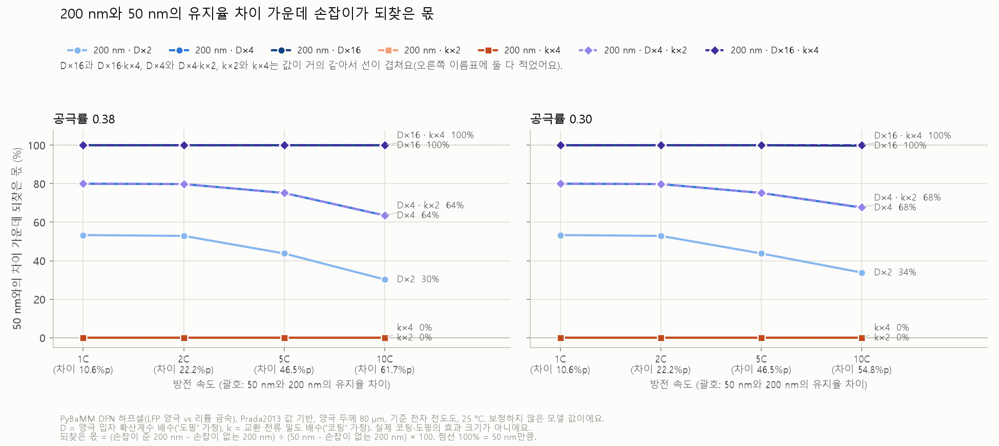

# 02. 시뮬레이션은 큰 입자가 고율에 불리하다는데, 특허는 왜 큰 입자를 섞을까?

**세 줄 요약** (AI가 정리)

1. **무엇을:** 시뮬레이션 e는 같은 공극률에서 큰 입자가 많을수록 10C 성능이 떨어졌는데, LFP 특허는 큰 입자를 섞는 걸 청구해요. 이 엇갈림을 AI가 낸 세 질문(무엇이 '큰 입자'인가, 어떤 성적을 보나, 시뮬레이션은 정확히 무엇을 말했나)으로 따져 봤어요.
2. **어떻게 확인했나:** 내가 "입자가 커지면 입자 안 이동(mass transfer)이 나빠지니, 코팅 같은 처리를 한 채로 다시 비교해야 하지 않을까?"라고 물었고, AI가 시뮬레이션 f에서 겉면 반응 속도('코팅' 가정)와 확산계수('도핑' 가정)를 따로 바꿔 계산했어요.
3. **알게 된 것:** 이 모델에서 큰 입자의 10C 손해는 거의 모두 입자 안 확산 거리 때문이었어요. 큰 입자만 쓴 전극에서는 겉면 반응만 빠르게 해서는 거의 되찾지 못했어요. 큰 입자를 섞은 전극에서는 큰 입자의 반응만 빠르게 해도 10C 손해의 10–15%를 되찾았어요. 특허의 큰 입자는 작은 1차 입자가 뭉친 2차 입자라서, 시뮬레이션의 '큰 입자'와 같은 것이 아닐 수 있어요.

> 2026-10-31에 나눈 대화와 그 뒤에 돌린 시뮬레이션 f를 정리한 노트예요.
> AI(Claude)가 생각해 볼 질문 세 개를 냈고, 나는 거기에 답했어요. 답하다가 내가 코팅 같은 처리를 한 채로 다시 비교해 보자고 했고, AI가 그 비교를 시뮬레이션 f로 계산했어요.
> '내 생각' 칸은 내가 반말로 짧게 쓴 답을 AI가 다듬은 것이에요. 판단과 이유, "\~것 같아" 같은 단서는 내 것 그대로 두었어요. AI 질문에 답한 곳은 그 질문을 괄호로 앞에 적었어요.
> '확인한 내용'(AI 설명) 칸은 AI가 쓴 설명이에요. 그 안의 숫자와 특허 문장은 AI가 특허 원문, 논문(Qian·Yu·Starke·Fongy·Song 논문은 초록만, 나머지 네 편은 본문), 회사 발표·통계 자료와 보도, 시뮬레이션 결과 파일에 대조했고, 출처는 맨 아래에 있어요.
> 시뮬레이션 e·f는 AI 에이전트가 만들고 돌렸고, 다른 에이전트가 일부 설계를 따로 다시 계산해 결과 파일과 맞춰 봤어요.

## 궁금했던 것

1. (AI가 낸 질문) [시뮬레이션 e](../simulations/pybamm/README.md#e-큰-입자와-작은-입자를-섞으면-고율-성능은)와 특허가 반대로 말하는 것처럼 보이는데, 누가 틀렸을까? ([공부 노트 01](01-bimodal-packing.md)의 '아직 모르는 것'에는 '둘 다 맞을 수 있는 조건은?'으로 적어 둔 질문이에요.) AI는 이걸 세 질문으로 나눴어요.
   - (가) 시뮬레이션의 '큰 입자'와 특허의 '큰 입자'는 같은 것일까? (2절)
   - (나) 둘이 같은 성적표를 보고 있을까? 전기차나 ESS에서는 어느 성적이 더 중요할까? (3절)
   - (다) 시뮬레이션이 "섞기는 나쁘다"고 말한 걸까? (4절)
2. (AI 질문에 답하다가 내가 물은 것) 입자가 커지면 입자 안 이동(mass transfer)이 나빠지는 건 맞으니까, 코팅 같은 처리를 한 채로 한 번 더 비교해야 하지 않을까? (5절, 시뮬레이션 f)

**먼저 알아 둘 말** (AI 정리)

- **1차 입자·2차 입자·단입자·D50(중앙 입경)**: [공부 노트 01](01-bimodal-packing.md)에 정리했어요. LG화학 특허는 단입자를 "10개 이하의 1차 입자로 이루어진" 입자로 정의했어요.
- **공극률**: 전극 속 빈 공간의 비율. **1C·2C·10C**: 1시간·30분·6분 만에 다 방전하는 속도. **유지율**: 빠르게 방전했을 때 용량 ÷ 아주 느리게(0.1C) 방전했을 때 용량.
- **고율**: 5C·10C처럼 빠르게 충방전하는 것. **율 특성(율속)**: 빠르게 충방전해도 용량을 얼마나 지키는지.
- **전하 전달(charge transfer)**: 리튬 이온이 입자 겉면에서 전자를 받으며 입자 안으로 들어가는 반응. **교환 전류 밀도**는 이 반응이 얼마나 쉽게 일어나는지 나타내는 값이에요.
- **입자 안 이동(mass transfer, 고체 확산)**: 겉면으로 들어온 리튬이 입자 안쪽으로 퍼지는 것. **확산계수**는 얼마나 잘 퍼지는지 나타내는 값이에요.
- **하프셀**: 시험할 양극을 리튬 금속과 짝지은 시험용 전지. **PyBaMM**: 무료 오픈소스 배터리 시뮬레이터예요.
- **ESS(에너지 저장 장치)**: 전기를 저장해 두었다가 필요할 때 내보내는 배터리 설비. 이 노트에서는 전력망용 대형 설비를 말해요. **활물질**: 전극에서 리튬을 실제로 담는 가루(여기서는 LFP). **도핑**: 결정에 다른 원소를 조금 넣어 성질을 바꾸는 것. **압연**: 롤러로 눌러 전극을 얇고 촘촘하게 만드는 공정.
- **SEM·TEM**: 전자로 입자를 찍는 현미경. SEM은 겉모양을, TEM은 얇게 만든 시료의 속까지 봐요. **두 상 반응**: LFP 입자 안에서 리튬이 찬 부분(LiFePO₄)과 빈 부분(FePO₄)이 경계를 이루며 바뀌는 LFP 특유의 반응.
- **지름과 반지름**: 특허의 입자 크기(D50)는 지름이고, 시뮬레이션의 입자 크기는 반지름이에요. 같은 '200 nm'라도 시뮬레이션 입자가 두 배 커요.
- **청구항·실시예·비교예**: 청구항은 특허가 권리로 주장하는 범위를 적은 문장, 실시예는 발명대로 만들어 시험한 예, 비교예는 견주려고 발명과 다르게 만든 예예요.

## 1. 무엇이 엇갈렸나

**확인한 내용(AI 설명):**

- **시뮬레이션 e** (PyBaMM, LFP 양극 하프셀 방전)
  - 공극률을 0.34로 둔 채 작은 입자(반지름 50 nm)를 큰 입자(반지름 200 nm)로 바꿔 가며 큰 입자 비율(부피)을 0%에서 100%로 늘리면 10C 유지율이 **90.77%에서 31.62%로** 떨어졌어요.
  - PyBaMM은 섞으면 촘촘해지는 효과를 계산하지 않아요. 그래서 "섞으면 공극률이 0.38에서 0.30으로 줄어든다"고 가정해 비교해 보면, 면적당 용량(mAh/cm²)이 속도마다 다르게 움직였어요.

    | 방전 속도 | 작은 입자만, 공극률 0.38 | 큰 입자 20%, 공극률 0.30 (가정) |
    |---|---|---|
    | 0.1C | 1.96 | 2.21 (늘어남) |
    | 5C | 1.87 | 1.91 (조금 늘어남) |
    | 10C | 1.78 | 1.67 (줄어듦) |

- **LG화학 실험표** (KR20240088617A, 6 μm 2차 입자와 1 μm 단입자를 무게비로 섞은 하프셀)

  | 큰 입자 : 작은 입자 (무게) | 전극 전자 전도도 (S/cm) | 2C 방전 용량 (mAh/g) | 접착력 (N/cm) |
  |---|---|---|---|
  | 100 : 0 (비교예 1) | 0.16 | 120 | 5.57 |
  | 95 : 5 (비교예 2) | 0.16 | 120 | 5.71 |
  | 80 : 20 (실시예 4) | 0.13 | 117 | 6.03 |
  | 70 : 30 (실시예 3) | 0.13 | 117 | 7.69 |
  | 60 : 40 (실시예 2) | 0.12 | 116 | 7.79 |
  | 50 : 50 (실시예 1) | 0.12 | 115 | 8.31 |
  | 40 : 60 (비교예 3) | 0.11 | 114 | 8.76 |

  큰 입자가 많을수록 2C 용량과 전도도가 높고, 작은 입자가 많을수록 접착력이 높아요. 청구 범위(90:10–50:50) 밖의 비교예 1·2는 접착력이 낮아서, 비교예 3은 전도도와 율 특성이 떨어져서 빠졌어요.
- 겉으로 보면 시뮬레이션은 "큰 입자가 많을수록 고율에 나쁘다", LG화학 데이터는 "작은 입자가 많을수록 고율에 나쁘다"예요. 방향이 반대예요.

## 2. 시뮬레이션의 '큰 입자'와 특허의 '큰 입자' (질문 가)

**내 생각:** (AI가 "리튬이 고체 속을 지나가야 하는 거리로 따지면, LG화학의 6 μm 2차 입자와 1 μm 단입자 중 실제로 '더 큰' 입자는 어느 쪽일까? '2차 입자는 작은 1차 입자가 뭉친 것'을 떠올려 보라"고 물었을 때) 더 큰 입자는 단입자라고 생각해. 2차 입자는 작은 1차 입자가 뭉친 건데, 6 μm 2차 입자의 율속이 더 높았던 걸 보면 그보다 더 작은 1차 입자 여러 개가 뭉쳐서 2차 입자가 만들어진 게 아닐까? 1 μm 단입자는 내가 생각해도 좀 크다고 생각해.

**확인한 내용(AI 설명):**

- **시뮬레이션의 '큰 입자'는 속이 꽉 찬 공이에요.** PyBaMM의 입자 반지름은 리튬이 고체 속을 지나가야 하는 거리예요. 반지름 200 nm 공이면 리튬이 200 nm를 고체 속으로 퍼져 가야 해요.
- **2차 입자라면 그 거리가 1차 입자 크기에 가까울 수 있어요.** 2차 입자 안 빈틈에 전해질이 들어가고 1차 입자마다 탄소가 붙어 있다면, 리튬은 1차 입자 하나만 지나가면 돼요(AI 해석).
  - LG화학 명세서도 같은 방향으로 적었어요. "작은 1차 입자로 구성된 2차 입자"가 LFP의 낮은 전기·이온 전도도라는 "단점을 극복하고" 입자 크기를 키워 부피당 에너지 밀도를 높일 수 있다고 했어요.
  - 삼성SDI 실시예(KR20260088242A)는 숫자를 적었어요. 2차 입자 약 10 μm, 그 안의 1차 입자 약 200 nm(SEM), 섞은 단입자 약 1.5 μm예요. 세 값 모두 지름(D50)이라서, 이 1차 입자(반지름 약 100 nm)는 시뮬레이션의 큰 입자(반지름 200 nm)보다 작아요. 2차 입자를 부숴 TEM으로 보니 표면 쪽과 안쪽 1차 입자 모두 수 nm 두께의 탄소로 덮여 있었다고 해요.
  - 참고 계산(AI): 삼성SDI 숫자로, 리튬이 2차 입자에서는 1차 입자 하나만, 단입자에서는 단입자 전체를 지나가야 한다고 하면, 겉면에서 중심까지 거리(반지름)는 약 100 nm 대 약 0.75 μm라서 약 7.5배예요. 퍼지는 시간은 거리의 제곱에 비례해서(시간 ∝ 거리² ÷ 확산계수, Malik 외 2010) 약 56배가 돼요. 이 가정이 맞다면 내 생각대로 단입자가 '더 큰 입자'예요.
  - 논문에서도 비슷한 보고가 있어요. 약 100 nm 1차 입자가 뭉친 약 3 μm 크기의 구멍 난(다공성) LFP 구슬에서는 탄소 원료인 당(수크로스)이 안까지 스며들어 안쪽 입자까지 탄소로 덮였고, 이 구슬은 10C에서 115 mAh/g을 냈다고 해요(Qian 외 2010). 또 구멍 난 LFP 구슬은 전해질과 쉽게 닿아 리튬 확산에 도움이 됐다는 보고도 있어요(Yu 외 2009).
- **허점: 2차 입자가 1차 입자와 똑같지는 않아요.**
  - 2차 입자 뭉치는 1차 입자보다 고율 성능이 조금 낮았고, 그 이유로 더 긴 확산 경로와 전극 안의 불균일함을 든 비교가 있어요(Starke 외 2017).
  - 삼성SDI는 2차 입자 속 구멍을 팽창을 받아 주는 공간으로만 설명했고, 전해질이 그 안으로 들어간다고는 적지 않았어요.
  - 결함이 있는 LFP에서는 입자가 클수록 확산계수 자체가 작아져서, 중간 크기 입자에서 "시간 ∝ 거리²"가 맞지 않는다는 계산도 있어요(Malik 외 2010). 그래서 위 56배는 대략값이고, 이 계산대로라면 실제 차이는 56배보다 클 수도 있어요.
- **허점: LG화학은 다른 이유를 댔어요.** 작은 입자가 많을 때 율 특성이 떨어지는 이유를 "크기가 작은 제2 리튬인산철계 양극 활물질의 비율이 높아져서 전극의 전자 전도도가 낮아지고"라고 적었어요. '확산'이라는 말은 특허 전체에 나오지 않아요.
  - 그런데 LG화학은 2차 입자 속 1차 입자 크기, 두 가루의 탄소량, 2C 시험 방법, 전도도 재는 방법을 적지 않았어요. 그래서 이 표만으로는 2C 차이가 전자 전도도 때문인지, 확산 거리 때문인지, 둘 다인지 가를 수 없어요(AI 의견).
  - 내 추론("율속이 더 높았던 걸 보면 더 작은 1차 입자가 뭉친 것 아닐까")은 방향은 맞을 수 있지만, LG화학 특허만으로는 확인할 수 없어요.

## 3. 같은 성적표를 보고 있을까 (질문 나)

**내 생각:** (AI가 "시뮬레이션은 10C처럼 아주 빠른 방전을 봤고, 특허는 부피당 에너지·팽창·접착력을 봤어요. 전기차나 ESS 같은 제품에서는 어느 성적이 더 중요할까? 10C를 조금 포기해도 되는 제품이 있을까?"라고 물었을 때) 솔직히 전기차에서 10C는 중요하다고 생각하는데, 10C까지 높이지는 않을 거야. 대신 충전에서는 중요하지 않을까? 출력에서는 그 정도는 필요 없을 것 같기는 해. ESS는 특히 더 중요하지 않을 것 같은데, ESS 쪽에서는 용량과 안전성이 율속보다 더 중요하지 않을까? 둘 다 10C를 조금 포기해도 될 것 같긴 한데, ESS가 특히 더 포기해도 좋을 것 같아. 전기차는 충전에서는 중요하다고 생각!

**확인한 내용(AI 설명):**

- **충전 쪽에서는 실제로 10C 이상을 내세운 발표가 있어요.** CATL은 LFP라고 직접 밝혔고, BYD는 업계 보도와 BYD의 블레이드 배터리 소개를 이어 보면 LFP일 가능성이 높아요(AI 추론).
  - CATL은 2025-04-21 2세대 선싱(Shenxing) 배터리를 발표하며, 주행거리 800 km와 **최대 12C 충전**을 함께 갖춘 LFP 배터리라고 했어요(최대 충전 출력 1.3 MW).
  - BYD는 2025-03-17 슈퍼 e-플랫폼을 발표하며 충전 전류 1000 A, **충전 속도 10C**, 충전 출력 1 MW를 내세웠어요. 보도 자료는 이 배터리를 '플래시 충전 배터리'라고만 불렀고, 업계 매체들이 이를 BYD의 블레이드 배터리라고 보도했어요. BYD는 블레이드 배터리를 LFP라고 소개해요.
  - CATL은 12C를 '최대(peak)' 충전 속도라고 적었어요. 그 최대 속도(1초 충전으로 2.5 km를 달릴 만큼)로 5분을 계속 채우면 750 km인데, 보도된 5분 충전 주행거리는 520 km예요. BYD 발표에는 10C에 '최대'라는 말이 없어요. 하지만 BYD가 밝힌 최고 속도(1초 충전으로 2 km를 달릴 만큼)로 5분을 채우면 600 km인데, 발표한 5분 충전 주행거리는 400 km예요. 그래서 두 회사 모두 그 속도를 처음부터 끝까지 유지하지는 않을 거예요(AI 계산·해석). 그래도 "전기차는 충전에서 고율이 중요하다"는 내 생각과 같은 방향이에요.
- **다만 시뮬레이션 e·f는 충전을 계산하지 않았어요.** LFP 양극 하프셀의 방전(양극에 리튬이 들어가는 쪽)만 풀었어요. 리튬이온 전지의 급속 충전을 다룬 리뷰는, 기존 리튬이온 전지에서 양극의 열화나 양극 표면 막 성장 같은 과정은 대체로 충전 속도를 정하지 않는다고 정리했어요. 또 흑연 음극 겉면에 리튬이 금속으로 쌓이는 현상(리튬 석출)은 주로 급속 충전 때 생긴다고 했어요(Tomaszewska 외 2019). LFP/흑연 셀도 흑연 음극을 쓰니 같은 문제가 생길 수 있어요(AI 해석). 그래서 시뮬레이션의 10C 방전 결과를 전기차 충전 속도로 바로 읽으면 안 돼요.
- **ESS는 10C와 거리가 멀어요.** 미국 국립연구소의 2025 기술 기준 자료(ATB)는 전력망용 배터리를 2–10시간짜리로 다루고, 4시간짜리가 더 흔할 것으로 봐요. 미국 에너지정보청(EIA)은 2020년까지 지은 미국 전력망 배터리가 정격 출력을 평균 약 3.0시간 낼 수 있다고 했어요. 4시간에 걸쳐 내보내면 약 0.25C예요(AI 계산). 내 생각처럼 ESS에서는 10C 성적이 거의 쓰이지 않아요.
- **특허가 본 성적표도 10C가 아니었어요.**
  - 삼성SDI 표 1에는 극판 밀도, 팽창률, 0.3C 용량, 부피당 에너지(Wh/L)만 있고, 고율 데이터는 없어요. 단입자가 "출력 특성과 용량 특성을 개선할 수 있다"는 문장은 있지만 그걸 보여 주는 데이터는 없어요.
  - LG화학이 내세운 효과는 접착력이고, 율 특성은 2C 용량 115 mAh/g 이상이면 우수하다고 본 정도예요.
  - 시뮬레이션은 10C 방전을 봤어요. 셋이 서로 다른 시험지를 본 셈이에요.

## 4. 시뮬레이션은 정확히 무엇을 말했나 (질문 다)

**내 생각:** (AI가 "섞으면(가정) 0.1C 면적당 용량은 늘었어요. 그러면 시뮬레이션 결과를 한 문장으로 정리할 때 어떻게 말하는 게 정확할까? 모델이 계산하지 않는 것 중 결론을 뒤집을 수 있는 건 무엇일까?"라고 물었을 때) '섞기는 나쁘다'를 말했다기보다는 '큰 입자가 많을수록 고율에서는 불리하다'를 얘기한 건 맞는 것 같아. 10C에서 성능이 나빠졌으니까.

**확인한 내용(AI 설명):**

- 맞아요. 조건만 붙이면 더 정확해져요.
  - **같은 공극률에서**: 섞어서 촘촘해지는 효과를 빼고 비교한 결과예요.
  - **이 모델의 큰 입자에서**: 속이 꽉 찬 반지름 200 nm 공, 즉 리튬이 겉면에서 중심까지 200 nm를 고체 속으로 지나가야 하는 입자예요.
  - **하프셀 방전, 보정하지 않은 모델에서**: 실측에 맞추지 않은 경향이에요.
- 촘촘해진다는 가정을 넣으면 한 문장이 조금 길어져요. "느린 방전에서는 섞어서 촘촘해진 이득이 커서 용량이 늘지만, 10C에서는 큰 입자의 손해가 더 커요." 시뮬레이션 e에서 계산한 공극률(0.26까지) 안에서는, 큰 입자를 섞은 설계의 10C 면적당 용량이 많아야 1.67 mAh/cm²로 작은 입자만 쓴 공극률 0.38 설계(1.78)보다 많지 않았어요.
- **결론을 뒤집을 수 있는 것** (AI 정리)
  - **2차 입자 속 구조**: 2절처럼 확산 거리가 1차 입자 크기라면, 특허의 '큰 입자'는 시뮬레이션의 '큰 입자'가 아니에요. 가장 큰 차이예요.
  - **전자 전도도 차이**: LG화학은 율 특성 차이를 전자 전도도로 설명했어요. LFP 전극에서는 느슨하게 쌓이면 전자 쪽이, 촘촘하면 이온 쪽이 속도를 막고, 공극률 30–35%가 가장 균형이 좋았다는 보고도 있어요(Fongy 외 2010). 시뮬레이션 e·f는 입자 종류마다 전자 전도도를 다르게 두지 않았어요.
  - **촘촘해지는 정도**: 가정으로만 넣었어요.
  - **LFP의 두 상 반응**: 모델은 단순 확산으로 계산해요.
  - **압연 때 깨짐**: [공부 노트 01](01-bimodal-packing.md#5-압연하면-무엇이-깨지나) 5절의 이야기예요. 모델에는 없어요.

## 5. 반응과 확산의 균형: 시뮬레이션 f

**내 생각:** (질문 다에 답하다가 덧붙인 것) 어쨌든 율속이 빠르거나 성능이 좋으려면 charge transfer랑 mass transfer의 비율이 맞아야 하잖아? 하나만 빠르다고 성능이 좋아지지는 않잖아? 그런데 입자 크기가 커진다는 것 자체로 mass transfer가 나빠지는 건 맞으니까, 코팅 같은 다른 처리를 한 채로 한 번 더 비교해야 하지 않을까? 내가 이해한 게 맞아?
→ AI가 이 비교를 계산으로 나눠 볼 수 있다고 해서, 돌려 달라고 했어.

**확인한 내용(AI 설명):** [시뮬레이션 f](../simulations/pybamm/README.md#f-큰-입자의-손해는-반응-겉넓이-때문일까-확산-거리-때문일까)의 결과예요.

- **어떻게 나눴나:** 시뮬레이션 e와 같은 LFP 하프셀에서 200 nm 입자의 두 값을 따로 바꿨어요.
  - 교환 전류 밀도 ×k: "코팅이 겉면 반응을 쉽게 만든다면"을 흉내 낸 가정이에요. 반지름이 4배(50 → 200 nm)면 전극 부피당 겉넓이가 4분의 1이 되니, ×4면 전극 부피당 반응 능력(겉넓이 × 교환 전류 밀도)이 50 nm와 같아져요.
  - 확산계수 ×D: "도핑이 리튬을 잘 다니게 만든다면"을 흉내 낸 가정이에요. 반지름이 4배면 퍼지는 시간이 16배가 되니, ×16이면 50 nm와 같아져요.
  - 실제 코팅·도핑이 이 값을 이만큼 바꾼다는 뜻이 아니에요. 한 값만 바꿔 원인을 가르는 계산 실험이에요.
- **결과 (10C 용량 유지율)**

  | 설계 | 공극률 0.38 | 공극률 0.30 |
  |---|---|---|
  | 50 nm | 92.23% | 85.31% |
  | 200 nm | 30.49% | 30.48% |
  | 200 nm, 확산계수 ×16 ('도핑' 가정) | 92.21% (차이의 99.97% 되찾음) | 85.16% (99.72%) |
  | 200 nm, 교환 전류 밀도 ×4 ('코팅' 가정) | 30.49% (0.00%) | 30.49% (0.01%) |
  | 200 nm, 둘 다 | 92.22% | 85.30% |

  

  그림: 방전 속도별로, 50 nm와 200 nm의 유지율 차이 가운데 바꾼 값('손잡이')이 되찾은 몫이에요. D×16은 확산계수 16배('도핑' 가정), k×4는 교환 전류 밀도 4배('코팅' 가정)예요. 중간 단계(D×2·D×4·k×2)와 둘을 함께 바꾼 경우(D×4·k×2, D×16·k×4)도 함께 그렸어요.

- **왜 반응을 빠르게 해도 소용없었나:** 큰 입자 겉면이 리튬으로 가득 차면 전압이 하한(2.0 V)까지 급히 떨어져 방전이 끝나요(공극률 0.38·10C에서 방전 끝 겉면 채움 정도 0.9997, 1이 가득). 그때 200 nm 입자 평균은 0.3055밖에 차 있지 않아요. 반응을 4배 빠르게 해도 끝나는 겉면 채움 정도는 0.9998로 거의 그대로라서, 남는 용량도 그대로예요. 겉면이 늦게 차려면 리튬이 안쪽으로 빨리 퍼져야 하고, 그건 확산계수가 정해요.
- **반응 속도는 전압에만 조금 나타났어요.** 공극률 0.38에서 10C로 반쯤 방전했을 때 반응에 드는 전압(반응 과전압)은 200 nm에서 48.0 mV였는데, 교환 전류 밀도를 4배로 하면 14.0 mV로 줄어 50 nm(13.4 mV)와 비슷해졌어요. 하지만 10C 에너지 유지율(용량 대신 에너지로 잰 유지율)은 28.55%에서 28.90%로 조금 오르는 데 그쳤어요.
- **내 생각과 이어 보면:** "하나만 빠르다고 성능이 좋아지지는 않는다"는 말은 반응 쪽에서는 맞았어요. 200 nm만 쓴 전극에서는 반응만 빠르게 하면 거의 되찾지 못했거든요(0.01% 이하). 하지만 확산계수 하나만 바꿔도 거의 다 되찾았어요. 그래서 이 계산은 두 값의 비율을 함께 맞추기보다 "느린 쪽을 빠르게 해야 좋아진다"에 가까웠어요(AI 해석).
  - 전극의 속도를 막는 과정으로는 전극 속 전자 이동, 전해질 속 이온 이동, 활물질 속 고체 확산, 겉면 반응이 꼽혀요. 각 과정에 걸리는 시간을 더해 전체 시간을 어림하는 모델도 있어요(Tian 외 2019). 시간을 더하는 구조라면 가장 오래 걸리는 과정이 전체를 좌우해요(AI 해석).
  - 이 모델의 200 nm 입자에서는 겉면 반응보다 고체 확산이 훨씬 느렸던 셈이에요(AI 해석: 확산계수를 바꿨을 때만 손해가 사라진 결과에서 읽은 것). 그래서 반응을 더 빠르게 해도 소용없었고, 확산을 빠르게 하니 거의 다 되찾았어요.
  - 거꾸로, 확산이 빠르고 반응이 느린 입자라면 코팅 같은 반응 쪽 처리가 효과를 낼 수 있어요. 반응 쪽 처리와 확산 쪽 처리 중 어느 쪽이 듣는지는 어느 단계가 느린지에 달려 있어요(AI 의견).
- **섞은 전극에서는 달랐어요.** 50 nm와 200 nm를 섞은 전극(큰 입자 20%·50%)에서는 큰 입자에만 교환 전류 밀도 ×4를 줘 봤어요. 그러자 섞은 전극과 50 nm만 쓴 전극의 10C 유지율 차이 가운데 10–15%를 되찾았어요. 1C·2C·5C에서는 11–24%였고, 섞는 비율과 공극률에 따라 달랐어요. 200 nm만 쓴 전극에서 0.01% 이하였던 것과 달라요. 이유는 확인하지 못했어요.
- **허점·조건**
  - 실제 탄소 코팅이 주로 올리는 건 전자 전도도예요(Wang 외 2024). 그래서 교환 전류 밀도 ×4는 실제 탄소 코팅의 대체값이 아니에요. 전자 전도도는 [시뮬레이션 d](../simulations/pybamm/README.md#d-고밀도-lfp-양극-극판을-눌러-밀도를-올리면-출력은)에서 따로 바꿔 봤어요. 같은 리뷰는 탄소층에 질소·붕소 같은 다른 원소를 넣으면 물질 겉면 구조가 바뀌어, 리튬 이온이 다니는 길이 짧아지고 이동이 빨라질 수 있다고도 적었어요.
  - LFP의 두 상 반응이 없는 단순 확산 모델이고, 하프셀 방전만 계산했고, 실측에 맞추는 보정을 하지 않았어요. 숫자 크기보다 **어느 쪽을 되돌려야 손해가 사라지는지의 방향**을 보는 결과예요.

## 6. 그럼 둘 다 맞을 수 있나 (AI 정리)

- 시뮬레이션이 보여 준 것: 리튬이 고체 속을 지나가야 하는 거리가 길면 고율에서 손해가 크고, 그 손해는 확산을 빠르게 해야 되찾아요.
- 특허가 섞는 '큰 입자': 작은 1차 입자가 뭉친 2차 입자예요. 삼성SDI의 1차 입자는 지름 약 200 nm(반지름 약 100 nm)로, 시뮬레이션 큰 입자(반지름 200 nm)의 절반이에요. 안쪽 1차 입자까지 탄소로 덮여 있었다고 해요. 그래서 μm 크기라도 확산 거리는 짧을 수 있어요.
- 특허가 본 성적표: 부피당 에너지, 팽창, 접착력이에요. 10C 성능이 아니에요.
- 그래서 이런 조건이면 둘 다 맞을 수 있어요(AI 의견, 이 자료들로 증명한 것은 아님).
  - 큰 2차 입자 안의 확산 거리가 1차 입자 수준으로 짧고, 전자 길(탄소)이 안쪽까지 이어져 있을 때.
  - 제품이 10C 방전을 요구하지 않거나(ESS), 고율이 필요한 충전에서는 속도를 흑연 음극 같은 다른 곳이 막을 때.
- 반대로 단입자처럼 속이 꽉 찬 큰 결정이 많아지면, 시뮬레이션이 말한 손해가 실제로 나타날 수 있어요. LG화학 표에서 1 μm 단입자(특허에서는 '작은 입자'지만, 2절의 가정대로라면 확산 거리로는 더 '큰 입자')가 많을수록 2C 용량이 떨어진 것도 이 방향과 어긋나지 않아요(AI 의견). 다만 LG화학은 그 이유를 전자 전도도로 설명했어요.

## 아직 모르는 것 (AI 정리)

- LG화학 2차 입자 속 1차 입자 크기, 두 가루의 탄소량, 2C 시험 방법과 전도도 재는 방법(특허에 없음).
- LG화학 표의 2C 차이가 전자 전도도 때문인지 확산 거리 때문인지(전도도를 맞춘 비교가 없음).
- 2차 입자 속으로 전해질이 실제로 얼마나 들어가는지(삼성SDI는 구멍을 팽창 완충으로만 설명).
- 충전(양극에서 리튬이 빠져나가는 쪽)과 흑연 음극을 넣은 실제 셀에서는 결과가 어떻게 바뀌는지(시뮬레이션은 하프셀 방전만).
- 섞은 전극에서 큰 입자에만 교환 전류 밀도 ×4를 줬을 때 10–24%를 되찾은 이유([시뮬레이션 f](../simulations/pybamm/README.md#f-큰-입자의-손해는-반응-겉넓이-때문일까-확산-거리-때문일까)에도 확인하지 않은 것으로 적어 둠).
- 같은 섞은 전극의 공극률 0.30·10C에서 큰 입자에만 확산계수 ×16을 주면 50 nm만 쓴 전극보다 유지율이 조금 높아진(되찾은 몫 105–111%) 이유(시뮬레이션 f에도 확인하지 않은 것으로 적어 둠).
- 2차 입자 구조(1차 입자 + 구멍)를 직접 넣은 모델로 계산하면 어떻게 될지. LFP 2차 입자 하나를 3차원으로 계산한 연구가 있어요(Song 외 2019).

## 출처

**특허** (2026-10-31 원문 확인)
- 엘지화학·울산과학기술원, [KR20240088617A](https://patents.google.com/patent/KR20240088617A/ko) (공개 10-2024-0088617): 청구항 1(중량비 90:10–50:50, 접착력 6.00 N/cm 이상), 명세서(단입자 정의, 중량비 이유, 2차 입자 설명), 실시예 1–4, 비교예 1–3, 표 1–3 / 등록 [KR103001989B1](https://patents.google.com/patent/KR103001989B1/ko)
- 삼성에스디아이, [KR20260088242A](https://patents.google.com/patent/KR20260088242A/ko) (공개 10-2026-0088242): 명세서(제1·제2 양극 활물질, 탄소 코팅층), 실시예 1, 표 1

**시뮬레이션** (battery-life-lab)
- [시뮬레이션 d](../simulations/pybamm/README.md#d-고밀도-lfp-양극-극판을-눌러-밀도를-올리면-출력은): [results/d_density_rate.json](../simulations/pybamm/results/d_density_rate.json)
- [시뮬레이션 e](../simulations/pybamm/README.md#e-큰-입자와-작은-입자를-섞으면-고율-성능은): [results/e_size_mix.json](../simulations/pybamm/results/e_size_mix.json)
- [시뮬레이션 f](../simulations/pybamm/README.md#f-큰-입자의-손해는-반응-겉넓이-때문일까-확산-거리-때문일까): [results/f_ct_vs_mass.json](../simulations/pybamm/results/f_ct_vs_mass.json)

**회사 발표·통계** (2026-10-31 확인)
- CATL 보도 자료, 2025-04-21. [catl.com/en/news/6401.html](https://www.catl.com/en/news/6401.html) (520 km/5분은 보도: [electrive 2025-04-22](https://www.electrive.com/2025/04/22/catl-presents-three-new-battery-breakthroughs-at-super-tech-day/))
- BYD 보도 자료, 2025-03-17. [byd.com](https://www.byd.com/us/news-list/BYD-Unveils-Super-e-Platform-Megawatt-Flash-Charging-Electric-Vehicles-Matching-Refueling-Speeds) / 블레이드 배터리라는 보도: [electrive 2025-03-18](https://www.electrive.com/2025/03/18/byd-introduces-megawatt-charging-for-electric-cars) / 블레이드 배터리가 LFP라는 BYD 소개: [byd.com/uk](https://www.byd.com/uk/technology/byd-blade-battery)
- National Laboratory of the Rockies(옛 NREL), Annual Technology Baseline 2025, 'Utility-Scale Battery Storage'. [atb.nlr.gov](https://atb.nlr.gov/electricity/2025/utility-scale_battery_storage)
- U.S. EIA, Today in Energy, 2022-03-25. [eia.gov](https://www.eia.gov/todayinenergy/detail.php?id=51798)

**논문**
- A. Tomaszewska 외, *eTransportation* 1, 100011 (2019). [doi:10.1016/j.etran.2019.100011](https://doi.org/10.1016/j.etran.2019.100011) (2.1·3.2절)
- R. Malik, D. Burch, M. Bazant, G. Ceder, *Nano Lett.* 10, 4123 (2010). [doi:10.1021/nl1023595](https://doi.org/10.1021/nl1023595)
- J. Qian, M. Zhou, Y. Cao, X. Ai, H. Yang, *J. Phys. Chem. C* 114, 3477 (2010). [doi:10.1021/jp912102k](https://doi.org/10.1021/jp912102k)
- F. Yu, J. Zhang, Y. Yang, G. Song, *J. Mater. Chem.* 19, 9121 (2009). [doi:10.1039/b916938e](https://doi.org/10.1039/b916938e)
- B. Starke 외, *Sustainability* 9, 888 (2017). [doi:10.3390/su9060888](https://doi.org/10.3390/su9060888)
- R. Tian 외, *Nat. Commun.* 10, 1933 (2019). [doi:10.1038/s41467-019-09792-9](https://doi.org/10.1038/s41467-019-09792-9)
- C. Fongy, A.-C. Gaillot, S. Jouanneau, D. Guyomard, B. Lestriez, *J. Electrochem. Soc.* 157, A885 (2010). [doi:10.1149/1.3432559](https://doi.org/10.1149/1.3432559)
- L. Wang 외, *Molecules* 29, 5250 (2024). [doi:10.3390/molecules29225250](https://doi.org/10.3390/molecules29225250) (2.1.2절)
- J. Song 외, *Nano Energy* 62, 810 (2019). [doi:10.1016/j.nanoen.2019.05.087](https://doi.org/10.1016/j.nanoen.2019.05.087)
